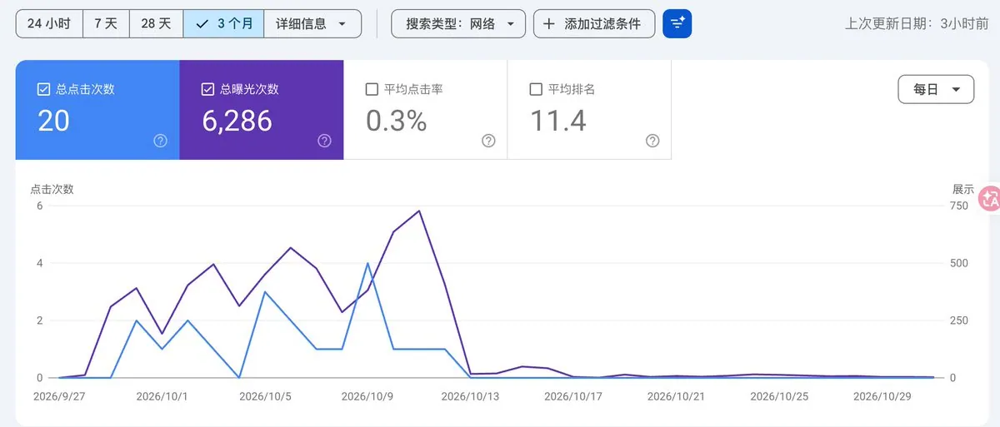
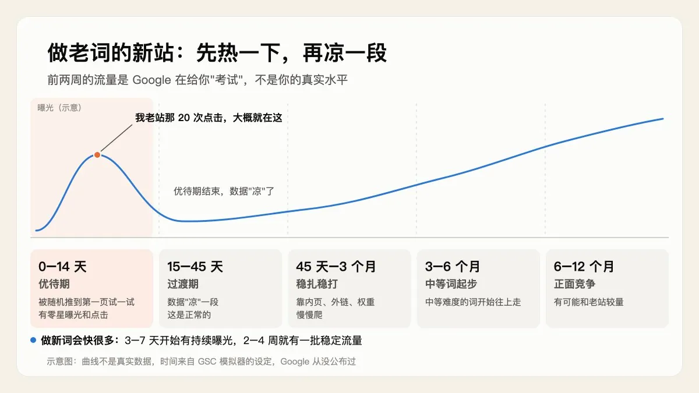
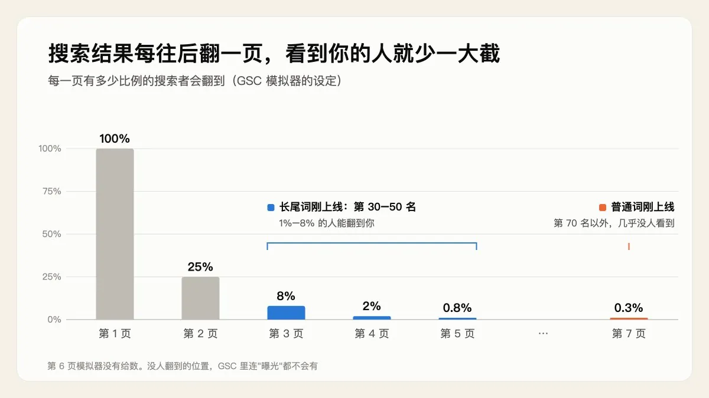
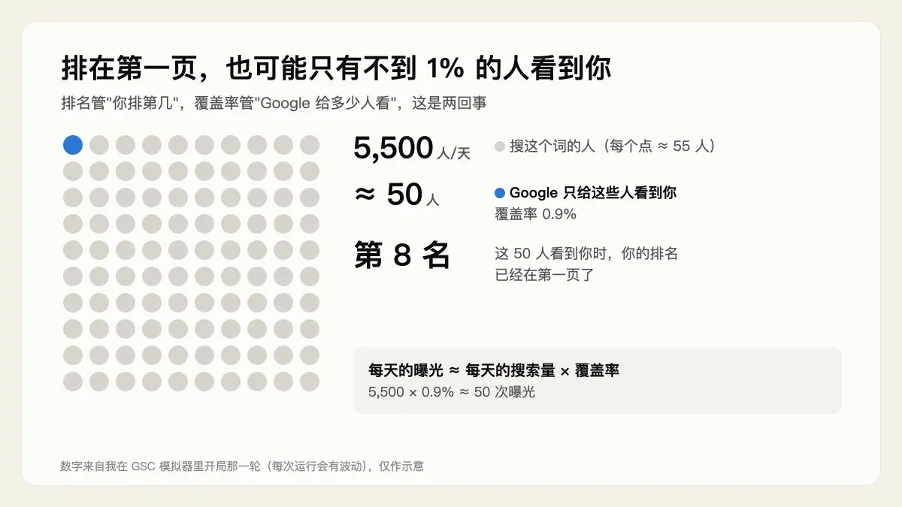
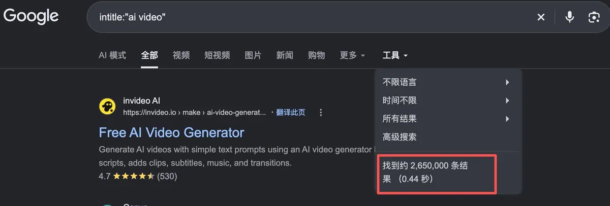
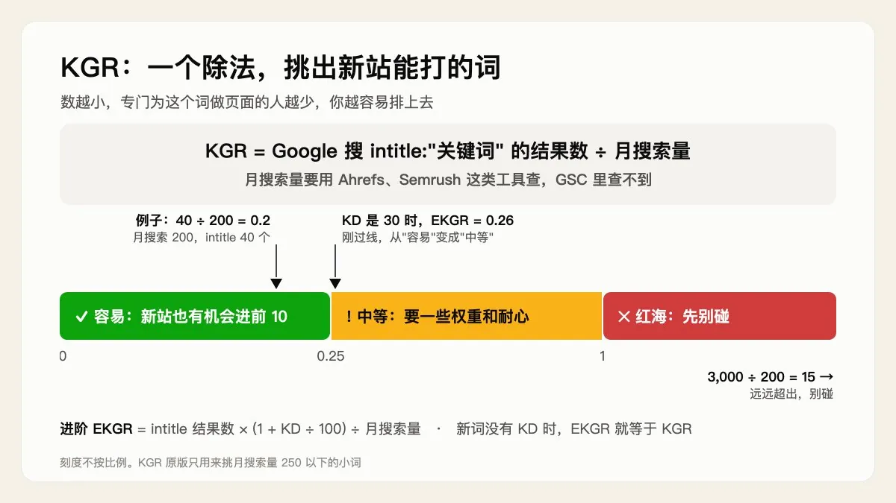
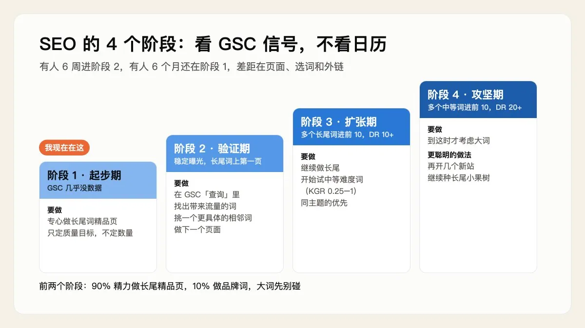

# 小肥羊（@xiaofeiyangfe）：新站上线 Google 为什么不给流量？用模拟器看懂的 6 件事

> 基于 Google Search Console（GSC）数据模拟器深度提炼新站 SEO 规律：内页与外链基础分工、前两周随机测试的优待期本质、排名与曝光覆盖率的差异机制、用 KGR 指标筛选长尾词，以及摆脱日历焦虑、基于 GSC 数据信号推进的 4 个阶段演进策略。

<!-- more -->

前段时间我打开 Google Search Console（下面简称 GSC，Google 官方的免费后台，能看到你的网站在搜索结果里被看到了多少次、被点了多少次），看到我一个老站的曲线：

上线后大概两周，陆陆续续有 20 次点击。然后就归零了，一直到现在。

我的第一反应是：是不是被 Google 惩罚了？

这两天我跟着哥飞社群里的一个“GSC 数据模拟器”学了 9 步。它模拟一个新站从上线第 1 天开始，每天谁搜了什么、看没看到你、点没点，一点点攒成 GSC 里的数字。学完我才发现，很多让我焦虑的“坏数据”，其实是新站的正常状态。

下面是我按自己的理解整理的 6 件事，尽量说人话。

先说明一点：文中的百分比和天数，大多是模拟器里的设定，用来帮你理解原理。Google 自己从来没有公布过这些数。

## 一、先认识 3 个词：内页、外链、权重

- 内页：你网站上每一个能被搜到的页面，比如一个工具页、一篇教程。
- 外链：别的网站上有链接指向你。
- 权重：Google 对你这个网站有多信任。

前两个你能自己动手做，第三个不能。权重是结果：内页做好了、外链慢慢攒起来、再加上时间，它自己会涨。常听人说的 DR，是 Ahrefs 这个工具估算出来的权重分数，不是 Google 官方的。

所以新手真正该花力气的，就两件事：做好内页，攒外链。

内页要做“精品页”，别焦虑数量。 每个页面瞄准一个具体的长尾词（又长又具体、搜的人少、但竞争也少的词），而且要有别人页面里没有的信息。宁可一周上一个好页面，也别一天上几十个凑数的页面。

外链早期先看“有多少个不同的网站链接你”。 100 个普通网站各给你一条链接，比 1 个大网站给你一条更有用。但垃圾外链别碰，比如几块钱买一千条链接、到处刷评论留链接。

免费的外链方法有：和同类站长互换友情链接、发 Product Hunt、在 Reddit 和 Indie Hackers 上分享、把项目放到 GitHub。我给自己定的是：每周花 2 小时，做一个免费的外链动作。

## 二、新站优待期：前两周的流量是“考试”，不是“奖励”

SEO 圈有个长期观察到的现象（Google 没有公开承认过）：新站上线的头 1 到 2 周，Google 会拿出一小部分搜索，把你随机推到第一页试一试，看用户点不点、留不留得住。

这就是“新站优待期”。

如果你做的是新词（刚冒出来的新游戏、新 AI 工具这类），搜索结果里还没什么竞争对手，3 到 7 天就可能开始有持续曝光，2 到 4 周就能有一批稳定流量。

如果你做的是老词（存在很多年的需求），节奏是这样的：

- 0 到 14 天：优待期，有零星曝光和点击
- 15 到 45 天：优待期结束，数据会“凉”一段，这是正常的
- 45 天到 3 个月：靠内页、外链、权重慢慢爬，没有捷径
- 3 到 6 个月：中等难度的词开始往上走
- 6 到 12 个月：才有可能和老站正面竞争

回头看我那个老站：上线两周有 20 次点击，然后归零，和这条时间线几乎一模一样。那 20 次点击很可能是优待期送的，不代表我真有这个实力。（同一时间还有一批页面掉出了收录，这个原因很可能内页质量不佳）

优待期最容易踩两个坑：

1. 把优待期的数据当成实力。 第三周数据一掉，就以为自己被惩罚了。
2. 上线时页面还没准备好。 优待期按时间走，不会等你，这两周就白白浪费了。

所以上线前就要把第一个页面打磨好，把 sitemap（网站地图）提交到 GSC，装好 GSC 和 GA4（Google 的网站统计工具）。

## 三、被收录，不等于有人看到你

我以前以为：Google 收录了我的页面，就会有流量。

其实收录只是拿到了入场券，排名才决定你进场后坐第几排。

模拟器里，一个新站刚被收录时，一个普通关键词大约排在第 77 名。要往后翻好几页，翻到第 7、8 页，才能看到你。

会翻到那么后面的人有多少？模拟器里的设定是：

- 第 1 页：100% 的人都会看到
- 第 2 页：25%
- 第 3 页：8%
- 第 4 页：2%
- 第 5 页：0.8%
- 第 7 页：0.3%

这里有个我之前完全没想到的点：没人翻到的位置，GSC 里连“曝光”都不会有。 曝光的意思是真的有人看到了你。所以新站排在 70 名以外时，GSC 几乎一片空白。不是“有人看到、没人点”，而是根本没人看到。

GSC 一片空白，不代表你做错了。

新站的出路有两条：一是用好优待期；二是做长尾词。长尾词竞争少，一开始就能排到第 30 到 50 名，也就是第 3 到 5 页，能看到你的人比第 7 页多 10 倍以上。

想知道自己的页面有没有被收录，可以在 Google 里搜 `site:你的域名`。我拿自己的练手站试了一下，搜出来几个页面，说明都收录了。

## 四、覆盖率：排在第一页，也可能只有 1% 的人看到你

这一节是我觉得最反直觉的。

Google 搜索是“千人千面”的：同一个词，不同地区、不同时间、不同搜索习惯的人，看到的结果都不一样。新站权重低的时候，Google 只把你展示给一小撮人试试。这一小撮人占所有搜索者的比例，模拟器里叫“曝光覆盖率”。

所以要分清两件事：

- 排名：你排在第几位
- 覆盖率：所有搜这个词的人里，Google 让多少人看到了你

我那一轮模拟开局时，网站在一个关键词上排第 8，已经在第一页了。但这个词每天大约 5,500 人搜，只有 50 个人看到了我，覆盖率不到 1%。

你每天能拿到的曝光，大约等于：

> 每天的搜索量 × 你的覆盖率

一个大词每天有 7,000 多人搜，你的覆盖率是 0，曝光就是 0。一个长尾词每天只有几百人搜，但只要有覆盖率，就真的有人能看到你。

在模拟器里，长尾词第 5 到 15 天就开始有覆盖，普通的词要 20 到 40 天，大词要 50 天以后才开始动。

覆盖率受 4 个因素影响：网站权重、有几种语言的页面、内页数量，还有关键词难度（大词难覆盖，长尾词容易）。

GSC 里没有“覆盖率”这个数字。我的做法是：在 GSC 的“效果”报告里，看某个词的曝光曲线是不是在慢慢往上走。往上走，就说明覆盖率在升。

模拟器举的例子是：今天 2%，3 个月后可能 20%，半年后 60%。具体数字不用当真，它想说的是：SEO 是慢慢攒出来的，不是一个开关。

## 五、挑词：用 KGR 找新站能打的词

既然新站要先做长尾词，那怎么挑？

很多教程让你看 KD（关键词难度 keywords diffcult），但 KD 是工具估算的，对新词、长尾词经常不准，新词甚至没有 KD 数据。

更适合新站的方法叫 KGR（Keyword Golden Ratio，关键词黄金比例）：

> KGR = 在 Google 搜 `intitle:"关键词"` 显示的结果数 ÷ 这个词的月搜索量

`intitle:"关键词"` 的意思是：只找标题里带这个词的页面。这个数越小，说明专门为这个词做页面的人越少。月搜索量要用 Ahrefs、Semrush 这类工具查，GSC 里查不到。

怎么看结果：

- **小于 0.25**：容易做，新站也有机会进前 10
- **0.25 到 1**：中等，需要一些权重和耐心
- **大于 1**：红海，先别碰

举个例子：一个词每月有 200 人搜，intitle 搜出来 40 个结果，KGR = 40 ÷ 200 = 0.2，可以做。如果搜出来 3,000 个结果，KGR = 15，别碰。

还有一个进阶版叫 EKGR，把 KD 也算进去：

> EKGR = intitle 结果数 × (1 + KD ÷ 100) ÷ 月搜索量

还是上面那个词，如果 KD 是 30：40 × 1.3 ÷ 200 = 0.26，刚好超过 0.25，从“容易”变成了“中等”。KD 越高，扣的分越多。新词没有 KD 数据时，EKGR 就等于 KGR。

两个小知识：

- KGR 最早是美国站长 Doug Cunnington 提出来的，原版只用来挑月搜索量 250 以下的小词。大词用它算，意义不大。
- 工具显示“月搜索量 0”，不代表真的没人搜，只是工具没采样到。跟你的业务相关、KGR 又特别低的词，很可能就是金矿。

## 六、SEO 的 4 个阶段：看 GSC 信号，不看日历

这是模拟器里说“最关键”的一步。

很多教程会说“第 1 个月做什么，第 3 个月做什么”。但现实是：有人 6 周就进入下一个阶段，有人 6 个月还在原地。差距不在时间，在于页面够不够精、词选得对不对、外链攒够没有。

所以判断自己走到了哪一步，要看 GSC 里的信号。

### 阶段 1 · 起步期

- 信号：GSC 几乎没数据，或者只有优待期的零星曝光
- 要做：专心做长尾词精品页，只定质量目标，不定数量目标
- 进下一阶段的标志：出现持续的、不是优待期带来的曝光

### 阶段 2 · 验证期

- 信号：有稳定曝光，少量长尾词进了第一页，开始有零星点击
- 要做：在 GSC 的“效果 → 查询”里，找出真正带来流量的词，再挑一个它旁边更长、更具体的词，做下一个页面。用数据挑词，比凭感觉准得多
- 进下一阶段的标志：几个长尾词稳定在前 10，点击一直在涨

### 阶段 3 · 扩张期

- 信号：多个长尾词进了前 10，DR 至少 10，每天上千次曝光
- 要做：继续做长尾词，同时开始试中等难度的词（KGR 在 0.25 到 1 之间），优先挑和已经做起来的词同一个主题的
- 进下一阶段的标志：中等难度的词也进了前 10，每天点击上百

### 阶段 4 · 攻坚期

- 信号：DR 至少 20，多个中等词进了前 10，外链稳定在涨
- 要做：到这时才有资格考虑大词。但更聪明的做法是再开几个新站，继续做长尾词

这就是哥飞常讲的“小果园”：与其死磕一棵大树，不如种 100 棵小果树，每棵结一点果，加起来更稳。

新手最常犯的错，是大词和长尾词混着做。结果大词没起来，长尾词也因为做得不够精而没有竞争力。在前两个阶段，90% 的精力放在长尾精品页上，10% 做品牌词，大词先别碰。

## 最后：我现在在哪

对照这 4 个阶段，我的两个站都还在阶段 1。

以前我会给自己定“半年做满 100 个页面”“冲某个大词进前 3”这种目标，然后天天焦虑进度。学完这 9 步，我把目标换成了一句话：

> 这个月，把手上这一个页面，做到对得起每一个搜到它的人。

我学习的方式也很简单：每天两个 25 分钟，一个用来读，一个用来动手。读完写 3 行：它讲了什么、我不懂哪个词、我要做哪一件事。

模拟器一共 16 步，后面 7 步学完再来写。

## 相关页面

- [[concepts/kgr-keyword-golden-ratio]]
- [[sources/google-seo-ranking-factors-2026]]
- [[sources/sagasu-2026-seo-backlink-strategy]]
- [[concepts/gefei-seo-keywords]]
- [[concepts/seo-basics]]
