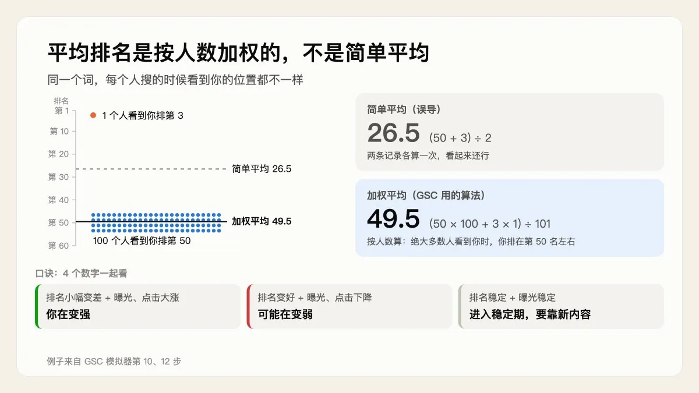
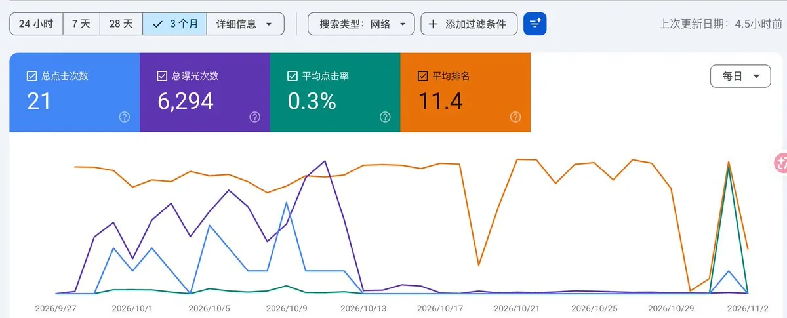
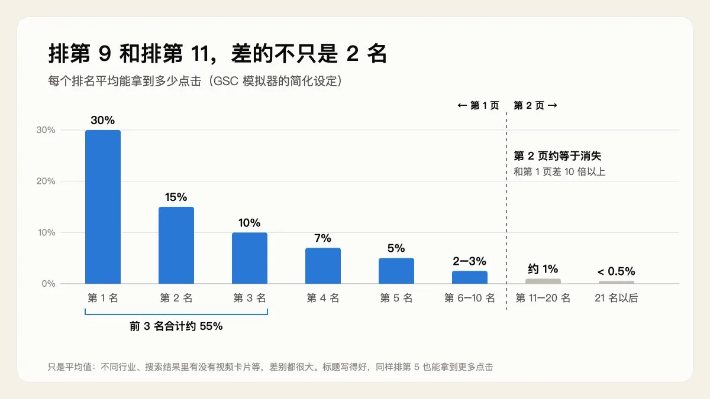
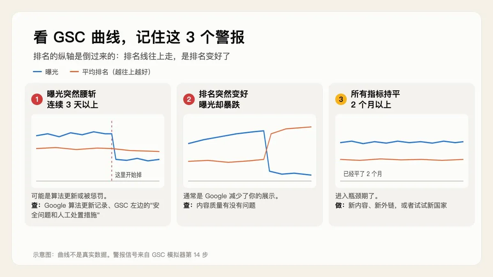
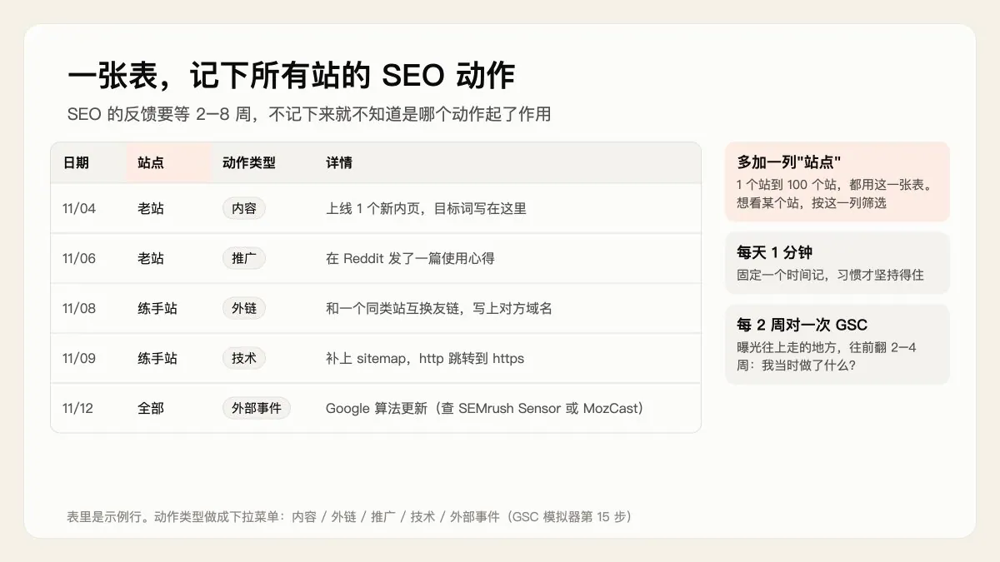

# 小肥羊（@xiaofeiyangfe）：平均排名会骗人——我用 GSC 模拟器学会看数据的 6 件事

> 借助哥飞社群「GSC 数据模拟器」学完 GSC 解读的 6 条实战心得：平均排名是按曝光加权的，简单平均会严重失真（100 人看第 50 名 + 1 人看第 3 名，真实值约 49.5 而非 26.5）；排第 9 与排第 11 差别巨大（是否进入精选摘要与是否被折叠）；每周 15 分钟把 GSC 切成 5 块来看；用曲线认出自己所处阶段并记住 3 个警报；建立「动作日志」表把操作与数据变化对齐；以及 90 天地图——别拿月份给自己定截止日期。文中百分比与天数均为模拟器设定，Google 从未公布。

<!-- more -->

上一篇我写了哥飞社群里“GSC 数据模拟器”的前 9 步，讲新站为什么一开始没流量。发出来以后，哥飞转发了，看的人比我想的多，谢谢大家。

这几天我把后面 7 步也学完了。前 9 步讲的是流量怎么一点点来，后 7 步讲的是 GSC 里的数字该怎么看。学完以后，我拿自己老站的 GSC 数据对了一遍，还建了一张“动作日志”表。

下面是我整理的 6 件事。还是老规矩：尽量说人话，把我当时的疑问也写进来。

先说明一点：文中的百分比和天数，大多是模拟器里的设定，用来帮你理解原理。Google 自己从来没有公布过这些数。

## 一、平均排名会“骗人”，4 个数字要一起看

GSC（Google Search Console，Google 官方的免费后台）的“效果”报告里有 4 个数字：点击、曝光、点击率（CTR）、平均排名。

前 3 个都好理解，最容易看错的是平均排名。

平均排名不是简单平均，是按曝光次数加权平均出来的。 同一个词，每个人搜的时候看到你的位置都不一样。模拟器举了个例子，假设今天有两条记录：

- 100 个人看到你排在第 50 名
- 1 个人看到你排在第 3 名

简单平均是 (50 + 3) ÷ 2 = 26.5，看起来还行。

按人数加权是 (50 × 100 + 3 × 1) ÷ 101 ≈ 49.5。绝大多数人看到你的时候，你都排在第 50 名左右，49.5 才是真实情况。GSC 用的就是这种算法。

明白了这一点，就能看懂几个“奇怪现象”：

- 平均排第 35 名，也有点击。 35 是平均出来的。可能 1000 次曝光里，有 5 次排在第 2、3 名，被点了 3 次；剩下 995 次排在 40 名以后，没人点。
- 平均排第 1.5 名，曝光却只有 200。 新站覆盖率低，Google 只把你展示给最相关的一小撮人，他们看到的你都很靠前。这是新站的正常状态，不是坏事。
- 网站变强了，平均排名反而变差。 覆盖率从 5% 涨到 50%，新覆盖到的那批人跟你没那么相关，看到你时你排在 20、30 名。整体一摊薄，平均排名就从 4 变成了 12。

模拟器给了一个口诀，我觉得是这一步最值得记的：

- 排名小幅变差 + 曝光大涨 + 点击大涨 = 你在变强
- 排名变好 + 曝光下降 + 点击下降 = 你可能在变弱
- 排名稳定 + 曝光稳定 = 进入稳定期，要靠新内容、新词才能再往上走

所以，永远不要只看平均排名这一个数字，4 个一起看。

我当时的疑问是：GSC 里根本没有“覆盖率”，也没有“权重”，我怎么知道自己是不是变强了？

后来弄明白了：

- 覆盖率可以粗略估： 某个词一个月的曝光 ÷ 工具查到的月搜索量。不过工具给的搜索量本身就是估的，算个大概就行。
- 更实用的是看趋势： 在 GSC 里选“比较”，拿最近 28 天和前 28 天比。一个词的搜索量一个月里变化不大，你的曝光涨了，就说明你在变强。
- 权重 Google 从来不公布，只能看替身： Ahrefs 的 DR、GSC 里外部链接的数量、“查询”表里出现的词是不是越来越多。

拿自己的老站对了一下

学完这一步，我打开老站的 GSC，把 4 个指标都勾上，看了 3 个月的数据：20 次点击，6,286 次曝光，CTR 0.3%，平均排名 11.4。

平均排名 11.4，看着还不错。但曲线告诉我另一件事：10 月中旬以后曝光几乎归零，排名线却还停在高处。这正好是口诀的第二条：排名变好，曝光和点击在掉，可能在变弱。

以前我只会盯着平均排名高兴，现在知道这是一个“假好数据”。

## 二、排第 9 和排第 11，差的不只是 2 名

第 11 步讲点击率，也就是看到你的人里，有多少会点进来。模拟器用的是一张简化的表：

- 第 1 名：约 30%
- 第 2 名：约 15%
- 第 3 名：约 10%
- 第 4 名：约 7%
- 第 5 名：约 5%
- 第 6 到 10 名：约 2% 到 3%
- 第 11 到 20 名（第 2 页）：约 1%
- 21 名以后：不到 0.5%

模拟器也提醒了：不同行业、搜索结果里有没有视频卡片之类的，点击率差别很大，这只是平均值。但“越靠前点得越多、第 2 页约等于 0”这个规律是通用的。

这张表说明三件事：

1. 第 2 页约等于消失。 第 1 页和第 2 页的点击率差 10 倍以上。排第 12 和排第 50 差别不大，排第 9 和排第 12 才是天差地别。
2. 前 3 名拿走一半多的点击。 三个加起来约 55%，所以大家都盯着前 3 名打。
3. 标题和描述决定你实际的点击率。 同样排第 5，标题写得吸引人可能有 10%，写得平淡可能只有 2%。这是不花钱的杠杆。

再加上上一篇讲的覆盖率和翻页率，就是一个完整的公式：

真实点击 = 覆盖率 × 翻页率 × 点击率

意思是：有多少人能看到你，看到的人里有多少翻到你那一页，翻到的人里有多少点进来。

模拟器给的行动建议，我记成了三条：

- 找出“曝光多、点击率低”的词，比如曝光 1000、点击率不到 2%，先改 title 改完等一周看效果。
- 排在第 11 到 15 名的词，集中补内容、加内链、争取外链，把它们推进前 10。这是回报最高的事。
- 排在 20 名以后的词先别管，回报太低。

这里我在老站上也看到一个坑。查询表里有几个词是别家公司的名字，我排第 3 左右，有几十次曝光，却一次点击都没有。搜这些词的人是在找那家公司的官网，我排得再靠前，他们也不会点我。

所以改标题之前要先确认：搜这个词的人，要的真的是你这个页面吗？ 不是的话，标题写得再好也没用。

## 三、每周 15 分钟，把 GSC 切成 5 块看

GSC 的“效果”报告可以按 5 个维度看，每个维度回答一个问题：

- 查询（关键词）：哪些词在给我带流量？哪些词被低估了？
- 网页：哪些页面是我的“大金牛”？哪些页面曝光不错、点击却很差？
- 国家：流量从哪些国家来，和我想做的市场对得上吗？
- 设备：手机和电脑哪个表现差？如果手机的点击率明显低，多半是手机上加载慢、排版乱。
- 日期：网站在变好还是变差？有没有哪天突然掉了？

几个维度还能叠在一起筛，比如“过去 30 天 + 美国 + 手机”，就能问出“我在美国手机端最受欢迎的词是哪几个”这种更具体的问题。

读这一步时我有 3 个疑问，弄明白以后记在这里：

1. 模拟器说的“近邻词”，就是长尾词吗？

不完全是。近邻词是和这个词挨得很近、搜的人想要的东西也差不多的词。更长、更具体的长尾词是其中一种，同类产品的同一类词也算。

2. 大金牛页面的权重，怎么“转”给别的页面？

靠内链。在金牛页面的正文里，提到相关内容时顺手加一个链接，或者在页面底部放 3 到 5 个“相关页面”。链接文字写对方页面的关键词，别写“点这里”。

3. 某个国家流量意外不错，模拟器建议做“本地化”，是要新开一个站吗？

不用。本地化是给那个国家的人另做一份像是专门为他们写的版本，语言、货币、付款方式、举的例子都换成当地的。常见做法是在同一个站里加一个语言目录，比如 /ja/、/ko/，原来的页面不动。

不过新站一下子做太多语言，页面数会翻好几倍，所以要等某个国家连续几周都稳定来流量了再考虑。

模拟器的建议是：每周固定时间，5 个维度各看一遍，15 分钟。 养成习惯比看得多细更重要。

第 12 步还有一条：每周固定一天，把 GSC 首页的 4 个数字截图存档，3 个月后回头看，成长曲线一目了然。我打算把这两件事合成一个习惯，每周同一天做。

## 四、看曲线认出自己的阶段，3 个警报要记住

上一篇讲过 SEO 的 4 个阶段。第 14 步教的是：从 GSC 的曲线上，怎么认出自己在哪个阶段。

- 起步期：曝光从 0 开始，前两周可能有零星的“意外好数据”，排名忽高忽低。这是优待期送的机会，不是常态。
- 验证期：优待期结束后数据会“凉一段”，这是正常的，不是被惩罚。然后长尾词的曝光开始从 0 慢慢往上爬。
- 扩张期：曝光一直涨，点击开始加速。平均排名反而可能变差，这就是第一节说的“假坏数据”。
- 攻坚期（稳态期）：曝光和点击进入平台期，平均排名稳定在 10 到 20 名。要再突破，只能靠新内容、新词、新外链。

看图时有个小细节：GSC 的排名纵轴是倒过来的，第 1 名在最上面。所以排名线往上走，是排名变好了。

更重要的是 3 个警报信号：

1. 曝光突然腰斩，而且连续 3 天以上：可能是算法更新，也可能被惩罚了。去查 Google 的算法更新记录，再看 GSC 左边的“安全问题和人工处置措施”。
2. 排名突然变好，曝光却暴跌：通常是 Google 减少了你的展示，要看看内容质量有没有问题。
3. 所有指标持平 2 个月以上：进入瓶颈了，需要新动作，比如新内容、新外链、新国家。

我的老站正好卡在两种解释中间：可能是验证期正常的“凉一段”，也可能是警报 2。区分的办法是接着看：如果是正常的验证期，长尾词的曝光会慢慢重新往上爬；如果到 11 月中旬还贴着 0，就更像是质量问题。这件事我还在查，有结果了再写。

## 五、我建了一张“动作日志”表

第 15 步讲的东西最简单，但我觉得最有用。

SEO 的反馈要等 2 到 8 周。上周流量涨了，可能是因为 3 周前发的一个帖子、2 周前上的 5 个新页面、1 周前换的友情链接，也可能只是 Google 算法更新或者季节波动。不记下来，你永远搞不清是哪个起了作用，只能瞎试。

所以要记一张“动作日志”，分 5 类：

- 内容：哪天上线了几个页面，每个页面的目标关键词是什么
- 外链：哪天拿到或换到几条外链，来源是哪个网站
- 推广：哪天在哪个平台发了什么内容
- 技术：改了 robots.txt、sitemap，调了网站结构，换了域名
- 外部事件：Google 算法更新（可以在 SEMrush Sensor、MozCast 上查）

读到这里，我的第一反应是：每天对网站做了什么，以后都让 AI 帮我记下来，每两周再拿 GSC 的数据对一次。

紧接着我又想到一个问题：以后要是做 100 个站，是建 100 个表，还是每个项目里各放一个？

最后的答案是：只建一张表，多加一列“站点”。

- 一次推广带了好几个站，或者一次算法更新影响了所有站，一张表里记一行就够了。
- 动作日志真正的价值是总结“什么动作有效”，要跨站对比才看得清楚。
- 每天 1 分钟的习惯，前提是只打开一个地方。
- 想看某一个站，按“站点”那一列筛一下就行。

我用 Google 表格建了一张，4 列：日期、站点、动作类型、详情。“动作类型”做成了下拉菜单，像算法更新这种影响所有站的事，“站点”那一列写“全部”。

用法也很简单：每天固定一个时间，花 1 分钟记。每两周拿它和 GSC 的趋势图对一次：看到曝光往上走的地方，就往前翻 2 到 4 周，看自己当时做了什么。

模拟器还提了一个进阶玩法：把动作日志公开发出来。我写这两篇笔记，也算是在做这件事。

## 六、90 天地图：别拿月份给自己定截止日期

最后一步把前面的东西串成了一张 90 天行动地图。它开头先提醒了一句，我觉得是整张地图里最重要的：

这只是理想节奏，不是承诺。 有人 6 周就进了验证期，有人 4 个月还在起步期。要按 GSC 的信号判断自己在哪，不要拿月份给自己定截止日期。

地图大概是这样：

- 第 1 个月，打地基：找一批 KGR 小于 0.25 的长尾词，第 1 周就把 GSC、sitemap、GA4 装好；挑最有把握的那个词，做出第一个精品页。
- 第 2 个月，验证和扩展：在 GSC 的“查询”里找出第一批有曝光的词，挑一个近邻词做下一个精品页；同时开始做外链。
- 第 3 个月，突破：优化曝光最多的几个页面的标题；把排在第 11 到 15 名的词推进前 10；开始试一两个中等难度的词，一次只攻一个。

每个月的数据预期也写了，没数据的时候正好拿来稳住心态：

- 第 1 个月：GSC 大部分时间是 0，月底可能有零星几次曝光（少于 20）。
- 第 2 个月：曝光从每天几十涨到几百，部分长尾词进第 1 页。
- 第 3 个月：曝光稳定在每天上千，点击每天上百，部分页面进前 3。

还有 4 条铁律：

1. 不碰大词（KGR 大于 1 的词，新站阶段先放着）。
2. 不买黑帽外链，承诺“快速上外链”的都是坑。
3. 不追页面数量，10 个精品页胜过 100 篇水文。
4. 2 个月没数据也别放弃，60 天的耐心是入场门票。

学完这一步，我发现了一件事：这个模拟器教的是怎么看懂数据。地图的第一步是“找词”，可找词它没教。 精品页怎么设计、外链具体怎么做，也没细讲。

找词这一课我已经开始补了，结果第一步就卡住了：我没有行业，种子词从哪来？下一篇就写这个。

#SEO #出海 #独立开发

## 相关页面

- [[sources/kkkeric-seo-new-site-gsc-and-300-backlinks]]
- [[sources/indie-hub-gefei-keyword]]
- [[concepts/seo-basics]]
- [[concepts/gefei-seo-keywords]]
