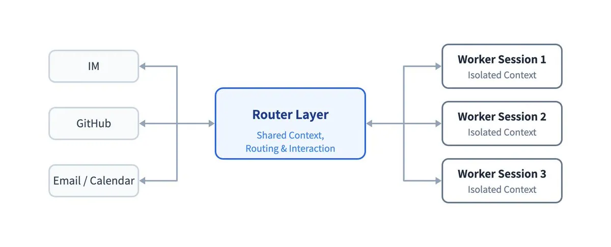
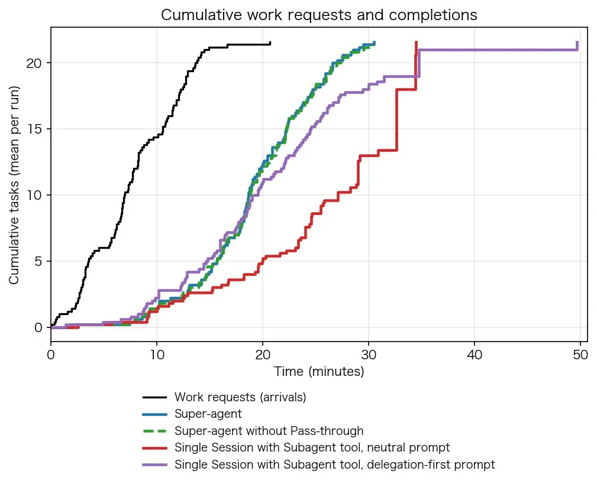

# 小互（@xiaohu）：同时开 5 个 Agent 人就盯不过来了——DeepSeek Super-agent 架构实验数据与安全代价

> 深入解读 DeepSeek Harness 团队 Super-agent 实验数据与架构反思：单人盯超过 5 个 Session 的注意力瓶颈、架构级剥离 Bash 解决模型不愿意委派的顽疾、PR 事件直通节约 37% token，以及每轮 23.2M token 吞吐代价与 BYOM 本地常驻面临的 Prompt 注入安全隐患。

<!-- more -->

同时开 5 个 Agent，人就盯不过来了

DeepSeek Harness 团队公开了一套 Super-agent 设计，思路很直接：session 别让人管了，交给系统。

你只跟同一个 Agent 说话，它在后台同时推进好几件事。

核心是两层：

Router 只负责沟通和派活，连 Bash 都不给它，用便宜的快模型

Worker 每个只做一件事，用最强的模型，但不许直接跟人说话，报错和工具日志全锁在里面，你在群里只看到 Router 整理过的结论

群里的消息先过代码规则

闲聊群直接丢掉，0 token

剩下的才交给轻量模型判断要不要管

有人在群里吐槽一个 macOS 的 bug，没 @ 它

它自己在后台复现，定位到 Electron 的 detail=2 机制，带着前后对比截图提了 PR

最有意思的是实验：

单会话 + 中立提示词，5 轮全是模型自己下场干，一个子任务都没派出去

换成强委派提示词，还是有 1 轮觉得任务小、自己干了

结果 p95 拖到 29 分钟，Super-agent 是 15.7 分钟

结论：想让模型分活，靠 Prompt 劝不住，得在架构上把它的手拿掉

代价也写得清楚：每轮 token 23.2M，单会话方案是 6.1M 和 10.8M

还有两个细节：

同一个 PR 的后续消息直接推给负责的 Worker，不再经过 Router。关掉这条直通，token 多花 37%

事件越密集越省：每分钟从 1 个涨到 40 个，单次决策反而从 6.4 秒降到 1.6 秒

大脑放在云端，你电脑上只跑一个轻量 daemon

笔记本合盖它照样盯群和 PR，第二天开机自动补跑本地测试

最大的坑还没填：它常驻、读公开群聊和外部 PR，又连着你的电脑。被 Prompt 注入一次，连着的设备都可能被接管

你敢让这样一个 Agent 常驻，还连着自己的开发机吗？

实验用的是合成负载（每轮约 300 条消息、20 个工作请求），团队自己说结果仅供参考；公开的只是部分实现的原型，不是 DeepSeek 官方产品。

完整解读：https://xiaohu.ai/article/deepseek-harness-super-agent/

## 相关页面

- [[sources/criscxuan-deepseek-super-agent-architecture-teardown]]
- [[sources/wangchen-super-agent-deepseek-harness]]
- [[sources/sujingshen-deepseek-harness-super-agent-reading]]
- [[concepts/deepseek-harness-agent-formula]]
