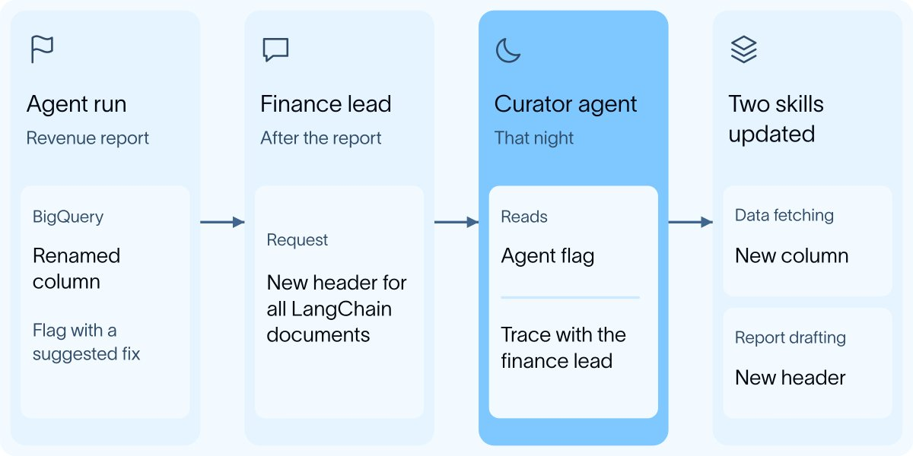

# 小互：LangChain 知识工厂——干活 Agent 与「馆长 Agent」拆成两头

> 让 Agent 在公司干活的最大麻烦是它不懂内部规矩（指标怎么算、数据哪张表、文档哪版页眉），经验散在老员工脑子和聊天记录里。LangChain 公开内部「知识工厂」做法：**拆成两头**——白天干活的 Agent 边做边像提工单一样标出哪里错、建议怎么改，标完继续把活做完；后台「馆长 Agent」按固定节奏运行，统一翻看标记与运行轨迹，对照 Slack / Notion 原始资料把技能和文档改对。不让干活 Agent 顺手改知识库，是因为它一心交差会把规则改乱、前后打架；靠人维护是无底洞。**例子**：写营收报告时发现 BigQuery 一列改名，标出后继续写完；财务负责人一起改格式要求换新页眉，当晚后台 Agent 把「取数」「写报告」两个技能一起更新。**存什么**：Snowflake / Databricks 里的正本放原处现查，知识库只攒三样——按公司规矩做事的技能、核心业务知识、写明「数据在哪怎么查」的取数指南。销售 Agent 在设计物料与 Content Studio 都跑这套回路；设计 Agent 每单提炼最多 5 条有证据的教训，每周把证明有用的并入技能与 wiki。起步不用等文档写完，挑一个反复要做的活接上「干活报错 + 后台整理」回路即可。作者注明原文未给出具体省人力/返工数据。

<!-- more -->

让 Agent 在公司干活，最大麻烦是它不懂内部规矩

比如某个指标怎么算、数据该去哪张表查、文档用哪版页眉。这些门道散在老员工脑子和聊天记录里，Agent 每次开工都像第一天入职。

LangChain 公开了他们内部搭「知识工厂」的做法：干活的 Agent 边做边报错，后台再配一个「馆长 Agent」定期改知识库。

他们专门拆开来做，原因很直接：如果让干活的 Agent 顺手改知识库，它一心想着把眼前任务交差，改着改着规则就会乱套、前后打架；靠人手工维护又是个无底洞。

拆成两头各管一摊就顺了：

- 白天干活的 Agent：遇到某列改了名、规矩对不上，像提工单一样标出哪里错、建议怎么改，标完接着把眼下的活做完
- 后台「馆长 Agent」：按固定节奏运行，统一翻看这些报错标记、Agent 运行轨迹，再对照 Slack 和 Notion 里的原始资料，把技能和文档改对

原文举了个写营收报告的例子：白天 Agent 发现 BigQuery 里有一列改了名，标出来后继续把报告写完；报告写完，财务负责人和它一起改格式，要求今后所有文档都换新页眉。当晚后台 Agent 读到标记和这段对话，就把「取数」和「写报告」两个技能一起更新了，下次干活直接生效。

存的时候也不用把所有数据搬进知识库。原文说，像 Snowflake、Databricks 这类数据底座里已有完整最新的正本，放原处现查就行，知识库里只攒三样东西：怎么按公司规矩做事的技能、核心业务知识、写明「数据在哪怎么查」的取数指南。

LangChain 说他们内部的销售 Agent 和做设计物料的 Content Studio 都在跑这套回路：销售在 Slack 里改邮件草稿，系统会在改动够大时按人提炼偏好并每周压缩一次记忆；设计 Agent 每做完一单提炼最多 5 条有证据的教训，后面的活给这些教训打分，每周由后台把证明有用的并进技能和 wiki。

起步不用等公司文档全写完，挑一个反复要做的活，把「干活报错 + 后台整理」的回路接上就能转。文中没给出这套做法具体省了多少人力成本或返工时间。

完整内容：https://xiaohu.ai/article/langchain-knowledge-factory/

## 相关页面

- [[sources/hwchase-knowledge-factory]]
- [[concepts/llm-wiki]]
- [[concepts/agentic-architectures]]
