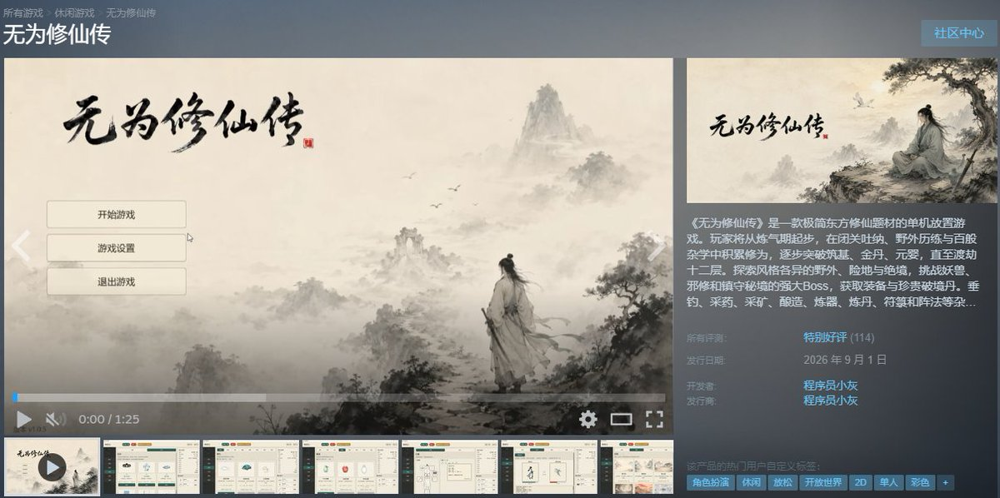
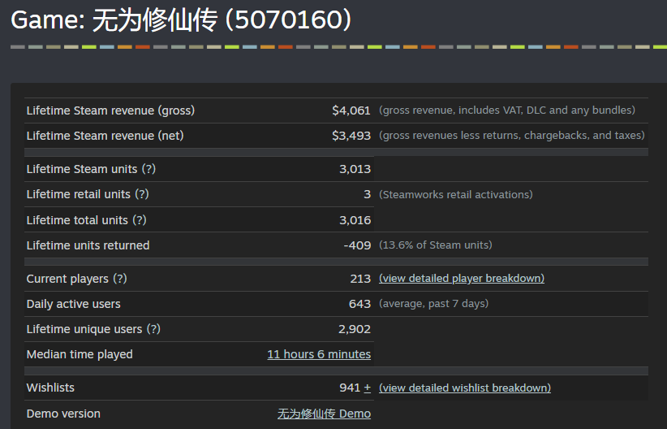
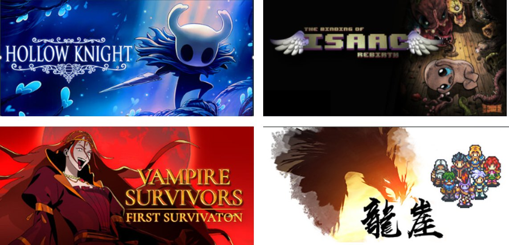
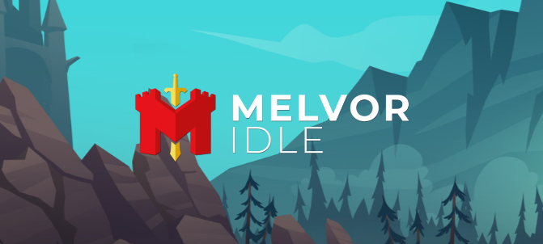
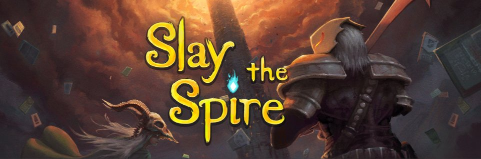
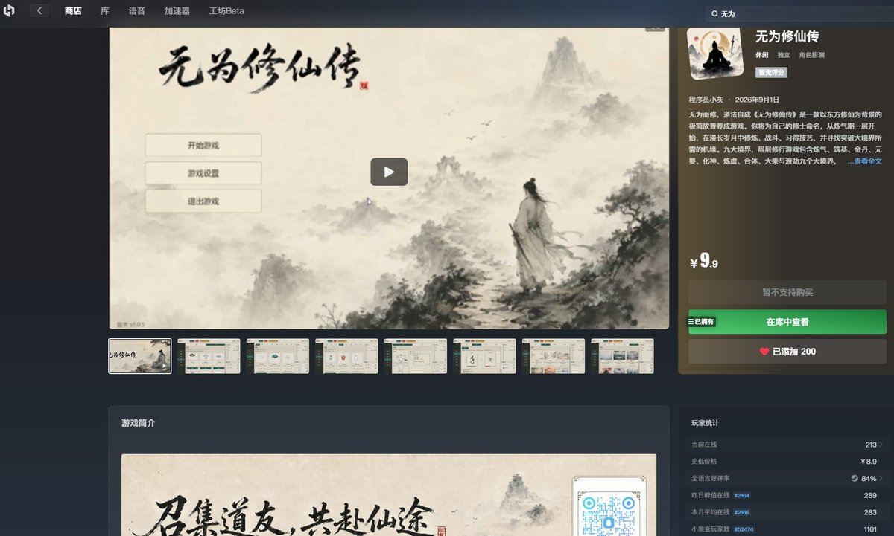
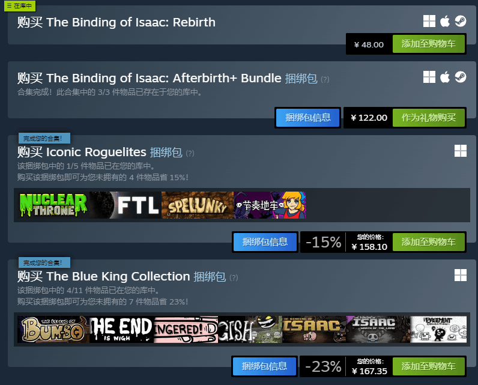
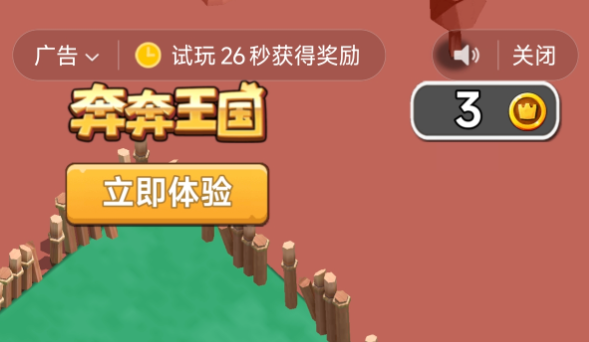

# 程序员小灰（@XiaohuiAI666）：AI 游戏发布 20 天，我赚了 23000 多元

> AI 编程时代普通人开发商业化游戏的完整变现实录：AI 爆发三年衍生出 AI 写作、绘本、漫剧、视频、客服、工具站等各类玩法，本篇正面回应「AI 只能做小 Demo 无法做完整商业游戏」的质疑；从创意选型、技术选型、AI 辅助开发流程、买量与自然流量获取，到最终 20 天斩获 23000 多元收益的全流程拆解。

<!-- more -->

大家好，我是程序员小灰。

自从 2023 年，OpenAI 旗下的 AI 模型 GPT-4 横空出世，整个世界进入了 AI 技术高速发展的时代。

短短三年多，AI 相关的玩法层出不穷，包括 AI 写作、AI 绘本、AI 漫剧、AI 视频、AI 客服、AI 工具站......每一种玩法都改变了许多普通人的命运。

那么，使用 AI 能不能开发游戏呢？

有人觉得，AI 当前的能力只能够开发一些小小的游戏 Demo，想要开发完整的商业化游戏，几乎不太可能。

然而，小灰用行动与实际结果证明，借助 AI 开发商业游戏是可行的。

我利用两个月的时间，完全使用 AI 工具开发了三款游戏，并上线了 steam 平台。

这三款游戏的销量如何呢？

虽然前两款游戏反响平平，但我的第三款游戏《无为修仙传》，却在 steam 平台拿到了非常不错的结果。

截至本文撰写时，我的这款仙侠风格放置游戏卖出了 2600 多份，净营收 3493 美元，合人民币 23000 多元。

虽然这个成绩算不上是大爆款，但是却为 AI 游戏开发这条赛道的可行性，给出了有力的证明。

我是如何拿到这个结果的？

今天小灰来给大家详细分享一下，我的 AI 独立游戏探索之路。

## 一、什么是独立游戏开发？

在正式讲 AI 游戏开发之前，我们首先需要搞清楚一个概念：什么是独立游戏开发？

很多人一听到“游戏开发”，脑海当中想到的往往是腾讯、网易、米哈游这样的大型游戏公司。

一个完整的商业游戏项目，可能有几十个人、几百个人，甚至上千个人参与。

其中包括游戏策划、程序员、原画师、UI 设计师、动画师、特效师、音效师、测试工程师、运营人员等等。

但是，游戏开发并不一定需要这么多人。

在游戏行业当中，还有另外一种非常重要的开发模式，就是独立游戏开发（Indie Game），简单来说，就是由个人或者小型团队独立完成开发的游戏。

有些独立游戏团队可能只有三五个人，有些甚至只有一个人。一个人既要负责游戏策划，又要写代码，还要制作美术素材、调整数值、测试 Bug、制作商店页面，最后把游戏发布出去。

这就是我们通常所说的独立游戏开发者。

事实上，Steam 平台上存在着大量这样的个人开发者和小型团队。

他们做出来的游戏未必拥有 3A 大作那样华丽的画面，但是依然可以依靠有趣的玩法、独特的创意或者鲜明的风格，获得玩家的认可。

比如我们经常看到的放置游戏、Roguelike 游戏、塔防游戏、卡牌游戏、模拟经营游戏，其中就有相当一部分来自独立开发者。

而 AI 技术的出现，恰恰给独立游戏开发带来了巨大的机会。

为什么呢？因为独立开发最大的难题，从来都不是“有没有想法”，而是“一个人能不能把这么多事情全部做完”。

你可能会写代码，但是不会画画；你可能会画画，但是不会做游戏逻辑；你可能既懂程序又懂美术，却不会做音乐，也不知道怎么设计 Steam 商店页面。

过去，一个人的能力边界非常明显。但是 AI 的出现，正在不断扩大个人开发者的能力边界。一个人不会写代码，可以让 AI 辅助写代码。

不会画画，可以使用 AI 生成游戏素材；不会写策划案，可以让大模型帮助我们整理玩法；不会写 Steam 商店介绍，也可以让 AI 帮助我们完成文案。

所以从某种程度上来说，AI 时代最适合爆发的一类游戏，恰恰就是独立游戏。

就拿小灰目前开发的三款 AI 游戏为例，游戏相关的策划文案与代码是用 Codex 实现的；美工素材是用 GPT-image-2 画的，音乐是用天工 music 生成的。

AI 并没有让一个普通人瞬间变成一个拥有十年经验的游戏开发专家，但是它可以让一个普通开发者，同时拥有多个“AI 助手”。这也是 AI 游戏开发最重要的基础认知之一。

那么，现阶段 AI 最适合用于开发什么样的游戏呢？我们下一节来展开讲讲。

## 二、AI 适合做什么样的游戏？

独立游戏的种类非常丰富，作为一个刚刚尝试 AI 游戏开发的普通人，适合利用 AI 开发什么样的游戏呢？

小灰建议大家在选择游戏方向的时候，重点考虑两个因素：

第一，这样的游戏能被 AI 低成本实现。

第二，这样的游戏容易火。

在网上，许多人曾经分享出非常酷炫的 AI 游戏演示，有 2D 的也有 3D 的，看起来十分唬人。

但小灰个人认为，这样的游戏演示仅仅是演示，甚至连 demo 都算不上。虽然它们乍一看十分吸引人，但真要是按照这样子做出完整的商业化游戏，要么非常不稳定，要么需要花费巨大的成本，不是一个人短时间能搞定的。

目前的 AI，更适合开发一些偏静态、偏数值、偏界面交互的游戏。

这里所说的“静态游戏”，并不是指游戏画面完全不动，而是指游戏中不需要大量复杂的角色动作、物理碰撞、实时演出和高精度动画。

比如，一个需要角色不断跑、跳、翻滚、攀爬、格挡、连招的动作游戏，对动画、碰撞检测、手感调优和关卡设计的要求都比较高。即便 AI 能够帮助我们写代码，后续的调试成本依然非常高。

但如果是一款以文字、数值、卡牌、图标和简单特效为核心的游戏，AI 就非常擅长。

因为这类游戏的大部分工作，本质上都是规则设计、数值计算、UI 界面、数据管理和简单逻辑，而这些恰恰都是当前 AI 比较擅长的领域。

所以，如果你是第一次尝试使用 AI 开发游戏，小灰比较推荐下面几种类型。

### 1.放置类游戏

小灰推出的 AI 游戏《无为修仙传》，就是这个类型。

所谓放置类游戏，就是玩家不需要持续进行复杂操作，角色或者系统会自动运行，并不断积累资源和成长。

比如玩家进入游戏之后，角色可以自动打怪、自动获得经验、自动获取金币和装备。玩家真正需要做的事情，主要是升级角色、调整装备、学习技能、分配资源，以及决定下一阶段的发展方向。

这类游戏最大的特点，就是玩法主要由数值驱动，而不是由操作驱动。

代表作：《Melvor Idle》

### 2.卡牌类游戏

所谓卡牌类游戏，就是玩家通过获取、组合和使用不同的卡牌，形成自己的战斗策略。

每一张卡牌本质上都可以看成一组数据。

比如卡牌名称、攻击力、消耗费用、卡牌效果、稀有度、触发条件等等。从程序开发的角度来看，这些内容其实非常适合进行结构化管理。我们甚至可以把所有卡牌放在一个表格或者 JSON 文件当中，然后让游戏程序自动读取。

这样一来，增加一张新卡牌，并不一定需要修改大量代码，只需要增加一条新的数据即可。

这种靠配置表格驱动内容、无需改动大量代码的开发模式，也是 AI 十分擅长的。

代表作：《杀戮尖塔》

### 3.文字冒险类游戏

所谓文字冒险类游戏，就是玩家主要通过阅读文字、查看图片和进行选项选择来推动剧情。

相比传统动作游戏，这类游戏几乎不依赖复杂的角色控制和战斗系统，它的核心内容通常是剧情、人物、对话、选择和分支。

比如游戏进行到某个剧情节点之后，玩家可能会看到三个选项：帮助这个角色、拒绝这个角色、暂时离开这里。

玩家选择不同的选项，就会进入不同的剧情路线，最终甚至产生完全不同的结局。

这种游戏从技术层面来说并不复杂。

本质上就是：显示剧情 → 玩家选择 → 判断条件 → 进入下一段剧情。

真正困难的地方，反而是需要大量内容。一款文字冒险游戏可能包含几十万甚至上百万字的剧情，以及大量人物对白。而这一点，恰恰又是生成式 AI 最擅长的领域之一。

代表作：《沙耶之歌》

如何寻找某一类型的爆款游戏呢？这里推荐一个不错的中文游戏社区：小黑盒。

steam 上的所有游戏，都可以在小黑盒平台上找到比较精确的数据统计，包括游戏在线人数、平均游戏时长、小黑盒玩家数等等。

根据这些数据，我们可以判断出哪些游戏比较火，哪些游戏值得我们去学习借鉴。

## 三、AI 游戏如何变现？

开发游戏的目的是什么？每个人的想法不尽相同。

有的人出于情怀，希望开发出一款好玩游戏为大家带来快乐；也有的人希望通过游戏，为自己带来一定的财富收益；更多的人，或许是介于这两者之间。

小灰觉得，赚钱这件事并不可耻。当你的游戏赚到钱，你的收获并不只是金钱本身，更有一份玩家的认可。

那么，一款独立游戏都有哪些变现方式呢？

### 1.付费买断

付费买断是独立游戏最常见、也最容易理解的一种变现方式。所谓买断制，就是玩家支付一次费用之后，就可以永久拥有这款游戏。

比如一款游戏售价 9.9 元、18 元、28 元或者 68 元，玩家完成购买以后，就可以下载安装并长期游玩。

对于个人开发者来说，买断制最大的优点就是简单。开发者不需要设计复杂的广告系统，也不需要搭建充值商城，只需要把游戏本身做好，然后发布到 Steam 等游戏平台即可。

尤其是对于单机游戏、剧情游戏、Roguelike、放置游戏、模拟经营游戏来说，买断制都非常常见。

### 2.广告变现

第二种常见方式，是广告变现。

这种模式在手机 APP 游戏和微信小程序游戏领域非常普遍。

游戏本身可以免费提供给玩家，然后通过展示广告获得收入。常见的广告形式包括开屏广告、插屏广告、横幅广告，以及激励视频广告。

其中，激励视频广告是目前比较常见的一种形式。比如玩家观看一段广告之后，可以获得一次复活机会、额外金币、双倍奖励或者其他游戏资源。

这种模式最大的优点，是玩家进入游戏的门槛非常低。因为游戏是免费的，所以更容易获得大量用户。但是广告变现也有一个非常明显的问题：它通常需要比较大的用户规模。

如果每天只有几十个或者几百个玩家，那么仅仅依靠广告，很难产生非常可观的收入。

所以，广告模式更适合用户量较大的休闲游戏、小游戏和移动端产品。

### 3. 游戏内购

第三种方式，是游戏内购。这也是很多免费游戏最主要的盈利模式之一。

游戏本身可以免费下载，但是玩家可以在游戏内部购买一些额外内容。比如角色的皮肤、装备、金币、钻石、体力、扩展功能、便利道具等等。

内购模式的优势在于，它可以不断从长期玩家身上获得收入。一个玩家可能不会只消费一次，而是在几个月甚至几年的游戏过程中持续付费。

但是，对于个人独立开发者来说，内购模式的复杂程度通常要高于买断制。你需要考虑支付系统、账号体系、数值平衡、商城设计，甚至还需要处理服务器和数据安全问题。

如果设计不好，还有可能让玩家产生“逼氪”的感觉。

所以，对于第一次开发商业游戏的新手来说，小灰并不建议一开始就挑战过于复杂的内购体系。

除此上面几种变现方式以外，独立游戏的变现还包括 DLC 扩展内容、赞助众筹、IP 内容衍生等等，后面小灰会单独写一篇教程来讲透游戏变现，这里就不过多赘述了。

## 四、哪些人适合做 AI 游戏开发？

讲到这里，很多朋友可能会问：我到底适不适合学习 AI 游戏开发？在我看来，有几类人非常适合：

### 第一类，是程序员。

如果你本身有编程基础，那么学习 AI 游戏开发会非常快。

因为你已经知道什么是变量、函数、类、数据结构，也能够看懂 AI 生成的大部分代码。

过去你可能从来没有开发过游戏。

但是借助 AI 和游戏引擎，现在完全可以非常快速地跨入游戏开发领域。

### 第二类，是游戏爱好者。

很多人玩了十几年游戏，脑海当中其实已经积累了大量游戏设计经验。

你知道什么样的玩法好玩，什么样的系统让人上瘾，什么样的设计让玩家觉得无聊。

过去唯一的问题是：你不会写代码。所以即使脑海里有很多游戏创意，也很难真正实现出来。而 AI 正在快速降低这道门槛。

### 第三类，是内容创作者。

如果你本身会写故事、做 IP、画漫画、做短视频，那么 AI 游戏开发同样非常值得尝试。

因为你的最大优势并不一定是技术，而是内容创意和流量运营。

未来很多 AI 游戏，可能并不是依靠极致技术取胜，而是依靠各种流量运营技巧获得用户，依靠独特的世界观、角色和玩法留住用户。

总而言之，在 AI 时代，开发游戏的门槛不再遥不可及。

即使你不会编程，不会美工，不会策划文案，只要你拥有对游戏创作的热情和想法，你都可以去勇敢地尝试。

不过话说回来，虽然有了 AI 的辅助，但不代表你可以随随便便就做出优质的游戏。想做好 AI 游戏，依然需要你投入大量的时间精力去测试、修改、打磨和思考。

真正适合 AI 游戏开发的人，不一定是最懂技术的人。但一定是愿意不断尝试、不断学习、不断把产品做得更好的人。

## 五、做 AI 游戏有哪些需要注意的点？

前面我们说了用 AI 开发游戏的种种优势，接下来我们说一说 AI 游戏存在着哪些坑。

### 1. 游戏大方向需要自己把控

AI 在游戏执行层面上能够提供很大的助力，但目前 AI 对于游戏大方向的选择，并不是特别擅长。因此，我们在选择游戏方向的时候，可以让 AI 启发我们，但不要过于听信 AI 的建议。

小灰开发的前两款 AI 游戏，一款是塔防类游戏，一款是增量放置类游戏。

当时为什么选择这样两款游戏呢？我把自己准备制作的几个游戏方向发给 AI，让 AI 帮我列出一个制作优先级，结果 AI 把塔防类和增量放置类游戏列在了最前面。

然而实际结果证明，这两个方向并不是最优选择。

游戏大方向的选择是最重要的一步，这一步我们必须亲自去调研，而不要偷懒完全交给 AI。

### 2. AI 开发游戏并不轻松

有人曾经问我：用 AI 开发游戏一定很轻松吧？是不是写几句提示词，就可以等着收钱了？

讲真， 虽然 AI 为独立游戏的开发减轻了许多工作量，但一个人使用 AI 开发一款商业化游戏依然不轻松。

为了更好地与玩家们互动，小灰创建了一个游戏 QQ 群，自游戏上线以来，每一天都在接收玩家们的反馈，平均每日迭代 2-3 个版本。

虽然有 AI 的帮助，但游戏的迭代过程依然非常辛苦。每一天我都在群里和玩家们互动，听取有价值的意见，让 AI 协助我修改问题，增加新元素，来来回回自测，最后打包上线。

这个过程非常熬人，但这是我的兴趣所在，看着自己的游戏逐步丰富完善，我体验到了前所未有的成就感。

各位在走上 AI 游戏开发这条路之前，一定要先向自己问清楚两个问题：

第一，你是不是真的喜欢游戏开发这条路？

第二，你在游戏开发与发售的第一个月，每天是否能够投入 5 小时以上？

如果这两条中的任何一条不能满足，那我并不建议你选择 AI 游戏这个赛道。

### 3. AI 游戏的成本不可忽视

许多人问小灰：你开发 AI 游戏需要消耗多少 token？还有其他额外成本吗？

小灰给大家仔细盘点下一款 AI 游戏的成本：

首先是 GPT 账号费用。要认认真真开发一款游戏，GPT plus 的 token 额度显然是不够的，小灰升级了 GPT Pro 5x，费用大约 700 人民币。

其次是天工 AI，用于生成游戏背景音乐。天工 AI 会员费用，最低档一个月 46 元。

最后是 steam 的游戏上线押金，每个游戏需要缴纳 100 美元，也就是 700 人民币。这笔押金，只有当游戏营收超过 1000 美元时才可以退回。Steam 上绝大多数游戏都达不到这个标准，因此你要做好押金大概率无法收回的心理准备。

综合算下来，假设你一个月只做一款 AI 游戏，那你的开发成本是 700+46+700 = 1446 元人民币。

是否值得投入这笔成本，需要你自己来衡量。

## 写在最后

在选择走上 AI 游戏这条路的时候，许多人问小灰：以你现在的自媒体体量，半个月时间赚两万人民币，似乎并不多？

确实是这样，但我依然会坚持继续走这条路，主要原因有两点：

### 1. 我真心热爱游戏开发这件事。

在游戏开发的过程中，小灰很辛苦，但也很快乐。哪怕比其他赛道收益低一些，我也更倾向于游戏赛道。

### 2. 游戏开发的天花板很高，且具有长尾效应。

独立游戏开发的天花板有多高？拿现象级独立游戏《鬼谷八荒》来说，开发者到手的收入能达到一个小目标。

而且优质的游戏在未来三五年之内，都可以持续为你带来收入。

好了，关于 AI 游戏开发的基础认知、方向的选择、变现方式、适合人群，以及需要注意的点，我就给大家分享到这里。

如果大家对我的 AI 游戏感兴趣，欢迎在 Steam 平台搜索“无为修仙传”，为本游戏提出宝贵的意见建议。

最后，希望未来能有更多的朋友走上 AI 游戏开发的道路，创造出更加酷炫、更加有趣的独立游戏。感谢大家！

## 相关页面

- [[sources/luffy-19yo-ai-tiktok-dance-girl-7-prompts]]
- [[sources/kyrie-ai-short-drama-monetization-6-business-models]]
- [[concepts/ai-content-pipeline]]
- [[concepts/b2c-conversion]]
