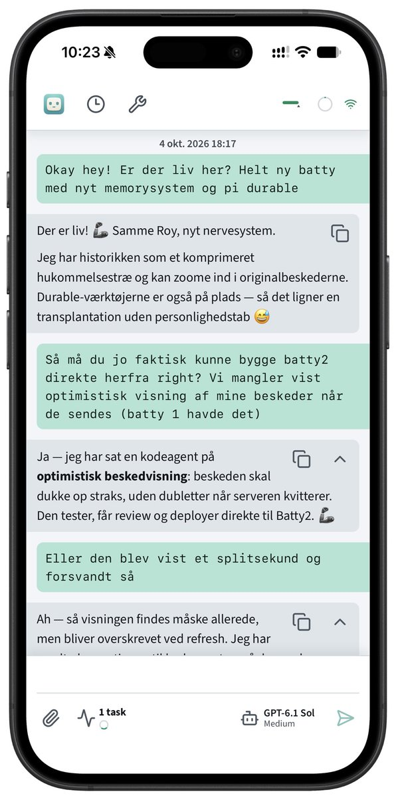

# 小墨同学（@xiaomovps）：自己开发 Personal Agent，可以从 Pi Durable 开始的 4 个项目学习路线

> 从零自建 Personal Agent 的四项目循序渐进学习路线：① pi-durable-hello（5 个例子理解任务持久化、崩溃恢复、请求去重与实时监听，无需 API Key）→ ② Batty（整合长期记忆、定时任务、Subagent、Skills、MCP 与移动端 PWA，重点研究如何在不塞满上下文的前提下记住事情）→ ③ Pots（开源版 Grok Bot，支持 Telegram/Slack/Discord，被外部事件或定时任务唤醒，且先用普通脚本检查任务、确需处理才调用大模型以省 Token）→ ④ Hearth Pi（接入 Home Assistant 控制智能家居，含人工审批与权限机制设计）。

<!-- more -->

自己开发一个 Personal Agent，其实可以从 Pi Durable 开始🔥

看到使用 GrokBot 的人越来越多，大家也越来越多 Personal Agent 越来越感兴趣，我也想看看能不能自己写一个呢？

我自己研究的时候就已经发现了这几个项目，可以从这 4 个项目开始，循序渐进地学习

1. pi-durable-hello｜从零理解 Pi Durable

通过 5 个简单的例子，学习任务持久化、崩溃恢复、请求去重和实时监听

不需要 API Key，适合先搞懂 Durable Agent 的运行原理

https://t.co/7Xs1xAO7Aa

2. Batty｜开发自己的私人 AI 助理

基于 Pi Durable，已经整合了长期记忆、定时任务、Subagent、Skills、MCP，还有移动端 PWA

最值得研究的是它的长期记忆系统，怎么让 Agent 记住之前的事情，又不需要每次都把所有聊天记录塞进上下文

https://t.co/HML68WPkkK

3. Pots｜开发一个会主动工作的 Agent

有点像开源版 Grok Bot，支持 Telegram、Slack、Discord，可以主动处理消息，通过定时任务和外部事件唤醒自己

比较有意思的是，它会先用普通脚本检查任务，确定需要处理才调用大模型，减少不必要的 Token 消耗

https://t.co/P4PGTfiL8i

4. Hearth Pi｜让 Agent 控制智能家居

把 Pi Durable 接进 Home Assistant，让 Agent 读取设备状态，再通过人工审批控制灯光、开关等设备

虽然还处于实验阶段，但很适合学习 Agent 怎么连接现实设备，以及权限和审批机制怎么设计

https://t.co/MxyNxbFEZh

从任务恢复、长期记忆，到主动执行和现实设备控制，这几个项目基本能串起一条 Personal Agent 的学习路线

Pi 是你的 Agent 启蒙，也可以成为你 Personal Agent 路上的好帮手，真就那句话

万物基于 Pi 😂

https://t.co/LrLMmFiijw

[animated_gif](https://video.twimg.com/tweet_video/HWlET5NbIAAJ7uS.mp4)

## 相关页面

- [[sources/durable-agent-agentcore]]
- [[sources/kongge-personal-agent-comparison]]
- [[concepts/agent-autonomous-pipeline]]
- [[concepts/loop-engineering]]
