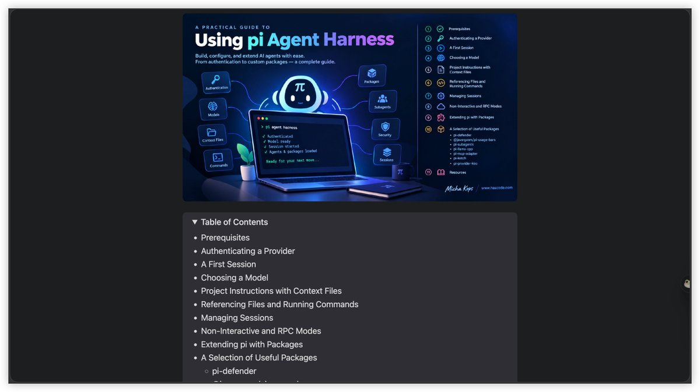
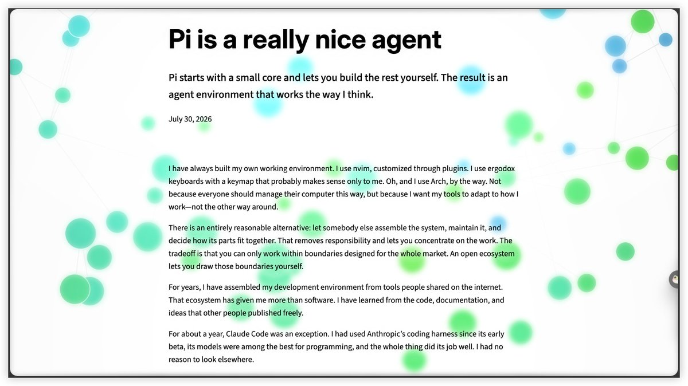

# 小墨同学（@xiaomovps）：学习 Pi 必须阅读的 5 篇经典文章——从入门到自己开发 Agent

> Pi（earendil-works/pi）官方与社区文章的精选书单：① Getting Started with pi — 涵盖安装、模型配置、Session 管理、RPC 与插件使用，还含连接本地 llama.cpp 模型的例子；② Pi is a really nice agent — 作者从 Claude Code 转向 Pi 的半年实战，刻意不装一堆插件，只保留 Subagent、代码检索、网页访问；③ Pi 扩展开发实战手册（中文）— 系统讲 Skill / Prompt Template / Extension / Package 四种扩展方式，从最小示例到事件机制、调试与插件发布；另含 Agent 架构与工程化落地等后续两篇。

<!-- more -->

学习 Pi 必须阅读的 5 篇经典文章，从入门到自己开发 Agent🔥

1. Getting Started with pi, an Extensible AI Agent Harness

这篇比较适合刚刚接触 Pi 的开发者，涵盖安装、模型配置、Session 管理、RPC 和插件使用，甚至还有连接本地 llama.cpp 模型的例子

整体比较全面，可以作为 Pi 的入门教程

原文：https://t.co/hG7O3tLBb8

2. Pi is a really nice agent

作者从 Claude Code 转向 Pi，分享了自己半年左右的实际使用经验

有意思的是，他并没有安装一大堆插件，而是只保留 Subagent、代码检索、网页访问等真正需要的功能

我觉得这篇很适合理解 Pi 的设计理念，以及如何根据自己的需求搭建工作流

原文：https://t.co/d6kcPNYrXA

3. Pi 扩展开发实战手册

这是一篇中文教程，也是我比较推荐国内开发者阅读的文章

作者详细介绍了 Pi 的四种扩展方式：Skill、Prompt Template、Extension 和 Package

从最简单的代码示例，到事件机制、调试方法和插件发布都有涉及，如果你想自己开发 Pi 插件，可以重点学习一下

不过文章基于 Pi 0.74–0.78，部分 API 可能已经发生变化，需要结合最新文档学习

原文：https://t.co/EqbnXXAZ8s扩展开发实战手册/

4. Pi Coding Agent: The SDK Is the Real Reason to Care

这篇文章的观点我很认同，Pi 真正值得研究的地方，不仅仅是它的 Coding Agent，而是背后的 SDK

作者通过一个发票处理系统，演示了如何将 Pi 集成到自己的程序中，还能限制 Agent 的工具调用权限

如果你想基于 Pi 开发自己的 Personal Agent，或者企业内部使用的 Agent，这篇很有参考价值

原文：https://t.co/AeIoXp9u83

5. My Pi Coding Agent Stack

这是一篇比较完整的 Pi 个人工作流实践，也是我觉得最值得参考的一篇

作者把长期记忆、异步 Subagent、Discord 远程控制、MCP 网关以及命令安全检查组合到了一起

不再是简单地安装几个插件，而是通过各种扩展，把 Pi 逐渐搭建成一套适合自己日常使用的 Agent 系统

原文：https://t.co/JACDkCj6sp

你的 Pi Agent 还在每次开新会话后，重新认识你吗？🔥

看到很多 person Agent，其实现在已经可以给 Pi 装上一套完整的记忆系统，玩出不一样的玩法

不只是记住聊天记录，还能保存你的使用习惯、项目经验，甚至让 Pi、Claude Code、Codex 共享同一套记忆

1. Engram｜让多个 Agent 共享记忆

支持 Pi、Claude Code、Codex、OpenCode 等多个 Agent，能保存项目决策、用户偏好和历史经验

比较有意思的是，不管切换到哪个 Agent，都可以检索同一套记忆，不需要每次重新交代项目背景

https://t.co/EhhnUk3X7c

2. Magic Context｜让 Pi 自动整理记忆

这个更像是给 Pi 增加一个自动管理上下文的系统

可以在后台整理历史会话，提取重要信息，还能定期合并、更新记忆，避免长期使用后积累太多重复内容

同时支持 Pi、OpenCode 和 OMP 共享项目记忆

https://t.co/4GW2JA7Uoj

3. Pi Hermes Memory｜让 Pi 记住犯过的错误

把 Hermes 风格的长期记忆带进 Pi，能够保存用户习惯、项目约定和之前失败的经验

比如某个问题上次是怎么解决的，哪些方法已经试过但没有效果，后面遇到类似任务就可以重新检索这些经验

还支持搜索历史会话和敏感信息扫描

https://t.co/reLsQjGBuf

我觉得这三个项目刚好代表了不同的记忆方案

Engram 适合同时使用多个 Agent，Magic Context 更适合长期运行和上下文管理，Pi Hermes Memory 则比较适合把 Pi 往 Personal Agent 方向改造

不过没必要三个都装，选一个符合自己需求的就够了

毕竟记忆系统最重要的不是存了多少内容，而是下次需要的时候，Agent 能不能真正想起来

## 相关页面

- [[sources/pi-agent-deepseek-v4-pro-codex]]
- [[sources/xiaomovps-4-projects-to-build-personal-agent-on-pi]]
- [[concepts/agentic-architectures]]
- [[concepts/agent-skill]]
