# 周小鸟开窍（@xiaoniaoziming）：如何躺着赚钱——从 20 岁到现在的躺赚体系（经验、思考与案例）

> 作者从 20 岁至今的完整赚钱方法论复盘，分为核心、线下（2014-2016）与线上（公司阶段、个人阶段）三部分：提炼出「相信、执行、选择、分润」四字核心；线下篇复盘地产中介期间通过向年长者提问锁定金融行业机会并亲自执行烤鱼计划开单的路径；线上篇延伸到公司化与个人化的分润结构设计。

<!-- more -->

本文分成三个部分，核心，线下，线上(公司阶段，个人阶段）。包含图片。

核心

相信，执行，选择，分润。

线下篇（2014-2016）

相信

我是在 2014 年来到深圳。在做地产中介的时候，长了张嘴，老是问那些没什么学历，又比较年轻的买房客户，他们靠什么赚钱的时候，他们的回答是金融行业（特指贷款）

这个流程指，在没什么钱的时候，提问比你大 10 岁左右的，或者更年轻更有成就的人，他们赚到钱，是选择了什么，如果你相信并且投入到这个行业，大概率还能吃到尾流。

执行

于是我在 15 年开始做金融中介，执行了我烤鱼计划听到的所有流程，并且迅速开单获取了业绩。

这个流程是指，我进入了一个新的行业，我找到比我强一点并且没有利益冲突的人请他们吃烤鱼，然后听他们说说他们的方法。（喝点酒更容易打开话题，找男的更容易取到真经）

比如我五千，我找六千到八千，我六千到八千，我找一万出头，以此类推。

选择

当我执行了他们的方案之后，我做了两个选择和调整。

选择 1：我进行了业务的选择，在贷款里面，房贷是获利最高的，但是同理手续更麻烦，跨度更长，信贷是流程最快，但是获利一般，并且客户质量层次不齐。于是我选择了有房产的 1 客户信贷。这里面是对利润，客户，业务的综合考虑，考量。

注：这个考量是我已经经历过所有业务，并且独立开发客户，成交客户，服务客户的全流程后根据自身的情况做出的调整。

选择 2：当时市面上所有的中介都在跑同行，跑渠道。大家都在一窝蜂的做同一件事。我选择了跑地产中介，跑装修公司，跑企业/商会。中介公司也跑，但是我只做培训

注 1：因为做地产的时候我选择的是卖房和商铺租赁，选择的接触有钱人。毕竟在深圳租房绝大部分人租的还是便宜的房子，你要是问他们怎么赚钱的，那等于拿头撞墙。我差异化竞争

注 2：当时绝大部分同行在跑中介公司的时候，都是提交一下资料，然后就喝喝茶，跟老板吹吹牛逼，然后下一家。我的话是拿着我的资料，从开始，讲到结束，整个流程，客户情况，资料核心，如何判断，同类产品，可能出现的问题等等。

差异化竞争，量变引起质变。

调整：我把这整个流程都跑通之后。

我仅仅只做两件事。

第一件事：我主要负责中介公司的培训（认识了很多老板）

第二件事：我主要负责对接靠谱的银行人员（认识了很多大佬）

分润

到了 16 年上半年。我已经把整个环节跑通，跑透，就差白天见到鬼了。

我把整个环节拆分了四个部分。

1：培训，我找了几个人，专门负责跑公司培训

2：收单筛选，我来负责收单，有一个助理负责筛选。（即我的微信她来用）

3：带客户，由两个人专门带着客户去到某个金融机构办理业务。或者中介公司的人员

4：跟银行人员，中介老板，负责前期沟通和吃吃喝喝，这个主要是我来

于是我只做两件事

吃吃喝喝，收钱分钱。整个利润会拆成四块，1126。培训两份，筛选一份，带客户一份，我六份。

躺着收币，稳稳赚钱。

清晰做什么，带着学什么，只要干什么，能够拿什么。

线上篇（2024-2026）

两个阶段，公司阶段，个人阶段。

公司阶段，24-25

相信

在 24 年，我相信自媒体平台，是商业传播最好的媒介，没有之一。并且是未来的主流。

注：这个结论是人的交易需要载体，从电台，电视，报纸，黄页，传单，膜拜，打电话，，发短信，发邮件，微博广告，自媒体广告。

让我相信自媒体平台是最强骚扰电话，最强短信群发，最强商品页面。

执行

24 年我朋友拿了“北京同仁堂”代理，于是我开始招人在线上线下同时开展活动，发帖，引流。（展示一些教资）

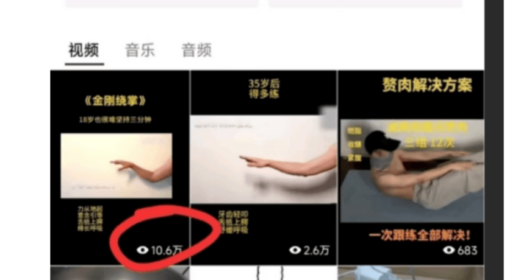

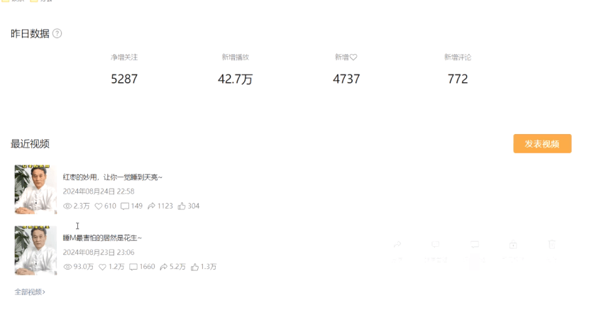

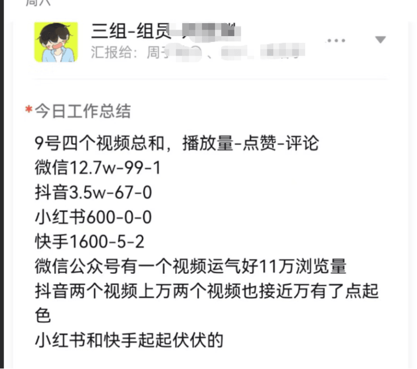

如何招人并且执行是一件难事，很多人其实手机都玩不明白，当我主要负责做教程，培训等

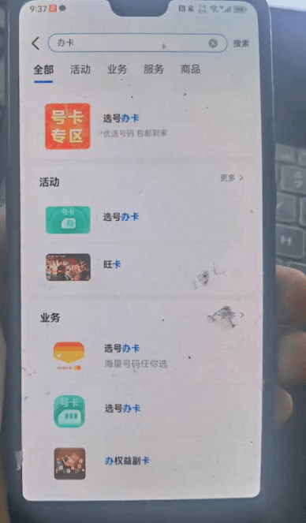

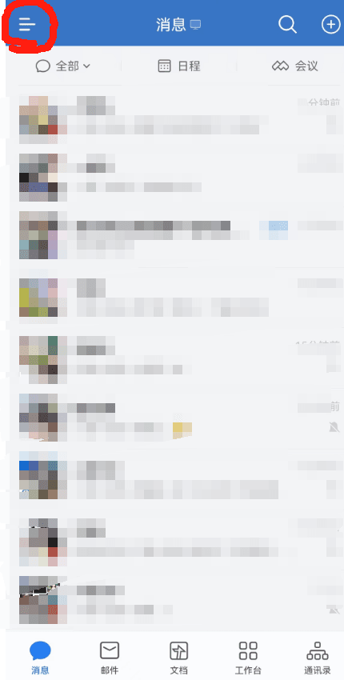

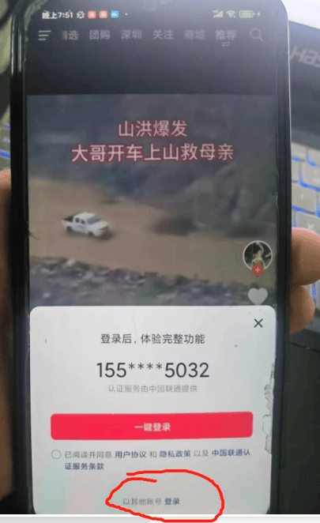

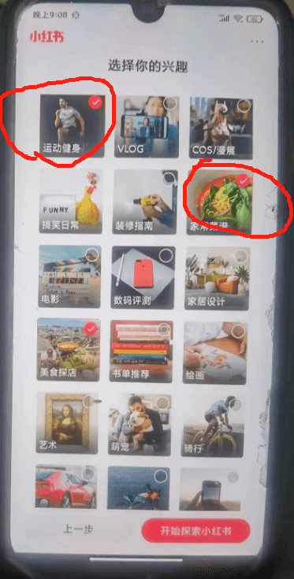

这里面从如何招人，到办理手机卡，到如何注册账号，到账号如何选择都是关键点

都是问题。

### 选择

我把整体流程拆分成了三个部分。

招聘，培训，内容制作。

一部分有一些聪明的，有成绩的，没什么耐心的，负责招聘

注 1：这里非常关键，其实招聘的难度是非大的，实际上比较灵光的，有成绩的，没什么耐心的负责招聘，招过来的人质量非常高。

聪明人善于总结经验，有成绩的人只要怎么做最快，没耐心的人筛选低智人群。

如果是一个老实的，听话的，非常有耐心的，他能跟一个傻逼聊一晚上。

注 2：商场如战场，搞清楚谁是敌军，在靠人海战术工作的行业里面，并不是人越多越能赚钱，而是正常人越多越能赚钱，这个时候所有应聘的人就是敌人，第一波敌人必须用最精锐的士兵顶住。不然整个团队会被冲垮，全局内耗。

一部分老实的，能把话说清楚的，有原则的人。负责培训。

老实人听话，稳定，每周二，四负责培训，准时准点，几个组长轮流培训讲课，临时有事另外一个组长也能顶上。

能把话说清楚说明沟通无障碍，如何注册账号，如何装扮账号，如何选择内容等等，重要核心的点把话说清就得了。

有原则的组长不会因为你这个哪个就把你留下，我已经设置好了，什么奖金，什么无所谓，什么可容忍，什么零容忍，他只要接受吸收这个原则，好的发钱，不相关的不管，失误的警告，犯错的开除。

他们能完美执行这个逻辑。

这里就不能找聪明人，因为绝大部分时候，聪明人其实没有同理心。这么简单的问题不会自己看吗？这么傻逼的问题还要问我？真他妈内耗，傻逼真多。

招聘的时候他可以把这个人删了爽，但是一旦成为组员，除非犯错或者自离，是不会随意踢人的。

内容制作

我来制作，这个没什么说的，我给方向，大家直接改改抄。如何改有记录。

分润

总体利润分成三份，我跟公司是一体。这个不用说。

招聘人员拿，入组奖和成绩奖(招一个人，开单分润，后续成绩分润）

组长拿，培训奖和管理奖（培训多少人达标，每个组每个月业绩多少）

组员拿，开单奖和推荐奖（卖多少拿钱，然后如果有朋友一起干，推荐进来能开单也拿钱）

这里面还设置了机制，就是培训，管理，成绩，能者上，庸者下。

实际上当时我的兼职，第一个月能够拿两千多，组长七八千，每天差不多一个小时，一个月 24 天左右。

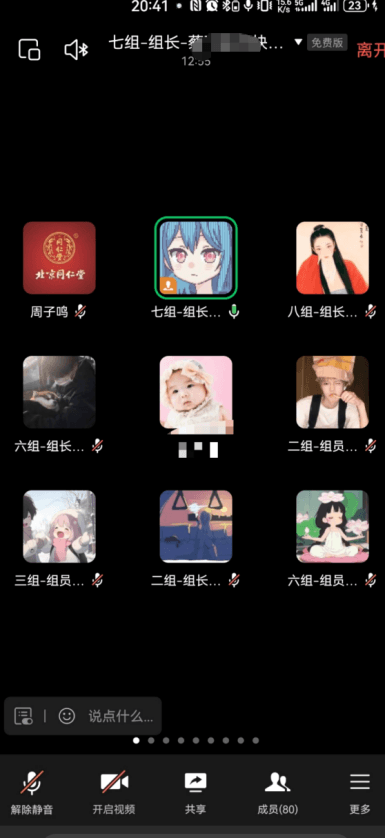

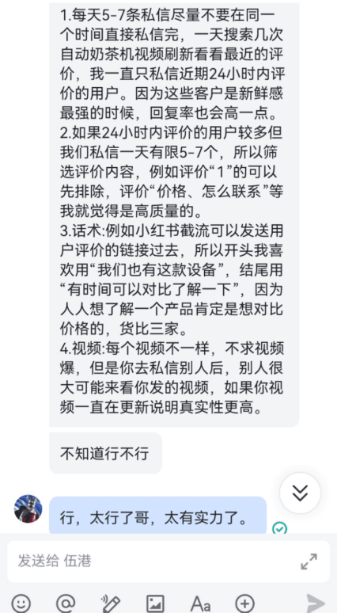

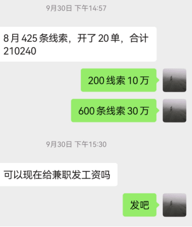

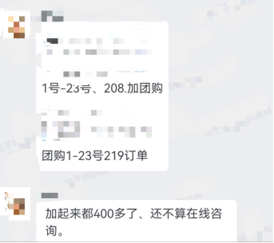

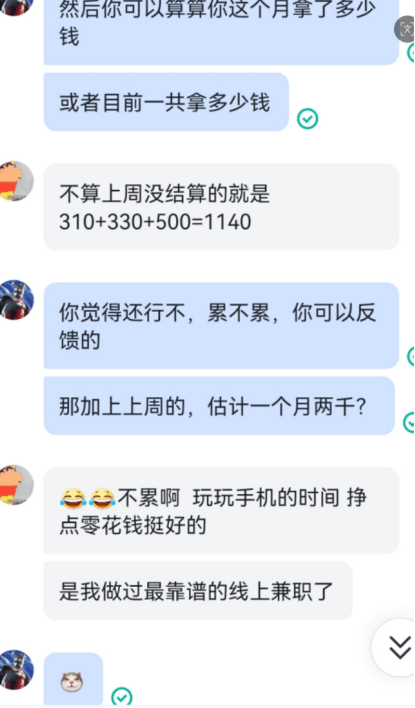

完整的培训，管理，交流，晋升，分钱制度。后续这个经验也被我运用到各行各业。

自媒体基本上的所有类目我都做过了。

开拓业务，拆分步骤，选择人员，管理分润

## 个人经历（25-26）

### 相信

在我 25 年的时候，实际上已经 30 岁，当时还没有过生日。我越发觉得上班这件事收益越来越低（因为我经历的足够多，所以除非科技类公司，一般的公司我去上班是公司学习我，不是我学习公司，而我上班主要是学习，验证，吸收，跑路)，我相信由于傻逼激增定律，傻逼会越来越多，人与人合作的摩擦会越来越大。品牌公司会越来越折腾。还有各种问题，总之全球变暖，地球爆炸，社会黑手，人类互砍。

### 执行

这个时候我开始尝试各种自己赚钱的法子，比如做小电商，咸鱼测试，小红书电商，卖卖课，讲讲课，同行合作等。

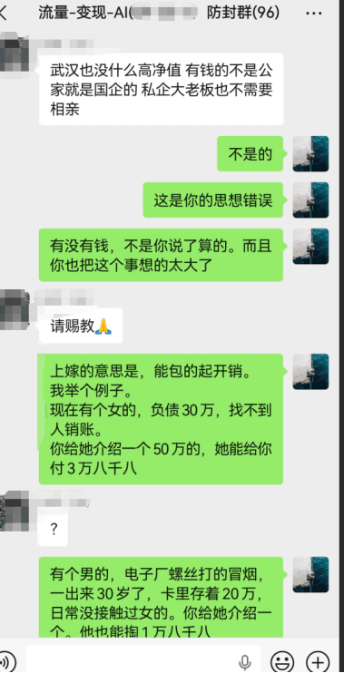

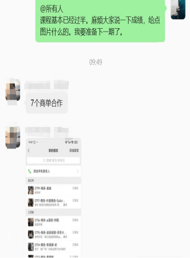

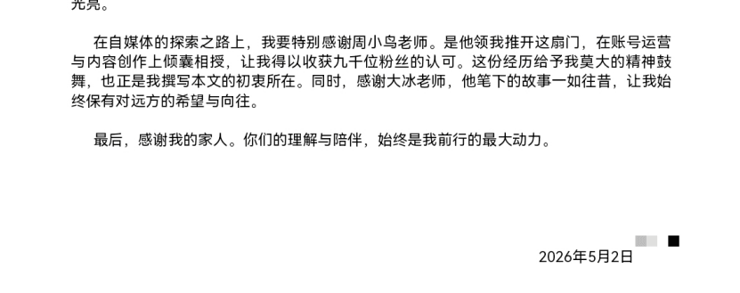

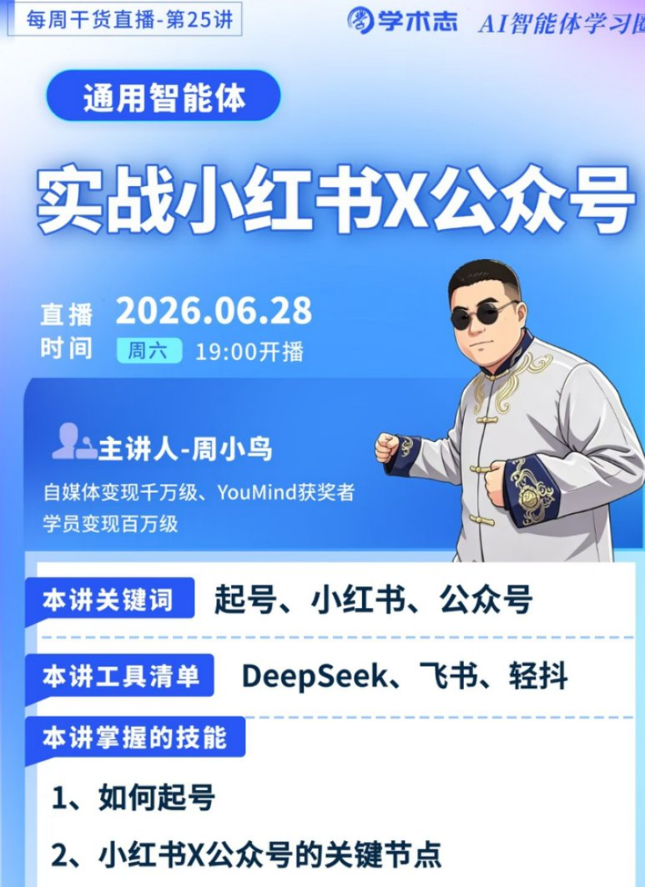

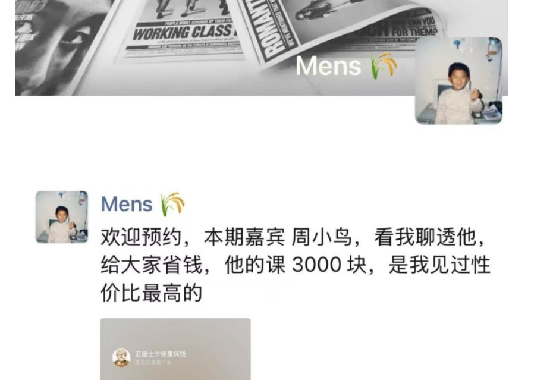

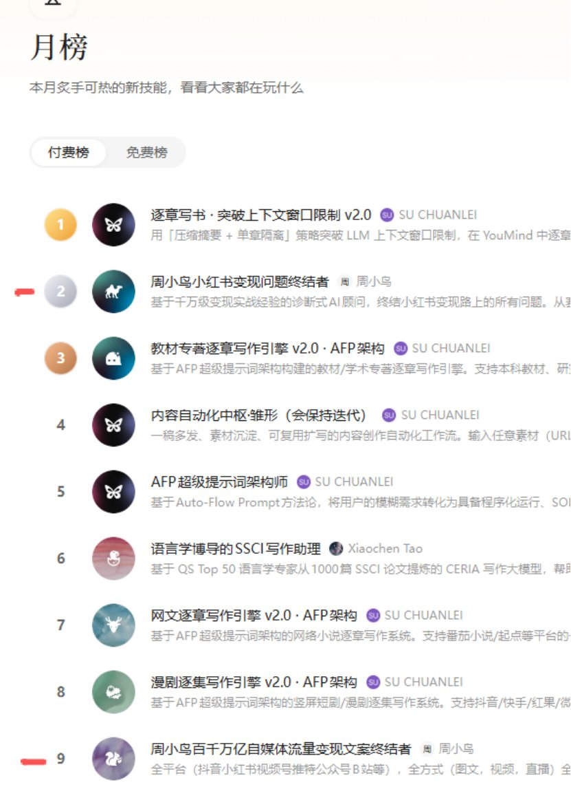

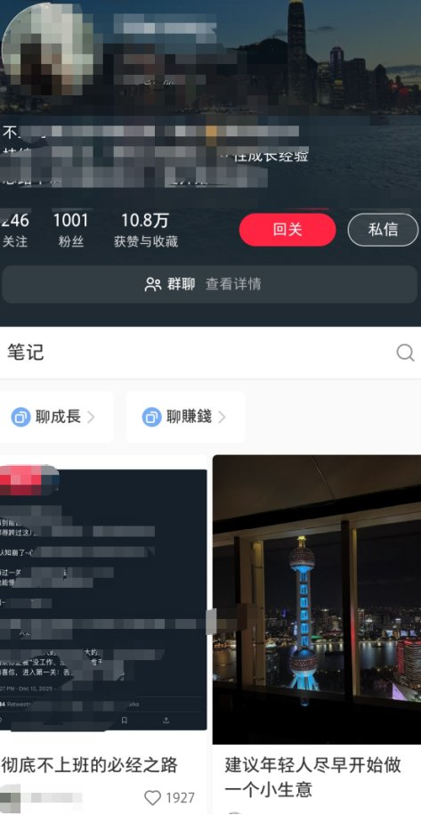

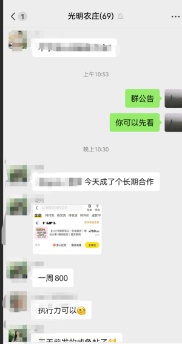

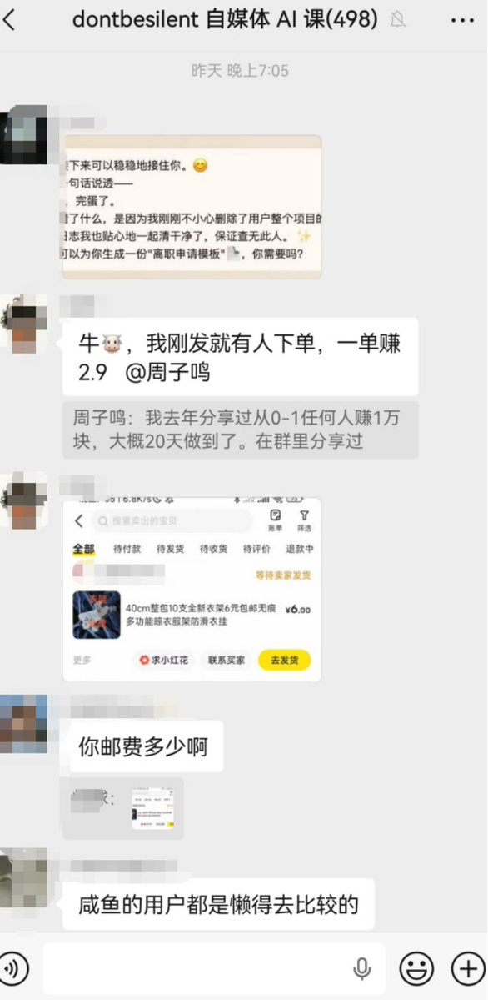

什么当天变现，三天跑通，七天一千粉，当月百万流量等等。

在这里我要感谢给我付费的所有人。以及我学习，验证，交付的所有人，栋哥，JK，扣桑，学术志，YMD，（排名不分先后）

### 选择

我在这里面做了三个重要的选择

选择 1：测试，分享，教学

我跑过什么厕所月入过万，AI 赚钱，教学赚钱，合作赚钱，媒体账号三天起号什么。

测试本身是我非常喜欢做的一件事，因为我非常喜欢新鲜感和挑战。

分享是我最好的总结，教学是我最好的验证。

用兴趣赚钱。

选择 2：学习

这里面主要感谢 JK。栋哥。YMD。

JK 让我知道 AI 能用。

栋哥让我用上 AI。

YMD 让我验证 AI。

这里要回到 1，相信。

JK 告诉我 AI 能做很多事，于是我相信，我相信栋哥的课程质量，于是我付费，当我做出一个成绩之后我相信 JK 推荐的 YMD，相信玉伯会做出好产品，于是上传 SK。

成绩，首月第四，付费月榜第二。

选择 3：选择

我开始用 AI 替换之前的员工，用朋友的账号来开始获利。

最难的是什么，筛选，内容，发布。

我开始在自媒体平台学习其他人做的一些项目，然后在里面筛选一些项目。

用 AI 辅助完成，然后找朋友的闲置账号发布，设置好路径，方案。

把经验再总结在自媒体平台，继续研究，验证，发布，合作，收币。整套流程。

又满足我的兴趣，又在我的舒适区，又能学到东西，还能收到币子。

自己测试，对公输出，教学验证。

对自己负责，对内容负责，对付费负责。

### 分润

一些朋友。能执行。

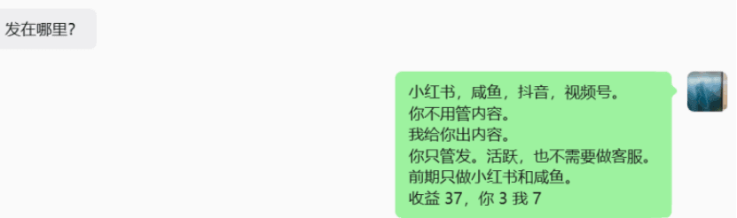

一些朋友。能做事

一些朋友合作

比如 jk，扣桑，学术志，等。没有业务冲突的互补互惠。

在这里我最核心的出装

相信的时候不带身体，我是傻逼，你是牛逼

执行的时候不带脑子，干就完了。

选择的时候对着市场，赚钱就是赚钱，不赚钱就是不赚钱。

分润的时候对着信仰，敬神如神在，无愧天地人。

## 相关页面

- [[sources/lin-crypto-15-human-nature-monetization-models]]
- [[sources/pengpai-wanghou-psychological-accounts-to-b-monetization]]
- [[concepts/boss-business-model]]
- [[concepts/selfmedia-compound-model]]
