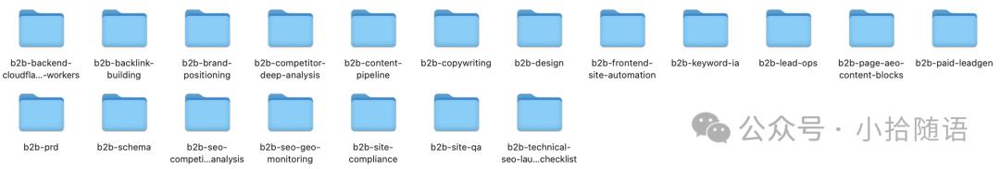
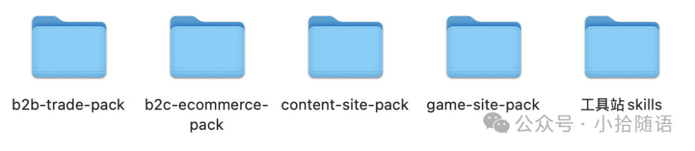
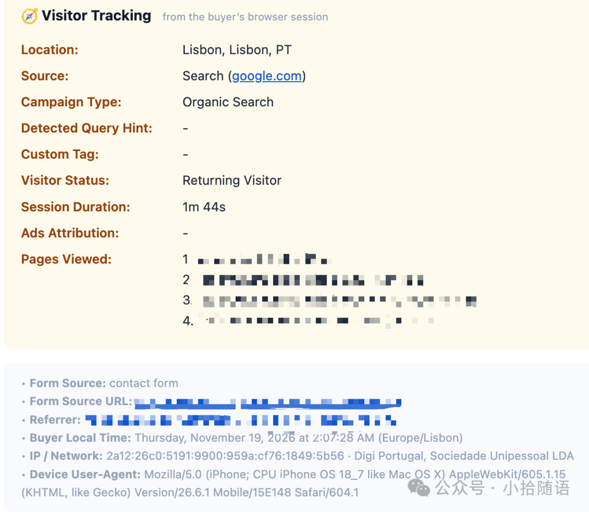
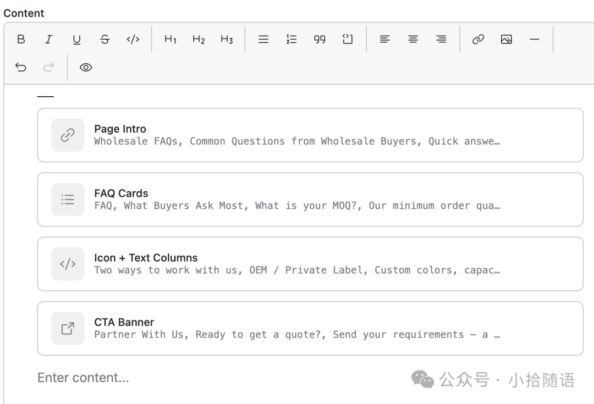
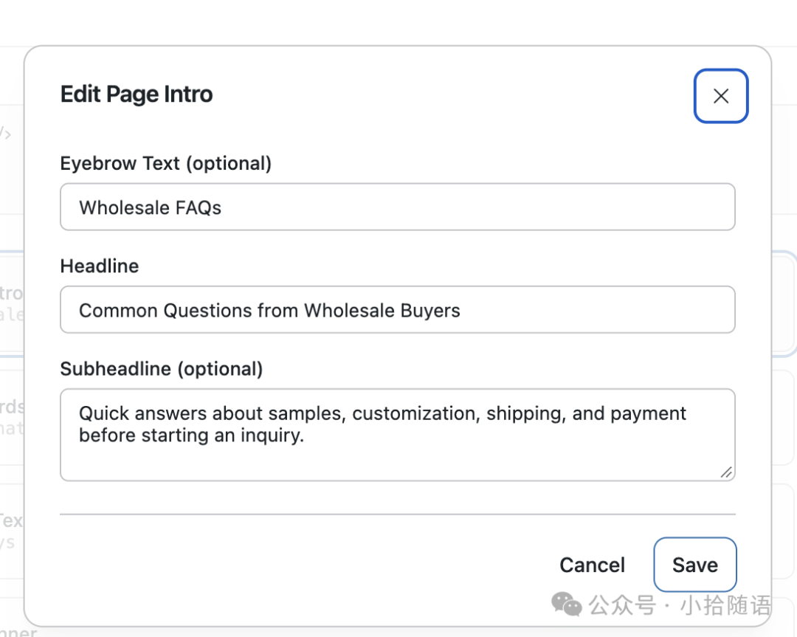
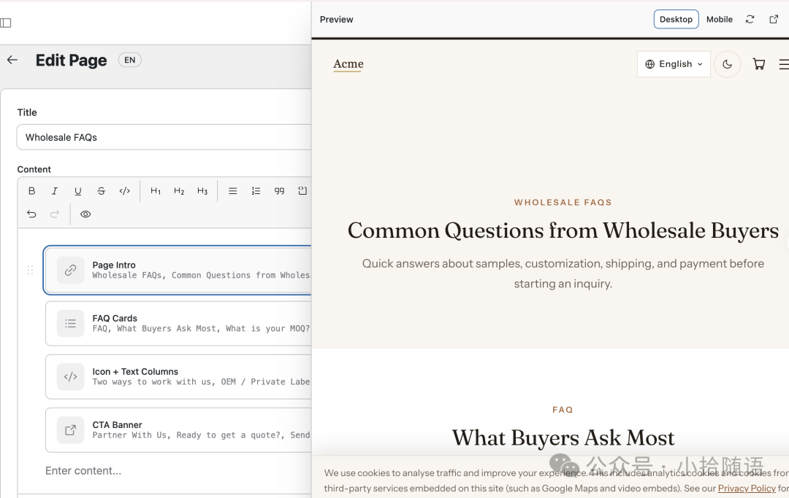
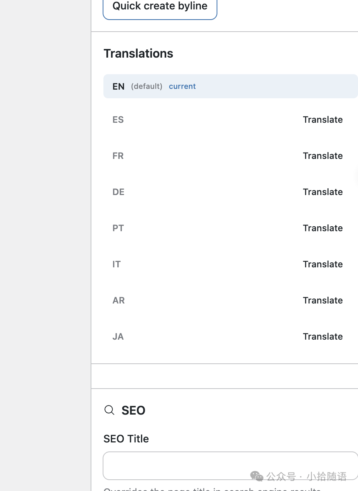

# 不用 WordPress 也不买服务器，我做的三个 B2B 站都拿到询盘了

最近做了三个 B2B 网站，两个外贸站，一个医旅站，都陆续收到了询盘。

医旅站是 10 月中旬初初上线的，后面断断续续修修补补，差不多到下旬才算真正完工。医旅这种业务更适合走社媒推广，后续资源对接还没找好，还没开始做社媒推广，邮箱里就躺了一封咨询邮件。

做这个站起因是一个朋友说想做医旅，说好他负责后续客户咨询对接。今天我把收到的咨询邮件转给他，他回了句不喜欢阿拉伯人，无语中。

事实上，这个客人是很容易成单的，邮件需求写得很详细：

如果哪位朋友有医旅资源，入境游资源可以对接，一起合作，之后我会把入境游也弄好一起社媒推广。

老实说，入境游，入境医旅最考虑资源的整合了。谁有后端的资源承接，其实就成功了一大半。

话扯回来，医旅站也好，外贸站也罢，只要是 B2B 业务，背后的打法基本相通。

## 工具别纠结，核心是方法

现在很多人在群里总是问用什么 AI 编程工具，是 Codex、Claude Code，还是其他编程工具？

这些全都是工具。真正的方法掌握了，用哪个写出来的代码都差不多，完全不用在工具上纠结。

这三个站能拿到询盘，主要是共用了一套我自己打磨的 B2B 技能包。

前后打包了差不多 20 个技能，每次做个网站就把已经验证过的方法写成技能，后来用 Fable 5.2 和 Opus 5.5 extra 写的，费了我好多额度。这套技能包如果拿去卖，卖个 1500 块我感觉不过分吧。

一共打磨了 4 个不同类型站的技能包，每个技能包里都有好多个技能，做什么站就拿出来调用，很方便。

有个朋友开了中国制造网会员，一年交 5 万多块。他的产品很小众，每天差不多也就 4 到 5 封询盘。之前我跟他开玩笑说：网站一天要能跑 10 封询盘，你那 5 万块平台会员费不要再续了。

## 技术选型：HTML+CSS 够用，没必要搭后台

关于建站的技术选型，如果是自己做站自己用、不给别人外包建站，我更倾向于直接用纯 HTML + CSS，简单干净。

我自己手头的两个外贸站，一个是用纯 HTML + CSS 写的，另一个用的是 Astro。用 Astro 我完全没写后台。很多人总觉得网站必须得有个像 WordPress 那样的管理后台，我觉得完全没必要，搭后台费劲不说，开发完了平时根本不怎么打开看。

询盘怎么处理？直接把询盘提交存到数据库，再给询盘邮件下弄个 visitor tracking（访问轨迹追踪代码），客户从哪个国家来、在网站上看过了哪些页面，一清二楚。

网站部署全部扔在 Cloudflare 上，除了一年几十块钱的域名费，服务器成本是零。

如果是给别人建站，情况就不一样了。别人经常会提一堆要求，比如要像 WordPress 一样能自己发博客、加页面。这种场景下可以用 Emdash，不过原版功能不够用，我自己做了二改。但 Emdash 整体非常重，我平时自己项目是坚决不用的，只有在别人明确需要自己要改内容、建页面时才推荐他们用 emdash

还弄了个预览功能，即后台做好后就可以打开看前台是什么样式的

后台还配了翻译

还弄了 visitor tracking, 这个二改 emdash 还可以用来建 b2c 独立站，配了相关的 b2c 功能。

## 500 块的建站为什么拿不到询盘？

市面上那些收 500、1000 块建外贸站的，做出来的充其量是个纯展示的空壳。外观看着还行，但代码里根本没有 SEO、AEO 和 GEO 的结构，搜索引擎和 AI 不会抓取，自然很难拿到询盘。

而且最主要的一个问题是，根本就没有调研目标客户关心的问题。

做好一个网站，如果产品是自己不熟悉的，肯定要跟业务员问相关的问题，拿到相关的信息才好做，不然自己在一边摸索，是理解不了目标客户群体，应用场景的，有些真的需要跟业务员沟通才知道这个产品的目标客户还有这群人用在这个场景中。

我自己做一个能拿询盘的 B2B 站，从前期准备到完全上线，至少要花两周。

大部分精力根本不是在敲代码上。前期要做的事情很繁琐：跟业务反复沟通产品细节、定目标采购商画像、挨个研究竞品网站、分析搜索意图、规划整站关键词。

在正式写代码前，我习惯先把网站结构和每个页面的排版布局做好，也就是先搓一套 HTML 原型。原型定清楚了再动手，后面开发就会顺畅很多，不会反复返工。

还有一点，是我在技能包里规定的，网站第一版就先做英语的，其他语言暂不做，等后续数据出来让数据替我说话，让它决定要做哪些语言版本。

不过我自己做，图方便，常常把几个语言都一起开发了。

但说实话，我现在很讨厌做多语言站，很费劲。Ai 总是会出现翻译小问题，要审查好几遍才行。

有些语法问题不是小语种专业的根本审查不出来，这些语法问题就放过吧，不要追求太完美了。

## 站在买家角度写内容与抠细节

要拿到询盘，关键就一条：完全站在目标客户的角度去写内容。不管网站文案还是博客文章，不要站在工厂自夸的角度写，要写买家采购时真正关心的问题。

再加 2 条：

1. 放大自己的优势。把���己的优势全部写上去。这一点我觉得跟做自媒体很像，都是拿自己擅长的来做自媒体的。
2. 要盯紧这个网站的终始目标，目的是为了什么。Ai 有时候写的文案常常会偏离网站目标。

这一点我觉得跟做自媒体很像，都是拿自己擅长的来做自媒体的。

2，要盯紧这个网站的终始目标，目的是为了什么。Ai 有时候写的文案常常会偏离网站目标。

上线之后也不是撒手不管，隔段时间得去翻 GSC（Google Search Console）和 GA4 的数据，看买家搜索哪些词进来的、在哪跳出的，根据真实数据来补内容。

做的时候细节很杂：SEO 和 AEO 的结构化数据（Schema）要补齐，内链结构要理顺。内容如果做扎实了，就算不做外链也能拿到询盘。我手头这几个站到现在都还没做任何外链，纯粹是因为我太懒散，外链这种繁琐事一般都拖到最后才碰。

还有一个经常被忽略的细节是图片的 alt 属性。网站上的每张图片，alt 都要写清楚。图片内容信息要全。

现在的 AI 搜索引擎在引用答案时，会直接抓取网页里的图片和视频。网站里可以放些视频，但不要把大视频文件都塞进来，太占存储容量。剩下的视频可以传到外部视频平台，在页面里嵌链接就可以。

你在建外贸站或者做海外获客时，目前卡在哪一步了？可以在评论区聊聊。

## 相关页面

- [[patterns/overseas-website-conversion-loop]]
- [[concepts/overseas-tool-stack]]
- [[patterns/guangzhou-industrial-ecommerce]]
