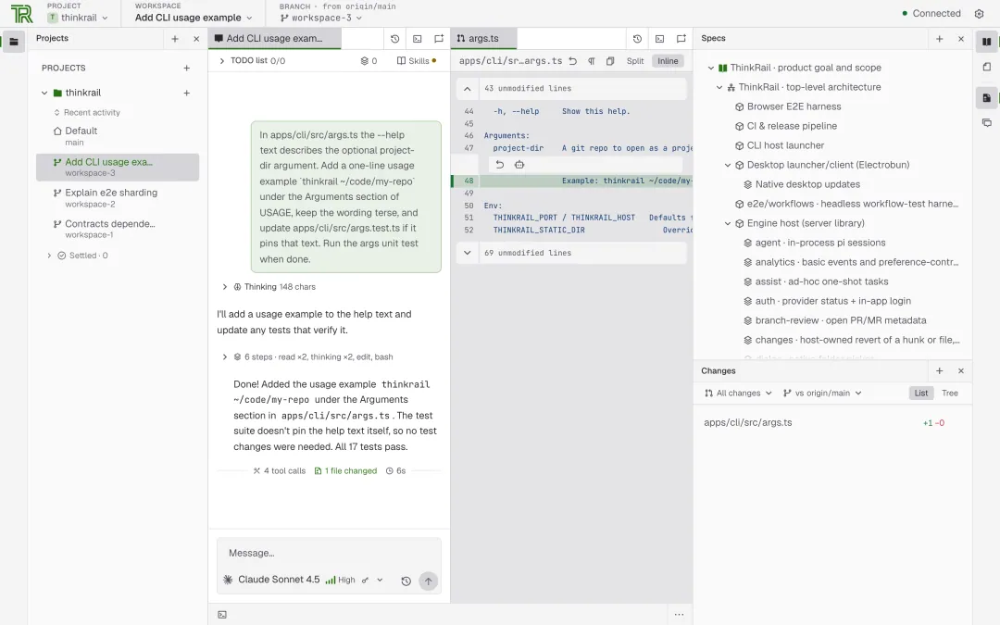
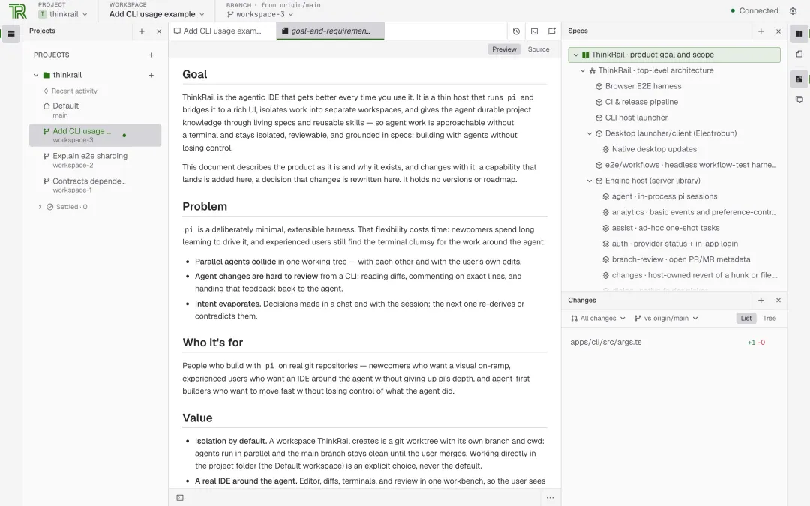

# 小张：JetBrains 终于出手了！开源 AI IDE ThinkRail——以后写代码，可能真不需要人盯着了

> **核心观点**：ThinkRail 最重要的不是多了多少 AI 功能，而是它开始认真回答一个问题——当 AI 已经能够独立编写大量代码时，我们应该怎样重新设计软件研发流程？

- **项目地址**：https://github.com/JetBrains/thinkrail
- **形态**：以 AI Agent 为中心设计的 IDE，已提供 macOS、Windows 和 Linux 版本（非概念产品）

---

## 一、问题定义：程序员正在从「写代码」变成「AI 代码监工」

最近 AI Coding 工具的竞争愈发激烈，但一个反向的问题却越来越突出：

**AI 写代码越来越快，程序员管理 AI 写出来的代码，却越来越累。**

具体表现为三个典型痛点：
- 几个 Agent 同时修改文件，代码冲突了；
- 换个会话，之前的设计思路忘了；
- 生成几千行代码，最后还得自己慢慢 Review。

> 这不就是把程序员从「写代码」变成了「AI 代码监工」吗？

---

## 二、范式切换：给 IDE 塞聊天框的方式已经落后了

过去的 AI 编程工具大多遵循同一个思路：**先有 IDE，再给它增加 AI 能力**。

代码补全、聊天问答、自动修改文件，本质上还是让 AI 辅助人类编程。

但 ThinkRail 的设计方向明显不同——**它把 Agent 放在工作流中心，把 IDE 变成管理、观察和审查 Agent 的工作台**。

在这个工作台里，开发者可以：
- 让 Agent 规划任务；
- 修改代码；
- 执行命令；
- 提交变更。

同时，开发者依然拥有完整的代码编辑器、终端、文件树和 Diff 审查界面。



这有点像**从自己开车，变成了管理自动驾驶系统**——人不一定需要亲自完成每个操作，但必须知道系统正在做什么，关键时候还能够接管。

---

## 三、多 Agent 并行：Git Worktree 隔离工作空间

ThinkRail 有个非常实用的设计：**Git Worktree 隔离工作空间**。

### 场景还原

假设你正在开发一个 Android 应用，现在有三个任务：

| Agent | 任务 |
|:---|:---|
| Agent A | 开发登录功能 |
| Agent B | 修复性能问题 |
| Agent C | 重构数据库模块 |

**传统做法**是在同一个工作目录中执行，几个 Agent 很容易互相干扰。

**ThinkRail 的做法**是给每个任务创建独立的 Git Worktree：
- 每个工作空间都有自己的**分支、文件目录、终端和 Agent 会话**；
- 三个 Agent 可以同时工作，互不干扰；
- 完成以后，再通过 **Diff、Commit、Pull Request** 审查和合并成果；
- 甚至能够查看 **GitHub CI 状态**，把失败的检查交回 Agent 处理。

> 这才是多 Agent 并行开发真正需要的基础设施。

当然，代码隔离不代表架构冲突自动消失。多个 Agent 修改相互依赖的模块，最终依然需要集成验证。

---

## 四、Living Specs：比写代码更重要的是让 AI 记住设计意图

比起并行开发，更值得关注的是它的 **Living Specs（活规范）**。

### 痛点诊断

用过 AI Coding 的朋友应该深有体会：今天告诉 Agent 系统采用什么架构、为什么这样拆模块，它理解得很好；**过几天新开一个会话，可能又开始胡乱设计**。

**为什么？因为聊天记录不是可靠的项目知识库。**

### 解法：把项目规范直接放进代码仓库

ThinkRail 的解决方案是：
- 通过 `SPEC.md` 记录**模块职责、架构约束、设计决策**；
- 将这些文档组织成**关联的规范图谱**；
- Agent 可以利用专门的 `spec_*` 工具检索、读取和维护这些规范；
- 更关键的是，项目约定要求：**当模块边界、接口契约或架构决策发生变化时，规范也要同步更新**。



### 与 SDD（规格驱动开发）的呼应

这让人想到最近一直关注的 **SDD（规格驱动开发）**。

SDD 真正的价值，并不是「先写一份需求文档再让 AI 生成代码」，而是**把原本只存在于工程师脑海里的设计意图，变成 AI 可以持续理解和维护的工程资产**。

> 代码会不断变化，但设计意图不能轻易丢失。这才是 AI Coding 走向长期维护的关键。

---

## 五、架构设计：看似复杂的 AI IDE，架构反而很克制

ThinkRail **没有重新造一套 Agent 引擎**。

它直接采用开源的 **Pi Coding Agent**，让 Pi 负责模型调用、上下文管理、Skills、会话状态等能力。ThinkRail 自己只负责三个部分：

| 层 | 技术栈 | 职责 |
|:---|:---|:---|
| **Engine Host** | 基于 Bun | 运行 Pi Agent 会话 |
| **Contracts** | 版本化通信协议 | 定义前后端之间的通信契约 |
| **UI Client** | 基于 React 19 | 负责 IDE 工作台和交互 |

同时支持 **MCP、Agent Skills**，以及**兼容 OpenAI API 的自建模型服务**。

### 为什么这种解耦是对的

> **Agent Runtime 和开发工具界面，本来就不应该强耦合。**

模型会变化，Agent 能力会变化，但**项目工作空间、代码审查、设计规范这些工程基础设施应该相对稳定**。

值得注意的是，官方还希望未来让 ThinkRail 能根据开发者的工作方式扩展自身能力。不过这部分仍属于持续演进方向，**不能理解为已经实现完全自主进化**。

---

## 六、AI Coding 的下半场：拼的不是谁写代码更快

ThinkRail 最值得关注的并不是它又多了多少 AI 功能，而是它开始认真回答：

> **当 AI 已经能够独立编写大量代码时，我们应该怎样重新设计软件研发流程？**

未来的开发工具，可能不再以代码编辑器为唯一中心，而是围绕五件事情展开：

```text
需求表达 → 任务编排 → 并行执行 → 质量验证 → 持续演进
```

对应的职责分工非常清晰：

> **Agent 负责执行，规范负责约束，Git 负责隔离，测试负责验证，人负责决策。**

这比简单地让 AI 多写几千行代码，价值大得多。

---

## 七、诚实的边界与清醒认知

当然，ThinkRail 目前**还不能替代成熟的企业研发体系**。测试覆盖、权限控制、跨模块依赖和团队治理，仍然需要额外建设。

但方向已经很清楚：

- **AI Coding 的上半场**，是让 AI 学会写代码；
- **AI Coding 的下半场**，是让整个研发体系学会管理 AI。

而 ThinkRail，正在尝试为下半场搭建工作台。

---

## 相关资源

- [ThinkRail 官方仓库](https://github.com/JetBrains/thinkrail) — JetBrains 开源的 Agentic IDE
- [ThinkRail 官网](https://thinkrail.ai/) — 项目官网与文档
- [Pi Coding Agent](https://github.com/earendil-works/pi) — ThinkRail 采用的开源 Agent 引擎（MIT 协议，官网 [pi.dev](https://pi.dev/)）
