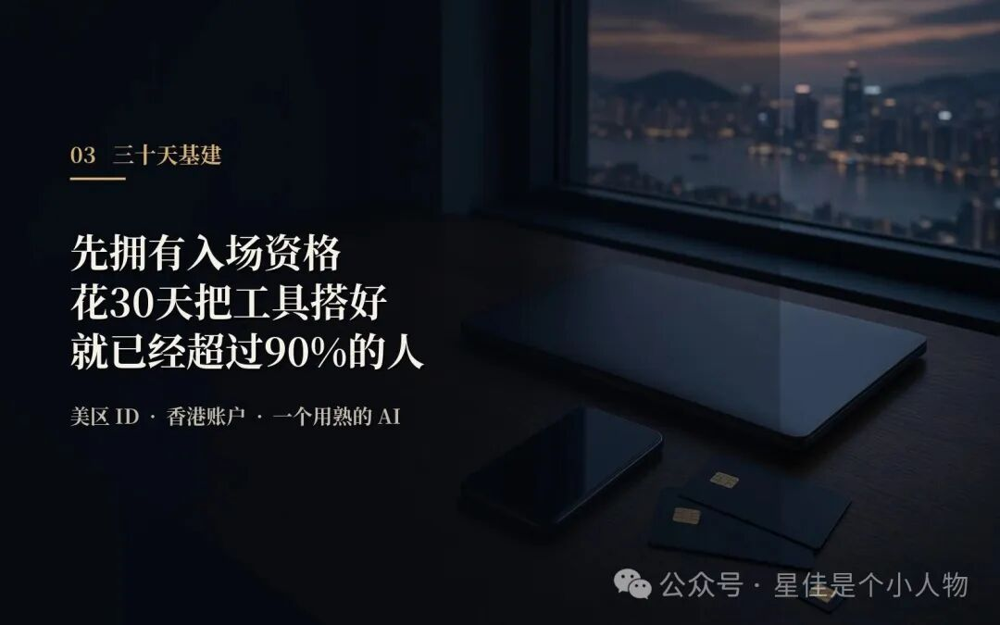
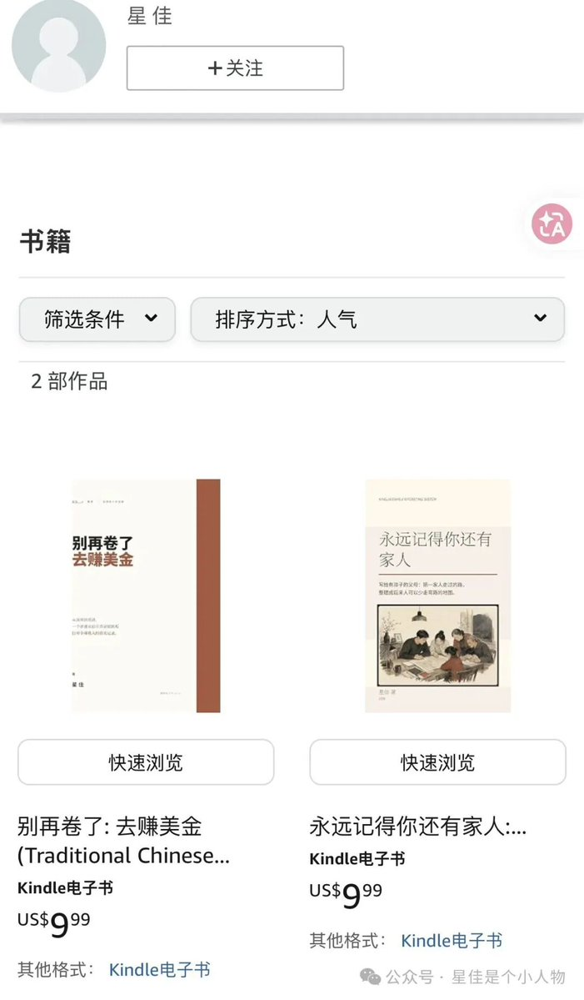

# 在香港的宁夏三娃老父亲星佳（@xingjia520）：存款不到 100 万的年轻人，请直接照做这张生存清单

> 面向普通年轻职场人与创业者的极现实避险与资产配置清单：在宏观降息与资产收益下行周期，如何克制消费冲动、建立流动性应急储备、做好基础保险兜底与债务隔离；重点阐明「保住本金与现金流 > 激进盲目创业投资」的底线防御哲学，为普通人提供可落地的财务生存指南。

<!-- more -->

前几天刷到一张 X 状态，标题很扎眼：“存款不到 100 万请直接照做”。

我盯着那 29 条清单一条一条往下看，越看越觉得熟悉，这不就是我这几年折腾香港公司、开海外账户、跑通 AI 出海的路线图吗？

从注册美区 ID 到开盈透证券，从学 Claude 到做自己的小产品，每一条我几乎都踩过坑、花过冤枉钱、也拿到了结果。

但光有清单不够。

清单告诉你“做什么”，没告诉你“为什么做”和“按什么顺序做”。

今天我把这张清单拆开，配上我自己踩过的坑，给你一个能直接上手的执行策略。

## 一、先搞清楚：你到底在为什么焦虑

我以前总觉得，焦虑是因为钱不够多。

直到我见过月薪五万还在焦虑的人，也见过收入不高但睡得特别香的人。

后来才明白，焦虑的根源不是钱少，而是收入来源单一、抗风险能力为零、对未来没有掌控感。

你每个月的工资到账，扣完房贷车贷生活费，剩下的全靠公司明年还愿不愿意给你发。

公司裁员、行业下行、身体健康出问题，任何一个变量出问题，整个系统就崩了。

这不是你不够努力，这是结构上的脆弱。

真正的安全感，不是银行卡里的数字，而是你有多少条腿在走路。

所以这张清单的底层逻辑，不是教你怎么暴富，而是教你怎么从“单腿站立”变成“多腿走路”，从单一工资收入，变成工资+投资+个人品牌+产品收入的多元结构。

## 二、第一阶段：工具基建，30 天搞定

很多人一上来就想做个人 IP、想做产品、想赚美元。

别着急，先把基础设施搭好。

就像盖房子，你得先通水通电通路，才能开始砌砖。

这些工具看起来都是小事，但每一件都在拓宽你人生的边界，你能接触到的信息、你能调动的资源、你能参与的游戏，都不一样了。

必做清单（按优先级排）：

1. 设备：苹果手机非国行版本 + MacBook。

不是崇洋媚外，是整个跨境生态对苹果最友好，美区 ID、海外支付、AI 工具，苹果生态是最顺的一条路。

2. 账号：注册美区 ID 和香港 ID，下载 X（原 Twitter）。

不是让你刷八卦，是让你直接看一手信息，AI 圈的最新动态、海外创业者的讨论、英文世界的真实讨论，都在 X 上。

3. 通讯：一张香港手机卡和美国 esim 手机号。

这是你进入全球金融系统的钥匙，很多海外银行、券商的验证，内地手机号根本收不到。

4. 银行：香港众安银行卡

https://l.za.group/qV99a 或

starryblu 新加坡借记卡

https://sg.starryblu.com/x/NSFHxKQj

+ 汇丰或者渣打银行卡「50 万达标全球理财」+ 美国 Amex 信用卡。

有了香港账户，你才能自由兑换港币和美元，才能买全球的股票和基金。

5. 券商：盈透或者致富，嘉信等证券账户。

这是个人投资者能开到的、全球投资品类最全的券商账户，美股、港股、ETF、期权，一个账户全搞定。

6. AI 工具：Claude、ChatGPT、Gemini、DeepSeek，至少深度用熟一个。

不是让你聊天玩，是让它帮你写代码、做表格、写文案、查资料，把它当成你的 24 小时助理。

这一阶段的核心是：先拥有入场资格。

很多人一辈子都在岸上看，从来没下过水。你花 30 天把这些搞定，就已经超过 90%的人了。

## 三、第二阶段：能力建设，90 天见效

工具有了，接下来练本事。

这一阶段的目标只有一个：让你一个人就能干以前一个团队的活。

AI 时代最大的红利，就是个人能力被指数级放大，一个会用工具的人，顶得上以前十个人。

具体做什么：

1. AI 深度使用：学会用 AI 写作、做表格、做 PPT、写代码和做视频。

不是“知道有这个功能”，是真的能用它产出工作成果。

拿 Codex 写一个简单的工具出来，哪怕只是一个自动处理 Excel 的小脚本，比如像我写一本书去 kindle 卖。

或者在线免费阅读的小说：

https://ai.xingjia.xyz/company

2. 编程入门：学会用 GitHub，能看懂优秀项目。不用你成为算法工程师，但你得能看懂别人在做什么、能抄作业、能改一改自己用。

3. 英语捡起来：每天花 1 小时，坚持用英文搜索和阅读。不用背单词，就直接搜你感兴趣的东西，AI 工具怎么用、海外怎么创业、美股怎么投。用着用着就会了。

4. 知识库搭建：用 Notion 或 Obsidian，最容易的就是付费的得到笔记 App 建一个自己的知识库。你看过的文章、踩过的坑、学到的经验，都分门别类存进去。这是你以后个人品牌和产品的原材料仓库。

5. 信息源升级：每周读一份行业报告，把刷短视频的时间换成 YouTube 上的干货视频。一手信息和二手信息的差距，比你想象的大得多。

这一阶段的核心是：用工具放大你的产出能力。

以前你一天只能干一件事，现在能干十件。

效率提升 10 倍，你的收入天花板自然就抬高了。

## 四、第三阶段：

## 资产与现金流，长期主义

能力有了，接下来是最关键的一步，把能力变成资产，把劳动收入变成现金流。

这是大多数人一辈子都没跨过去的坎。

他们一直用时间换钱，从来没想过怎么让钱替自己干活、怎么让产品替自己干活。

具体路径：

1. 指数基金定投：持续买入标普 500 和纳斯达克 100。这是普通人能拿到的、风险收益比最好的投资品，没有之一。不用选股、不用择时，每个月工资到账先买一笔，买了就忘掉。

2. 多元货币配置：建立美元资产意识，不要只了解人民币资产。港币、美元、人民币，至少持有三种货币的资产，对冲单一货币的风险。

3. 个人 IP 起步：运营一个 X 账号和一个国内自媒体账号，每天输出一篇内容，不管有没有人看，坚持一年。

这不是为了当网红，是为了建立你的个人供给，让别人知道你是谁、你能做什么、愿意为你付钱。

4. 做一个自己的小产品：小网站、小工具、小课程都行。产品是睡后收入的载体——你做一次，它能卖无数次。不用追求完美，先做出来再说。

比如星佳的付费产品

https://books.xingjia.xyz

5. 攒第一桶金：每个月存下收入的 30%，学会记账，知道每一分钱花去了哪里。第一桶金不是用来花的，是用来生钱的本金。

这一阶段的核心是：从“出卖时间”转向“拥有资产”。

资产的特点是，你睡觉的时候它还在帮你赚钱。当你的资产性收入超过工资收入的那一天，你就真正自由了。

## 五、最后说几句掏心窝子的

我把这张清单和网友总结的“八荣八耻”放在一起看，发现说的其实是同一件事：

以指数纪律为荣，以奢侈品撑场面为耻；

以跨境通行能力为荣，以一代人积蓄换学区信号为耻；

以个人供给可定价为荣，以职位代替能力为耻；

以多元货币收入为荣，以单一工资裸奔为耻；

以掌握源头信息为荣，以二手观点代替求证为耻；

以深度输入代替空转刷屏为荣，以拒绝新工具重复低效为耻；

以工具放大产出为荣，以负债满足虚荣为耻；

以现金流、睡眠和可支配时间为荣，以透支身体换钱为耻。

所有扰乱你情绪、消耗你、拖慢你的人和环境，都要斩立决。每天看一遍，绝对不能扰乱圣心。

这不是鸡汤，这是一个普通人在这个时代能拿到的最实在的生存策略。

你不需要全部做到，从第一阶段的 30 天基建开始就行。

买个美区 ID、开个香港账户、装个 Claude 或者 ChatGPT

这三件事，做完你会发现，世界好像比以前大了一圈。

如果你也在走这条路，或者准备开始走，评论区留个脚印，路上的人多了，就不孤单了。

## 相关页面

- [[sources/svwang-wealthy-entrepreneurs-path-dependency-and-waiting]]
- [[sources/xiaoniaoziming-lie-down-income-system-20-to-now]]
- [[concepts/selfmedia-compound-model]]
- [[concepts/b2c-conversion]]
