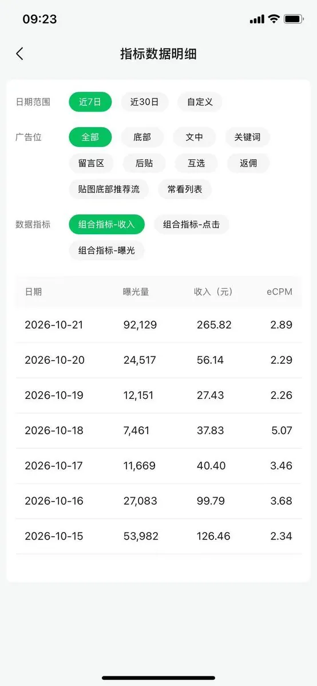

# 熊叔的茅草屋（@xionghuanwei）：一天 265 收益 9 万曝光——公众号爆款赛道选择与避开真人验证 6 大硬规则

> 实战学员按照推荐方法跑通公众号曝光 9 万+、单日流量主收益 265 元的操盘干货：少写国内题材敏感话题、长文章与贴图笔记双轮驱动、单日更新控制在 5 篇以内、正文字数 1000-1200 字黄金区间、减少使用纯 AI 假图防触发微信真人验证，以及标题少用三段式与问号的算法风控规则。

<!-- more -->

一天 265 的收益，公众号文章曝光是 9 万多。

首先声明一下这个号的数据不是我的，是网友按照我推荐的赛道和方法写出来。

赛道和经验我在同步一下：

01. 尽量不要写国内题材话题
02. 文章和贴图笔记可以同时写
03. 每天写的内容不超过 5 篇
04. 文章字数控住在 1000-1200 字左右
05. 贴图和图片尽量不要用 AI 图片，要不然容易出现真人验证。
06. 标题少用三段和问号

## 相关页面

- [[sources/stanley-wechat-tietu-6000-words-monetization-playbook]]
- [[sources/wadezone-hollywood-three-act-storytelling-copywriting]]
- [[concepts/wechat-image-post-account]]
- [[concepts/selfmedia-compound-model]]
