# 西堂 AI：WorkBuddy + LibTV 做多人音乐短片——文、资、视、剪四步跑通

> 参考《过来人》的同台接唱形式，原创一首《走慢一点》，让诸葛亮、辛弃疾、李清照同台说唱。按「文、资、视、剪」四步推进：词要先写出人物处境与今天的共鸣，不是人物简介；Suno 的 Lyrics 只放歌词和 [Verse]/[Chorus] 标签，声线编曲放 Styles，生成后要整段听完防止后半段换声；资产先用「爆款拉片复刻 Skill」拆镜头，再定人物、舞台、三人同台参考图（先统一构图，否则近景各自好看拼起来割裂）；视频用 Seedance 2.5 样片模式先出 480P 检查口型和一致性再放大 1080P，近景太多时补观众前景和灯海；剪辑返工最多的是嘴型与音乐衔接，换整首音乐后句长全变，优先保住满意片段而不是重生成。工具把门槛降到更低之后，难的是那句「一边难过，一边买菜」。

<!-- more -->

最近刷到喆 FILM 的《过来人》，我想试着做一支自己的古人同台说唱。

古人站在麦克风前，一人接一句，没有端着架子背古诗，唱的全是今天我们打工人的心事。


先看喆 FILM 的原作《过来人》。

[video](https://video.twimg.com/amplify_video/2115391804216647680/vid/avc1/1280x720/_FtA3aakrxTkSJlV.mp4?tag=29)

看完这支片子，很多朋友都在问同款怎么复刻。

这次参考它的同台接唱形式，自己写词做了一首《走慢一点》，找来诸葛亮、辛弃疾和李清照同台，下面是我们这次做出来的版本。

[video](https://video.twimg.com/amplify_video/2115392020449824768/vid/avc1/1280x720/GRQaPSy0OAN9pyS-.mp4?tag=29)

以前做这种多人音乐短片，要在好几个网站之间来回导素材，非常折腾。

为了更方便地制作，这次用上了 WorkBuddy 接入 LibTV。

前面聊的歌词、找的参考、定下的人物，可以沿着同一段对话继续做成图和视频。音乐我单独放在 Suno 做，其他部分交给 WorkBuddy 连接 LibTV 往下推进。

动手前先把连接器接好。

打开 WorkBuddy，点输入框旁的“+”，在连接器里找到 LibTV，连接并完成账号授权。回到任务里确认启用，就可以给它素材、说需求了。

[video](https://video.twimg.com/amplify_video/2115392194744025089/vid/avc1/960x640/sCj6tmymkjaBTGyh.mp4?tag=29)

不用一上来把所有按钮都理解一遍。我们就围绕这一个案例，按“文、资、视、剪”往下做，完整歌词和 Suno 输入文本放在文末。

## 文｜先唱进心里

不会写歌词的 rap 不是好 rap，这类视频，词得先写好。

动手前，可以把原作音频交给 AI，分析人声、节奏、编配和主副歌关系，再和 WorkBuddy、Codex 一起磨自己的歌词。

这次我们选了叙事说唱的方向，低沉男声、略粗粝的男声和温暖女声轮流接唱，伴奏保持简洁。

写古人很容易写成人物简介。我更想写出他们当年的难处里，和今天我们能产生共鸣的那一部分。

诸葛亮那段写有时候也想卸下重担的疲惫，到了辛弃疾，就写那种准备很久、还在等机会却一筹莫展的心情。

> 灯下的剑，我擦了又擦
> 等来的话，还是“再等等吧”

李清照这段，我反而想写得日常一点。难过归难过，饭还得吃，日子还得过。

> 我也会一边难过，一边买菜
> 回家把碗筷，一个个摆开

这些都是借人物处境写的原创歌词。词写得顺眼了，再去押韵，比硬塞几个古风词舒服。

歌曲这次选 Suno，是我们对演唱效果的取舍。LibTV 也有音乐模型，大家可以按自己的习惯尝试。

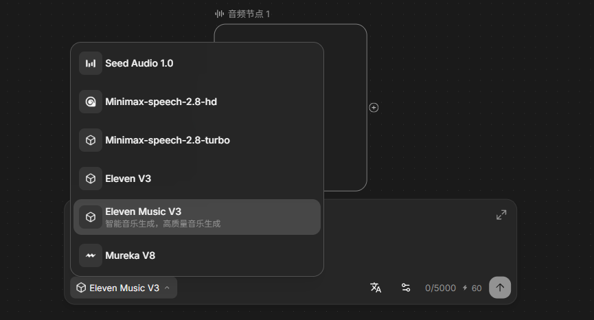

这里有个很容易踩的坑。我不小心把“诸葛亮主歌”写进歌词框，AI 可能连这几个字也唱出来。

所以 Lyrics 只放唱的歌词和 [Verse]、[Chorus] 这类分段标签，声线和编曲要求放 Styles。

我们要两段男声、一段女声，再接共同副歌，这样我们就能精细地控制对应的男声和女声唱的部分，以及对应的音色。

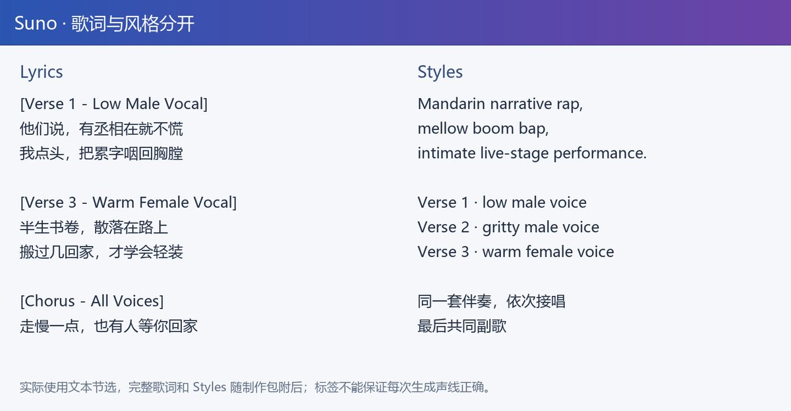

生成后别只听开头。这次就遇到李清照前半段是女声，后半段突然换成了男声。

我起初只换后四句，结果两版旋律接不上。最后干脆让她的整段主歌、连同第一句副歌，都用同一版女声唱完，再接合唱。完整歌词和 Suno 输入文本都放在文末，可以直接参考格式。

这版女声更合适，李清照的主歌和第一句副歌都从这里选取。

[video](https://video.twimg.com/amplify_video/2115393252337844224/vid/avc1/1280x826/9zjKJjgPjdcfbDmx.mp4?tag=29)

音乐定好，再切三个人的主歌和副歌。每段音频跟对应视频放在一起，后面改哪一句，就找哪一组。

## 资｜把舞台搭起来

接着让 WorkBuddy 调用 LibTV 的“爆款拉片复刻 Skill”。

参考视频、自己的歌词和歌曲都给它，先看它怎么拆镜头，再决定要生成什么。

参考《过来人》的同台接唱形式，用我们的《走慢一点》做三人说唱。

先调用 LibTV 的爆款拉片复刻 Skill，拆出主唱、同台和观众镜头，再按我们的歌曲列出角色、舞台、音频素材和分镜，给我检查后再生成。

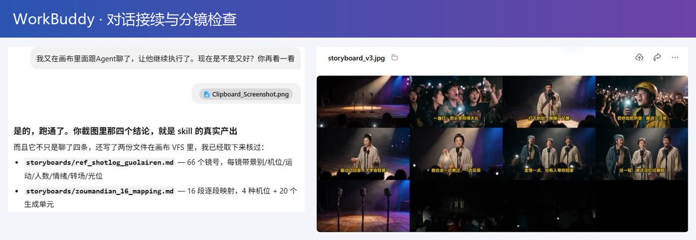

这一步我也会打开原作者的画布对着看，很多创作者用 LibTV 做出爆款视频，我们也能从中看到很多作者创作的思路。

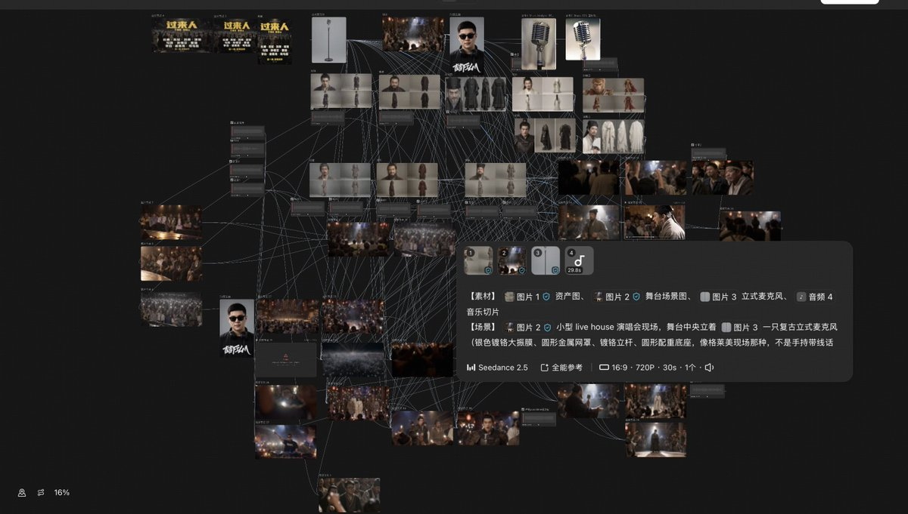

在我们这个案例里，谁在唱，其他人在做什么，什么时候切观众，副歌怎么回到同台。

这几点看明白，比照抄一大串提示词有用。

中途任务停住，就回画布看看是不是在等确认；我们这次也是继续沟通后才往下跑的，LibTV 画布里面的 Agent 最好要设置成为自动生成模式。

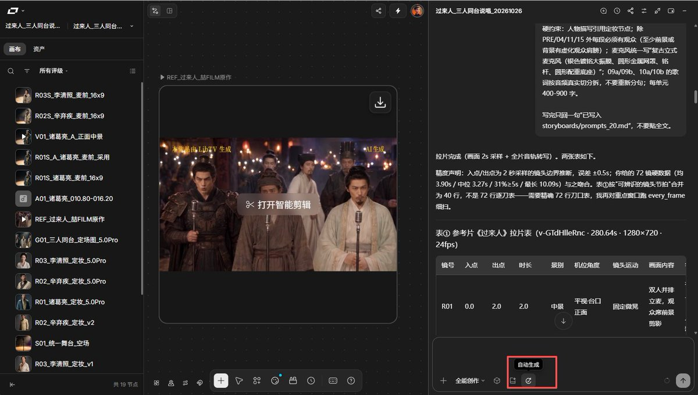

“资”就是片子要用的资产，人物、背景、道具都算。

为了更加还原，三位古人我先找经典画像，诸葛亮的纶巾长须、辛弃疾的面部和冠服、李清照的发髻衣领，都有了参考。

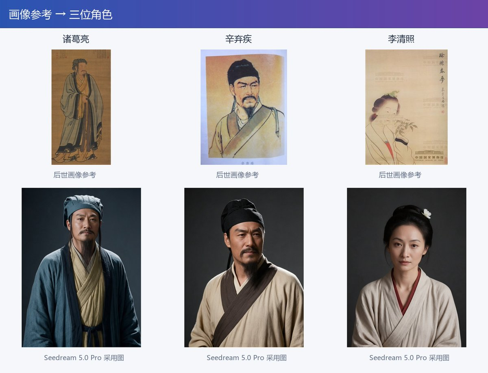

第一轮 Seedream 4.5 的角色我不满意，希望能够再年轻一点，就让它换 Seedream 5.0 Pro 接着改。

这次做古装人物，我更喜欢后者出来的感觉。在 LibTV 里面模型切换很方便，已经定下的人物要求和参考图在我们后续生成视频能够接着用。

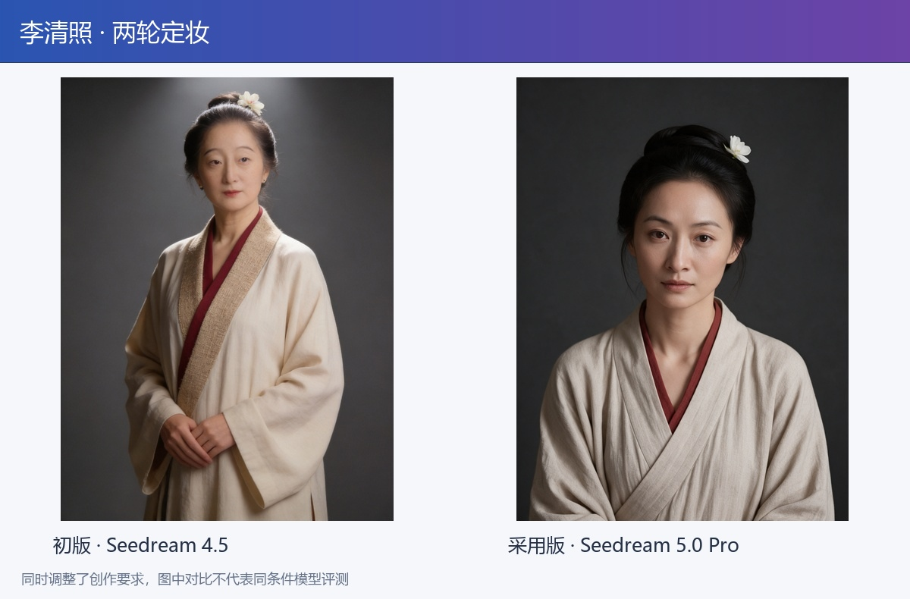

这里也不用把所有图都用一个模型生成，像这些角色，为了看起来更像国人，我偏向于用我们国产的 Seedream 模型，场景和后期图像编辑调整喜欢用 GPT Image 2.5 这类综合实力更加强大。

在我单人图选好后，又继续做了一张三人同台参考图。

从观众视角看，诸葛亮在左，李清照居中，辛弃疾在右，一人一支立麦。面光暖一点，后面留一点蓝紫，有唱歌的氛围感。

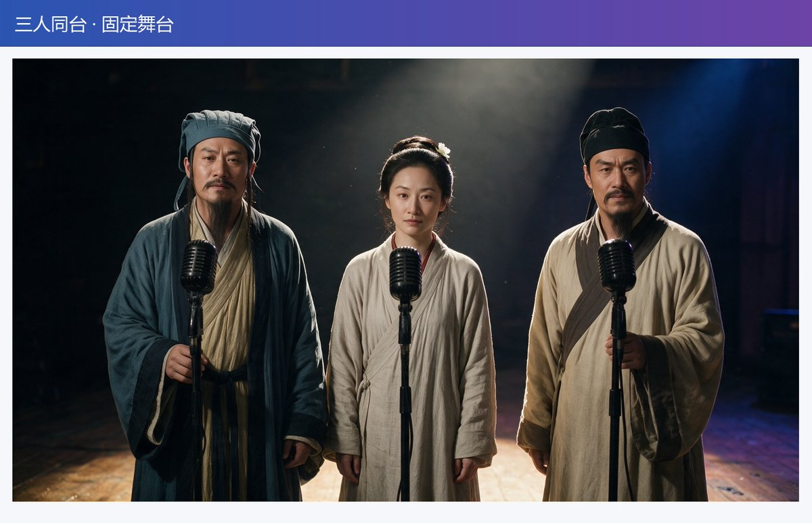

这张图要先确定下来。否则三个近景各自好看，拼起来却像去了三家演出现场，割裂感就会比较强。

## 视｜让角色开口

主体视频用 LibTV 里的 Seedance 2.5，让 WorkBuddy 把对应音频、人物图和舞台图一起上传进去。

这次在 WorkBuddy 里调 LibTV 生成视频，有个很聪明的地方：它会先自动跑一段测试小视频，帮你看看提示词效果、嘴型对没对上，以及角色和场景一不一致。

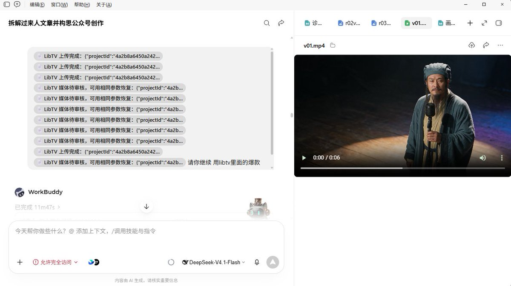

要写清楚谁唱、谁听，镜头拍谁，别让观众也跟着抢唱。

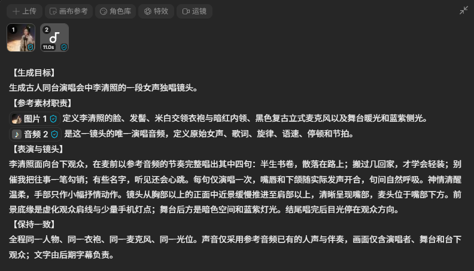

开始直接用 Seedance2.5 生成，我还是挺肉疼的，后来发现 LibTV 里面有 Seedance2.5 的样片模式，可以先低成本地生成 480P 的视频，肉眼检查发现如果没有问题就可以继续放大成 1080P。

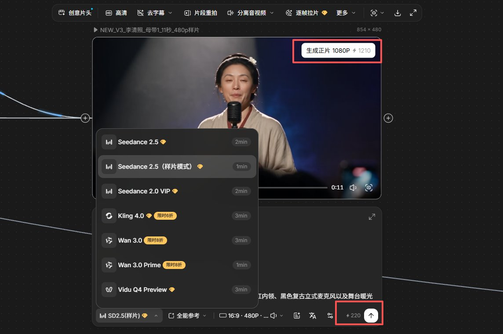

确认样片后，我用的是 LibTV 的“生成正片”。它会沿用样片任务参数生成 1080P 版本。出来以后再看一遍脸、动作和光线，确定能接进片子。

这里展示的完整成片导出为 720p，李清照约 47—58 秒的一段仍保留 480p 样片；局部生成过 1080p 镜头，不代表全片都已升级。

[video](https://video.twimg.com/amplify_video/2115397120324980736/vid/avc1/960x414/ZeXSQIU9_raiwcIc.mp4?tag=29)

除此之外，我们在生成视频的时候也要注意，第一轮近景太多，三个角色像在各唱各的。我后来补了观众前景和手机灯海，才有了同一场演出的感觉。

主歌让观众认清正在唱的人，唱到有情绪的句子，再给一个听众反应。

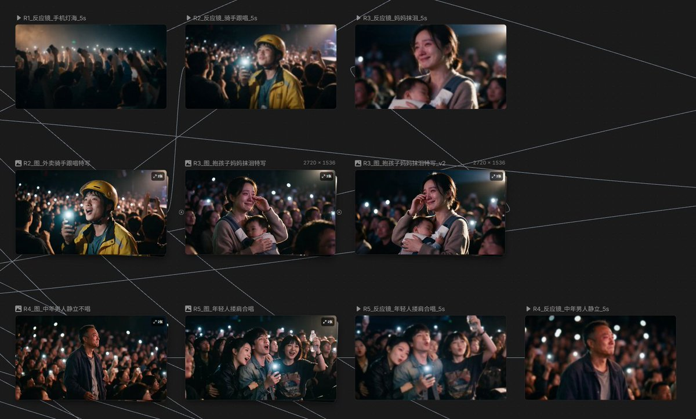

副歌回三人同框，把前面的唱歌收束在一起。运镜相对舒缓一点，人物关系和唱的句子都确定好，音画一致，这样观众也更容易沉浸在其中。

[video](https://video.twimg.com/amplify_video/2115397287581298688/vid/avc1/1280x720/MVSx-5Xz1wCEnnYc.mp4?tag=29)

这次为了快速跑通流程，我们在运镜上做得比较克制，主要以固定机位和平缓推拉为主。

大家自己做的时候，如果想让画面更有呼吸感，可以在提示词里多加一些镜头语言。

我也整理了一份常用的运镜词（见下图），大家生成时可以直接拿去用。

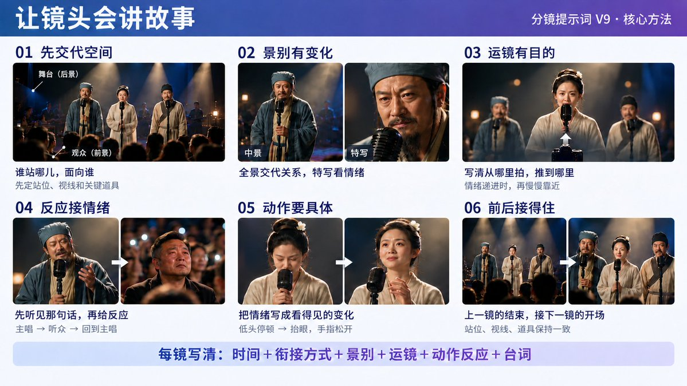

## 剪｜别只顾着拼接

这次返工最多的地方，是嘴型和音乐衔接。

原视频跟着无编号版歌曲生成，后来为了女声换过整首音乐，两版唱句的时间都不一样，画面自然对不上。

但是我又不想重新生成视频，重新生成视频有点麻烦，比较费积分。

所以最后还是先保住满意的部分。

我们看到视频哪里不对，也是直接可以跟 WorkBuddy 沟通。

也可以让支持音视频分析的模型帮忙定位问题，再结合实际播放结果调整。

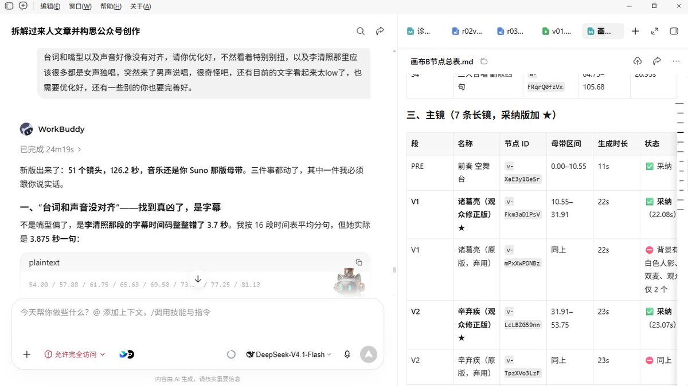

中间试过分离人声、拉节奏、修音，反而弄出了电音感。

还有个小细节，切去观众时，演唱镜头也要在下面继续走。切回来得接此刻正在唱的字，不能从刚才离开的地方继续。

这次排查剪辑问题时，我让 AI 结合声音波形和视频截图定位，再回到连续画面和声音里检查。

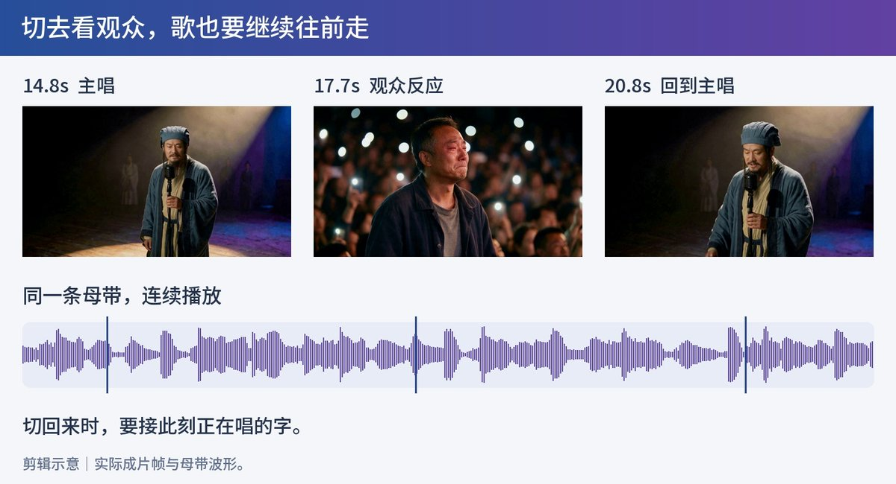

字幕留到最后加，白字、轻描边。

人物第一次出场，名字下面补两行经历，留久一点，观众才知道这些话为什么由他来唱。

[video](https://video.twimg.com/amplify_video/2115397923320328192/vid/avc1/960x700/wdEWg9asX9lml8US.mp4?tag=29)

## 最后聊两句

很多人问我，参考一支热门作品，最难的是什么？

跑完这套流程你会发现，最难的早就不在技术了。

WorkBuddy 加上 LibTV，已经把拉片、定资产和试口型的门槛降到了更低。以前要折腾几天的工程，现在沿着一个对话框就能摸出七八分模样。

但也正因如此，工具越聪明，背后的那个人就越重要。

你可以用拉片功能一秒拆解别人的镜头，却拆不出那句“一边难过，一边买菜”的烟火气。技术替我们铺平了从文字到画面的路，剩下的那一步，得靠你自己走。

毕竟，AI 负责让古人开口，而你，负责让他们言之有物。

## 完整歌词与 Suno 输入

歌词为借历史人物处境写的当代原创，不是历史人物原话。Lyrics 与 Styles 分别放入 Suno 对应输入框。

## Lyrics

```
[Verse 1 - Low Male Vocal]
他们说，有丞相在就不慌
我点头，把累字咽回胸膛
一盏灯，把长夜照得太长
桌上的饭，又凉了几趟
谁还没把“我不行”删了几行
最后只回一句“我来扛”
今夜把羽扇，轻轻放在身旁
这一次，谁能替我扛一扛

[Verse 2 - Gritty Male Vocal]
灯下的剑，我擦了又擦
等来的话，还是“再等等吧”
他们夸我的词，写得多漂亮
没人问我，还想不想上场
别人都问，如今混得怎样
我说还好，没说心里那场仗
若你也把热望，藏进了寻常
来，借半拍，把名字唱响

[Verse 3 - Warm Female Vocal]
半生书卷，散落在路上
搬过几回家，才学会轻装
别催我把往事一笔勾销
有些名字，听见还会心跳
我也会一边难过，一边买菜
回家把碗筷，一个个摆开
明天会怎样，明天再猜
今夜的窗，先替自己打开

[Chorus - All Voices]
走慢一点，也有人等你回家
说声累了，天不会因此塌
这一程，谁还没红过眼眶
今晚这句，我们陪你唱

[End]
```

## Styles

```
Mandarin narrative rap, mellow boom bap, 90 BPM, 4/4, intimate live-stage performance. Three contrasting lead vocalists taking turns within one continuous song.
Verse 1: a low, mature male baritone, calm and weary, restrained conversational rap.
Verse 2: a different male voice, rougher and brighter, firmer rhythmic delivery, contained frustration.
Verse 3: a warm, clear adult female voice, intimate and composed, conversational rap with a gentle melodic touch.
Final chorus: both male voices and the female voice sing together in a simple, memorable unison melody.
One consistent instrumental throughout: warm bass, sparse drums, soft piano, subtle plucked strings. Clear Mandarin diction, natural breaths, vocals upfront. Start directly with the first verse. Three short verses followed by one final chorus. Short ending.
```

Styles 中的 90 BPM 是创作提示值，不是原作节拍的实测结论。不同生成版本的句长、声线和节拍可能不同，换音频后要重新检查剪点和口型。

原作《过来人》归喆 FILM；《走慢一点》由西羊石 AI 视频创作。本教程展示的是本次制作过程与实际取舍。

## 相关页面

- [[sources/mixailab-workbuddy-html-pipeline]]
- [[patterns/story-studio-video-pipeline]]
- [[patterns/code-video-rendering-method-matrix]]
