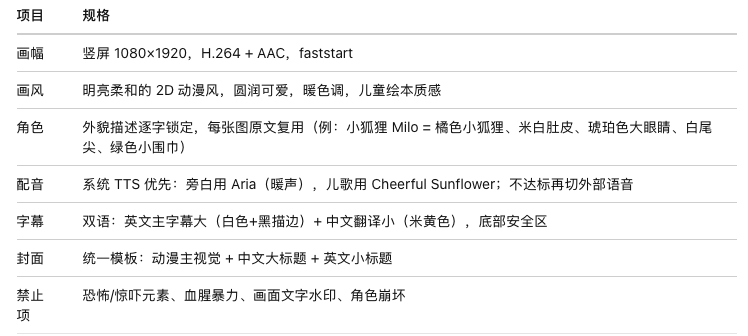
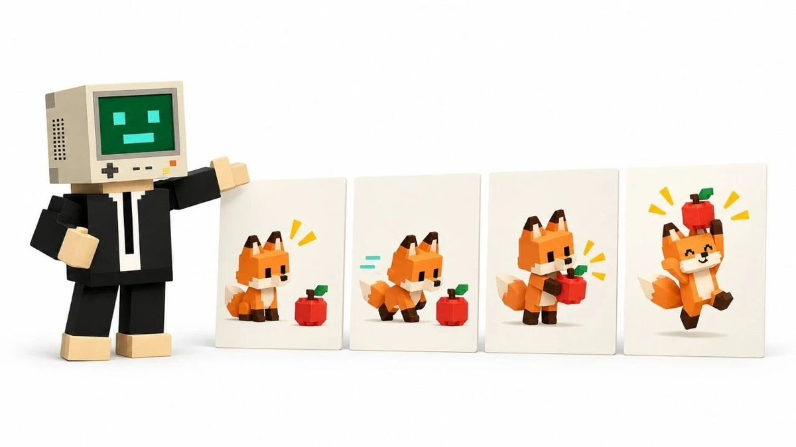

# 北衡：让 Muse 全权运营一个小红书账号的实操记录

> 4–9 岁儿童英文启蒙小红书账号的全无人值守流水线：账号定位、三个固定栏目、故事与儿歌公式、视频规格锁定、7 步成片、创作者平台发布、三个定时任务与防重复锁、评论区话术三原则，附文件结构与踩坑清单。

<!-- more -->


这是一套真实跑通的流程：一个 4–9 岁儿童英文启蒙小红书账号，从定位、做视频、发布，到每天自动更新两条视频、自动回复评论，全链路无人值守。下面每一步都按实际操作顺序写，照着做就能复刻。我觉得核心不在「会不会用 AI」，而在把定位、栏目、规格和定时任务一次锁死——后面 Muse 才接得住。

## 01｜先想清楚：账号定位

动手前先定三件事，写下来贴在墙上，后面所有决策都向它看齐。


一句话定位：给 4–9 岁孩子的英文启蒙乐园——原创绘本故事 + 原创英文儿歌，动漫风，温暖有趣。

目标观众：4–9 岁孩子 + 陪看的家长。记住：做决策、点赞收藏的是家长，所以文案要同时打动家长（「对孩子有用」）和孩子（「好看好玩」）。

差异化：全部原创。故事、儿歌、画面都不搬运，每集一个完整小故事，有小意外但不惊吓，双语字幕方便家长陪看。

## 02｜内容栏目设计：三个固定栏目轮换

不要想到什么发什么。固定三个栏目，按 A→B→C→A… 轮换，观众会形成期待，制作也有节奏。


A《Moonlight Tales 月光故事》：原创英文绘本故事视频，45–60 秒。英文旁白 + 中文字幕。

B《Sing with Mimi 跟 Mimi 唱》：原创英文儿歌视频，30–45 秒。每集一首 4–8 句的儿歌，配动作提示。

C《Word Friends 单词小伙伴》：英语启蒙跟读视频，约 30 秒。一集 3–5 个主题单词或 1 个句型：看图—听—跟读—小游戏。

故事和儿歌是主力，单词是调剂。我们的第一集就是 B 栏目的《小狐狸的苹果歌》。

## 03｜创作规范：故事和儿歌怎么写

### 故事公式（栏目 A 用）

每次从主题池随机抽主题（动物/食物/颜色/数字/家庭/自然……），抽过的主题 30 天内不重复。故事按这个结构写：

1. 开场：主角 + 一个小心愿

2. 过程：2–3 个趣味小事件

3. 小意外：温暖向反转，绝不惊吓。例如：黑暗里以为是怪兽，结果是打呼噜的熊宝宝；以为拼图少了一块，结果是小狗拿去当枕头了

4. 结尾：拥抱/晚安 + 今日单词回顾

语言难度锁死启蒙级：高频词、短句，每集只教 3–5 个新词，句式重复。

### 儿歌公式（栏目 B 用）

- 4–8 句，AABB 或 ABAB 押韵

- 每句不超过 8 个词，全部用启蒙高频词

- 每句配一个简单手势动作（挥手、拍手、摸肚子……），方便孩子跟做

示例（《小狐狸的苹果歌》实战歌词）：

Little Milo, little fox, say hello! One red apple in the box, you know! Two red apples, yum yum yum! Three red apples, here they come! Oops! One apple rolled away, Bunny caught it! Hip hooray! Share an apple, me and you, Apples are sweet, through and through!

8 句，数数 + 小意外（苹果滚走被小兔接住）+ 分享结尾，一气呵成。


## 04｜视频制作规格：一次锁定，次次复用

规格别每次重开讨论，写成表贴在流水线入口：



| 项目 | 规格 |
| --- | --- |
| 画幅 | 竖屏 1080×1920，H.264 + AAC，faststart |
| 画风 | 明亮柔和 2D 动漫风，圆润可爱，暖色调，儿童绘本质感 |
| 角色 | 外观描述一字不差锁定，每张图复用（例：小狐狸 Milo = 橙色小狐狸，米白肚皮，琥珀色大眼睛，白色尾尖，绿色小围巾） |
| 配音 | 系统 TTS 优先：旁白用 Aria（温暖），儿歌用 Cheerful Sunflower；不达标再换外部歌声 |
| 字幕 | 双语：英文大字幕（白字黑描边）+ 中文小翻译（米色），底部安全区 |
| 封面 | 统一模板：动漫主视觉 + 大字中文标题 + 英文小标题 |
| 禁止项 | 恐怖惊吓、血腥暴力、画面文字水印、角色崩坏变形 |

## 05｜手把手：从零做出一条视频

以《小狐狸的苹果歌》为例，全流程 7 步。

### 第 1 步：写剧本 + 分镜

先定 4 个镜头，每个 8–10 秒，写清画面内容和对应的歌词行：

- S1（第 1–2 句）：阳光苹果园，Milo 对镜头挥手，面前木盒里一颗红苹果

- S2（第 3–4 句）：Milo 开心数苹果，三颗红苹果排排飞，摸着肚子笑

- S3（第 5–6 句）：小意外——苹果滚下山坡，小兔 Lulu 纵身接住

- S4（第 7–8 句）：金色黄昏，树下分苹果吃，暖心收尾

### 第 2 步：生成 4 张动漫关键帧



用 AI 生图，提示词写法 = 风格前缀 + 角色锁定描述 + 本镜场景 + 禁止项。角色描述四个镜头一字不差，人物才不会「换脸」。

### 第 3 步：图生视频做微动效

把关键帧转成 4 段约 10 秒的视频，动作要温和：挥手、蝴蝶飞、苹果滚、接住、花瓣飘。禁止镜头剧烈抖动，儿童内容求稳不求炫。

### 第 4 步：配音

儿歌逐句合成（方便后面精确对字幕时间轴）。实战命令：

```bash
tts speak --voice avocado_v2:Vanessa --language en --speed 95 \
  --output line1.mp3 --text-stdin <<< "Little Milo, little fox, say hello!"
```

8 句各生成一个 mp3，顺手量出每句时长。注意：系统 TTS 是「念」不是「唱」，如果觉得儿歌味不够，这一步就换外部歌声配音。

### 第 5 步：合成 + 双语字幕

用 ffmpeg 组装：4 段视频按镜头时长裁剪 → 缩放到 1080×1920 → 0.4 秒 dissolve 转场 → 配音按「一句+0.5 秒间隔」拼接 → 双语 ASS 字幕。

字幕有个大坑：必须用 ASS 格式并显式写 PlayResX: 1080 / PlayResY: 1920，用 SRT 的话 ffmpeg 会 fallback 到 384×288 画布，字大得离谱。

成片约 29 秒。抽帧检查 3 张（开头/中段/结尾字幕），确认无误再往下走。


### 第 6 步：做封面

主视觉帧 + 大字中文标题 + 英文小标题。标题不超过 20 个字（小红书硬性限制），我们用的是：

小狐狸的苹果歌🍎英文儿歌跟唱

### 第 7 步：写发布文案

按固定模板：故事梗概 → 今日单词（英文+中文）→ 陪看建议 → 互动提问 → 标签（每篇 6–10 个）。

```text
🍎 原创英文儿歌《小狐狸的苹果歌》来啦！
小狐狸 Milo 在果园数苹果：one, two, three…
哎呀！一颗苹果滚下山坡了——小兔 Lulu 纵身接住，好耶！🎉
✨ 今日单词
apple 苹果 / red 红色 / share 分享 / bunny 小兔 / yum 好吃
💬 你家娃学会了吗？评论区打卡 Day 1，Milo 明天还来！
#英语启蒙 #儿童英语 #英文儿歌 #亲子英语 #磨耳朵 #幼儿英语启蒙 #英语绘本 #AI儿歌
```

## 06｜发布：小红书创作者平台


入口：https://creator.xiaohongshu.com/publish/publish（网页端）

登录：只有两种——手机号+短信验证码，或手机 App 扫码。没有密码登录。

规格：MP4/MOV（H.264+AAC），时长 15 秒–5 分钟，网页端文件 ≤10GB，首选 1080P 竖屏 9:16；标题 ≤20 字，正文 ≤1000 字，标签 ≤10 个。

封面：上传后可传自定义封面图，也可在视频截图里选。

审核：发布后笔记会进「审核中」，公开链接暂时打不开是正常的，审核通过即可访问。

定时发布：网页端支持，适合排期。

实战：我们第一集 18:41 发布，28 秒、33MB，一次通过，发布后状态「审核中」。

## 07｜自动化：三个定时任务，全年无休

手工发一条可以，天天发两条必须自动化。我们设了三个每日任务（北京时间 / Asia/Shanghai）：

早间发布：每天 6:00 起，随机延迟 0–120 分钟 → 在 6:00–8:00 之间随机发出一条

日间发布：每天 8:00 起，随机延迟 0–60 分钟 → 在 8:00–9:00 之间随机发出一条

评论巡检：每天 9:00 起，随机延迟 0–180 分钟 → 在 9:00–12:00 之间检查评论并逐条回复

随机延迟是为了让发布时间看起来自然，不像机器。

### 防重复机制（很重要）


两个发布任务可能时间重叠，必须加锁：

1. 发布前查发布日志，当天已有 2 条就跳过

2. 开工时写 IN_PROGRESS 占位文件，另一个任务看到 3 小时内的占位就等待或跳过

3. 栏目按 A→B→C 自动轮换，主题 30 天内不重复

### 每条视频的全自动流水线

定时任务触发后自动跑完：随机主题 → 写剧本 → 生图 → 生视频 → 配音 → 合成字幕 → 封面 → 文案 → 登录态发布 → 登记日志 → 汇报链接。全程约 15–25 分钟。

## 08｜评论区运营：话术三原则


1. 暖：身份是「儿童英文启蒙老师」，语气亲切，1–2 句中文短回复

2. 具体：夸孩子要夸到点上（「third apple 那句跟得真准！」），家长问单词/发音要耐心解答

3. 留人：顺手引导收藏和「明天再来」，广告引流辱骂直接忽略

## 09｜文件结构一览

```
xiaohongshu/
├── 运营配置.md        # 定位/栏目/规格/发布规范（总纲）
├── 发布日志.md        # 每条的日期/栏目/主题/标题/链接
├── voice_tests/       # 配音试音小样
├── pipeline/
│   ├── 流水线.md      # 制作步骤标准
│   └── 主题池.md      # 随机主题 + 已用记录（30天不重复）
└── episodes/ep001/    # 每集独立目录
    ├── script.md      # 剧本+分镜
    ├── frames/ clips/ audio/
    ├── subs.ass       # 双语字幕
    ├── cover.jpg      # 封面
    ├── caption.txt    # 标题+正文+标签
    └── final-1080x1920.mp4
```

## 10｜踩过的坑（帮你省时间）

创作平台 504：发布当天平台登录页一度 504，不是我们的问题。设了每 30 分钟自动检测，恢复第一时间继续。

「视频分辨率较低」警告：素材是 704×1248 放大到 1080×1920，平台给了个温和提示，不影响发布。后续换更高分辨率素材可消掉。

二维码会过期：扫码登录时二维码有有效期，过期刷新一张即可。

SRT 字幕巨字坑：见第 05 步，务必用 ASS + 显式 PlayRes。

标题 20 字红线：先写短标题再配正文，别等上传时才发现超了。

这套流程 2026 年 10 月 11 日真实跑通。

## 相关页面

- [[sources/andyl5cc-xiaohongshu-codex-workflow]]
- [[sources/indie-hub-7-xhs-skills]]
- [[sources/leaf-sanren-seecut-video-pipeline]]
- [[concepts/agent-autonomous-pipeline]]
