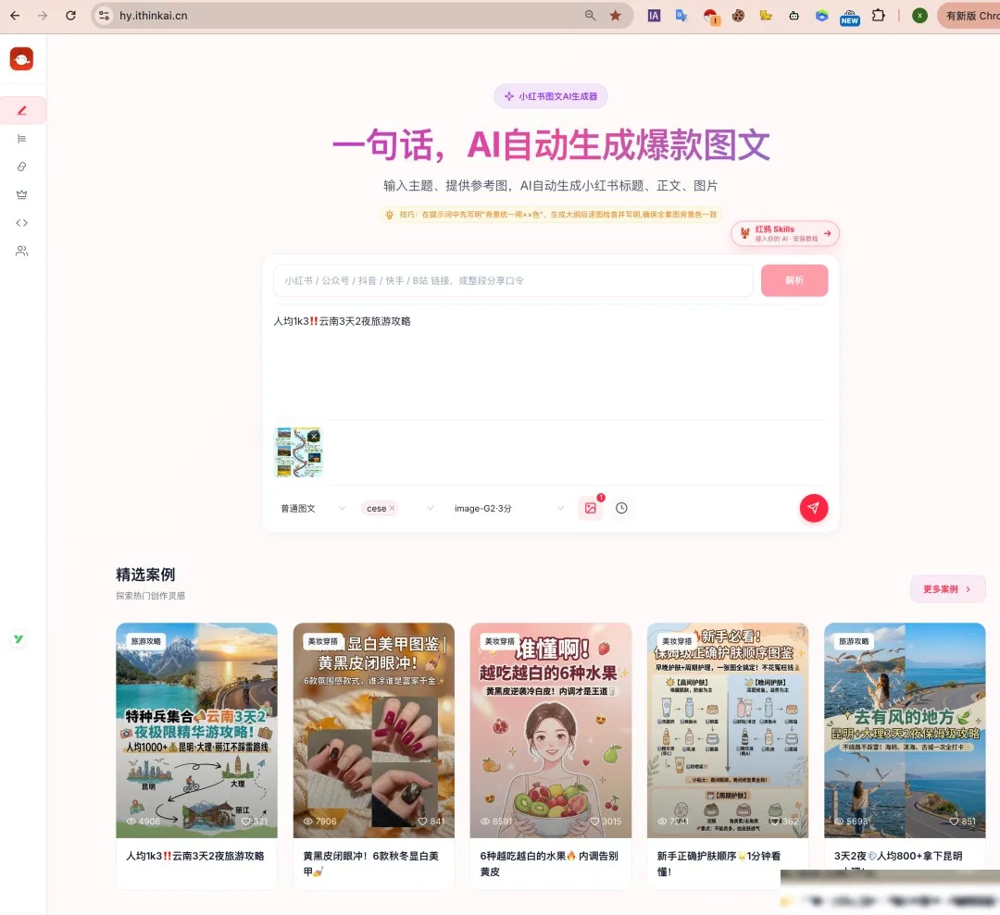
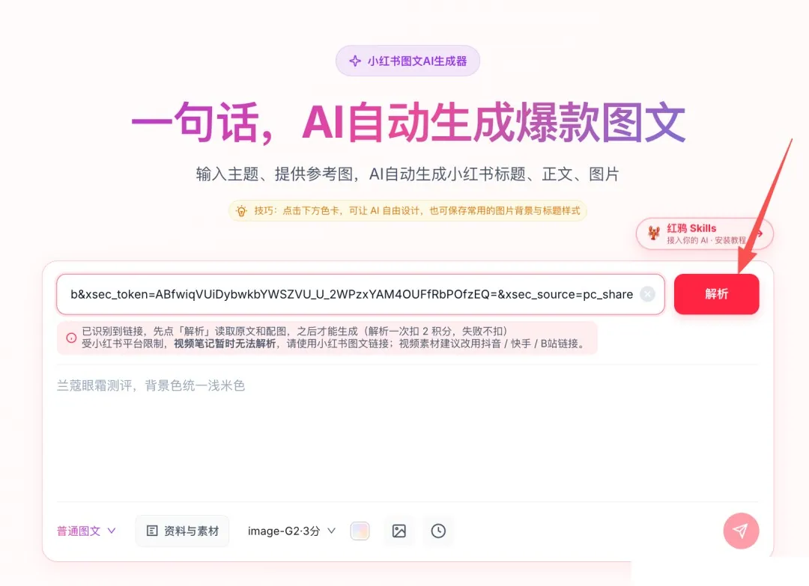
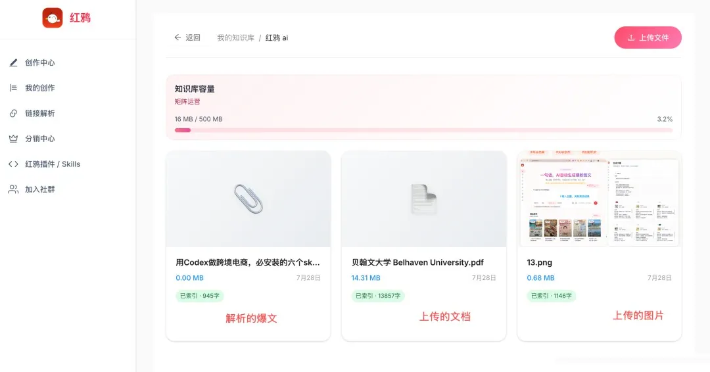
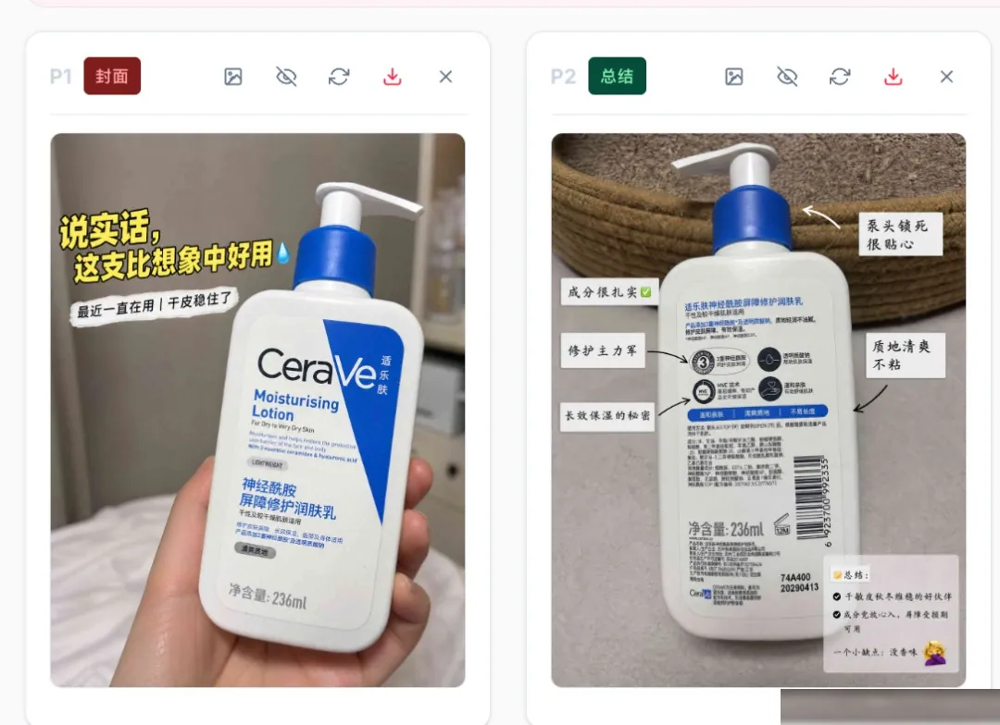
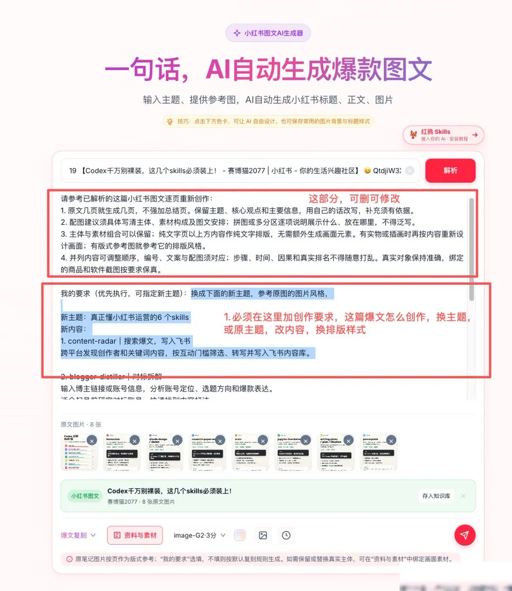
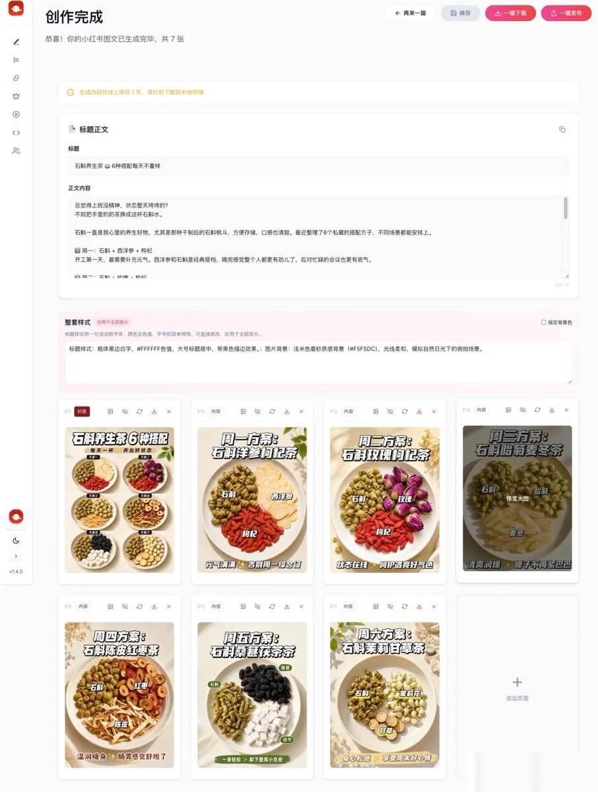
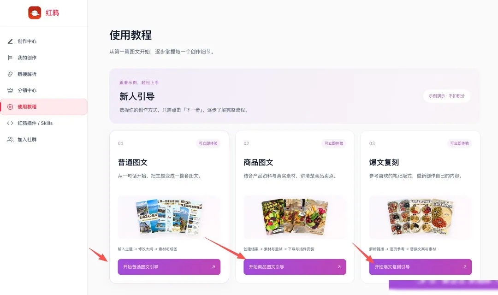

# 北衡（@xoyif63862452）：红鸦 AI——一人公司怎么批量做小红书图文，靠的是这个复刻 Skill

> 一人团队高频运营小红书的核心工业化工具：基于开源 Skill 体系，拆解爆款图文笔记的视觉结构与文案段落，通过自动化图文生成管线实现「输入一个主题/素材 → 自动生成 3:4 竖屏高清轮播卡片、吸引人标题与正文话题标签」，单人轻松撑起矩阵号日更。

<!-- more -->

一人公司要养几十个小红书账号，最耗人的往往不是选题，而是把信息塞进几张图里：第一页讲什么、后面怎么展开、文字和画面怎么配。红鸦 AI 把这件事接进了图文创作流程——你给一个主题，或一条已有内容的链接（图文、视频、文章都行），它先出整体大纲，再生成标题、发布正文、逐页图片大纲和生图提示词，最后批量出封面和内容页。普通图文可以挂个人或品牌知识库，商品图文可以绑商品档案并选不同种草 Skill；既能在网页端做，也能让 Codex、Claude Code、WorkBuddy 这类 Agent 直接调用它的 Skill。官网 https://hy.ithinkai.cn/ ，Skill 入口 https://hy.ithinkai.cn/developer 。

先选输入：从零写，还是用已有素材。有明确选题就直接写主题，别只丢「旅行攻略」三个字——把目标读者、行程长度和重点一起交代。例如可以这样提要求：「做一套云南三天两夜旅行攻略，面向第一次去的游客，重点讲路线安排和交通衔接。先列分页大纲，涉及费用的地方不要编造数字。」已经想好图片数量、风格或背景色，也可以一并写清。手里已有内容，就从链接开始：小红书图文链接用来解析笔记、同主题重写或研究对标的信息组织（后面若要逐页参考，还要选「爆款复刻」模式）；公众号文章链接把长文拆成适合多页图承载的内容，尤其要检查分页后有没有丢掉条件、解释和关键步骤；抖音视频链接整理口播或产品介绍，依赖动作演示才能懂的部分最好补文字说明。从输入到成品，建议记住这条顺序：提供素材 → 选择模式 → 补充自己的资料 → 修改标题和分页大纲 → 生成图片 → 检查并导出。

三种模式按任务选。普通图文适合知识分享、教程攻略、经验总结，以及旅行、美食、职场、家居等内容——可以关联知识库（品牌介绍、课程文档、产品说明、历史文案），画面素材图回答「这一页展示什么」，版式参考图回答「这些内容怎么摆」。

商品图文先建商品档案：名称、品牌、类目、目标人群、核心卖点和禁用表达写清楚，参数和效果描述都要有依据，以后同款关联档案即可。

爆款复刻的特点是按参考笔记页数逐页创作、并为相应页面绑定参考图；入口目前对应小红书图文链接，不等于公众号或视频解析也能同样逐页复刻。两种思路更稳：借鉴信息布局和视觉组织，换成自己的主题和资料；或保留同一选题，重新提问、组织论述，并更换表达与版式。「复刻」是功能名，不代表可以照搬别人的文案和图片——只换几个词、换个产品名，读者看到的仍可能高度相似。更有价值的是弄清参考笔记为什么易读，再用自己的材料重新回答问题。写要求时别只丢「帮我做一篇类似的」，要把新主题、读者、要保留的表达特点和必须重做的部分说清。

逐页参考可以记成：解析链接 → 选爆款复刻 → 写清创作要求 → 检查标题正文和每页提示词（参考图别绑错）→ 批量生图 → 对照结果看信息是否更清楚，而不是越像越好。所有模式最后都要走好：准备资料 → 编辑标题正文和每页大纲 → 确认后批量出图 → 放大预览、有问题的页单独改再重跑。整套确认后可保存下载；发布插件能把图片和文案带进小红书编辑页，但带入不等于已发布，最终标题、顺序、正文和声明仍要你自己确认。

第一次用，建议先在电脑浏览器打开官网，对照普通图文、商品图文、爆款复刻的新人引导各走一遍，比同时开多个模式更能看清流程。

已经在用 Agent 的，也可以把红鸦图文 Skill 接进原来的工作流，减少来回搬运材料。能批量生成，不代表可以省掉判断——AI 图会不会影响流量，跟题材、真实性、重复度、反馈和平台规则都有关，用某个工具也不保证推荐量。发布时按目标平台当时有效的规则做 AI 生成合成内容标识、来源及商业声明。我自己的判断是：工具负责减少重复操作；文章和图片最终值不值得读，仍取决于你交出了什么。时间线上要是也在用 AI 做小红书图文或矩阵素材，欢迎评论区说说你卡在选题、分页，还是合规标识这一步。

## 相关页面

- [[sources/guizang-social-card-skill]]
- [[sources/yooee-xiaohongshu-zero-followers-monetization-blueprint]]
- [[concepts/agent-skill]]
- [[concepts/selfmedia-compound-model]]
