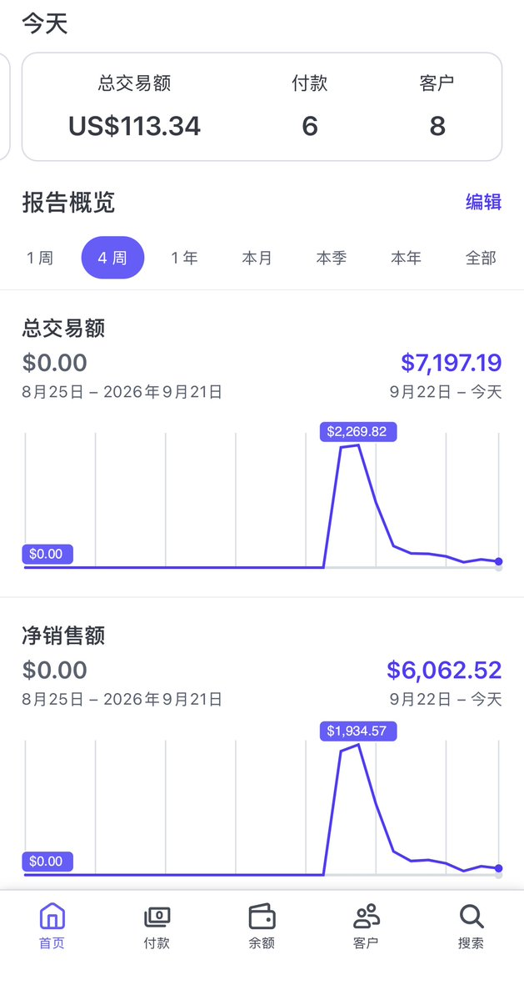
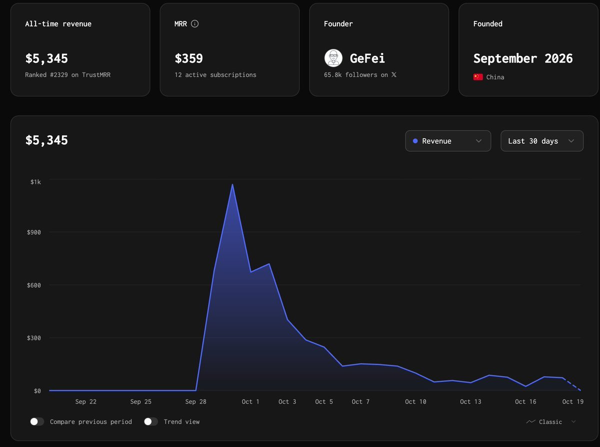
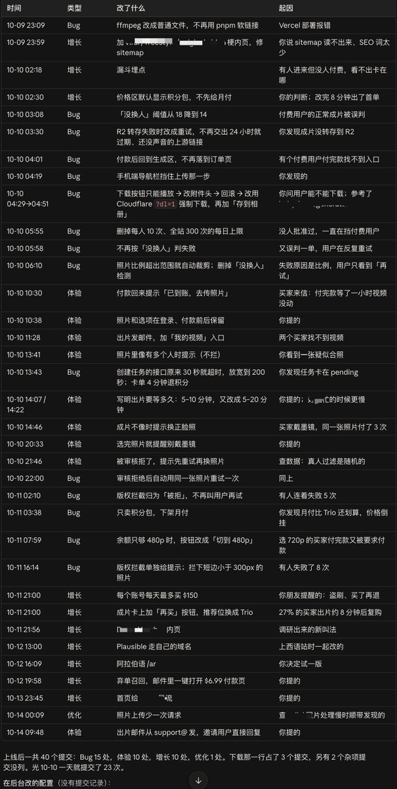
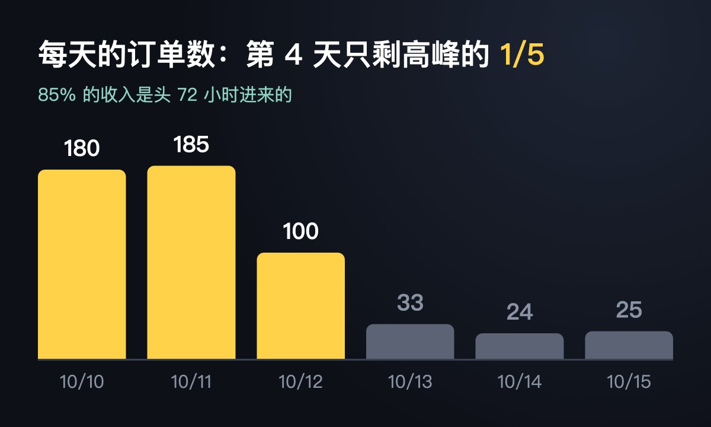
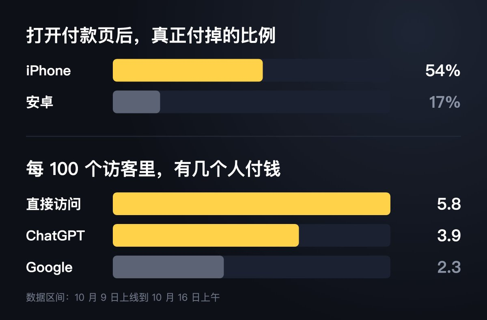

# 绪轩（@xuxuanzhou）：没投流、没买外链，一个新词站 72 小时 $5,480——从买域名到出单的完整复盘

> 10 月 9 号下午买的域名，第二天凌晨 2:38 出第一单，72 小时流水 $5,480（标题里的数字是首单后 72 小时的订单标价，不含结账时加的税，也没扣退款），第一周 6700 多刀、到复盘时接近 7200 刀（Stripe 总交易额，含税），既没投流也没买外链，作者把秘诀归为一个字：早。做的是多米尼加说唱歌手 Bulin 47 一段即兴说唱在 TikTok 火起来后的 AI 复刻：上传一张自己的照片，生成一条你在里面说唱的 19 秒视频。选词方式是把 hotel lobby、ai raindance、ai zombie 这些词一起丢给 Claude Code，让它去 TikTok 上找用户想复刻、且复刻出来的视频本身也在火的同类梗，他最终选了刚抬头、在 Google Trends 上已开始超过 hotel lobby 的 Bulin 47；动手的诱因是 9 月底哥飞老师亲自下场做的新词站目前累计收入 5345 刀。关键节点：10 月 8 号下午先在一个老站上加了 hotel lobby ai 页面，10 月 9 号下午定域名、当晚 12 点左右把不太满意的版本上线，回来发现价格区默认推订阅套餐，改成主推积分包后 8 分钟就有人下单、20 分钟后已有 3 个人付费；随后又发现 Claude 之前加的「没换人就判失败」判定把付费用户的正常成片误退了，先调松再整个删掉。数据面：梗冒头到 Google Trends 见顶大概 4 天，85% 的钱是头 72 小时进来的，第 4 天单量只剩高峰的五分之一；第一周一共 558 单、$6,434，393 个人付了钱，退了 22 单，退款率 3.9% 基本都是觉得「不像本人」；打开付款页之后 iPhone 用户一半以上付掉了、安卓只有 17%，美国访客只占四分之一、付款却占了快一半。可复用的六点：看到苗头就动手、模板要提前备好（那天真正写代码只有 5 个多小时）、先上线再改（上线第一天提交了 23 次）、别让 AI 替你加限额和自动判定、按次卖别做订阅（$9.99 一条的单占了 92%）、说不像的直接退款。问答补充：朋友看了他在哥飞社区的分享后周日就出了两单、自己的第二个站目前收入在 500 刀左右；API 到现在花了 10000 多人民币，没有免费额度，没做外链；弃单召回给 100 个打开过付款页但没付钱的人发邮件把价格降到 $6.99、一个人都没买，模型用的是 Seedance 2.5。

<!-- more -->

先放数据：10 月 9 号下午买的域名，第二天凌晨 2:38 出第一单，72 小时流水 $5,480，第一周 6700 多刀，到现在接近 7200 刀（Stripe 总交易额，含税）。没靠投流，也没买外链。

如果非要说这次的秘诀，就一个字：早。

简单说一下我做的是什么。10 月初，多米尼加说唱歌手 Bulin 47 的一段即兴说唱在 TikTok 上火了，很多人用 AI 把自己放进这段视频里再发出来。我的网站就干这一件事：上传一张自己的照片，生成一条你在里面说唱的 19 秒视频。

## 为什么这次去做新词

再解释一下「新词」：刚冒出来、还没多少网站在做的搜索词。比如一个梗刚在 TikTok 上火，大家开始搜「xxx ai」，这时候谁先有一个能用的网站，谁就能吃到第一波搜索流量和 AI 过来的流量。

新词新站这套打法我是在哥飞群里学的，包括怎么选词，选域名，做好 SEO 友好的落地页等。我们群里一直有人在做新词站。以前 AI 工具站盯的主要是新模型的名字，做的人多了，越来越卷，我后来就没怎么关注，转去做老词（已经很多人在搜、很多网站在做的词，比如 ai image generator 这样的）了。直到这次 @gefei55 飞哥在群里一条条晒新词站的出单，我才发现这块还是能做出不错的收益。

9 月底哥飞老师为了给我们教学，亲自下场做了一个新词站，目前累计收入 5345 刀。那段时间他经常在群里转发新词，很多群友跟着去做站，也都拿到了不少收益。我在旁边看得心动，但人在外面旅游，一直没动手，10 月 8 号回来才开始。

## 10 月 8 号：先在老站上加了一个页面

8 号早上 10 点半，良辰美老师发给我一堆新词，有 ai raindance、ai zombie 这些（都是 10 月初火过的 AI 视频梗），我回了感谢，说会好好研究。但那天手上一堆老站的事要处理，没顾上看。

下午在想要不要给 hotel lobby ai 这个词做个新站。想想已经晚了这么多天，新站估计也没量了，最后只打算在我一个老站上加个页面试试。晚上 6 点多，小群里另一位朋友做的 hotel lobby 新站也出单了。我一想，都过去这么多天了还能出单，那还是有机会，就赶紧把那个页面上了。（这个页面第二天也出单了，也算一个契机。）

## 10 月 9 号：去 TikTok 上找下一个词

9 号早上，我开始认真看良辰美老师给的那些词，发现都已经有挺多人在做了。现在进场能喝口汤，肉是吃不到了。我想，与其去挤一个竞争多的热点，不如去找刚起来的。

而且有心人都能发现，这一波新词基本都是从 TikTok 火起来的。那直接去 TikTok 上找，不就能更早发现吗？

带着这个想法，我把 hotel lobby、ai raindance、ai zombie 这些词一起丢给 Claude Code，让它去 TikTok 上找有没有类似的梗：用户想复刻某个爆款视频，而且复刻出来的视频本身也在火。它真的找出来几个，包括后来挺多人做的 burning bridges。我没选它，选了另一个，就是 Bulin 47。在 Google Trends 上一看，刚抬头，已经开始超过 hotel lobby 了。看了一下爆款视频，有点抽象，看不太懂，所以动作上有点缓慢。（以后要信数据，而不是自己的好恶！）

最终我拖到下午才定下买哪个域名，这点以后得改。一开始有好几个候选词，得挑一个做域名，我就把它们都放进 Google Trends 比，看哪个量最大、最像是想找工具的人在搜，中间还跑去吃了个饭。为什么说「早」呢？我去注册的时候，想要的那几个域名都还没人注册，很顺利就拿到了。

## 当天上线

上站本身对我来说还好，主要是测试花了好几个小时，生成的效果一直不太满意，就一直没上。到了晚上 12 点左右，老婆催我去睡觉，我才把这个自己不太满意的版本上上去，还加了一些限制和判断（比如判断成片不像，就自动给用户退款。后面看，这些都是画蛇添足）。

## 第一夜：8 分钟出第一单，然后一直在修 bug

本来这时候该睡了，但前一天上的那个 hotel lobby 页面出了两单，我赶紧去看，发现两个用户都没生成成功。查问题、修复、发邮件跟用户道歉，弄完已经 2:19 了。中间回头看了一眼新站，已经有人进来了，但没人付钱，我就让 Claude 赶紧在 Plausible 加上漏斗统计，看用户是在哪一步走掉的。

处理完那边，我发现新站的价格区怎么默认推订阅套餐？这种做一条视频就走的用户，谁会订阅。马上改成主推积分包。改完 8 分钟就有人下单了，20 分钟后已经有 3 个人付费。看出单这么猛，哪里还有睡意，就一直盯着后台，看用户有没有生成成功、进来了多少人。

然后就发现，有个用户明明生成成功了，网站却给他退了款。我去看了视频，挺像的啊。跟 AI 一通沟通才发现，是 Claude 之前加的那个「没换人就判失败」的判断，把付费用户的正常成片误判了。先把判定标准调松，后来干脆整个删掉。接着又发现网页特别卡，还会报 500。原因是人进来太多，数据库连接被打满了，又赶紧修。前两天基本没怎么睡，一直在修 bug、改体验。这里让 claude code 整理出我头两天修的 bug，感兴趣可以点开看看：

## 为了少出客服单，我还做了这几件事

- 视频一生成好就给用户发邮件，让他们知道有问题可以直接回邮件找我。
- 发邮件要退款的，一律退。觉得效果不好、想要更多积分的，也都给了。
- 盯着用户的生成任务看，有问题直接联系。这种热梗站的用户都是买了马上就用，希望立刻出结果。失败了能马上看出问题在哪，马上响应。

## 数据

标题里的 $5,480 是首单后 72 小时的订单标价，不含结账时加的税，也没扣退款。第一周一共 558 单、$6,434（同样是标价），393 个人付了钱，退了 22 单。

梗冒头到 Google Trends 见顶大概 4 天。85% 的钱是头 72 小时进来的，第 4 天单量就只剩高峰的五分之一。

几个出乎我意料的数：

- 打开付款页之后，iPhone 用户一半以上付掉了，安卓只有 17%。我猜是 iPhone 用 Apple Pay 一点就付，安卓用户大多没绑 Google Pay，只能手动输卡号。
- 流量一半是直接访问，Google 占三成多。ChatGPT 上线第一天就有人点进来，付款率差不多是 Google 的 1.7 倍。站上放了 llms.txt、提交了 IndexNow，不过我不确定这招有没有用，我觉得更关键的是域名和页面标题对上了大家搜的词。
- 美国访客只占四分之一，付款却占了快一半。梗是从多米尼加火起来的，那边流量排第二，但点了购买的人只有五分之一付成功。
- 退款率 3.9%，基本都是觉得「不像本人」。

## 可以复用的几点

主要还是快和早，再加上多跟人交流。其他几点大家看看有没有用：

1. 看到苗头就动手。我选域名拖到下午两点半，现在回头看，那几个小时能省就该省。
2. 模板要提前备好。那天真正写代码只有 5 个多小时，因为支付、积分、登录、埋点这些早就在别的站上修过一轮了。
3. 先上线再改。上线第一天我提交了 23 次，问题几乎都是真实用户撞出来的，上线前根本想不到。
4. 别让 AI 替你加限额和自动判定。「每天 300 次」和「没换人就判失败」都是 AI 自己加的，两个都挡住了付费用户。
5. 按次卖，别做订阅。热点活不过一个月，$9.99 一条的单占了 92%。
6. 说不像的，直接退款。我试过送积分让他们重试，最后基本还是退了。

## 大家问得最多的几个问题

- 你这套方法是否可复用：我说一个 case，我朋友周五看了我在 Web.cafe（哥飞的社区）的分享，立刻行动，周日就出了两单了，我自己的第二个站，目前也在赚钱，收入在 500 刀左右。
- API 花了多少：到现在 10000 多人民币。
- 有没有免费额度：没有。
- 有没有做外链：没有。
- 有没有投流：后面小额试了一下，不过还是关掉了，算了一下打不正。
- 有没有做弃单召回：做了。给 100 个打开过付款页但没付钱的人发了邮件，价格降到 $6.99，一个人都没买。
- 用的哪个模型：Seedance 2.5。

## 最后

不敢说自己多厉害。这次能做出来，要谢谢哥飞的新词方法，和他在群里一直晒单催着大家动手，也谢谢良辰美老师给的新词和小群朋友们一直以来的讨论，剩下的就是运气。

## 相关页面

- [[sources/jiang-yunhe-first-100-usd-new-word-playbook]]
- [[sources/echo-ai-site-5-days-1500-usd]]
- [[patterns/viral-content-monitoring]]
- [[concepts/b2c-conversion]]
