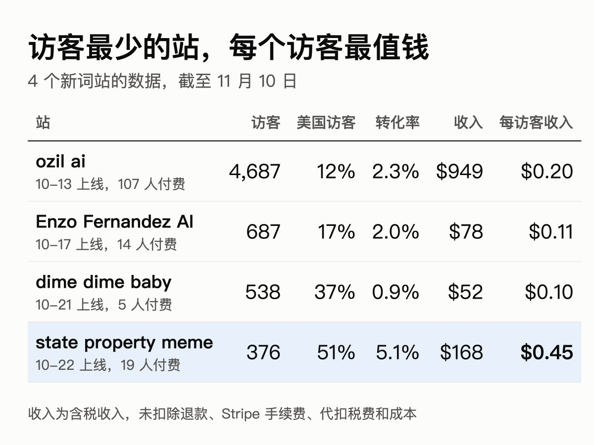
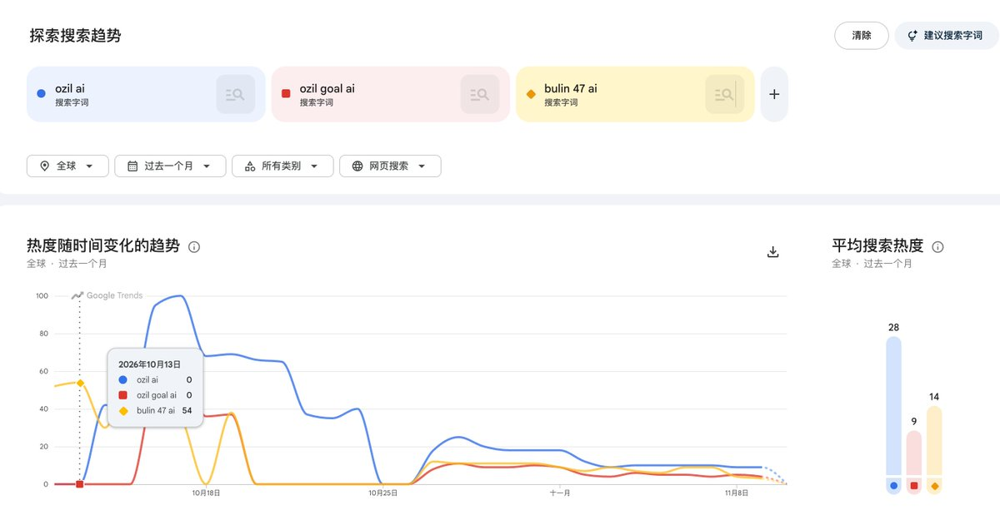
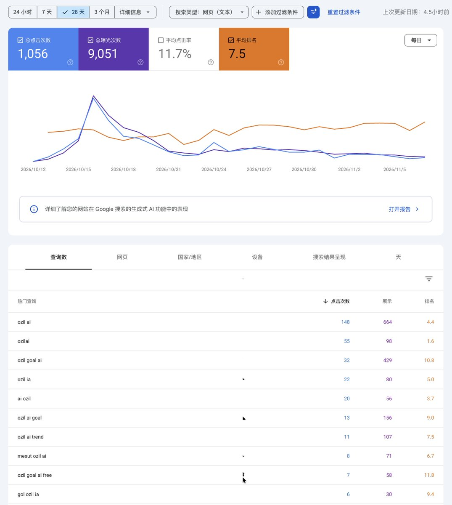
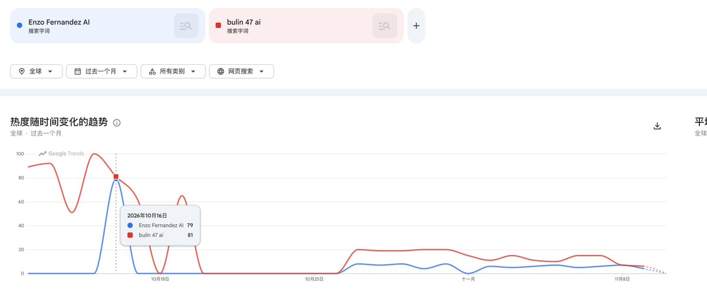
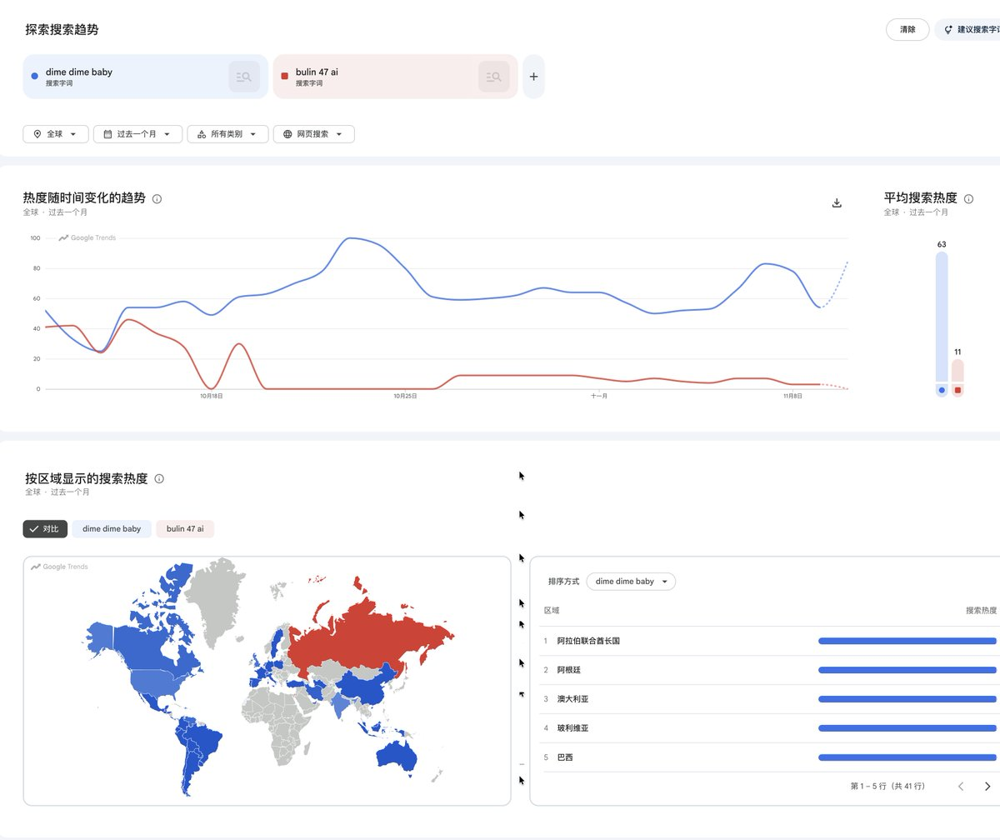
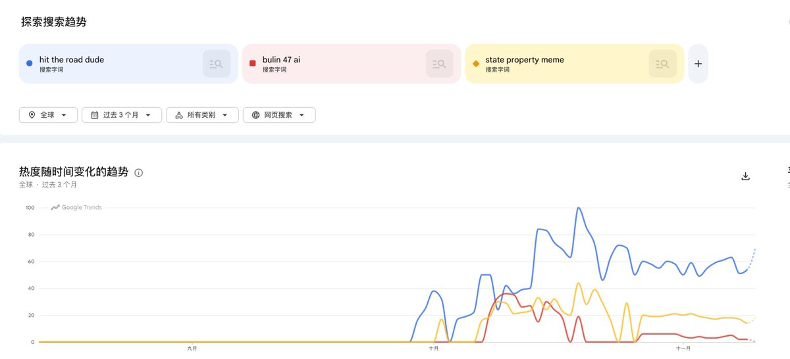
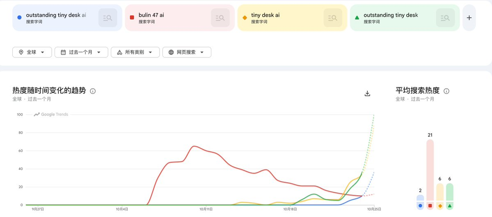
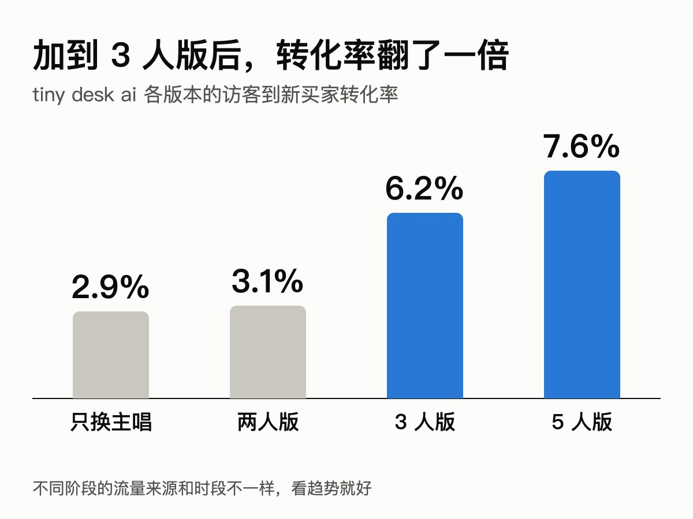

# 绪轩：一个月上线 5 个新词站的复盘和教训

> 5 个新词站逐个复盘：ozil ai 按国家定价（高价档付款率 41.5% vs 低价档 12.1%）、dime dime baby 犹豫一天错失一天窗口、state property meme 换说法切入、tiny desk ai（84% 美国用户，转化率 12%）、新词监控信息密度控制与 ChatGPT 流量观察。

<!-- more -->

距离上次发帖已经过去半个多月了，上篇文章收获了挺多人的关注，感谢大家。我这个人倾诉欲不是很强，所以不太经常发帖。另一个原因是出海网站这条路，每一阶段的成果都不会那么快得到正反馈，没有新的东西分享，我也不好意思发文章。

好了，废话不多说，给大家复盘一下最近做的几个新词新站吧，中间夹杂着我的一些思考，看看对大家有没有用，也欢迎大家来讨论。

## 我的新词监控：信息不是越多越好

首先呢，方法还是我上篇文章说的那个，不同的是，我把它变成了一个监控，加上了我的一些判断标准，让 Claude 每天给我跑对应的任务，然后把找到的新词给我看，我自己再判断做不做。

上一次我说，我通过问 Claude，它给我找到了 bulin 47 这个词，很多人也效仿了。但是，你要把它变成一个每天都能运行的监控，是需要有判断标准的。

所以，我在让 Claude 帮我找出 bulin 47 这个词之后，会接着不断地问它，你从哪里找的，为啥找这个，标准是什么，如果按照同样的标准去回测过去一段时间，这个标准能找到什么词。然后通过这个回测和我们已经掌握的一些情况（比如 hotel lobby，rain dance 这些），来判断这个标准合不合理，够不够快，以此不断地迭代这个监控系统。

我看见有很多人分享了他们做的新词监控系统，很多人可能觉得不错，但是我自己有一个判断标准，就是监控给出来的信息不能太多。个人觉得信息多其实不是一件好事，你需要对每个信息都进行判断和决策，这其实很消耗精力。一天两天可能还好，如果每一天都需要你针对几十个新词做出判断，我个人是有点受不了的。

所以我给了比较严格的标准，尽量不把大机会漏掉。结果肯定是不全的，也确实漏过词（后面说的 hit the road dude 就是一个），漏了我就回头查为什么漏，再去改规则。但好处是，每次真正需要我拍板的新词就那么几个，我很容易就能决定要不要做。

最近 Claude Code 把我封号了，同样的提示词给到 Codex，它能给我找出十几个，但最后都没有用，看得我头疼，害。

anyway，我只是分享我个人的习惯和判断，并不一定是对的。而且新手期间，还是要多看。只是你要确保自己不要被信息淹没，从而懈怠，根据自身情况，把信息控制在一个合理的范围内，自己处理起来舒服就行。

## 先看一下汇总

下面我把最近做的几个新词新站给大家说一下，顺便复盘。收入我就大概说一下，大家可以对照着自己做的站看，收益图这次就不贴了。先放个汇总，tiny desk 放到后面单独说：

这里的收入都是含税收入，没有扣除退款、Stripe 手续费、代扣税费和成本，后面不再重复说明。

可以看到，state property meme 上线最晚、访客最少，但美国用户占了一半，平均每个访客带来的收入是 ozil 的两倍多。

## ozil ai：按国家定价，低价档没有想象中好卖

这是上个月做的第二个新词，我是 10 月 13 号上线的。上线之前我看了一下，已经有一个站比我早上线了几个小时，但还好我算是比较早期的，所以也是赶紧弄完就上了。

而且吃过上一次 bulin 47 的亏，我这次早早就开始发外链和发文章，截止到目前，我的站还排在首页，虽然已经没有流量了。

下面是 Google Trends 的相关数据，可以看到 13 号上线的时候 Google Trends 上还没有量，但其实我做的时候是有量的，不知道为啥现在看没有。

顺便贴一下我的 gsc 数据吧。

然后呢，这个词有几个点可以学习一下。一开始我定价 9.99 美元，挂了不到一天，付款页只被打开了 5 次，最后只成交了 1 单。

我回过头去看，这个词进来的用户，很多都来自巴西、阿根廷这类国家，消费力比较弱，所以我赶紧改变了定价策略，根据用户所在的国家展示不同的价格，消费力强的国家看到的是高价档，消费力弱的国家看到的是低价档。

改了定价之后，单子也多了起来，当然这里面也有流量上涨的原因。但最终我发现，还是高价档的单子多，低价档的偏少。单条视频里，高价档卖了 70 单（62 个人），低价档只有 26 单（24 个人）。

其实两档的访客差不多，全程下来低价国家还多一点（2503 比 2184）。在价格稳定的那段时间（10 月 15 号到 24 号），打开付款页的也是低价档更多（223 次比 183 次），但打开之后，高价档有 41.5% 付了款，低价档只有 12.1%。

而且低价国家内部差别也很大，巴西 393 个访客出了 14 单，和美国（556 个访客 21 单）差不多，阿根廷 344 个访客却只有 1 单。

后面流量下滑，我把首单价降到 3.99 美元，也没能获得更多的订单，低价档的付款率还是 11% 左右。

所以我现在怀疑，这些用户没付款的原因不只是价格，可能还有支付方式。我早期查过 4 个没付款的用户，都是安卓手机，根本没有提交卡信息，而付款页上只有银行卡和 Cash App。

最终这个站目前收入 949 刀。

## Enzo Fernandez AI：不符合标准，但我还是做了

这个词是 16 号发现的，也是一个足球相关的词，17 号上线。流量不大，基本很快就掉没了。严格来说，它当时并不符合我的标准，但我还是做了。

从图上可以看到，基本只有 16 号那天有量，奇怪，等我上线的时候，峰值其实已经过了。

这个词的受众主要也是消费力偏弱的国家，所以定价从一开始的 6.99 美元，直接砍到 3.99 美元，才有人愿意买单（6.99 美元的时候一单都没有，最后 18 单里有 17 单是 3.99 美元）。

最终只赚回 78 美元，还行，不亏。后面没有量了，我也没有跟踪排名，也没有做其他运营动作。

这个词学到的，可能就是针对消费力偏弱的国家，定价要低一点他们才愿意付费。不过降价前付款页也只被打开了 7 次，样本很小，只能算个参考。

## dime dime baby：犹豫一天，窗口就没了

这个词我 10 月 19 号就看到了，但当时看了没感觉，觉得这个又是消费力偏弱的受众，不赚钱，就不太想上。当时应该一个竞品都没有，域名什么的也都还在。

等到第二天复盘的时候，Claude 跟我说相关域名已经被人注册了，我才磨磨蹭蹭地注册了一个域名，但内心还是不太想上，因为 Google Trends 上显示的热度国家都是消费力偏弱的国家，加上每次调试这些模板都挺麻烦的，我当天还是没有上，拖到第二天也就是 21 号才上线。

最终这个网站收入 52 美元，还好没有亏钱。

事后复盘，我 20 号上午看的时候，Google 首页还一个工具站都没有，到 21 号早上，前 6 条已经全是工具站了。窗口就这不到一天，我因为偏见和磨蹭错过了，所以还是不能有偏见。

另外还是得打磨好模板，之所以拖拉，一个原因就是调试这些模板比较费时间，我不想浪费时间。

## hit the road dude（state property meme）：换个说法切进去

这个词我原本不想做，它不符合我的标准。

不是它不够好，是因为我不够快。我知道这个词的时候大概都 10 月 17 号了，是群里的小伙伴跟我说的。可是你们看上面的 Trends，它是 9 月底火的，10 月 17 号进去，基本吃不到肉了，不太想做。

但是生财联合办公的另一个小伙伴接下来两天跟我说，他做了这个词，然后连续出单了。我就回去看数据，发现这个词的 Trends 一直都很不错，热度一直没有下降，当时手头也没其他事情，就想着算了，那就做吧。

但是 hit the road dude 相关的域名基本已经被注册完了，到 21 号已经有 16 个站上线，我再去卷这个词，短期内肯定排不上号。所以我就跟 Claude 沟通，做这个词，除了用它做域名之外，还可以用哪些词。

Claude 跟我说，这个梗的另一个说法是 state property meme。我一查 Trends，它的热度大概是 hit the road dude ai 的 8 倍，所以这不算退而求其次。我又搜了一下，首页只有一个 EMD 站，那不就稳了，赶紧注册了一个，22 号就上线了。

但是这个站上线之后我基本就没管了，这其实是不对的。依靠自然流量和 ChatGPT 流量，目前也有 168 美元的收入，如果一开始就加外链、不断上内页，是不是能更多呢？后面看看。

这也算是给我提了个醒，上线之后运营动作还是不能停，传统 SEO 的动作，比如上内页、上外链这些，还是不能歇着。

## tiny desk ai：我最喜欢的一个词

这是个好词啊，好词，我可太喜欢这个词了。这个词我们群里 5 个小伙伴加起来收入应该是有万刀的。

这个词我是 10 月 25 号中午发现的，26 号凌晨上线。当时我就发了这张图到群里，跟小伙伴说我会做。那时候已经有竞品上了，而且上了超过一天，还有好几个域名也被买了，不过还好排在首页的竞品不多。

当时排在第一位的竞品是 [https://aitinydesk.com](https://aitinydesk.com/) ，我还给小伙伴们打气说，不用管这个竞品，它根本没有识别好这个词的意图，提供的都是乱七八糟的模板，都不是人们要复刻的模板，我说它排不了多久就会下去的。果然没过多久，它就被挤下去了。

真的是很可惜，做得最早，最早获得排名，但却给用户提供了一个错误答案。这个网站到现在也还是用自己重新生成的场景，没有做原版的复刻（可能也有规避版权的考虑）。要知道，人们搜这个词，就是奔着复刻来的，复刻原版视频才更有识别度和热度。

说一下为啥这个词是好词，除了因为收入高之外，还让我们学到挺多。

1. 受众几乎全是美国人

我站上 84% 的访客都来自美国。做过网站的都知道，美国人的消费力基本是最高的。

这个词的转化，我们群里的小伙伴基本都能做到 10%-15%（按订单数除以访客数算）。我自己的站后期是每 100 个访客出 12 单左右，其中新买家 7 个左右，其余是复购和加购。给个对比数据，普通 SaaS 的转化率大概在 3% 以下。

2. 大部分更新都能带来转化率的提升

一开始我做这个词，是只换主唱的，因为调这种多人视频的复刻还是很麻烦的，时不时就会没换过去，或者动作不一致，即使用的是当前最强的 Seedance 2.5。

为了着急上线，我和 Claude 讨论完后决定只换主唱，但这个也调了我好久，最后只能把原视频切片，分成不同的小段一个个替换，效果才稳定一点。只换主唱的时候，转化率大概在 3% 左右。

上线后我也没闲着，想着可能人们不止要复刻主唱，其他人也要，所以上了可以替换两个人的功能，结果发现新付费用户基本都选两个人（这时候转化率变化还不大，但至少说明大家想要）。

那时候我大概就猜到，搜这个词的人，是想把视频里的人换成他们的朋友或者家人，他们想要全部都替换。所以我接着做了 3 人，以及最后的 5 人，一步步地满足用户的需求，转化率也一步步上来了。

3. ChatGPT 流量很少，但后来的站也还有机会

很奇怪，做这个词的，ChatGPT 那边的流量很少。我的站前两天还有一些，到 10 月 30 号基本就没有了，全程只占 4% 左右，而 ozil、dime dime baby、state property meme 这几个站，ChatGPT 流量都占到了 26%-32%。这也导致后面做的人基本都没有订单。

有一个群里的小伙伴 27 号才上线，这个时候不做其他改变，基本很难拿到排名了，但是他想着死马当活马医，不断追踪这个词，上线内页，优化落地页体验，反倒成为我们群里在 ChatGPT 那边获得流量最多的人，最终也有个五六百刀。

这至少给了我一个经验，后来的站不要一上线就不管了，不断地借鉴其他站，不断地更新优化，是可以获得流量的。外链前期比较难看出效果，这个时候优化网站，个人感觉比发外链更管用。

反正最差就是没有流量嘛，你本来也没有啊。但是你这么去折腾，真的获得流量之后，你才有经验，才能成长。如果指望上个站之后放在那里不管，然后等着订单来，那你永远不会成长。

4. 每天盯排名，向排在前面的站学习

我们具体做了哪些优化这里我不会说，毕竟有些是群友总结出来的，我不好分享，但是方法是可以分享的。

其实新词前期的排名都很不稳定，基本半天一变或者一天一变。所以我本人基本每天都会观察几次这个词的 Google 排名变化，看看我自己的排名掉没掉，哪个站升上去了，为什么它挤掉了我的排名，它做了什么我们没有做到的？这些统统都是可以学习的。

甚至你们还能观察域名，排在前面的网站域名是怎样的，那么下一个站，你大概就能知道哪些域名是有加成效果的（至少不会有负面效果）。在新词新站这边，个人感觉域名还是很重要的，当然也不是全部，前几名里也经常有大平台的内页。

所以在这个观察记录的过程中，你至少能学到这几样：

- 什么样的内容是 Google 喜欢的。
- 什么样的网站能排到前面，他们针对这个词做了什么样的落地页，SEO 是怎么做的。

很多时候，你自己去用一下竞品，就能很容易发现自己的不足，知道如何去改善自己的网站。但据我了解，其实很多人没有做这一步。

当然，很多时候都是猜，没有人能肯定某种手段就能百分百奏效。但只要不影响原有的 SEO（比如 TDH 的修改），我都会去尝试。而且新词的反馈很及时，基本上你今天改了，后面两天就知道做得对不对，是个很好的学习机会，不要浪费。

我这里说一个例子，我们小群有个小伙伴也是 26 号上线的，前期基本没有获得排名，订单也只有一个，但是后面不断优化，到了 11 月反而排到首页，转化率也上来了，目前两三千刀是有的。

5. 我自己的站也被挤下去了

我自己的站前面几天还能排在首页，但最近一周被挤下去了，有点可惜，目前也还搞不清楚这个排名的机制，只能多学习、多复盘了。

## 最后总结一下

这一个月做下来，我自己的感受主要是三点：

1. 受众在哪里很重要。同样是新词，美国用户为主的站，平均每个访客带来的收入，比拉美用户为主的站能高好几倍。
2. 新词的窗口真的很短，有时候就差一天。想做就赶紧上，不要有偏见，也不要磨蹭。模板要提前打磨好，才不会因为怕麻烦而拖拉。
3. 上线只是开始。看排名、用竞品、改页面，把用户真正想要的东西做出来，这些才决定后面能不能拿到单子。

## SEO 是这一切的前提

上面说的所有经验，前提都是 SEO 已经做好了。如果 SEO 都没有做好，比如连精品落地页都没有，那后面再怎么改也是没有用的。

想补 SEO 的话，可以先从免费的资料开始。哥飞有个网站，没有进社区的也有免费额度可以试用，大家可以先看看：

可以先看看哥飞的公众号，里面有很多文章和知识点，很适合小白学习。

另外也推荐先看看哥飞的公众号，里面有很多文章和知识点，很适合小白学习。

我自己在社区里，主要有这几个收获：

- 能看到很多人的经验和分享，很多大佬都会在上面分享。
- 有线下聚会。
- 有“问大咖”，可以向大佬提问，也可以围观别人的问答。
- 有哥飞的 AI agent。新手用它比问其他 AI 更有经验，因为里面有很多实战经验，是通用 AI 没有的。

最后说明一下，进社区不保证赚钱，只是多了一个信息渠道，也多了一个可以分享和沟通的地方。小白也可以先从免费资料学起，看个人选择。

以上就是这段时间的复盘，欢迎大家一起讨论。

