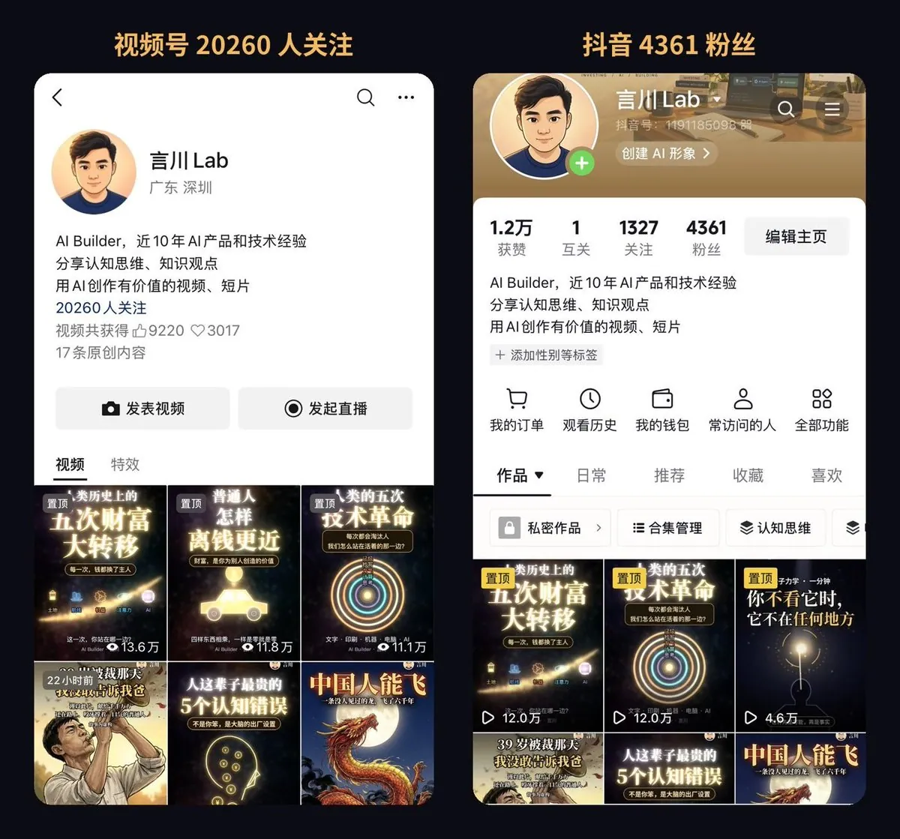
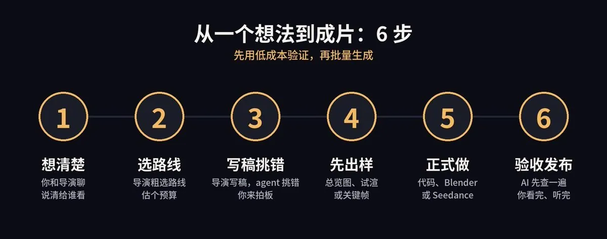
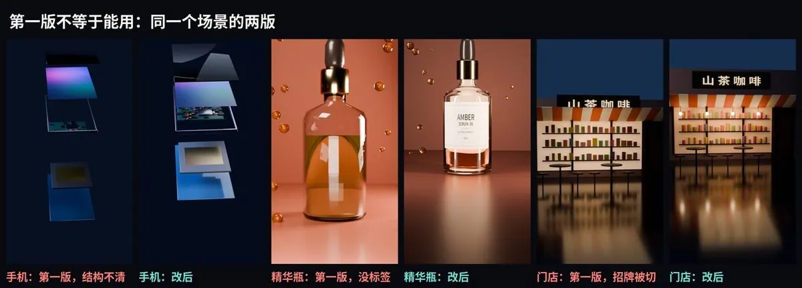
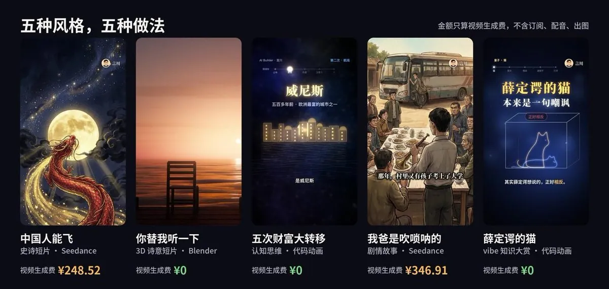

# 言川（@yanchuanlab）：AI 视频 Bot（2D/3D）——从想法到成片一手实战全流程（附完整提示词）

> 从想法到成片的一手实战全流程：如何设计一个能自动产出 2D 与 3D 视频的 Bot——选题与脚本生成、角色与场景设定、分镜与关键帧绘制、配音与音乐、画面合成与导出，并附完整可复用的提示词与踩坑经验。

<!-- more -->

我做了五种风格完全不同的 AI 视频：史诗短片、3D 诗意短片、认知思维、剧情故事、vibe 知识大赏。这篇每种风格挑一条代表作，给你讲清楚一个想法怎么一步步做成片子：用了哪些 AI、分几步走、每一步的提示词，还有每条片子踩过的坑。2D、3D 都有。

从 10 月 20 日开始发短视频，截至 11 月 9 日，20 天左右，视频号加抖音累计 24300+ 粉丝，累计播放 70 万+。

视频号 20000+ 粉丝，抖音 4300+ 粉丝，两边累计播放 70 万+



截图里能看到的播放量只是部分片子的数据，仅作示意。

下面按这个顺序讲：

1. AI 视频制作 bot：一张图看懂全流程。 你、大脑规划层、能力层、反馈层、记忆层，五层各管什么。
2. 从一个想法到成片的 6 步： 每一步都附提示词，复制就能用。
3. 五个实战案例和经验： 每条片子怎么做、花了多少，怎么省钱，怎么把效果做好，以及我踩过的坑。

## 一、AI 视频制作 bot：一张图看懂全流程

我一共用到 6 个主要制作工具：Claude Code、Codex、Seedance、Blender、Gemini，再加一个配乐用的 Lyria。你不用先学会编程和剪辑，但账号、Key 的配置和最后的验收，得你自己来。

我把这一整套想成一个会拍片的 bot，分成五层。你在最上面，下面四层它自己转：


第 1 层，你：视频公司的 CEO。 你给的是目标，不是做法。我做《五次财富大转移》时，给 Claude 的需求里一个技术词都没有，只说了想让大家看懂什么（见案例 3）。之后你只在几个关口出现：花钱前点头，样片出来看一眼，成片出来从头看完、听完，最后拍板发不发。

第 2 层，大脑规划层：导演 Claude Code。 这是整个 bot 的大脑。你平时只跟它说话，其他工具都由它去调。它听懂你的需求，把片子拆成一个个镜头，判断每个镜头用什么做法、要花多少钱，再写好故事、分镜和每一句提示词，最后把活派下去、把结果收回来。

第 3 层，能力层：各干各的活。 导演自己不画图、不演戏，它指挥下面这几位：

- 画师 Gemini： 画角色定妆图、每个镜头的关键帧和封面底图，我当时每张约 ¥1。
- 3D 布景师 Blender： 用代码搭 3D 场景，比如产品、建筑、地球。软件免费，但很吃电脑，渲染慢。
- 演员 Seedance： 把图变成会动的视频，演真人感的人物和复杂实景。按秒计费，是最贵的一环。
- 作曲 Lyria 3 Pro： 生成一整首配乐，没有解说的片子全靠它撑情绪。我用时约 ¥0.6 一首。
- 剪辑师 Python、ffmpeg 和 Azure 语音： 用代码画动画和字幕、配旁白、拼接混音出片。代码免费，配音按字数收费。

注意一点：Claude 自己不生成视频。 画面要么是它指挥画师和演员做的，要么是它让剪辑师用代码一帧一帧画出来的。我那三条视频生成费 ¥0 的片子，画面全靠代码和 Blender。

第 4 层，反馈层：层层审核。 做出来的东西，不直接给你，先过一遍审核：

- 剧本： 查出处、查逻辑、查开头抓不抓人。交给 Codex，或者让 Claude 新开一个 agent。它只列问题，改不改由你拍板。
- 画面： 抽帧检查错字、穿帮、人物前后不一致。
- 声音： 把旁白转回文字，和稿子对一遍，查读错的字。
- 配乐： 节奏、情绪、响度。Gemini 能先听一遍，但最后必须你自己听。

审核为什么要另开一个 agent？看结果就知道。《我爸是吹唢呐的》做完，我和导演都看过好几遍，另开的 agent 通看一遍，又查出一串问题：父亲一镜白发、一镜黑发；同一场戏，服装前后不一样；手靠近脸，被画成了手套。审核不过的，打回导演重做。

反馈层的最后一关是你。还是《吹唢呐》：配乐开头写成接近静音，电脑上听着有氛围，手机外放时前 4 秒等于没声音。这种问题只有拿手机听一遍才知道。Claude 看片靠一张张截图，配乐它听不见；Gemini 能听，但会听错。连续的画面和声音，最后都要你自己过一遍。

第 5 层，记忆层：记住你的偏好和习惯。 这一层最容易被忽略，但它决定了这个 bot 是越用越顺，还是每次都从头教。

我的做法很简单：

- 项目规则文件： 你说过的硬规矩，比如“超过 ¥30 先问我”“竖屏发抖音、横屏发 X”，都写进项目里的规则文件（Claude Code 里叫 CLAUDE.md），每次开工它会先读。
- 每种风格一个 skill： 认知思维、史诗短片这些风格，各有一份“怎么做”的说明，做同类片子直接照着来。
- 你的原话和修改意见： 每次验收时我说的话逐字留底，问题改完写成规则，能减少重复犯错，但每次仍要复查。
- 账本： 每一笔花费都记下来，汇报时以账本为准。

你看图上那两条回路：审核发现的问题，一条打回导演重做，一条写进记忆。这样下一条片子开工时，它已经知道你喜欢什么、讨厌什么、上次在哪里翻过车。

最后是配置清单，你照着让 Claude 帮你搭：

- 导演： 装好 Claude Code 并登录，主流程都跑在它上面。Codex 我用来审片。
- 视频生成： 在火山方舟开通 Seedance，充值后拿 API Key。
- 出图和配乐： Gemini 和 Lyria 3 Pro 都是 Google 的，去 Google 官网（Google AI Studio）申请 API Key。
- 配音： 开通 Azure 语音服务，拿 Key 和区域，按字数计费。
- 3D 和剪辑： Blender、Python、ffmpeg 都免费，让 Claude 帮你装。

所有 Key 写进项目里的配置文件（比如 .env），不要贴进聊天框。调用脚本让 Claude 写，你只要盯着它第一次调用成功。

## 我只守一条原则

先用便宜的办法把片子做对，再花大钱把它做好看。

《中国人能飞》第 12 镜就是例子。审关键帧时发现，王座画得太像一部知名美剧里的那把。因为是在图上发现的，重画一张约 ¥1。要是拍成视频才发现，这 4 秒就得花 ¥6.1 重拍。


这条片子竖屏 22 个镜头，正式只重拍了 3 镜，另外 2 条是开拍前比较两个模型的测试片。能在文字和关键帧上发现的问题，都在批量生成视频之前改完了。

我把这套做法写成了一张开工单，每条片子开始前发给 Claude。这张开工单写清目标、每个阶段交什么和怎么验收，以及钱和版本怎么记。

开工单，直接拿走（括号里的换成你自己的）：

```
新项目叫（填片名）。你当导演，我看结果、批钱。

我先交代清楚这几件事：
1. 给谁看，看完他能得到什么：（填一句话）
2. 多长，竖屏还是横屏，要不要旁白：（填写）
3. 总预算（填金额）元，单次花费超过 30 元先问我。
4. 我手上有的参考、资料和照片：（没有就写“无”）

做的过程分五个阶段，每个阶段交给我这些，我这样验收：
1. 先聊清楚一句话主旨，粗选路线，估一个大概预算。
2. 再交逐句脚本和分镜表。涉及真实历史、科学结论和数据的句子附上出处，对白和虚构情节不用；每个镜头标出用代码、Blender 还是生成，给出正式报价。我确认脚本和总价。
3. 然后出样：代码片给一张总览图，3D 给首、中、尾三帧，要生成的镜头给定妆图和关键帧。我圈出要改的。
4. 挑全片最难的一镜先试做，我看风格对不对。
5. 最后交整片，再附一张清单，写明哪些画面你没逐帧看过、哪些声音你听不到。我看完、听完，再定发不发。

另外三样要记好：
1. 每次调用都记进账本，写清时间、镜头、模型、秒数和金额。
2. 改动存成新文件，旧版本放进“旧版”文件夹，不删。
3. 我说的意见按原话记下来，以后也适用的写进项目规则文件 CLAUDE.md。

每个阶段交完就停下，等我回复再往下走。
```

## 二、从一个想法到成片：6 步



## 第 1 步：想清楚给谁看、看完得到什么

很多人一上来就问“我拍什么”，然后直接开做。其实这一步最划算：方向没想清楚，后面做得再好也白做；而在这一步改，只是改几句话，一分钱不花。

一句话说清：给谁看，看完他能得到什么。

说不出来就先别往下做。这句话后面会变成你的标题、封面和第一句台词。

开头 3 秒给结论或最强的画面。

不做自我介绍，不念标题。这是我所有片子最大的短板：平台后台的 3 秒完播率总是偏低，大量观众在第一分钟内就划走了。

一条片子只回答一个主问题。

《五次财富大转移》讲了五段历史，但都在回答同一个问题：钱是怎么换主人的。几个章节围着一个问题转，观众看完才说得出这条讲了什么。

最后留一句观众愿意转述的话。

转发，其实就是观众替你说话。有一句好转述的话，他更容易转给别人。

提示词，直接拿走：

```
我想做一条视频：（填你的想法，一两句话就行）
给谁看：（越具体越好，比如 30 岁、刚被裁的程序员）

先别写脚本，帮我把想法聊清楚，有不清楚的直接问我。
聊完给我：
1. 一句话：这条片子给谁看，看完他能得到什么。
2. 开头 3 秒的 5 种写法，每种都要让人想看下去，不做自我介绍。
3. 观众看完能转述给朋友的一句话，写 3 个。
4. 这个想法最弱的地方，直接说，不用顺着我。
```

## 第 2 步：选路线，决定花不花钱

这一步决定了你的视频生成费是 ¥0 还是几百块。

做视频主要是四条路线：


- 代码动画： 适合知识讲解、清单、数据、金句。导演自己写代码画，不收接口费。我的例子是《五次财富大转移》和《薛定谔的猫》。
- 3D 动画： 适合诗意短片、产品、建筑、机械。Blender 来搭，不收接口费，但费电脑。我的例子是《你替我听一下》，还有一条行业介绍片里的产品场景。
- 生成视频： 适合真人感的人物、故事、史诗、手绘动画。Gemini 画图，Seedance 来演，按秒计费。我的例子是《中国人能飞》和《我爸是吹唢呐的》。
- 实拍剪辑： 适合老板口播、门店、真实产品。你来拍，AI 来剪，花的是拍摄成本。这条我只做过示范，没做过完整成片。

怎么选？我会问三个问题：这个画面代码画不画得出来？画出来的效果够不够？要花多久、花多少钱？

文字、图表、粒子、几何体、产品，代码和 Blender 都能画，不收接口费，但不等于不花时间：《你替我听一下》用 Blender 渲染了 7.5 小时。真人感的脸和表情、复杂的实景，代码做不像，我用 Seedance 生成，这部分按秒花钱。

能混着用就混着用：代码能做好、耗时也合适的，优先用代码；其他镜头再考虑生成。

走 3D 路线要多留一个心眼：第一版经常不能用。我做行业介绍片时，第一版的手机结构看不清，精华瓶没有标签，门店招牌被切掉了一半：



这些问题，先用低采样试渲首、中、尾三帧，在我的电脑上 10 秒左右就能看出来。我有几场是渲完才返工的，一场就是几十分钟。

提示词，直接拿走：

```
这是我的片子：（填第 1 步定下来的那句话）。时长（填秒数），预算（填金额）元。
先别做，先根据这条片子的内容方向，定下用哪种方式来做。

可选的做法：代码动画（不收接口费），Blender 3D（不收接口费，但渲染费时间），Gemini 出图再用 Seedance 生成（按秒收费），或者我自己拍。也可以几种混着用。

请给我：
1. 你推荐的做法，为什么适合这条片子的内容，效果能做到什么程度。
2. 一个备选做法，和推荐的比好在哪、差在哪。
3. 大概的预算和时间范围。价格去查官方最新的，查不到就直接说。

原则：代码能做好、耗时也合适的，优先用代码；其他部分再考虑生成。
用哪种做法必须先问我，我确认了再往下写脚本。正式分镜和报价，等脚本定了再出。
```

## 第 3 步：写稿和分镜，再让另一个 agent 挑错

每个事实和数字都要有出处。

这是我吃过亏的地方。有一次稿子里写了“女佣投了 100 盾”，让 AI 去找原文，查无出处，最后换成了有记录的“仆人投了 50 盾”。AI 写得很顺的句子，不一定是真的。

每个镜头写清它在片子里干什么。 标准要按风格分：

- 知识片： 这一句观众多知道了什么，答不上来的可以删。
- 剧情片： 人物、冲突、情绪有没有往前推。
- 诗意短片： 画面和音乐带来了什么感受。留白不算废镜头，别把最有情绪的那几秒删了。

要生成的镜头，写的时候就避开 AI 拍不好的画面。

这几条都是我踩过的坑：

- 写实人脸的参考图，在我当时用的模型和账号权限下会被 Seedance 拒收。人物用背影、远景或者手绘风格。
- 手靠近脸，容易被画成手套一样。改构图，让手出画。
- 画面里的字和招牌容易变成乱码。要出现的字，后期用代码写上去。

写完另开一个 agent 审，你来拍板。 挑错交给另开的 agent，它只列问题、不改文件；哪些要改、怎么改，由你看完它的意见再定。请它从下面四个方面列问题。

写稿的提示词，直接拿走：

```
按我们定下的那句话，写脚本和分镜。

1. 先列出片中要用到的每个事实和数字，附上原文出处。查不到原文的不用。
2. 逐句写脚本，每句后面标出它的作用：知识片写观众多知道了什么，剧情片写推动了什么情绪或冲突，诗意短片写带来什么感受。写不出作用的标出来给我看，留白镜头除外。
3. 写分镜表：时间、画面、字幕、配乐情绪、用哪种做法，以及每个镜头的正式报价。
4. 要用 Seedance 生成的镜头：人物用背影、远景或手绘；画面里不要出现文字。

写完给我看，先别做画面。
```

挑错的提示词（发给 Codex，或者让 Claude 新开一个 agent）：

```
请审这份脚本和分镜：（填文件名）。只出审稿意见，改不改由我定。

分四部分交给我：
1. 作用：逐句标出这一句在片子里干什么。知识片看信息，剧情片看情绪和冲突，诗意短片看感受。说不出作用的标“待定”，留白镜头不算。
2. 事实：每个数字和事实对照出处表，出处缺失、对不上、说过头的列出来。
3. 拍摄：要生成的镜头里，一镜多个动作、写实人脸、手靠近脸、画面里有字的，逐个列出。
4. 删减：如果全片只能留一半时长，你保留哪几段，为什么。

每条写：第几句或第几镜、问题、改法。优点不用写。
```

## 第 4 步：先出“样”，别急着做整片

这一步最省钱。三种路线，“样”长得不一样：

- 代码动画： 出一张总览图，每句台词截一帧拼在一起，几十秒就能看清全片的画面安排。
- 3D： 低采样试渲首、中、尾三帧。
- 生成视频： 先出角色定妆图和每个镜头的关键帧，全部审完再拍。然后挑最难的一镜，用低清晰度先试拍。

注意，样片不是开头那 15 秒，是全片最难、最能代表风格的那一段。 最难的过了，主要风险就排掉了，其他镜头照样要查。

前面那把王座，就是在这一步审关键帧时查出来的。

提示词，直接拿走：

```
脚本和分镜我确认了。先别做整片，先出样。

- 代码动画：每句台词截一帧，拼成一张总览图给我看。
- 3D 场景：低采样试渲首、中、尾三帧，拼成一张图。
- 代码和 3D 路线：再各做一小段动态预览，让我看动作和节奏。
- 要生成的镜头：先出角色定妆图，我确认形象后，再出每个镜头的关键帧。
  关键帧全部出完后，另开一个 agent 逐张审：人物和画风有没有跑偏、有没有写实人脸和文字、像不像某部知名作品。
  审完挑全片最难的一镜，报价后用低清晰度试拍。

我看过样之后再做整片。
```

## 第 5 步：正式做，声音别等到最后才想

拍完一镜查一镜，能修的不重拍。

字写错了，用代码擦掉重写；开头、结尾几帧坏了，剪掉。人物崩了、关键动作没出来，后期救不回来，才报价重拍。

配旁白用有商用授权的。

我早期用免费的 edge-tts，后来发现没法确认它的语音输出有明确的商用授权，就全部换成了 Azure 付费语音。配完再让 faster-whisper 把声音转回文字，和稿子比一遍，查读错的字。

没有解说的片子，先定音乐，再剪画面。

我用的是 Google 的音乐模型 Lyria 3 Pro，优先一次生成一整首，长度不够时按乐句延长，不东拼西凑。这是我花钱买到的教训，后面《中国人能飞》的案例里细讲。

发抖音、视频号：先导出一版不带配乐的，再在 App 里加曲库音乐。

这一版保留旁白、对白和音效，只去掉背景音乐。别直接在 App 里关原声，那样人声会跟着一起没了。曲库里的歌也要看清这首允许怎么用。X 这种没有曲库的平台，用原创配乐。

注意前后要接上：按配乐剪的片子，换一首歌，切点和高潮多半就对不上了。所以先想好发布版用哪首；像《中国人能飞》这种整片按音乐剪的，如果某个平台必须换曲库的歌，换完要重新对一遍切点，必要时按新歌微调剪辑。

提示词，直接拿走：

```
样片我确认了，开始做整片。

1. 要生成的镜头按分镜拍，每拍完一镜抽帧看一遍。错字、坏帧这类先用后期修，修不了的报价给我，我同意再重拍。
2. 旁白用 Azure 语音，配完用 faster-whisper 转回文字，和稿子逐句比，列出读错的字。
3. 配乐：有旁白的，配乐给人声让路；没旁白的，先定一首完整的曲子，再按它的节奏剪画面。
4. 混音后响度统一到 -14 LUFS，片尾音乐淡出，不要硬切。
5. 另外导出一版不带配乐的（保留旁白、对白、音效），发抖音、视频号用。如果要换曲库的歌，我告诉你换哪首，你按新歌重新检查切点。
6. 每一笔花费记进账本。
```

## 第 6 步：验收和发布

验收分两半：

- 让 AI 查的： 画面和文字，比如按分镜里的时间和场景，该保持一致的人物脸、年龄、发型、服装有没有变（剧情安排的变老、换装不算），手和道具有没有变形，画面里有没有乱码和穿帮，错别字、字压字；还有事实出处、响度、时长、黑帧、读错的字。
- 你来查的： 节奏顺不顺、配乐好不好听、情绪对不对、你敢不敢把名字放上去。AI 查出来的问题你也要过一遍：它说的对不对，有没有漏的，改完是不是真的好了。

AI 这一半也交给另开的 agent。但它查完，你还是要从头到尾连续看一遍、听一遍：抽帧会漏掉一闪而过的问题，转写也不保证查出每个读错的字。

验收时我改过的问题，举几个例子：

- 剧情故事《我爸是吹唢呐的》： 父亲一镜白发、一镜黑发；同一场戏服装前后不一样；手靠近脸被画成手套；招牌出现乱码；配乐开头太静，手机外放前 4 秒没声音。
- 史诗短片《中国人能飞》： 先按旁白剪、后换纯配乐，声音和画面对不上，最后按一首完整的曲子整片重剪；横屏版是竖屏加模糊背景，我不接受，重新生成了一套。
- 认知思维： 开头没有钩子，看不出这条讲什么；有条片子 43 帧里约 16 帧是饼图，画面单调。

标题也是验收的一部分。标题要写观众能得到什么，不要只写形式。 我改过的两个标题：

- 《同一句话，说给五个时代的 AI 听》只讲了形式，改成《看懂 AI 的五个时代，才能更好地提高生产力和工作效率》。
- 《一个农村孩子 30 年求索，终于找到通往财富自由的路》讲的是“我”，改成《我们普通人如何才能通往财富自由之路，我花 30 年磨出来的六个认知》。

提示词，直接拿走（新开一个对话发）：

```
请给这条视频做发布前检查：（填视频文件名），对照脚本（填脚本文件名）。只出问题清单，不改文件。

1. 画面：每 3 秒抽一帧，查错别字、字压字、字太小、主体被切；每个切点前后各抽 3 帧，查跳变和闪烁。
2. 人物：按分镜中的时间和场景设定检查人物连续性，该保持一致的脸、年龄、发型和服装有没有变化，剧情安排的变老、换装不算穿帮；手和道具有没有变形；画面里有没有乱码、多出来的人或东西。
3. 异常：完整解码一遍，用 ffmpeg 查黑帧、静帧和静音段。
4. 声音：旁白转成文字，和脚本逐句对，列出读错、漏读；量整片响度，看片尾音乐是淡出还是被切断。
5. 事实：每个数字对照出处再核一遍。
6. 标题和封面：只看标题，能不能答出“看完我能得到什么”。

问题按严重程度排，写清第几秒、什么问题、怎样算改好。
最后列出你建议我重点看、重点听的几段。
```

## 三、五种风格的实战案例

方法讲完了，下面看真实的片子是怎么一步步做出来的。先看五条放在一起的账：

- 史诗短片《中国人能飞》，2 分 21 秒。Gemini 出图，Seedance 生成视频，竖屏版视频生成费 ¥248.52。
- 3D 诗意短片《你替我听一下》，1 分 39 秒。画面全部用 Blender 搭建和渲染，视频生成费 ¥0。
- 认知思维《人类历史上的五次财富大转移》，7 分 36 秒。画面全部用代码画，Azure 配音，视频生成费 ¥0。
- 剧情故事《我爸是吹唢呐的》，3 分 01 秒。Gemini 出图，Seedance 生成视频，视频生成费 ¥346.91。
- vibe 知识大赏《薛定谔的猫，本来是一句嘲讽》，约 2 分钟。用代码画，不配音，视频生成费 ¥0。

这里只算视频生成的账本。出图、配乐、配音另算：《中国人能飞》的出图和配乐我估算约 ¥60；《五次财富大转移》的 Azure 配音按字数计费；每条都要用的 Claude 订阅也没算进去。



每个案例都按同样的顺序讲：我提的需求、走的路线、花了多少钱、关键做法、翻车和教训。

## 案例 1：史诗短片《中国人能飞》，视频生成费 ¥248.52 做 2 分钟大片

我的需求： “你给我做一个中国人能飞主题的视频，其中可以展示中国上下五千年的历史以及中国龙的象征。时长不限制，你去做好就行。”

路线： 生成视频。Gemini 画定妆图和每个镜头的关键帧，全部审完后，Seedance 2.5 按 720p 拍，再用 Lyria 生成配乐，最后 Claude 按音乐剪。Lyria 是 Google 的音乐模型。

花费： 竖屏 22 个镜头，正式重拍 3 镜，另有 2 条开拍前比较模型的测试片，Seedance 账本 ¥248.52。后来横屏版按 16:9 重新拍了一套，又花了 ¥224.75。

关键做法：

- 全片围绕中国人的飞天梦想展开，起承转合清楚。冯如 1912 年坠机是其中一次沉重的挫折，他当时不到三十岁。
- 年份和出处做成画面上的“年代牌”，传说就明说是传说。比如万户的故事没有一手史料，片中直接写“史书里找不到”。
- 人物只拍背影或手绘。我当时用的模型下，含写实人脸的参考图会被 Seedance 拒收，我们不用遮挡、加标记这种办法去绕审核。

翻车和教训： 这条翻得最大的一次在声音上。

第一版有 Azure 旁白，画面是按旁白的节奏剪的。我看完说：“不要有人声解说，只要配乐。”

换成纯配乐以后，我又说：“声音和画面配不起来啊。”

问题出在顺序上：画面是按旁白剪的，音乐是后贴上去的，当然对不上。最后的办法是重新生成一首完整的曲子，整片按它重剪。配乐一共生成了 7 版。

从那以后，没有解说的片子我都先定音乐，再剪画面。

还有两个教训：

- 第一版横屏是把竖屏放中间、两边加模糊，省了拍摄费，但我看了不接受。要发横屏平台，开拍前就把第二套的钱算进预算。
- Gemini 听片说第 54 秒有“哀乐”，后来发现是它把时间点标错了。AI 听片给出的时间点和判断，都要切出对应片段复核，不能直接采纳。

## 案例 2：3D 诗意短片《你替我听一下》，不花视频生成费，纯 Blender 做 1 分半

我的需求： “我只想知道你做视频的能力边界，其他的我都不管，你放手去做，不要花钱。”所以题材、形式、时长都由它自己定，不参考任何别的片子。

它给自己选的题目是：“我能算出世界，但体验不到。” 一个 AI 用代码搭出一间屋子、一片海，自己却看不见、也听不见。

路线： 3D。Claude 写 Python 脚本指挥 Blender，墙面、木地板、窗户、水面、海上日落，全部用代码建出来，再用 Blender 的 Cycles 渲染器出图。配乐也是代码合成的。

花费： 视频生成费 ¥0。代价是时间：851 行代码，2016 帧，Blender 渲染了 7.5 小时。

关键做法：

- 用代码建模，只拍它擅长的东西：光、水、木头、空间。不拍人。
- 用一把空椅子代替人。片中那句“这里本该有一个人”，镜头就停在海边那把空椅子上，比硬做一个 3D 人物有力得多。
- 独白很短，一句一屏：“这间屋子不存在。”“这是海。”“这段音乐，我从没听过。”
- 片尾把账摊开：素材 0、录音 0、图像和视频生成模型 0。这本身就是一个让人想转发的点。

翻车和教训：

- 用代码建 3D 生物，很容易做得像塑料玩具。我在另一条片子里试过用代码建一条 3D 龙，最后放弃了。所以用代码建模时，我现在不硬拍人和动物，去拍物和光。
- 渲染非常吃电脑。我同时跑过 3 个 Blender，电脑直接卡死重启。一次只跑一个渲染任务。

## 案例 3：认知思维《人类历史上的五次财富大转移》，不花视频生成费做 7 分钟知识片

我的需求： AI 时代正在发生变革，我想让大家看懂财富往哪里流。

你看，需求里一个技术词都没有，只有目标。

路线： 代码动画。认知思维是我账号的主力风格：黑底星空，发光粒子，一条主线讲透一个大问题。导演 Claude 一个人就干完了：查资料、写稿、写代码画画面、用 Azure 配音、用代码合成配乐。

花费： 视频生成费 ¥0，配音按量计费。7 分 40 秒左右的片子，在笔记本上渲染约 40 分钟。

关键做法：

- 一条主线贯穿全片：页眉上有一把“钱流向”的量尺，每讲完一章走一步。
- 每章用同一个公式：什么稀缺，谁变富，谁被掀翻，普通人怎么上车，最后一句结论。
- 每章最后一句，能单独截图转发。

翻车和教训：

- 我验收时说：“开头没有钩子，我们主要讲的是什么。”后来定成规则：第一句给反常识的事实，15 秒内说清看完得到什么。
- 有一条片子的总览图一看，43 帧里约 16 帧是饼图。之后定成规则：一句一个主视觉，同一种图表全片最多出现 3 次。
- 一条长片渲染到第 319 秒，因为代码里一个数组越界崩了。之后先用低帧率试跑一遍，确认不报错再正式渲染。

## 案例 4：剧情故事《我爸是吹唢呐的》（39 岁被裁），视频生成费 ¥346.91 做 3 分钟故事片

我的需求： 农村贫困孩子靠读书和努力走出来；全片靠唢呐配乐；从被裁后的处境写起，结尾让人看到重新开始的可能；720p。

AI 写出来的一句话故事是：

39 岁被裁，他瞒着吹了一辈子唢呐的父亲；父亲走后，他在账本最后一页发现：父亲早就知道。

路线： 生成视频，手绘炭笔水粉风格。Gemini 出关键帧，Seedance 拍（以 2.5 为主），Lyria 生成一整首唢呐曲，账本上的字用代码一笔一笔写上去，因为 AI 画出来的字会乱码。

花费： 38 个镜头，一共生成了 49 次（含 2 次换模型的对比），Seedance 账本 ¥346.91。

关键做法：

- 好故事靠伏笔和兑现。比如开头他吹不响唢呐，父亲说“气不断，就响”，到全片高潮他第一次吹响；他上车离开村子时一次也没回头，结尾下一个孩子回头了。
- 先划红线：情绪只落在一个人身上，不评论大环境，不指责公司；成功只给几秒，不拍豪车庆功；葬礼不拍痛哭。
- 手绘风格的人脸，Seedance 首帧可以用。这也是选手绘的原因之一。

翻车和教训：

- 提示词写“脸涨得通红”，结果被画成了血红的脸。改成写“肤色自然”。
- 配乐提示词写了开头要接近静音，结果手机外放时，前 4 秒等于没声音。我试过两种改法都不满意，最后定成“慢慢起来，但第一帧就要有声音”。
- 配乐到 175 秒就开始变弱，片尾没声了。办法是在一个强拍处接回 2 小节前，把高潮续到黑场前。
- 另开一个 agent 把全片通看了一遍，查出一串问题：关键帧里人物太小，脸会漂；父亲一镜白发、一镜黑发；手靠近脸被画成手套；招牌出现乱码；同一场戏服装不一致。
- 我本来想在片尾对观众说“AI 带来裁员，也给普通人机会”。最后改成放在剧情转折处，用主角的口吻说出来：“这个时代裁掉了我，也把 AI 递到了我手里。”片尾不说教。

## 案例 5：vibe 知识大赏《薛定谔的猫》，不花视频生成费、不配音、2 分钟

我的需求： 只给了一个主题，“量子力学：薛定谔的猫”。

路线： 代码动画，不配音，只用字幕和配乐。这个栏目每期用同一个底子：深蓝的雾、金色的光核、宋体大字。每期只换章节名、比喻和领域标签，观众一眼就能认出来，出片也快。

花费： 视频生成费 ¥0，也没有配音费。

关键做法： AI 去读了薛定谔 1935 年的论文（看的是 Trimmer 的英译本），里面把猫这类情形称作 “quite ridiculous cases”（相当荒谬的情形）。他是借这个思想实验指出：把量子描述直接套到猫这样的宏观物体上，会推出荒谬的结论。于是整条片子的观点定成了：这只猫本来是一句嘲讽。 这个发现改变了我原先讲这只猫的角度。

所以我现在觉得，核原文不只是为了防错，好观点常常就藏在原文里。

量子在这条片子里只在结尾拿来打一次比方，画面上标明“借它打个比方”。这是开这个栏目时定下的底线：我当时想把量子力学用到生活里，AI 直接反对，说“观测改变结果，所以你相信什么就会变成什么”是伪科学。我采纳了。

翻车和教训： 这条没有大翻车，有两点说明：

- 字幕按这个栏目的规则留时间：每秒 6 到 7 个字起步，术语多、画面复杂的地方留得更久，最后再实际看一遍调。
- “不配音效果更好”这件事，我还没有验证。选它是因为出片快、风格好认。

## 四、怎么省钱，怎么把效果做好

这一节是我做下来最想告诉你的。

## 省钱

- 能用代码和 Blender 画的，就不用生成。三条视频生成费 ¥0 的片子都是这么做的。
- 关键帧全部审完再生成视频。图上改一张约 ¥1，视频上改按秒算。
- 先用低清晰度试。我的项目里，2.0 mini 480p 约 ¥0.22 一秒，1080p 约 ¥1.12 一秒。
- 错几个字、坏几帧，先用后期修，修不了再重拍。
- 设预算上限，超了先报价，防止 AI 一路重拍下去。
- 要发横屏，开拍前就把第二套的钱算进去。

价格会调整，上面是我项目里当时的单价，开工前让 AI 去查官方最新的。

## 把效果做好

- 开头 3 秒给结论或最强画面；知识片 15 秒内说清看完得到什么。
- 一句一个主视觉，同一种图表全片最多 3 次。
- 去读原文，不看二手转述。
- 没解说的片子，先定音乐再剪。
- 故事靠伏笔和兑现。
- 人物用中近景；同一时间段里，年龄、发型、服装保持一致。
- 另开一个 agent 通看全片，最后自己再看一遍、听一遍。

## 五、我踩过的坑：出过的问题和以后的写法

下面每条都是真出过的问题，引号里是我现在写进提示词的话，可以直接抄：

- 知识片开头没钩子：“第一句给反常识的事实，15 秒内说清看完得到什么。”
- 稿子里有查不到出处的数字：“涉及历史、科学和数据的句子附原文出处，查不到的不用。”
- 同一种图表用了太多次：“一句一个主视觉，同一种图表最多 3 次。”
- 长片渲到一半崩溃：“先低帧率试跑一遍，不报错再正式渲染。”
- 3D 第一版质感不行，渲完才发现：“先低采样试首、中、尾三帧，我确认后再正式渲染。”
- 写实人脸的参考图被拒收：“人物用背影、远景或手绘，不要绕审核。”
- 写“脸涨得通红”，画成了血红脸：“写肤色自然，避免会被夸张理解的颜色词。”
- 画面里的招牌和字变成乱码：“画面里不要出现文字，要出现的字后期用代码写。”
- 先剪画面后配音乐，怎么都对不上：“没解说的片子先定一首完整的曲子，再按它剪。”
- 配乐开头太安静，手机上前几秒没声音：“配乐慢慢起，但第一帧就要有声音。”
- 配乐比画面先结束，片尾没声音：“交付前检查片尾的音量，音乐要撑到黑场。”
- 竖屏加模糊当横屏，画面不好看：“横屏按 16:9 重新构图，开拍前就算进预算。”
- AI 听片说的时间点不对：“AI 听片的结论，切片复核后再采纳。”
- 用了尚未确认商用授权的配音：“旁白用确认有商用授权的服务。”

## 最后

整篇其实就三件事：

- AI 视频 Bot 全流程： 你定目标，导演 Claude 规划，能力层干活，反馈层挑错，记忆层让它越来越懂你。
- 6 步： 想清楚，选路线，写稿挑错，先出样，正式做，验收。每一步都在让错误早点暴露。
- 经验： 代码能画的不花钱，先改好关键帧再生成视频，看和听这两件事永远留给自己。

AI 把做视频的门槛拉低了很多，“能不能做出来”已经越来越不是问题。真正留给人的，是想清楚给谁看、他卡在哪、看完能得到什么，以及最后你愿不愿意把自己的名字放上去。

我是言川，目前还在探索 AI 视频能力边界和不同视频风格的路上，后续会根据实战持续迭代升级 AI 视频 Bot 全流程，希望目前的 V1.0 版本对你有帮助。

## 相关页面

- [[sources/eian-claude-code-codex-seedance-ai-video-full-workflow]]
- [[sources/nopinduoduo-ai-comic-drama-production-10000-credits-tutorial]]
- [[concepts/ai-content-pipeline]]
- [[concepts/prompt-engineering]]
