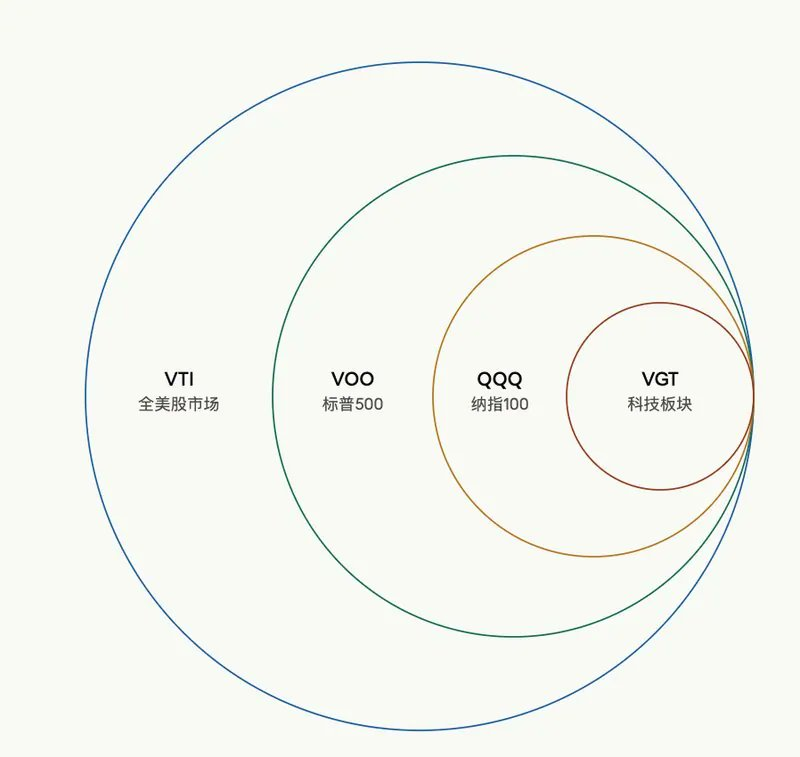

# Dreameryanyan（@yanliudreamer）：如果只有 1 万美元，我会怎么开始投资美股？

> 出海新手与小额投资者的美股极简资产配置体系：针对 1 万美元起步资金，破除频繁短线博弈迷思；详解指数 ETF（VOO / QQQ）底仓配置比例、科技巨头龙头股的定投时机、期权保护与汇率风险对冲，建立穿越周期的稳健复利投资框架。

<!-- more -->

先说一个最大的误区：

很多人觉得，投资是有钱人的事。

其实不是。

我最早也是从一笔并不大的本金开始，慢慢积累，到现在依然觉得，真正重要的不是你一开始有多少钱，而是你有没有建立起自己的投资方法。

$10,000 可能不会很快改变人生，

但它可以成为你投资系统的起点。

怎么买？为什么买？

什么时候卖？亏钱了怎么办？

所以说，就是练手，就是交学费🤓

第一笔钱不一定要赚很多，甚至可以允许自己犯一些小错。

因为你真正要练是慢慢建立自己的判断力：

- 怎么研究一家公司
- 怎么理解风险
- 怎么面对波动
- 怎么控制自己的情绪

等本金越来越大的时候，你会发现：

最值钱的，其实是前面这些小钱帮你练出来的投资能力。

很多人亏钱，都是因为太分散：今天看 AI，明天看券商，后天研究新能源，大后天又去追小盘股，每天都在研究股票，但真正研究透的公司，一只都没有。我以前也有过这个阶段。所以小资金最大的优势，不是资金多，而是可以足够专注。

假设我的现金流已经比较稳定，这 1 万美元确实是长期不用的钱，

那么我会先给自己建立一个简单的仓位框架：

底仓： 用来参与长期趋势，不因为短期波动频繁进出。

机动仓： 市场出现明显波动时再使用，而不是为了交易而交易。

现金仓： 永远给自己留一点余地，不把所有资金一次性押进去。

## 第一部分：先建立自己的安全垫。

我不会把 $10,000 全部押在个股上，如果是一个刚开始投资的人，我更倾向于先建立一个核心仓位。

比如：60%ETF，具体的四只之前和大家推荐过了

让整个市场成为自己的底仓。

原因很简单：

我不认为一个普通人必须每天证明自己比市场更聪明。

如果你刚开始投资，你可能根本不知道未来十年哪个行业会成为最大的赢家。与其花大量时间试图预测每一个行业，不如先让一部分资产直接参与整个市场长期的增长。

这部分对我来说更像是 portfolio 的地基。

## 第二部分：30% 只买自己看得懂的公司

这里才是我会开始研究个股的地方。

也是为什么我之前整理了那 10 家公司。

我并不是说这 10 只股票现在全部可以买，我更希望通过这些公司，让一个完全不懂美股的人先建立一张基本的地图：

- AI 价值链到底有哪些环节？
- 谁在提供基础设施？
- 谁在提供芯片？
- 谁在提供云服务？
- 谁拥有真正的用户和分发渠道？
- 谁已经开始赚钱？
- 谁只是市场在讲故事？

先理解行业，再理解公司，最后才是看股价。

你会发现，一旦开始这样思考，投资就不再只是“猜哪只股票涨”，而是在学习一个产业。

比如你研究 Google，可以问：

- 它靠什么赚钱？
- 广告收入占多少？
- Cloud 增长怎么样？
- AI 会不会影响 Search？
- 它的护城河是什么？
- 最大的风险是什么？

如果大家感兴趣，下篇文章来聊聊怎样了解一家公司。

## 最后留一小部分，10%给“高风险高成长”

我会留给自己非常看好，但风险也更高的成长型公司。

这部分钱的意义不是“我要靠它翻倍改变人生”，而是我允许自己参与一些高风险，高潜在回报的机会。因为高增长和低风险从来不是一回事。

很多高速增长公司，估值也会非常高，所以它们可能涨得特别快，也可能在市场预期变化的时候跌得非常狠。如果你把全部资产都押在这种股票上，那么一次判断错误就可能严重影响你的财务状况。

但如果只是 portfolio 里的一小部分，

即使判断错了，也不会影响整个系统。

所以这种“核心 + 卫星”思路的原因：

大部分资产追求稳定和长期增长，小部分资产允许自己承担更高风险，寻找更高潜在回报。

你可能第一次发现：“原来我真的拿不住一只股票跌 30%。”

也可能发现：“原来我看到别人赚钱的时候真的会 FOMO”

或者：“原来我其实更适合长期投资，而不是每天交易。”

这些认知，可能比第一年到底赚了 8%还是 18%更重要。

再分享几个 tips👉

## 1️⃣ 不要一次把所有钱都投进去

尤其是刚开始的时候，我更倾向于分批投入。

比如把准备投入股市的钱分成几份，每个月投入一部分。这样做不一定能让你的收益最大化，但它可以让你慢慢建立对市场波动的真实感受。

大家天天说的“长期投资”，和你亲眼看着自己的钱跌掉 20%，完全是两回事😂

## 2️⃣不要想一夜暴富，先学会不犯大错

$10000 最怕的不是一年少赚几个百分点，而是：

梭哈一只股票，加杠杆，追涨杀跌，听消息买股。

如果本金只有 $10,000，我宁愿第一年只赚一点，

也不愿意因为一次错误，把本金亏掉一半。

因为亏 50%，需要涨 100% 才能回来。

所以投资早期，我觉得最重要的能力是：

控制回撤，管理风险，活得足够久。

## 3️⃣ 不要买自己完全不懂的公司

这是我觉得新手最容易踩的坑。

看到别人说：“这家公司马上要涨！” “AI 赛道下一个巨头！” “这个股票已经跌这么多了，肯定要反弹！”

然后自己连它是干嘛的都没搞清楚，就跟着买了。

真的很容易被套住，别问我怎么知道的😂

所以在买一家公司之前，至少花一点时间把它搞明白：

它到底是做什么的？

它靠什么赚钱？

收入主要来自哪里？

未来为什么还能继续增长？

它的竞争对手是谁？

它真正的护城河是什么？

最大的风险又是什么？

机会永远都有。

没看懂的钱，不赚也没关系。

## 4️⃣了解大趋势和市场行情，增加信念感

市场总会有起伏，短期的涨跌很容易让人心态崩掉，但如果足够了解它背后的逻辑，就更容易拿得住。

比如 PLTR，我从 2022 年开始持有，均价还不到 20 刀。那时候它一度也跌了很多，但我对长期方向有信心，大数据+AI 应用一定会爆发。所以忍住没卖拿了三年，在低点时不断加仓，如今涨幅已高达 669%📈。同样还有 Tesla 和英伟达，了解大趋势后闭眼入也不担心。

如果只有 $10,000，我会把它当成长期投资实验账户。

用这笔钱，慢慢建立自己的投资框架：

理解公司 - 分散风险 - 长期持有 - 持续学习 - 定期复盘。

所以如果你现在手里只有几千，几万闲散的钱，

不用等到有钱了再开始学习投资，

先让自己成为一个会管理钱的人。

本金，是可以慢慢积累的。

投资的认知，也需要时间积累。

你越早开始理解公司，行业，估值，风险，资产配置和长期复利，就越早开始建立一个不完全依赖工资收入的财富系统。投资真正改变一个人的，可能从来不是某一只股票涨了多少，

## 而是从你第一次开始理解：

原来钱也可以生钱💰

最后希望大家都能早日自由！

有其他感兴趣的话题欢迎告诉我👏

如果觉得有启发，欢迎点赞留言，转发给朋友~

以上只是我的个人投资思路，不构成投资建议。

具体配置应该结合个人的财务状况，风险承受能力和投资期限。

## 相关页面

- [[sources/xingjia-young-adults-net-worth-under-1m-survival-checklist]]
- [[sources/svwang-wealthy-entrepreneurs-path-dependency-and-waiting]]
- [[concepts/b2c-conversion]]
- [[concepts/selfmedia-compound-model]]
