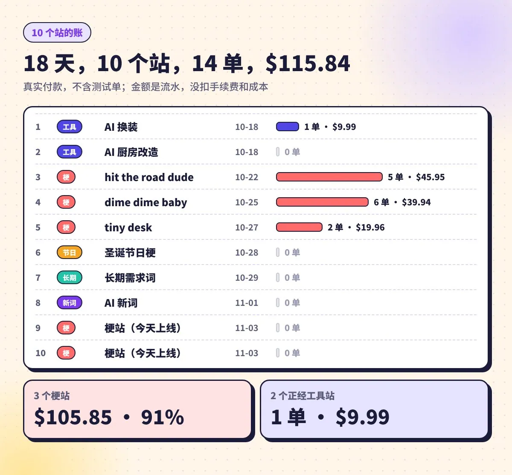
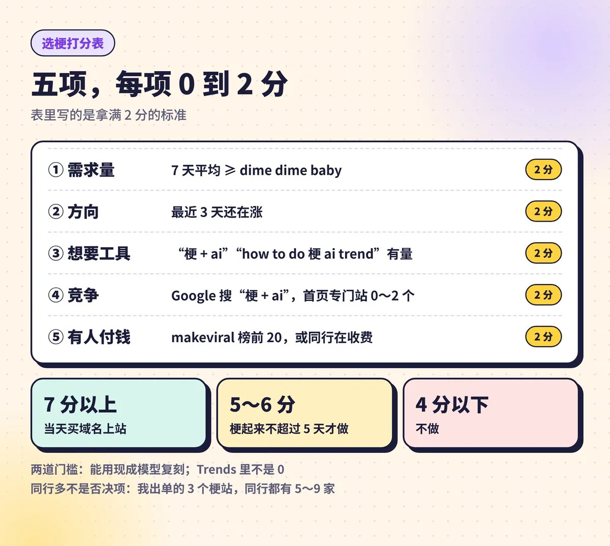
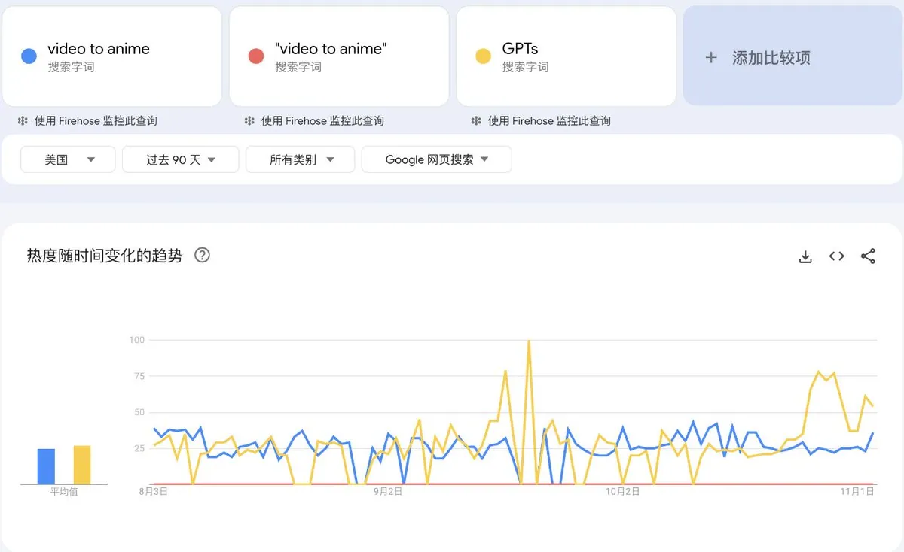
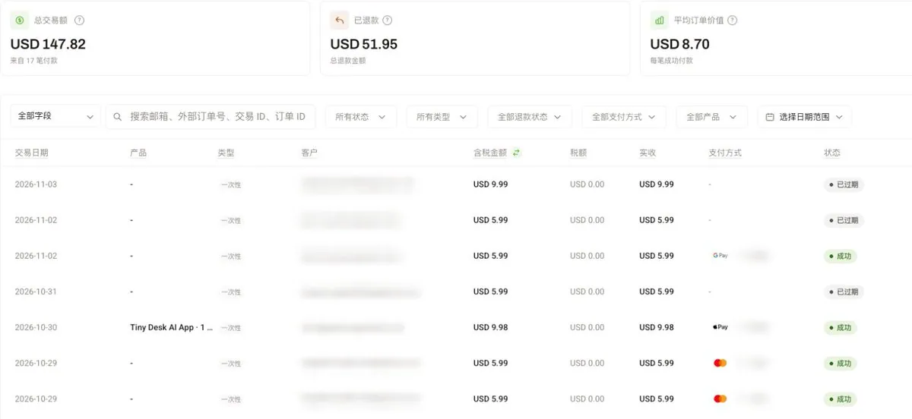
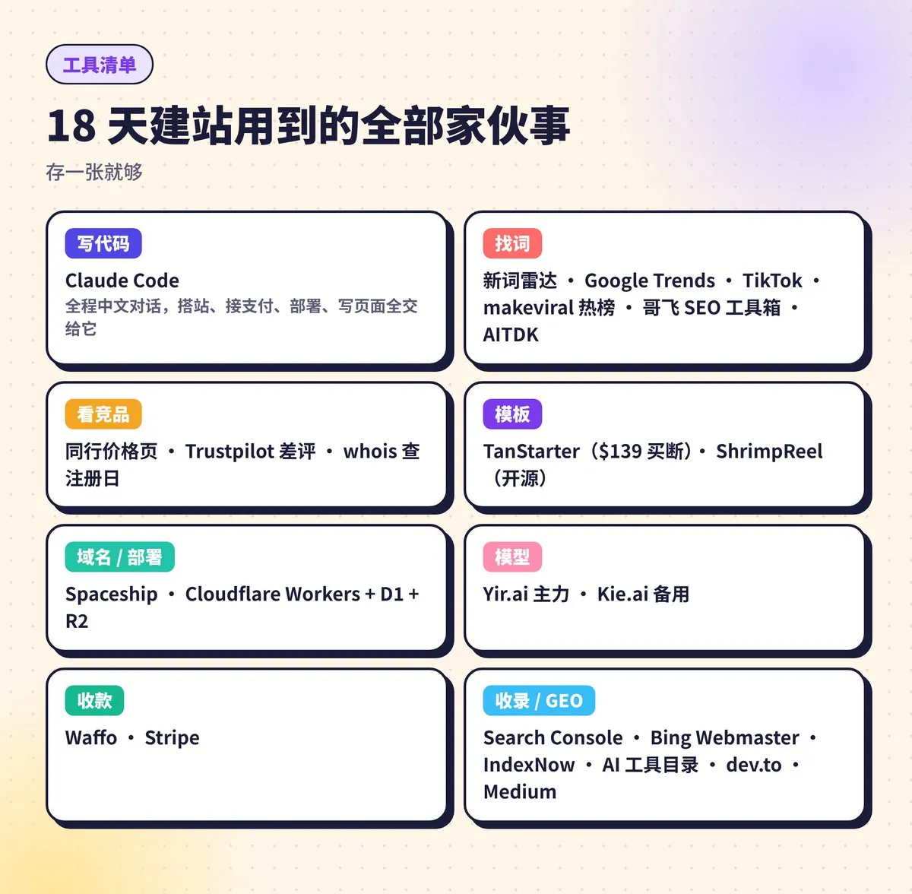

# 虹安（@yaohongan2025）：18 天做了 10 个出海站——认真做的没人买，随手糊的出了 91% 的单（新词抢跑与热梗建站实操）

> 程序员白天电商代运营、夜间独立出海实操万字复盘：18 天上线 10 个站点收获 14 笔美金付款；深刻反思「认真不值钱，选对词和抢对时间才值钱」——精心打造的换装站颗粒无收，随手跟跑 TikTok 热梗（hit the road dude / dime dime baby）的按次付费视频生成站却贡献了 91% 订单；拆解抢跑 72 小时时间窗口、西语等小语种自然流量红利、排除 GSC 爬虫假流量，以及从短平快追梗走向长期长尾需求词的三轨演进路线。

<!-- more -->

我花了两天，认认真真做了一个 AI 换装站。

选词做了两份文档，域名跟主词精确匹配，H1、Title、子页面全按 SEO 的老规矩来，一步没落。上线半个多月，出了 1 单。

后来我花一天，照着 TikTok 上一个火了的梗，随手糊了个梗视频站。上传一张照片，生成你出现在这个梗视频里的样子，按次收费。这个站出了 6 单。

18 天，我一共上线了 10 个站，收了 14 笔真实付款，$115.84。其中 91% 的钱，来自这种我自己都觉得有点糙的梗站。

说实话这个结果挺打脸的。我之前是写代码的，一直觉得认真做的东西就该有回报。这 18 天给我上了一课，做站这件事，认真不值钱，选对词和抢对时间才值钱。

这篇我把这 18 天全摊开讲。前半段是故事，我怎么一路撞墙一路拐弯；后半段是我摸出来的东西，一张选梗打分表，一个站从 0 到收款的十步，还有我花钱买来的几条教训。

先把丑话说前头，115 美金是流水，不是利润。光建站模板我就花了 $139，账面上还没回本。所以这不是暴富故事，是一个前程序员、白天还在做电商代运营的人，第一次从陌生人手里收到美金的全过程。

## 认真做的，没人买

事情是这样的。

10 月 13 号我装了一个开源的新词雷达，每天扫 AI 圈新冒出来的词。连着跑了两天，它都在推同一个词，ai outfit generator，美国月搜 1600，KD 只有 5，前 10 名里还有 4 个弱站。

我一看，这不是送分题吗。

10 月 17 号早上 7 点，我买了域名，又花 $139 买了个终身的建站模板，开干。第二天换装站就上线了。同一天，我用同一套代码又上了一个 AI 厨房改造站，觉得一套代码做两个站，血赚。

然后就是漫长的没动静。

更扎心的是做完才发现的一个事。雷达把 clothes 当成了敏感词，直接过滤掉了。结果同一个需求里最大的那个词，ai clothes changer，月搜 22200，雷达一次都没查过。我是人工补查才看到的。

我精心挑的那个词，从一开始就不是最好的那个。

## 第一单，来自哥伦比亚

10 月 21 号，我读了几篇梗视频站的复盘。其中有个大佬，一个梗刚冒头当天他就上线了，72 小时赚了五千多美金。

我看完坐不住了，当天就开始找梗。第二天，hit the road dude 的站上线；25 号，dime dime baby 的站上线。

这种站跟工具站完全是两个路子。TikTok 上一个梗火了，很多人想自己也拍一条，可他不会剪，也没那个环境，那就上传一张照片，花几美金生成一条。需求来得猛，走得也快。

10 月 27 号早上 9 点 49，后台弹了一单。

$5.99，一个哥伦比亚的手机用户，从 Google 搜进来的。我还没反应过来，13 分钟后，同一个人又买了一单。

我盯着屏幕愣了半天。不是朋友捧场，不是我自己测试，是地球另一边一个我永远不会认识的人，搜到我的站，觉得值，就付了。

引用推文：虹安 (@yaohongan2025)

给大家揭秘一下，我一个站从买域名到出单，两天。 不是什么牛逼技术，就是流程对了，简单粗暴。昨天后台弹了两单，哥伦比亚的用户，Google 自然搜索过来的，$5.99 一单。金额不大，但这说明一件事：词选对了，站做出来就有人付钱。 下面把我做站的完整流程拆开讲，每一步都说清楚。 1，找词：先看别人怎么找的 我用 Grok Bot（或者直接在 Grok 里搜）去 X 上找那些写“做网站赚钱”“出海工具站”的帖子，把地址全部贴出来。重点看的不是他们赚了多少，而是他们怎么选词的，选了什么词，用什么工具查的。 这一步别省，多找几篇，尤其是那种真的在跑站、有后...

https://x.com/yaohongan2025/status/2115268326783906189

接下来四天是订单最密集的时候，29 号一天就进了 4 单。美国、墨西哥、德国、加拿大、秘鲁，一个个国家往外冒。dime 那个站我顺手做了西班牙语的页面，结果拉美就贡献了 4 单。

那几天我刷后台比刷 X 还勤。

## 然后，一个字扎了心

爽了没几天，我把自己的数据跟几篇大佬的复盘放在一起对了一遍。

越对越难受。

hit the road dude 我是 10 月 22 号上线的，可这个梗的热度，10 月 18 号就已经见顶了。我上线的时候，它已经在往下走了。

dime dime baby 我比第一个同行晚了大概 6 天，等我进场，同行已经有 9 家。

而那个大佬，梗冒头当天就上线，85% 的钱是头 72 小时赚的。他复盘里说，如果非要说有什么秘诀，就一个字，早。

我做了这么多年程序，一直以为拼的是技术。结果站做得再快，支付接得再顺，晚了 4 到 6 天，人家吃肉，我只能喝点汤。

我跟大佬差的不是技术，是那几天。

引用推文：虹安 (@yaohongan2025)

最近一直在做新词上站，说一个很真实的感受：跟赌博一模一样。 你得找到一个新词，这个词可能谷歌上都搜不到几条结果，你就赌它接下来会火。 然后快速的去买域名、上站、接谷歌收录，然后就等。 等它搜索量涨起来，涨了你就赢了，没涨你就白忙一场！ 但我后来想明白了，这种赌其实比真赌博划算太多了。 一个域名 10 美金，做 10 个站也就 100 美金。10 个站里面能起飞 3 到 5 个就够了，剩下的全废了也不心疼。 你去赌场 100 美金能玩几把？这边 100 美金你能下 10 注，每注都有机会持续赚钱。 所以我现在就是批量上，矩阵铺，拼概率。跟电商提前布局...

https://x.com/yaohongan2025/status/2116020489961558277

## 有一天，我以为要爆了

10 月 31 号早上，我打开后台，所有站的访问量同时往上蹿。dime 一天就来了 100 次访问，全是新加坡、电脑端、从 Google 来的。

我当时心里还盘算，是不是哪个词突然排上去了。

结果去 Search Console 一看，Google 那边根本没有对应的展示。一个展示都没有，哪来的 Google 流量？

全是机器人。

那天我干的最重要的一件事，就是给自己加了条规矩，看流量之前，先把这种假的排除掉。不然你看着一片红红火火，以为自己要起飞了，其实是在自己骗自己。

也就是那天，我认真复盘了一次。11 单，几乎全集中在 27 号到 30 号，付款流程没毛病，缺的是流量，不是付款坏了。

## 我决定不追了

尝到甜头之后，人最容易干的事，就是再复制十个同类站。

我也想过。但梗这东西太看运气和时间点了，热度一过，流量说没就没。而且我已经看清楚了，论手速，我拼不过那些天天盯着 TikTok 的人。

引用推文：虹安 (@yaohongan2025)

做产品最危险的时刻，就是刚赚到第一笔钱的时候。 睡一觉起来，后台多了 几笔订单，好几个国家的人分别从 Google、Bing、ChatGPT 搜过来的。新词站，我啥也没干。 爽吗？爽。但这种钱有周期，新词热度一过，流量说没就没。 这时候最容易犯的错就是 all in 复制，再搞十个同类站，热度一退全白干。 所以我给自己分了三条线： 1. 短平快的：抓到新词就上，能赚一波是一波，全靠运气和手速。 2. 长尾的：找一直有人搜的需求词，慢慢养，至少三个月才有动静。 3. 公开构建的：在 X 上边做产品，边公开过程。过程本身就是内容，内容本身就是流量。 尝...

https://x.com/yaohongan2025/status/2115588189037682756

所以 10 月 28 号我就开始转向长期需求词，29 号上了第一个长期站，挑的是一簇美国每月好几万次搜索、竞争又不大的词。11 月 1 号我进了哥飞的社群，接上了他们的 SEO 工具箱，新站先停，重心转到 SEO、GEO 和外链上。

今天又有两个梗站上线，是之前就排好的。做完这俩，新梗我就不追了。

## 我选梗用的打分表

梗站做了几个以后，我把找梗的路子整理成了四步：

1，看 TikTok 和 makeviral.ai 的热榜，找那种“用户想复刻、复刻出来的视频也在火”的模板。

2，去 Google Trends，把梗词跟一个基准词放一起比。基准词我用 GPTs，后来也用自己出过单的 dime dime baby。

3，看 Google 首页，前排如果还是 YouTube、Reddit、新闻和大站内页，说明还有位置。

4，查域名，同名域名最近几天被注册了几个，你就知道多少人在抢。

然后用这张表打分，五项，每项 0 到 2 分。

7 分以上当天买域名上站；5 到 6 分，只在梗起来不超过 5 天的时候做；4 分以下不做。

另外有两道门槛。一是能用现成模型复刻出来；二是 Trends 里不能是 0。有个 Missed Train Dance 的梗在 TikTok 上特别火，但 Google 上根本没人搜，我就没做。TikTok 火和有人搜，是两码事。

还有一条是我后来改的。我原来觉得同行多就别做，结果复盘一看，我出单的 3 个梗站全是晚进场的，同行少的 5 家，多的 9 家。同行多不是否决项，有人在做，说明有人在买。

顺便说一个 Google Trends 的坑，我差点栽进去。不加引号的时候，Trends 会把几个单词按任意顺序一起算。我查 video to anime，不加引号热度 61，跟 GPTs 差不多；加上英文引号，几乎是 0，美国月搜只有 260。

所以由普通单词组成的词，一定加英文引号再比。

## 一个站从 0 到收款，我的十步

我的梗站后面基本当天就能上线，靠的是两样东西：模板提前备好，流程固定下来。

模板我用两套。工具站用 TanStarter，$139 买断，项目不限，登录、积分、支付、博客、SEO、后台全自带。梗站用开源的 ShrimpReel，专门做照片变梗视频，后面每个梗站都在上一个站的基础上改。

大佬复盘里有句话说得特别对，真正写代码就几个小时，因为支付、积分、登录、埋点，早在别的站修好了。

十步是这样的：

1，定词：Trends 加 TikTok 加竞品分析，把同行的价格、视频时长、示例、FAQ、退款政策列成一张表。

2，买域名：Spaceship，10 美金左右，跟主词精确匹配。

3，写建站提示词：一份完整的中文提示词丢给 Claude Code，写清梗的来历、数据、竞品、价格和止损线。后期我一定会加一句“开工前先读记忆，不要再踩以前的坑”。

4，搭站：从模板复制一份，改首页、价格页、FAQ、条款、隐私、退款、DMCA，再写 5 篇左右的长尾页，比如 how-to、梗的来历、宠物版、对比页。

5，接模型：主力 Yir.ai，Kie.ai 备用，一个挂了自动切另一个。

6，接付款：Waffo 为主，每个站单独开一个店铺，也开了独立的 Stripe 账户。

这是我最早那个收款店铺的后台，好几个站的钱都在这一个店铺里。总交易额 $147.82，里面退掉的 $51.95 全是我自己的测试单，扣掉以后再加上后来单独开店的两单，就是文章开头那 $115.84。

7，部署：Cloudflare Workers，在 Spaceship 后台把 NS 改到 Cloudflare。

8，收录：Google Search Console、Bing Webmaster 都验证，提交 sitemap，再用 IndexNow 推一下。

9，GEO 和外链：提交 AI 工具目录，在 dev.to、Medium 写文章，再直接去问 ChatGPT 相关问题，看它推荐谁、引用哪些页面，照着补。

10，看数据：后台做一个漏斗，看到生成器、选照片、登录、打开收银台、付款，每天盯订单和来源。

定价我就一个办法：照着排第一的同行的价格结构来，每档便宜 1 美元左右，不发明新档位。比如 tiny desk 那个梗，同行是 $8.90、$19.90、$29.90，我就定 $7.90、$18.90、$28.90。梗站按次卖，不做订阅，没人会为一个梗包月。每一档都要算清楚，用户把额度用满了我还得赚钱。

最后一条，是我这 18 天里觉得最有用的习惯：每个站上线之前，先把止损线写好。

梗站，3 天没有 Google 展示，或者 5 到 7 天没有付款，就停。工具站，8 周之内主词没进前 20、一单都没有，就不再加页面。

为什么要提前写？因为站做出来你会舍不得，总觉得再加两篇文章就起来了。提前写好，到点就认，不跟自己较劲。

## 花钱买来的 8 条教训

1，付费找词工具，两天烧了 30 美金左右。后来的规矩是，先用免费来源初筛，筛完再少量调付费接口。

2，测试太烧钱。做 tiny desk 乐队模式那天，模型费一天花了 $26，因为我在两家供应商上反复测同一件事。现在的规矩是，一个问题只做一次付费测试。

3，免费额度别乱送。换装站一开始送免费次数，大部分人试完就走。更离谱的是，被系统拦下来的换装请求，大多是比基尼和裸体。也是服了。11 月 1 号，免费直接取消。

4，先看清支付平台的规则。Waffo 禁止真人换脸，就算用户本人同意也不行，梗站做真人换脸有封店风险。tiny desk 那个站，我后来改成只做宠物版。

5，一个站一个收款店铺，从第一天就分开。我最开始压根不知道要分，好几个站的钱全用一个店铺收，就是前面截图里那个。结果后台一堆订单混在一起，哪个站卖了多少，我得回每个站自己的数据库里一条条对。更要命的是风险，所有站挂在一个店铺上，哪个站出点事被封，其他站跟着一起收不了钱。我是最近才开始给每个站单独申请店铺的，可每开一个要审 1 到 3 个工作日，跟追梗的速度又是冲突的。所以我现在的规矩是，买完域名当天就把店铺申请先交上去，站做完了，审核差不多也下来了。

要是站做完了审核还没下来，我还有个办法：先用 Stripe 顶上。只要你有香港银行卡，在 Stripe 新开一个收款账户都不用等审核，直接就能用。站先挂着 Stripe 收钱，等 Waffo 的店铺审核过了，再切回来就行。追梗这种事，晚一天就少一天的钱，收款可不能卡在审核上。

6，Bing 不收录，ChatGPT 就不推荐你。ChatGPT 联网搜索很依赖 Bing，我的站在 Bing 那边一直是“已发现未抓取”，去问 ChatGPT，它基本不提我。偏偏 ChatGPT 来的人付费率最高，hit the road dude 那个站 4 个付费客户里，3 个是第一次从 ChatGPT 进来的。

引用推文：虹安 (@yaohongan2025)

卧槽，我的小破站通过 ChatGPT 来的越来越多了，果然啊，现在很多人想找什么正在慢慢从谷歌搜索转换到问 AI 了，那能得到 AI 的推荐，流量不比 SEO 弱。 https://t.co/gNF5WRgTv8

https://x.com/yaohongan2025/status/2115712489652662356

7，网站别长得都一样。前几个站我全用模板默认主题，一眼看过去像流水线产品。后来改成每个站照着头部同行的视觉风格做。

8，收了钱，售后就躲不掉。11 月 2 号，tiny desk 站有个买家生成的结果有问题，我得写邮件道歉、免费给他重做，还得回头补偿 10 月 30 号那位第一个客户。人家花 9.98 美金信你一次，你得接得住。

至于工具，我整理成了一张图，存一张就够。写代码全程用 Claude Code，全中文对话；找词靠新词雷达、Google Trends、TikTok 和哥飞的 SEO 工具箱；部署和数据库全在 Cloudflare；收款用 Waffo 和 Stripe。

## 我现在卡在第二关

18 天下来，我把做出海站这件事分成了三关。

第一关，新词。拼速度、拼手感，赚快钱。我算是过了，至少证明了我做的站真有人掏钱，虽然只是喝汤。

第二关，需求词。拼耐心，拼 SEO 和 GEO，新站一般三个月左右才见效。我现在就卡在这儿，手上 10 个站先不加了，把 Bing 收录搞定，让 ChatGPT 愿意推荐我，把外链一点点做起来。

第三关，做真需求。自己去发现那些还没被好好解决的问题，找到第一批客户。这是最难的，也是我最想做成的。

引用推文：虹安 (@yaohongan2025)

做出海站这段时间，我发现有三种打法，各有各的爽和累。 1、做新词 拼速度，拼执行力，也拼选词眼光。比别人先出现就能吃到肉；不够快，就像我一样只能喝点汤，哈哈哈。 好处是正反馈来得快，特别适合刚开始做的人，先尝到甜头，后面才熬得住。但大部分新词就是一波流，一直追着跑很累。少数新词会沉淀成长期有人搜的词，那就是捡到宝了。 2、做需求词 拼耐心，拼 SEO 和 GEO 的功力。想方设法把谷歌排名做上去，再让 AI 推荐你。我这边看，AI 推荐过来的用户转化挺高。做起来了是真香，能持续赚钱。 但新站做低竞争的词，一般也要三个月左右才慢慢见效；竞争大的词更久...

https://x.com/yaohongan2025/status/2117076225630064760

回头看这 18 天，最值钱的不是那 115 美金，是我终于搞明白了，认真做一个没人搜的站，不如快一点做一个有人要的站。

你要是也在做站，现在卡在哪一关？

## 相关页面

- [[sources/fanshifu-grok-bot-800-new-sites-monitoring-workflow]]
- [[sources/geektao-geo-google-and-chatgpt-traffic-step-by-step-guide]]
- [[concepts/gefei-seo-keywords]]
- [[concepts/b2c-conversion]]
