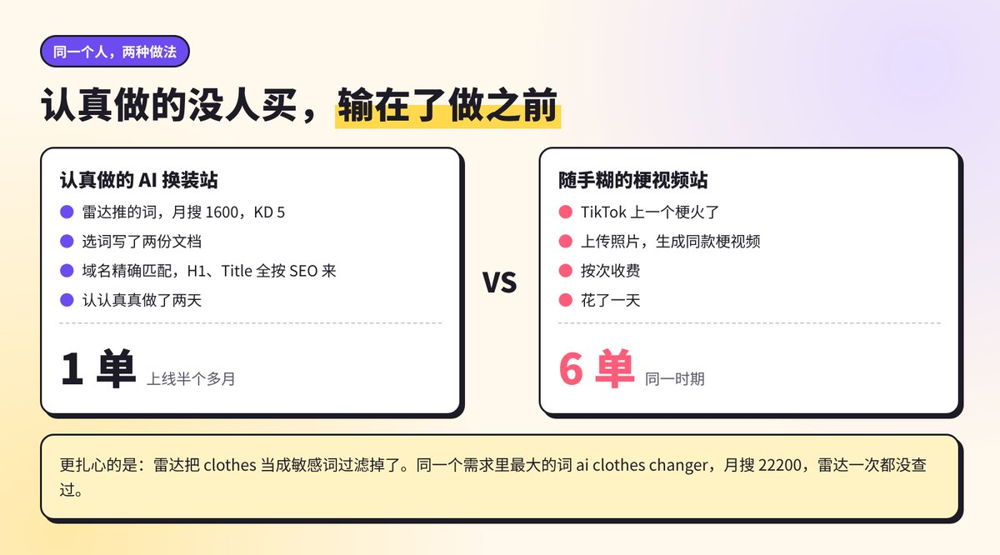
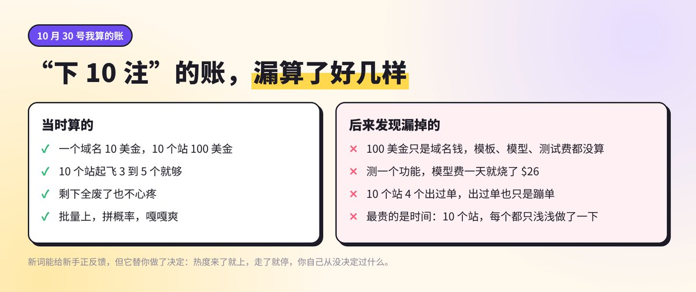
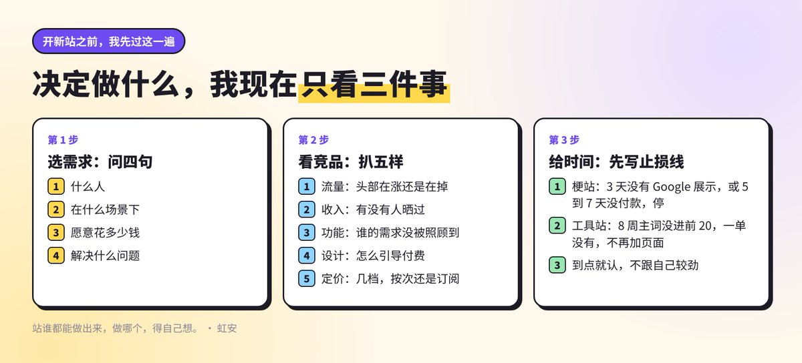

# 虹安（@yaohongan2025）：做了一个月出海站，我才发现最难的不是建站，是决定做哪个

> 出海建站一个月的复盘：真正卡住人的从来不是技术、服务器或域名，而是「做什么」这个决策——需求太宽就无从下手，太窄又撑不起商业模型；作者拆解了自己如何从人群、痛点、付费意愿、竞争密度、能否长期迭代等维度收敛方向，并给出把决定权交还给「谁在什么场景下会为什么掏钱」的判断框架。

<!-- more -->

前两天有人在评论区问我，新词站还出单吗？

还在出，就是蹦单。今天来一单，明天没动静，后天又来一单。

那一周我觉都没睡好，半夜醒了第一件事就是摸手机看后台，白天上班也心不在焉。后来翻了一圈别人的复盘，发现大家基本都经历过这个阶段。

做站快一个月了，10 个站，4 个出过单。回头看，我最大的感受跟一开始想的完全反过来。

我之前是写代码的，以为做出海站难在技术。现在模板一套，Claude Code 一开，一天上一个站真不费劲。我最快的梗站，从找词到上线，一天。

真正难的是上站之前那一步：做什么。

这篇就聊这个。我把“决定做什么”拆成三件事：选哪个需求，怎么看竞品，给它多少时间。每一件我都踩过坑，有些现在有了自己的规矩，有些还没想明白，我都如实写。

## 一、站越好做，越容易不想清楚就开干

先说一个我自己的对比，到现在想起来还挺扎心。

10 月 13 号，我装了个开源的新词雷达，它连着两天推同一个词，ai outfit generator，美国月搜 1600，KD 只有 5，前 10 名里还有 4 个弱站。我一看，这不是送分题吗。

17 号早上，我买了域名，又花 $139 买了个终身的建站模板，认认真真做了两天。选词写了两份文档，域名跟主词精确匹配，H1、Title、子页面全按 SEO 的老规矩来，一步没落。

上线半个多月，出了 1 单。

后来我照着 TikTok 上一个火了的梗，花一天随手糊了个梗视频站。上传一张照片，生成你出现在梗视频里的样子，按次收费。这个站出了 6 单。

说实话这个结果挺打脸的。我认真做的那个，输在了做之前。

更扎心的是做完才发现的事。雷达把 clothes 当成敏感词，直接过滤掉了。同一个需求里最大的那个词，ai clothes changer，月搜 22200，雷达一次都没查过。我精心挑的那个词，从一开始就不是最好的那个。

引用推文：虹安 (@yaohongan2025)

https://t.co/OxLYxyMy1g

https://x.com/yaohongan2025/status/2117599496242860127

这件事让我想明白一个道理。

以前做一个网站，要写一两个月代码，你自然会在动手前反复想：这东西有人要吗，值不值得。现在上站太快了，快到你根本不需要想清楚，先上了再说。

站的成本降下来了，可决定做什么的成本一点没降。

你选错一个词，损失的不是那 10 美金域名，是你接下来几天甚至几周的时间、注意力，还有那种“再等等也许就起来了”的心态。这些东西比钱贵多了。

## 二、我一开始的办法，是赌

刚开始做新词那会儿，我是真觉得自己找到了一个划算的玩法。

我当时还专门发了一条帖子算账：一个域名 10 美金，做 10 个站也就 100 美金。10 个站里能起飞 3 到 5 个就够了，剩下全废了也不心疼。你去赌场 100 美金能玩几把？这边能下 10 注。

引用推文：虹安 (@yaohongan2025)

最近一直在做新词上站，说一个很真实的感受：跟赌博一模一样。 你得找到一个新词，这个词可能谷歌上都搜不到几条结果，你就赌它接下来会火。 然后快速的去买域名、上站、接谷歌收录，然后就等。 等它搜索量涨起来，涨了你就赢了，没涨你就白忙一场！ 但我后来想明白了，这种赌其实比真赌博划算太多了。 一个域名 10 美金，做 10 个站也就 100 美金。10 个站里面能起飞 3 到 5 个就够了，剩下的全废了也不心疼。 你去赌场 100 美金能玩几把？这边 100 美金你能下 10 注，每注都有机会持续赚钱。 所以我现在就是批量上，矩阵铺，拼概率。跟电商提前布局...

https://x.com/yaohongan2025/status/2116020489961558277

那时候的心态就是：批量上，拼概率，嘎嘎爽。

现在回头看，这个账算漏了好几样东西。

1，100 美金只是域名钱。模板、模型费、测试费都没算进去。我做 tiny desk 那个站的时候，在两家模型供应商上反复测同一个功能，一天就烧了 $26。

2，10 个站最后 4 个出过单。出过单跟起飞是两码事，出过单的那几个，也是蹦单。

3，最贵的那一项根本没写进账里：时间。10 个站，每个站都要盯数据、回邮件、处理售后、补页面。我白天还要上班，晚上的时间就那么多，摊到 10 个站上，每个站都是浅浅地做一下。

我不是说新词不该做。我到现在也觉得，新词特别适合刚入门的人，它能让你确认一件事：我做的东西，真有陌生人愿意掏钱。这个正反馈对新手太重要了，我第一次收到哥伦比亚用户付的那 $5.99，盯着屏幕愣了半天。

但新词有一个毛病：它替你做了决定。

热度来了你就上，热度走了你就停，你一直在跟着梗跑，自己其实从来没决定过什么。这种感觉做久了会上瘾，也会把你拖累。

## 三、第一件事：选哪个需求

后来我开始想，不赌了，那到底该怎么选？

我目前的理解，做出海站大概有三种打法，我之前单独写过一条：

1，做新词。拼速度、拼执行力，正反馈来得快，但大部分是一波流。

2，做需求词。别人已经在搜的需求，拼耐心，拼 SEO 和 GEO，新站一般要三个月左右才慢慢见效。

3，做需求。自己去发现还没被好好解决的问题，还得找第一批客户。最难，一旦做成了，这群人能跟你很久。

引用推文：虹安 (@yaohongan2025)

做出海站这段时间，我发现有三种打法，各有各的爽和累。 1、做新词 拼速度，拼执行力，也拼选词眼光。比别人先出现就能吃到肉；不够快，就像我一样只能喝点汤，哈哈哈。 好处是正反馈来得快，特别适合刚开始做的人，先尝到甜头，后面才熬得住。但大部分新词就是一波流，一直追着跑很累。少数新词会沉淀成长期有人搜的词，那就是捡到宝了。 2、做需求词 拼耐心，拼 SEO 和 GEO 的功力。想方设法把谷歌排名做上去，再让 AI 推荐你。我这边看，AI 推荐过来的用户转化挺高。做起来了是真香，能持续赚钱。 但新站做低竞争的词，一般也要三个月左右才慢慢见效；竞争大的词更久...

https://x.com/yaohongan2025/status/2117076225630064760

这三个不是做完一个才能做下一个。我现在的状态是新词站还在出零星的单，同时把更多注意力放在需求词上。

那需求词怎么挑？我目前用的是三个问题，挺土，但管用。

第一个问题：有没有人在搜。

这个最基础，Google Trends 一查就知道。但我踩过一个坑，Trends 不加引号的时候，会把几个单词按任意顺序一起算。我查 video to anime，不加引号热度 61，跟 GPTs 差不多；加上英文引号，几乎是 0。由普通单词组成的词，一定加英文引号再看。

第二个问题：搜的人是想看热闹，还是想解决问题。

这个是做梗站时悟出来的。一个梗火了，搜的人里有一大块是来找这首歌叫啥、这个梗啥意思的，他们不会掏钱。真正掏钱的，是那些“我也想拍一条，但我不会剪”的人。

第三个问题：他会不会为这个付钱，付多少。

我最近看了很多月入上万刀的大佬写的复盘，有个共同点。他们看 AI 产品榜单的时候，会边看边问四个问题：什么人，在什么场景下，愿意花多少钱，解决什么问题。

引用推文：虹安 (@yaohongan2025)

前天有人在评论区问我，新词站还出单了吗？当然还在出，只是蹦单而已！ 那一周给我整得觉没睡好，主业工作也做不好，每天半夜都看手机有没有出单，看了一圈，发现大家都经历过这个阶段，哈哈哈！ 最近一直在跟朋友聊，那些月入万刀怎么做达到的呢？朋友跟我说，他们在做需求词，就是那种需要几个月打磨才能有反馈的词。我一听，怪不得呢，人家积累的足够多啊！ 后来我就看了很多月入万刀大佬写的复盘文章，无一例外都是需要几个月的打磨，他们踩坑基本上都一样，都是要么疯狂瞎上站，要么选自以为是真需求的词，但，无一例外都得做不咋出单。 后来他们随着经验打磨越来越成熟之后，就去看那些...

https://x.com/yaohongan2025/status/2119399857513230409

这四个问题我现在每看一个产品都会过一遍。过不下去的，再火我也不碰。

我自己也交过这方面的学费。有个 AI 图片站我一开始主打免费，没注册能生成两张，登录再送两张，想着用得好就付费。结果人来了一堆，用完就走，还有人换账号反复薅。后来改成只给一次机会、出图带水印，白嫖的少了一大半，反而来了真掏钱的。

那次让我明白，“有人来用”和“有人愿意付钱”，中间差着十万八千里。选需求的时候，要选的是后面那个。

还有一个思路，是朋友跟我聊的时候提的：先圈住一群人，再看这群人缺什么。

比如做出海站的这群人，找词工具、建站模板、API 模型服务、SEO 和 GEO 服务，都是刚需。这群人里我自己就是一个，我自己痛的地方，大概率也是别人痛的地方。那些做这类基础设施生意的，说实话，我挺羡慕的。

不过这还只是我的观察，我自己还没做这类东西，先放在这儿。

## 四、第二件事：怎么看竞品

决定做哪个方向之后，下一个问题是：凭什么是我？

以前我看竞品，主要是为了抄。人家首页长啥样、定价几档、FAQ 写了啥，我照着来，每档便宜 1 美元左右。这招在梗站上挺好使，因为梗站拼的是快，抄最省时间。

但做需求词，这招就不够用了。

让我改变想法的是范师傅的一篇文章，里面有句话我记到现在：别抄站，抄需求。

引用推文：虹安 (@yaohongan2025)

这篇最值钱的一句：别抄站，抄需求。 每天几百个新站上线，大部分两周后就没了。拿它们当竞品研究没意义，但拿来看需求就不一样了。一个人愿意买域名、挂支付，说明他认定这里有钱。 范师傅用 Grok Bot 每天扒 800 多个新站，看四件事：域名有没有踩需求词，是不是新注册，有没有人晒收入，做起来轻不轻。 我刚决定从新词转去做需求词、找需求，这篇来得正好。看别人在哪下注，比自己闷头想靠谱多了。

https://x.com/yaohongan2025/status/2117645379361784122

每天有几百个新站上线，大部分两周后就没了。拿它们当竞品研究，意义不大。可拿来看需求就不一样了，一个人愿意花钱买域名、挂支付，说明他认定这里有钱。

不过这里我得给自己泼盆冷水。有人买域名、挂支付，只能说明有人在下注，不能说明真有人付了钱。线索就是线索，不是证据。

那我现在是怎么看竞品的？

前几天我跟 Claude Code 聊需求站，我说我想先找几个方向砸点钱试试，赌赢了就做，赌不赢换下一个。它直接说这样没意义，钱得花在刀刃上，先确认是不是真需求。

确认的办法也朴素，就是多看。

比如想做 AI 生图，就把这个垂直领域的站一个个看过去，看五样东西：

1，流量。头部的站流量是在涨还是在掉，主要从哪来。头部还在猛涨，说明这个赛道是真的。

2，收入。有没有人公开晒过，大概什么量级。

3，功能。头部都做了哪些功能，有没有哪类用户的需求，大家都没照顾到。

4，设计。用户第一眼看到的是什么，按钮放在哪，怎么引导付费。

5，定价。几档，每档多少钱，是按次还是订阅，免费给多少。

引用推文：虹安 (@yaohongan2025)

最近一直在研究需求站，有个挺大的感受想聊聊。 做过需求词站的都知道，起码得熬 3 个月。我这种急性子，真的很难坚持。 一开始我的想法还是赌，找几个方向氪点金，赌赢了就赢，赌不赢就换下一个。跟 Claude Code 一聊，它直接说这样没意义，钱得花在刀刃上，先确认是不是真需求。 确认的办法也很朴素，就是多看。比如想做 AI 生图，就把这个垂直领域的站都看一遍，看它们的流量、收入、功能、设计、怎么定价。这一步我现在觉得比写代码还重要。 因为看得不够多，你根本没有判断依据，做什么都是蒙。看透了，心里就有底了。头部还在猛猛涨，说明这个赛道是真的；你在红海...

https://x.com/yaohongan2025/status/2118711811109175356

看完这五样，我要找的是一个具体的切口：在头部做大的这个需求里，有没有一小块是它们没照顾好、竞争又不大的。

我现在想的很简单。头部一个月挣 1 万刀，我在旁边找块小地方挣个 1000 刀也行，哈哈哈。

当然这只是我想的，到现在还没做到。

还有一种竞品是我以前完全没想到的：AI 推荐你的竞争对手。

我前几天拿手上 11 个站，每个站挑一个买家会问的问题，挨个去问 ChatGPT。11 个站，它只提到了 1 个。我把它引用的网页一个个点开看，梗站的问题，它引用的几乎全是竞品官网；工具站的问题，它引用的是大牌工具和第三方写的榜单文章。

引用推文：虹安 (@yaohongan2025)

https://t.co/j5q6jiyzrD

https://x.com/yaohongan2025/status/2118506707189977583

所以现在我看竞品，会多看一层：用户问 AI 的时候，AI 推荐的是谁，为什么是它不是我。

这一步看完，经常就能判断出这个方向我能不能挤进去。挤不进去的，我宁可不做。

## 五、第三件事：给它多少时间

这是我最难受的一件事。

做需求词，起码得熬 3 个月。我这人是急性子，做新词习惯了，上线三天没单就心里发毛。真让我对着一个站等三个月，说实话，我心里没底。

所以我给自己定了一条规矩：每个站上线之前，先把止损线写好。

我现在的止损线是这样的：

1，梗站。3 天没有 Google 展示，或者 5 到 7 天没有付款，就停。

2，工具站。8 周之内主词没进前 20，一单都没有，就不再加页面。

为什么要提前写？因为站做出来你会舍不得，总觉得再加两篇文章就起来了。提前写好，到点就认，不跟自己较劲。

但写着写着我发现，止损线只解决了“什么时候停”，没解决“为什么值得等”。

熬三个月最难的不是时间长，是你不知道自己在等什么。等着等着就开始怀疑：是不是词选错了？是不是该换个方向？一怀疑，手就痒，就想去开新站。

我现在的办法，是把等待的理由提前攒够。

前面说的多看竞品，就是在攒理由。你看过一圈，知道头部还在涨，知道这个需求真有人付钱，知道自己切的那一小块确实没人做好，这三个月就没那么难熬了。心里有底，跟硬扛着等，完全是两种状态。

还有一件事跟时间有关，是我上周才意识到的。

做了十来个站，我发现自己每次上新站都在从头问 AI：选词怎么选、上线要提交哪些地方、竞对怎么看。每次都重新说一遍，每次都花一大块时间。

所以这两天我在把重复的那几步整理成一份 Skill：选词看哪几个来源、多少分才做；上线后 Google 和 Bing 有没有提交，AI 爬虫能不能进来；竞对前几名是谁，谁被 ChatGPT 推荐了，我差在哪。

这个跟“决定做什么”有啥关系？关系挺大。

上站越省时间，我就越能把时间留给前面那一步：看需求、看竞品、想清楚。我下一个站想试试，能不能半天就把这一套跑完，剩下的时间全拿去看。

钱也一样。我最近也在想给站花钱做曝光，但给自己定了一条：只给已经有人付过钱、转化不错的站花，新站、没出过单的站一分不花，先让它自己证明一下。

时间和钱都是一个道理，先决定值不值得，再决定投多少。

## 六、我现在卡在哪

写到这，好像我已经想明白了。其实没有。

我现在的状态是这样的：新词站还在零星出单，手上的站先不加了，大部分精力在研究需求词和看竞品。需求词站到现在还没跑出来，3 个月的考验我还没熬过去。

朋友最近跟我说，你还是看得太少了。

确实。我一直是那种想走捷径的人，尤其有了 AI 之后更想走。可看得越多越发现，有些东西真没法走捷径。做自媒体讲内容的网感，做需求词就得有需求的网感，这种感觉只能靠大量地看、大量地琢磨，一点点攒出来。

AI 能帮我一天上一个站，帮我扒数据、写页面、提交收录。但这个站该不该做，它替不了我拍板。

所以接下来这段时间，我给自己定的事就三件：

1，每天看垂直领域的产品和榜单，用那四个问题过一遍：什么人，什么场景，花多少钱，解决什么问题。

2，挑一个方向，把竞品的流量、功能、设计、定价全扒一遍，找到那一小块切口再动手。

3，动手之前，写好止损线。

做出海站快一个月，我花得最多的时间在写代码和上站，可真正决定结果的，是上站之前那几天想没想清楚。

站谁都能做出来，做哪个，得自己想。

## 相关页面

- [[sources/yaohongan2025-seo-and-geo-two-layers-of-one-thing]]
- [[sources/yaohongan-geo-five-actions-guide]]
- [[concepts/indie-product]]
- [[concepts/app-idea-validation]]
