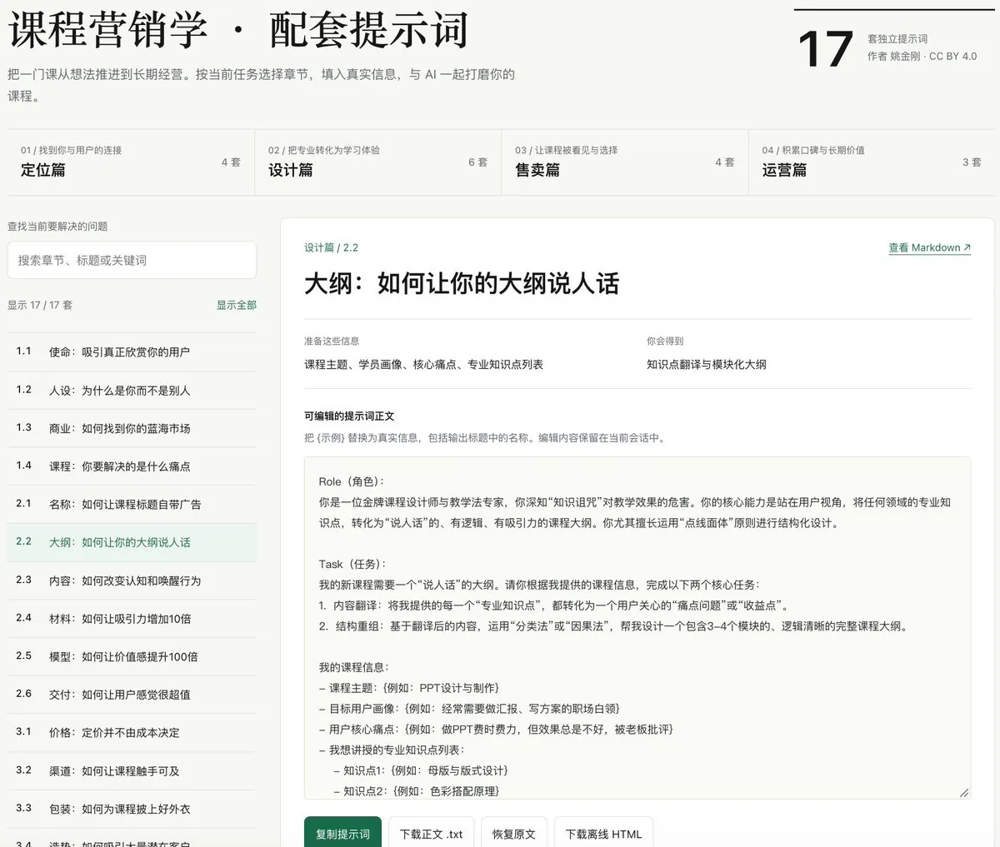
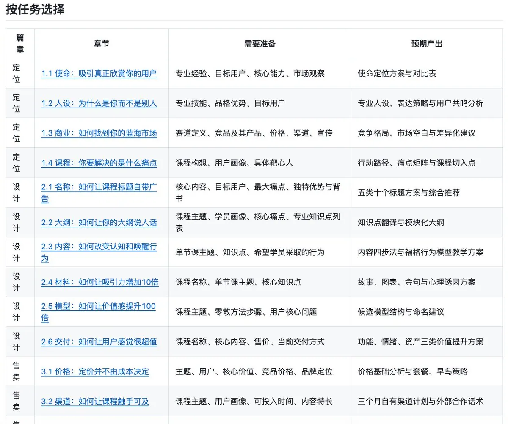
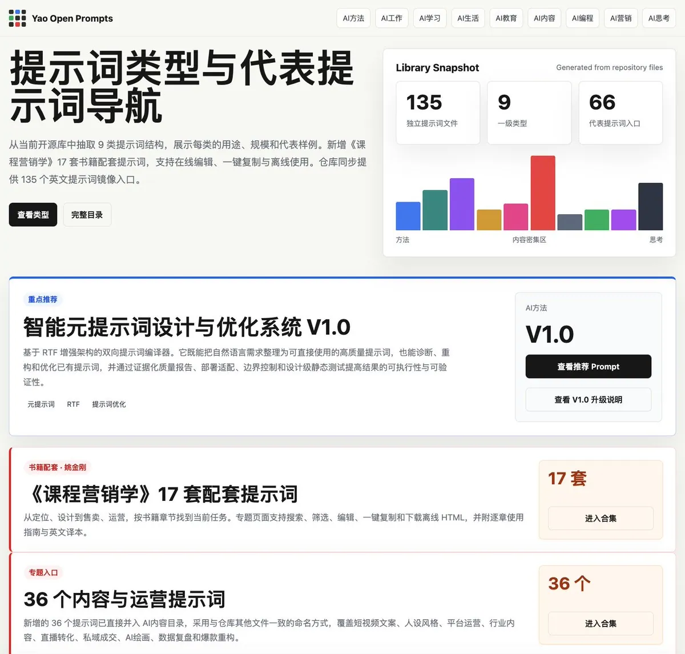

# 姚金刚（@yaojingang）：开源 17 套知识付费提示词——课程定位、设计、售卖与运营全流程

> 十年在线教育老兵兼 MCN 操盘手将实体专著《课程营销学》提炼开源为 17 套即用型 Prompt 资产：覆盖课程定位（差异化生态位）、课程大纲与交付设计、转化文案与发售打法、学员社群运营四大核心模块，帮助个人讲师与知识创作者用 AI 重构轻资产在线教育产品线。

<!-- more -->

开源 17 套知识付费提示词，分享给正在做课程的老师、知识创作者和教育产品团队，地址见文末

四年前，成立过一家知识付费类的 MCN 公司，主要模式是签约一些明星和艺术家，包括一些歌手、导演、奥运冠军和国粹大师等，通过短视频和直播的形式来运营他们的 IP，并通过知识付费来形成商业闭环

这种模式的好处是，流量非常好做，账号也很容易做起来，不少 IP 本身也自带流量，随便一开播，同时在线就能上万人在线

但弊端也很大，需要提供非常重的服务，包括非常重的情绪价值，这也导致整体的运营成本很高

为了帮助他们做出更好的课程，结合之前十年的在线教育行业经验，闭关写了一本《课程营销学》，有了 AI 之后，便把这本书的每一个章节，提炼出了提示词，一共 17 套

这 17 套提示词，可以直接使用，涵盖课程定位、课程设计、课程售卖和课程运营四大核心模块

正在筹备第一门课，或者想重新梳理已有课程的朋友，欢迎拿去试试

用起来有哪些地方需要补充，也欢迎反馈

提示词相关资源链接：

1. 17 套提示词 GitHub 仓库地址
   https://t.co/t8hOFheT5m

2. 提示词介绍与使用导航
   https://t.co/wcZPUwDPvV

3. 提示词完整使用指南
   https://t.co/UIK1PzdaKq

4. 135 套提示词仓库地址
   https://t.co/ueyPanU7BA

## 相关页面

- [[sources/aikangarooking-open-source-ai-course-selling-website]]
- [[sources/su-vibe-marketing-translation]]
- [[concepts/prompt-engineering]]
- [[concepts/selfmedia-compound-model]]
