# 老杨（@yhslgg）：AI 美女写真短视频全流程变现 SOP——养号、作图、剪辑模板、私域承接与二转交付

> 拆解 AI 美女图文与短视频私域变现全链路 SOP：设备与账号抗封养号细节、ComfyUI/FLUX/GPT Image 套图生成技巧、NodeVideo 与剪辑抠图模板、ABCD 多账号中转矩阵钩子、QQ 合并转发卡片与付费进群系统交付，以及后端线下 SPA / 同城合作的二转高客单变现模式。

<!-- more -->

老杨那篇美女无人直播发出去，大家都在问怎么搞。但又要准备电脑，又要接互动工具、配直播画面，门槛还是有点高。

引用推文：老杨啊 | AI 产品商业化 (@yhslgg)

https://x.com/i/article/2100620538473512967

https://x.com/yhslgg/status/2100621429624762667

上次预告过大家不用直播的：直接做图文、短视频，用美女写真打老色批男粉，再接到私域做付费进群。

这次的保姆级教程，把做号、养号、定位、人设、素材、私域和转化，按实际操作一步一步写给大家。

一张照片，怎么做成图文和短视频？作品有人看，怎么通过不同账号接住用户，然后让 lsp 付费进群以后，他们到底拿到什么？这里全部都讲。

而且进群费还只是第一步。文章末尾，还有更牛逼的二转、三转玩法。 先把前面这套跑顺，后面的业务才接得住。

## 前期准备：先把工具备齐

- 小红书：找人物风格、写真选题、构图参考，以及可以合作的写真作者。
- 醒图／美图秀秀：裁图、调色、抠图、做封面，把一组照片处理成统一风格。
- NodeVideo：导入模板，替换图片或视频，做卡点、运镜和转场。
- 剪映／快影：剪掉多余片段、配乐、加文字；画质需要修复时再用 Wink，也可以用它处理实况图。
- ComfyUI＋FLUX.2 klein、GPT Image 2.5、Z-Image Turbo、Qwen Image 3.0：按需要选一种作图路线，具体用法放在第三步。
- MiniMax H3：放在视频环节，用人物图和动作描述生成短片。
- GPT／MiniMax Agent：整理人物设定、提示词、文件命名和发布文案，把重复步骤做成 Skill。
- 抖音／快手、QQ、付费进群系统：发作品、承接粉丝、收款和交付。

先准备一组照片和一个承接群，再选一种适合自己的制作方法开始做。图文、模板视频、抠图视频、实况图，都能接到同一套承接和付费流程。

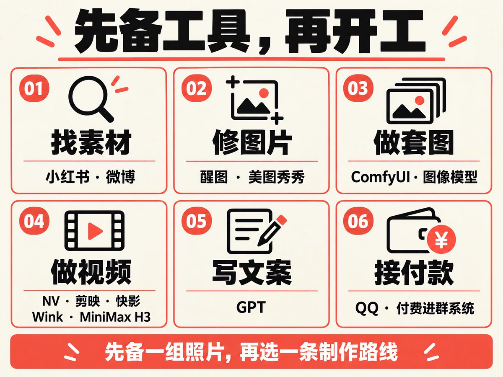

工具准备：找素材、修图片、做套图、做视频、写文案、接付款。

## 整体流程：一共九步

1. 养号：模拟真人动作正常用号，熟悉内容，检查账号，开始试发。
2. 定位：定人物风格，再决定做全国还是同城（后期有别的业务要说）。
3. 作图：小红书【纯个人喜好】找方向和作者，准备图片，修图、排版。
4. 做视频：NV 模板、抠图换背景、快手魔法、实况图、动作迁移、单图生视频，选合适的方法。
5. 发预览：用 GPT 写文案，配封面发布，每条作品给一个明确去向。
6. 放钩子：ABCD 账号承接，配合图文标记、视频文字和主页置顶。
7. 接私域：QQ 合并转发卡片展开后，展示预览、说明和商品购买码。
8. 做一转：开通或搭建付费进群系统，用户付款后领取写真、短片和更新合集。
9. 做二转、三转：再接后端业务，文末讲方向。

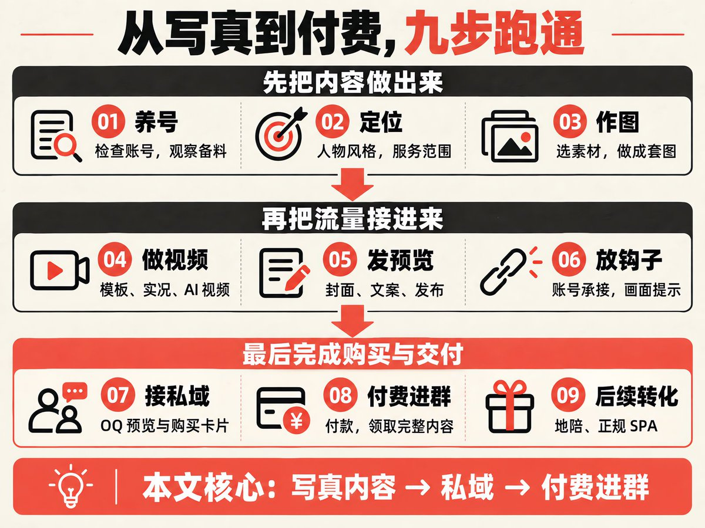

九步流程：内容制作、流量承接、付费交付与后续转化。

## 第一步：先准备帐号、养号，再开始发美女作品

切记：新号不要发太露、太擦边的内容。先用正常穿搭、街拍、日常写真起步，封面、动作和文案都别靠性暗示，后续更新也一样。

抖音新号先按“前三天观察，第 4 天试发”安排。这是准备节奏，不是平台规定或流量保证。

## 1. 准备账号、设备、网络三件套。

- 帐号：帐号可以是自己的老号或者新号，也可以 找号商买白号或者千粉美女号。
- 网络：用稳定的自有 Wi-Fi 或手机流量，避免公共网络和频繁换出口。软路由、流量卡可用于管理接入，但不等于独立公网 IP，也不能保证账号互不关联。
- 设备：安装官方客户端，起步先固定一部常用手机做一个号，少来回切号、换机，不装刷量、群控或改机工具。

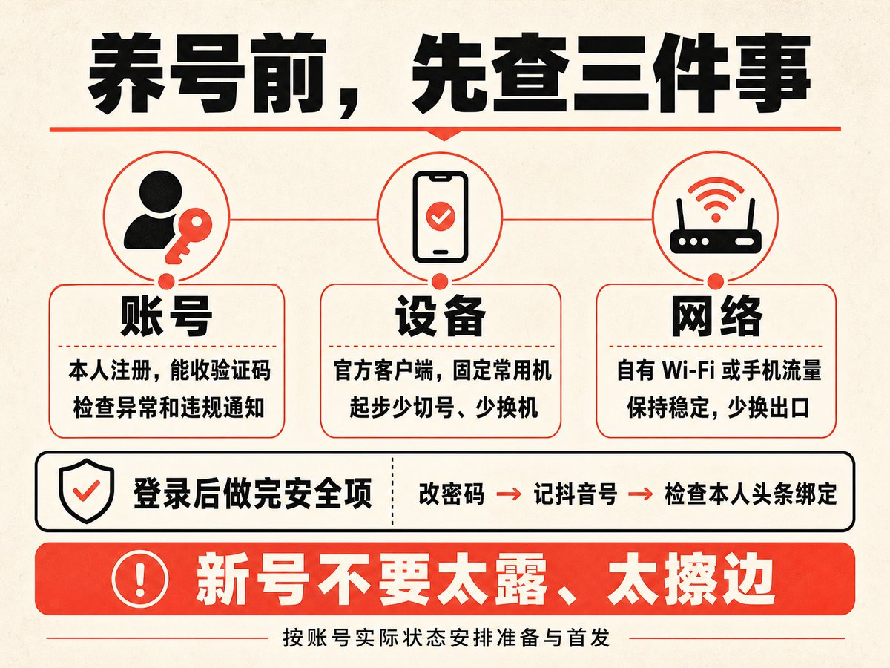

养号准备：检查账号、设备、网络，登录后完成安全项。

## 2. 帐号登录后，先做给帐号做个安全大保健。

自己的号这里就不多说了：实名、人脸核验，密码，设备绑定，安全中心帐号体检，先看登录异常、违规通知和功能限制，老号也检查，有违规就处理，处理不了的就注销。

买来的号：先找号商接验证码；扫脸核对，扫自己的脸就行，安全中心帐号体检，先看登录异常、违规通知和功能限制，老号也检查，登录后设置独立密码，核对绑定手机和登录设备，截图记下抖音号——不是手机号。

先给手机断网再联网，重新打开应用，检查登录是否正常。掉线、反复验证或出现违规提示，先查安全通知，如果有，就找号商换号。

新号必须做：

新号登录后第一件事就这么绑定好，抗封，别问为什么，问就是经验。

关闭同城推荐

## 3. 前三天：活跃帐号、不改资料、不发作品、不写评论

号准备好后，这三天，一定要去活跃帐号，去蹭同类视频热度，做热评；

做热评就是为了活跃我们的账号，

热评怎么做？直接去别人爆过的作品里面抄，再自己加工一下再发出来。

（可以自己写个豆包工作包去用关键词抓取别人的热评，很实用）

每天分几段看同赛道视频，每次约半小时。可以安排 1—3 小时做浏览、选图和记选题，看视频时别一次刷完或挂机；重点看封面、人物风格、配乐、开头和评论。

喜欢的作品适度点赞，优质账号少量关注，不连续猛赞、批量关注。头像、昵称、简介资料这三天先不动，把人物方向和第一批素材准备好。

## 4. 第 4 天：补全资料，每天先发一条

统一头像、昵称，简介先写“分享日常穿搭”这类中性内容，不急着塞 QQ 号、联系方式和进群钩子。

有合格成品再发，起步每天一条。继续正常浏览，去刷同类视频做热评。高赞评论可以截图收集（后面可以做为创作素材）改成自己的文案，别原句到处刷。

## 5. 发完先检查，数据低别急着删

先看审核状态、是否公开可见，再记录播放量、主页访问和咨询情况。数据低，先查封面、开头、素材清晰度和题材是否一致，别直接下定论说号没养号。

正常但播放低的作品，先留着复盘，不要反复删除、隐藏、重新上传；违规作品按提示处理或申诉。

起步阶段不大量私信、不频繁换设备、不批量点赞关注。群和接待入口按账号实际开放的权限使用，收到违规提示先处理。

快手的话不需要养号，第一天熟悉内容、准备素材，第二天起每天少量试发并持续更新，至少一周后才会出来流量。

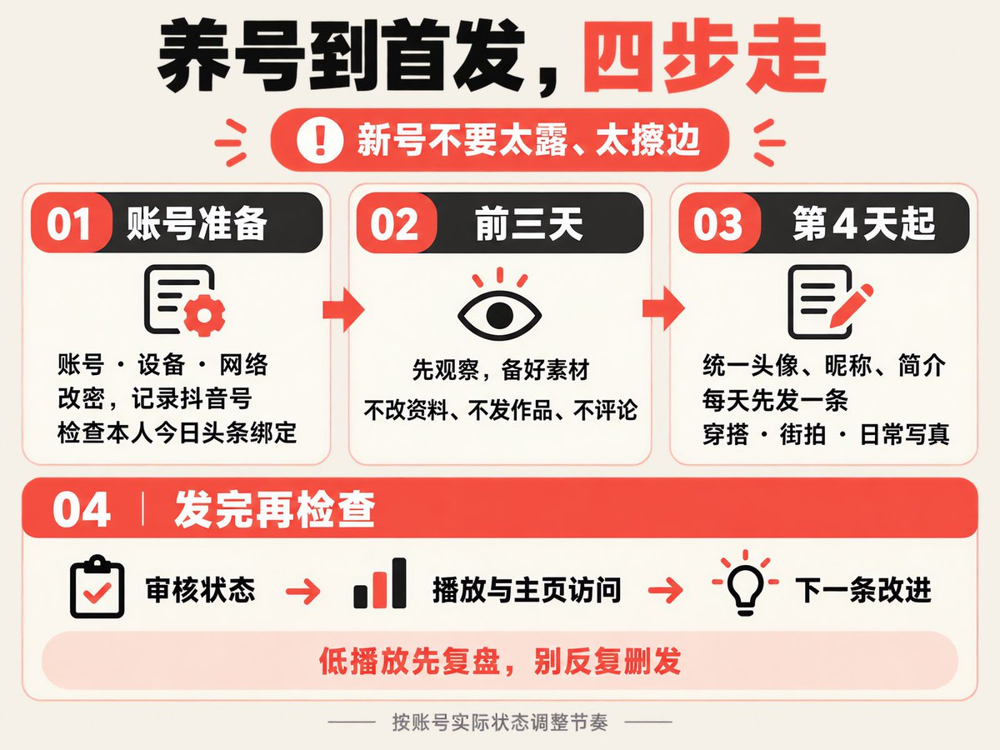

## 第二步：定人设，把这二件事做好

- 定人物和风格。同一个号围绕一个主要人物做，从甜妹、御姐、运动、古风、日常穿搭中选一个方向。
- 统一呈现。头像、昵称、服装、场景和封面保持一致；真人合作写真、AI 虚拟写真如实说明。

## 第三步：重点做法一，把图片做成一套写真

找同风格素材 → 做同系列套图 → 统一修图 → 分成公开预览和完整交付。

1. 找方向和素材。在小红书或微博搜索“甜妹日常、御姐穿搭、运动写真、古风写真、cos、瑜伽 不漏脸为主”，进入作者主页找连续作品。正式用图选自己的拍摄、授权合作素材，或自己生成的图片。
2. 做成套图。固定同一个人物和主题，再变化姿势、角度、衣服或背景。已有成套照片就直接加工；需要新图，再用下面的作图工具补齐，筛掉变形、重复和人物不一致的图。
3. 统一加工。醒图／美图秀秀做裁切、调色和封面，保留自然肤色与纹理。要放进竖屏视频的图片，提前检查 9∶16 构图。
4. 分用途保存。公开作品用几张预览，NV 用处理好的素材，付费交付保留完整高清系列。外面展示哪套，里面就能找到哪套。

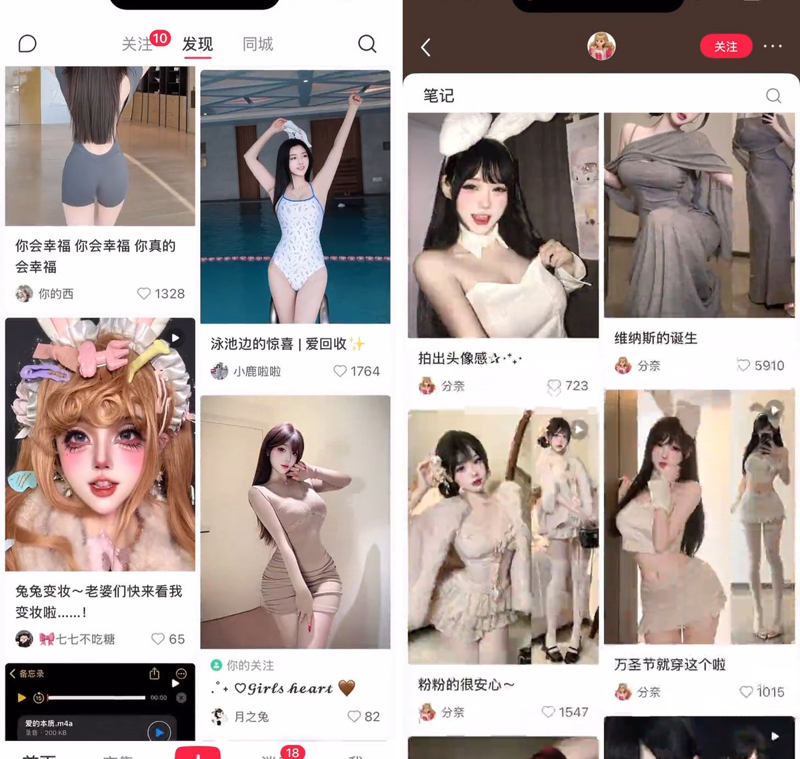

左：发现页筛选人物与风格。右：进作者主页继续找同系列作品。

## 作图工具怎么选、怎么用

- ComfyUI＋FLUX.2 klein：打开对应的图像编辑模板，按提示补齐模型文件，上传人物参考图，填写场景、服装和姿势要求，再运行出图。先跑通一张，再逐张改动作、角度，扩成同系列。
- [GPT Image 2.5](https://developers.openai.com/api/docs/guides/image-prompting)／[Qwen Image 3.0](https://www.alibabacloud.com/help/en/model-studio/qwen-image-edit-guide)：在支持该模型的图像编辑入口上传参考图，用文字说明“保留谁、改变什么”。先做满意的基础图，再围绕它换装、换背景、补不同景别。
- [Z-Image Turbo](https://github.com/Tongyi-MAI/Z-Image)：可以在 ComfyUI 中用对应文生图模板，输入人物、穿搭、场景和光线要求，先做人物底图。需要沿用同一张脸继续编辑时，再接上面的参考图编辑路线。

先用模板默认参数做一张，再慢慢调。本地模型按实际开放的步数、种子等参数逐项试；在线工具就调提示词、参考图和画质选项。一次只改一个因素，满意后保存这组设置，再扩套图。

换装就加服装参考，换背景就加场景参考，保留人物的要求可以这样写：

以这张人物图为参考，保持脸部特征、发型和肤色一致，生成【主题】的同系列写真，变化姿势、角度和景别，保持自然光线。

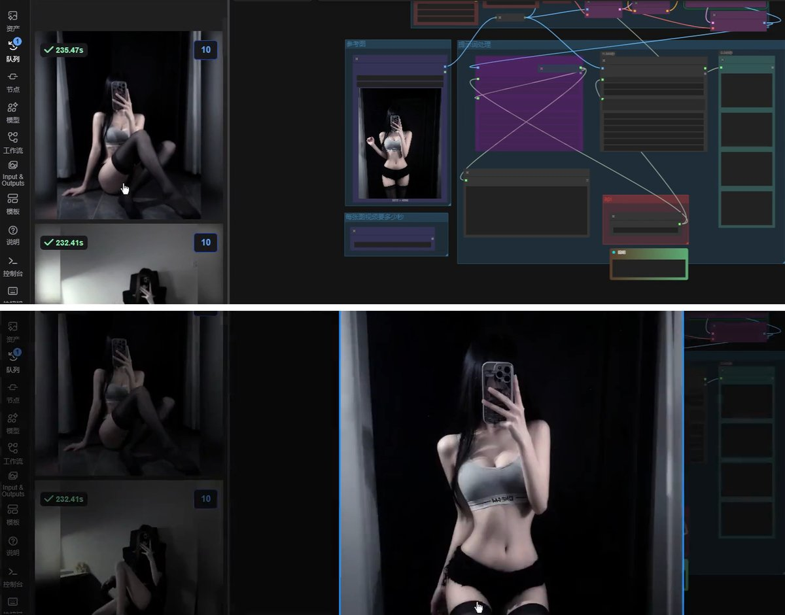

先检查人物一致性，再把选中的图片交给醒图／美图秀秀统一裁切、调色。换脸也在作图环节处理，底图和人脸参考都使用原创或已获许可的素材。

GPT／MiniMax Agent 可以把固定人设、出图要求、文件命名和配文整理成 Skill，方便后续重复执行。

## 第四步：重点做法二，用 NV 模板把照片做成视频

在小红书或 B 站搜“NV 写真模板”“NV 单图模板”“NV 多图卡点”，选与素材数量、风格相符且允许本次使用的工程文件。

- 导入。把工程包保存到手机文件目录，用 NodeVideo 导入；iPhone 也可以从分享菜单选择 NodeVideo 打开。
- 替换。在项目菜单找到“替换素材”，逐项换成自己的图片或短片，保留模板的特效和关键帧。
- 检查。调整缩放和位置，检查黑边、裁脸、字幕遮挡，再改成本期文案与合适的音乐。
- 导出。先做 7—10 秒的竖屏短片，按 1080P 导出，到相册完整看一遍，再发布。

先固定一两个模板，用新图片持续做同系列图文和短片。

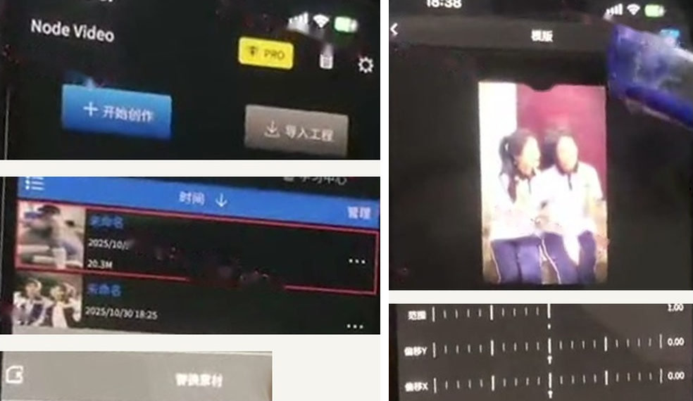

左侧找导入与替换入口，右侧检查构图、调整缩放和位置。

## 其他做法，按手里的素材选

## ① 剪映抠像换背景：有现成人物视频，用这条。

准备背景图和人物短片，在剪映里把背景放主轨，人物加到“画中画”，点“智能抠像”；调好人物大小、位置，把背景时长拉到与人物一致。再加轻微运镜，检查人物边缘、脚下位置和光线，导出竖屏成片。

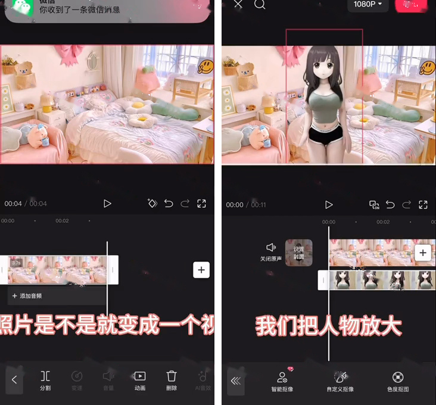

剪映：背景放主轨，人物加到画中画，再使用智能抠像。

## ② 快影＋Wink＋快手魔法：先剪素材，再加效果。

用快影导入短片，裁掉多余片段、选好封面后导出；画质需要改善，再进 Wink 做高清／人像修复。接着打开快手拍摄页，选“魔法”，用“多段拍”分段拍效果，或选择当前可用的“AI 盲盒”效果；

进入编辑页加入自己的素材，排好顺序、调时长和音乐，再预览发布。

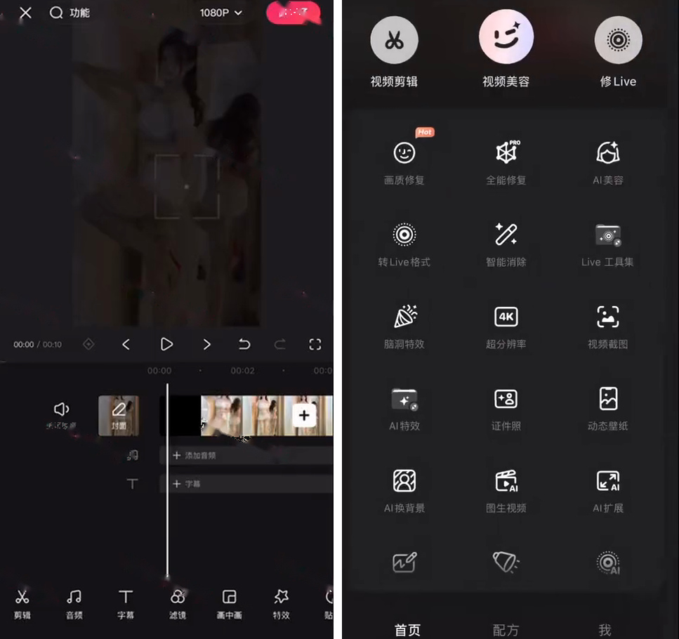

左：快影裁片、编辑。右：Wink 的画质修复和实况工具入口。

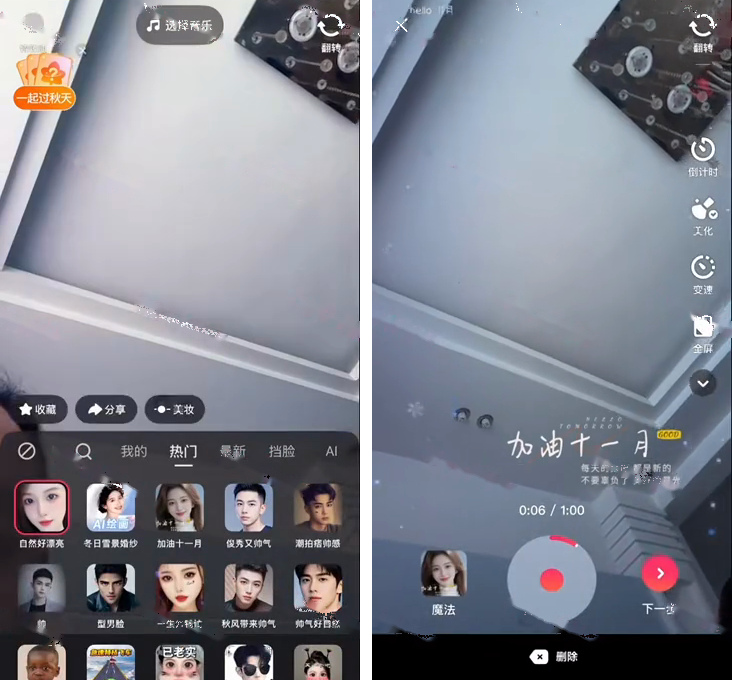

快手：选择魔法，用多段拍完成效果片段，再进入编辑。

## ③ 实况图：把一段视频拆成几张会动的图。

用美图秀秀“修视频”导入素材，按回头、微笑、整理头发等动作切段，每次保留一个短动作，导出选择 Live／实况，保存到相册。也可以用剪映的实况导出，或 Wink 的实况转换入口；发布时按顺序选择这几张实况，配文、配乐，先在相册和发布预览里确认能动。

导出格式要选实况，别选成普通 MP4 或 GIF。

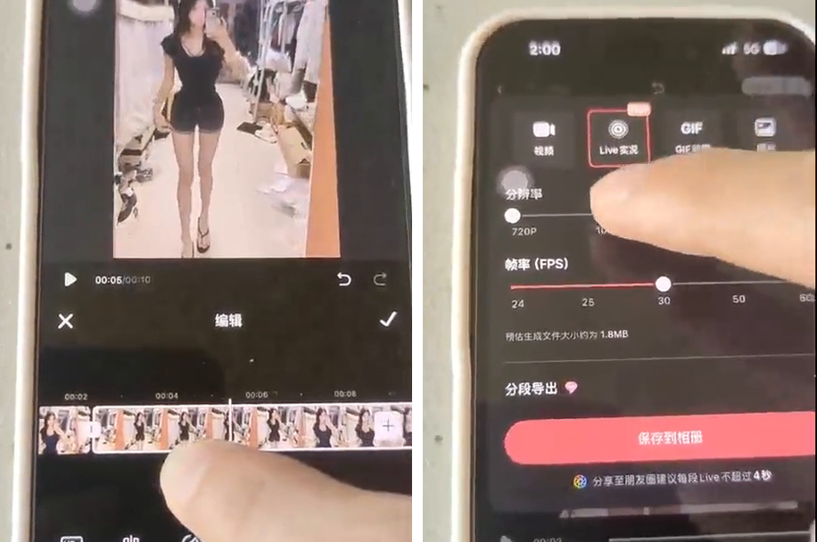

实况制作：左侧在时间线上切动作片段，右侧选择 Live 实况导出。

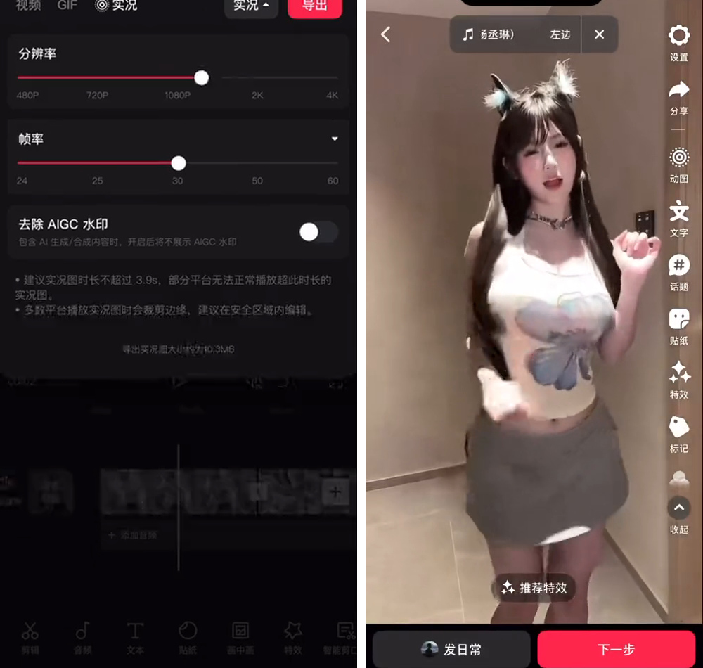

左：剪映的实况导出设置。右：发布前检查实况预览和排列。

## ④ 动作迁移：让人物跟着参考视频动。

用 ComfyUI 的动作迁移模板，选带“人物图片＋参考视频”两个输入的流程，补齐它要求的模型和节点，再分别上传素材。人物图决定外观，参考视频决定动作；先用简单短动作生成，检查脸和四肢是否稳定，再用剪映裁片、配乐、导出。

普通文生图模板不能直接完成这一步。

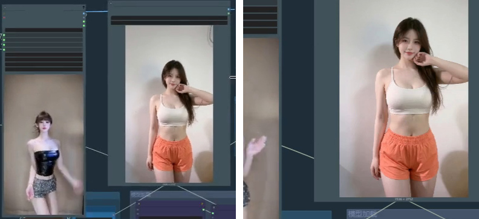

动作迁移：输入人物参考图和动作视频，对照生成结果。

## ⑤ 单图生视频：只有一张照片，也能做短片。

用 [MiniMax H3](https://www.minimax.io/blog/minimax-h3)，或在 ComfyUI 中使用已接好视频模型的图生视频模板：上传人物图，写清一个动作和镜头变化，按工具可选项设置时长、画幅，再生成。比如“人物轻微转头、自然微笑，镜头缓慢推进，保持人物和服装一致”。

生成后检查脸、手和背景，再进剪映／快影配乐、加文字；想发会动的图文，就接着转实况。

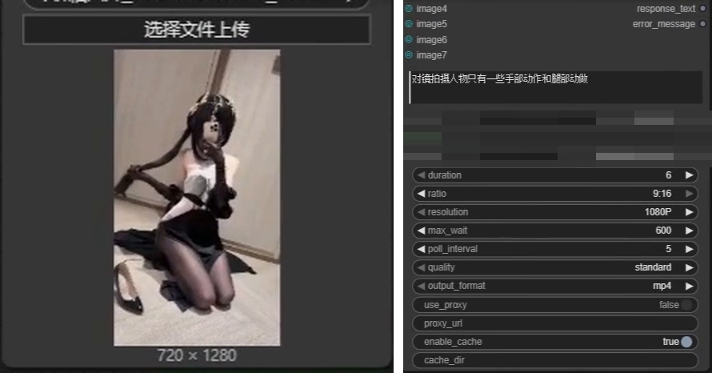

ComfyUI 图生视频示例：上传人物图，填写动作描述，再设置视频参数。

## 第五步：配好封面和文案，把图片、视频发出去

公开作品先放同一组里最好看的几张，或一段有看点的短片。第一张图、视频开头先抓住人，公开预览与付费交付对应，用户喜欢哪组，进来就能找到哪组。

## 爆款文案怎么写？用 GPT 做候选，再挑

先找同赛道表现好的作品，记下它的开头怎么抓人、问了什么、怎么引导下一步。把三五条参考文案和本期图片、画面描述一起交给 GPT，用这个提示词：

你是写真账号的文案编辑。账号风格是【甜美／运动／御姐】，本期内容是【画面描述】，参考文案是【粘贴参考】。学习它们吸引人的结构，用自己的话写 5 个版本，每条不超过 60 字，包含开头钩子、具体看点、一个互动问题；已有承接入口的，再自然加一句“完整系列看主页置顶”。分别尝试反差、选择题、场景代入，不照抄，不编人物经历，不用露骨暗示。每条再配一个 10 字以内的封面标题。

从里面挑一句最贴画面、最像真人说话的，删掉夸张空话。例如这组确实有白天与夜景两套照片，就可以写：

同一套穿搭，白天和夜景差这么多？你更喜欢哪一组？完整系列看主页置顶。

新号还没搭承接入口，就先保留看点和互动。后续换题材、换开头，结合播放、评论和主页访问来比较，别把 GPT 生成的第一条直接当爆款。

## 做完怎么发

抖音／快手点“＋” → 相册选图片或成片 → 排顺序、选封面 → 配音乐 → 填文案和相关话题 → 预览后发布。图文把最吸引人的一张放前面，视频封面与内容对应；需要承接时，再按第六步加 @账号或画面提示。

每条作品只给一个明确去向：@说明号，或者看主页置顶。发之前检查素材权限、音乐和必要的 AI 标识；发之后记录播放量、主页访问、进群、付款，知道人在哪一步没有继续。

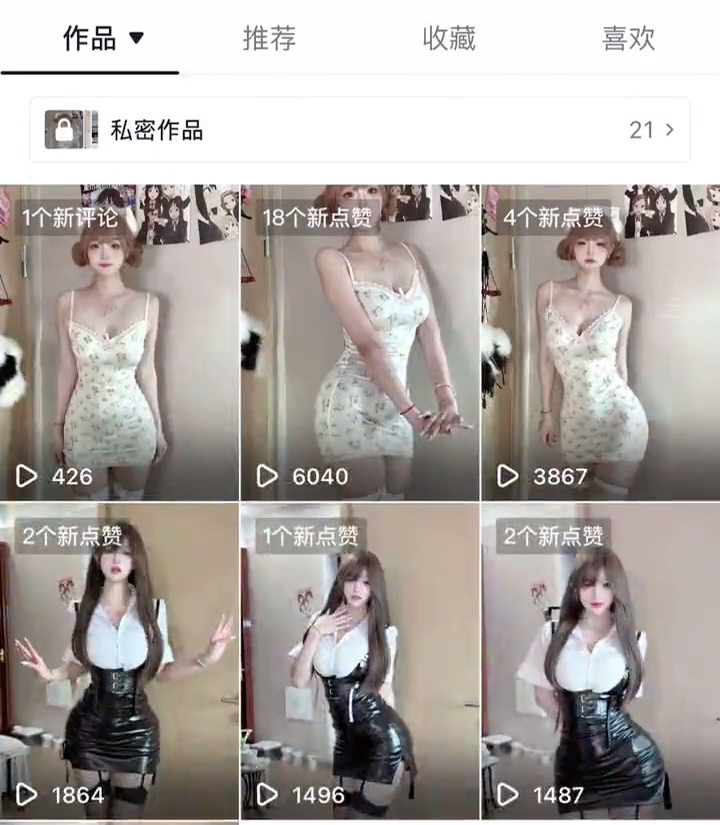

作品缩略图左下角的三角标识是播放量；预览上方的“新点赞”是另一项数据。

## 第六步：放钩子，两种方法把人接到下一步

## 方法一：A 发作品，B 中转，C 建群，D 接待

1. A 内容号：发写真预览。发布页点“@朋友／提及”，选中自己的 B 号，配一句“完整目录看 @B”。要选中真实账号，不能只手打名字。
2. B 中转号：简介或置顶说明写“目录、更新和群入口看 @C”，让点进来的人知道下一步去哪。
3. C 建群号：创建公开群，在主页展示群入口，用户点击后申请或加入。
4. D 接待号：进 C 的群，设为管理员或可发言的接待成员，发送“本期目录＋预览说明＋QQ 承接方式”，负责答疑和更新。

用户走的是：A 作品 → B 说明 → C 公开群 → D 接待 → QQ 免费承接群。站外接待信息放在账号获准使用的位置，未开放相应入口时先用站内群或客服承接。

A 展示作品与发布页的 @入口，B 简介指向 C，C 主页提供公开群入口，D 在群内接待。

搭好后，换一个普通用户视角逐个点过去，检查 @账号、群入口和接待消息。多个 A 号共用 B、C、D 时，目录、更新和接待信息也要同步。

## 方法二：图文加标记，视频加文字，引导看主页置顶

这里的“标签”是画面里的引导标记或文字提示，不是单纯加 #话题。

图文：选图片 → 在编辑页可用的“标记／文字”入口写“完整系列看主页置顶” → 放到不挡脸、不挡主体的位置。没有标记功能，就用清楚的文字提示。

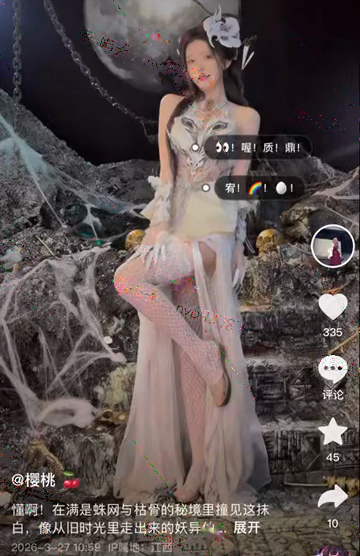

图文里的标记放在画面空白处，用来提示看主页或置顶说明。

视频：导入成片 → 编辑 → 文字／添加文字 → 输入同一句提示 → 调整位置、大小 → 拖动时间轴上的文字条，设置出现时段。先展示内容，后面再出提示，停留到能读完。

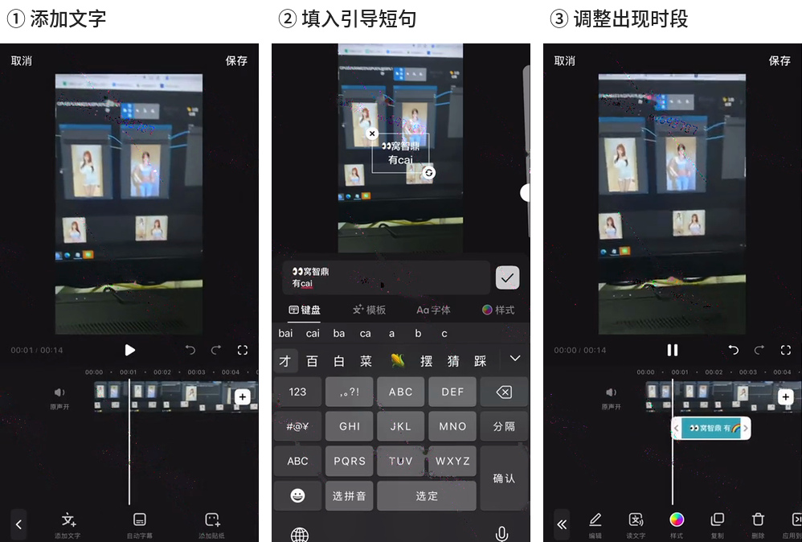

先添加文字，再填提示，最后拖动文字条调整出现位置和持续时间。文字贴纸本身不是跳转链接。

## 入口说明帖

接着发布一条入口说明帖，封面写“本期写真目录／进群说明”，正文说清完整内容、更新安排和接待入口，有置顶权限就置顶。

需要评论区承接的，在自己的说明帖下补充入口信息；图片评论、图码和跳转按账号当前权限使用，并从新用户视角试一次。

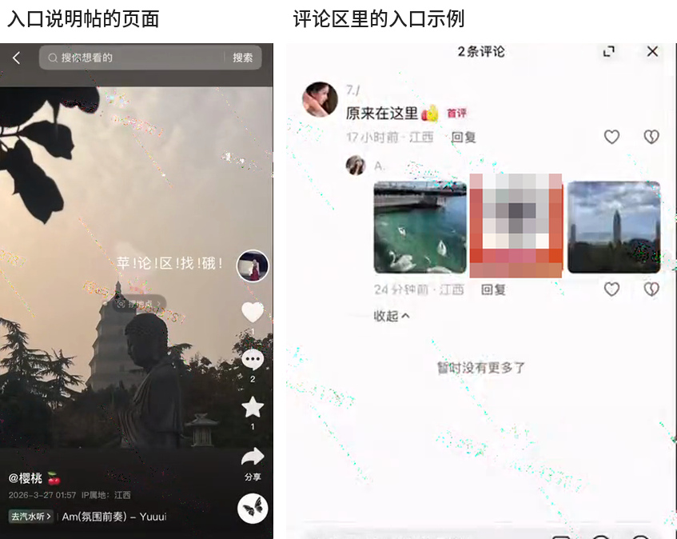

说明帖要有明确的下一步入口；使用评论区承接时，入口信息应与主页和群说明一致。

文字贴纸本身不能点击跳转。它把人带到主页或置顶，真正承接的是 @账号、群入口和接待说明。两种钩子可以配合用，但每条作品的去向要一致。

## 第七步：QQ 放第二个钩子，点开就能看预览和购买入口

先建免费承接群，付费交付群单独准备。新人进来，要能看清“里面有什么、完整内容多少钱、付完去哪拿”。

这里用 QQ 的合并转发聊天记录：群里先显示一张折叠卡片，点开后是预览、内容介绍和购买码海报。

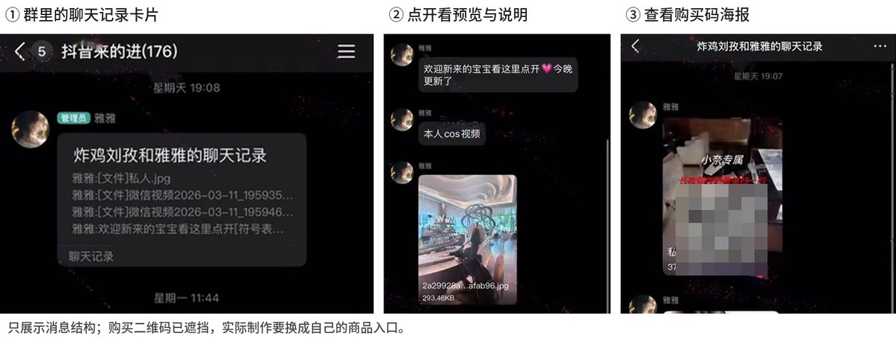

用户先看到聊天记录卡片，点开后看到预览、介绍和购买入口；二维码示例已遮挡。

## 卡片里面按这个顺序放

1. 开头提示：“本期【主题】已更新，点开先看预览。”
2. 几张预览或一段短片：与实际售卖的同一人物、同一系列对应。
3. 购买说明：完整交付什么、实际价格、更新范围或有效期。
4. 购买码海报：放第八步生成的本商品入口，说明付款后如何进群或领取。

这是商品购买码，不是免费群的加群码；免费群里也不要直接放付费群邀请链接。

## 怎么把消息折叠起来

先在测试聊天里按顺序发好上述内容，再操作：

长按消息 → 多选 → 勾选文字、预览和购买码 → 转发 → 合并转发 → 发到测试聊天。

选“合并转发”，才能生成同一张聊天记录卡片；“逐条转发”会把消息一条条发出去。先做一层，让用户点开一次就看到内容和付款入口。

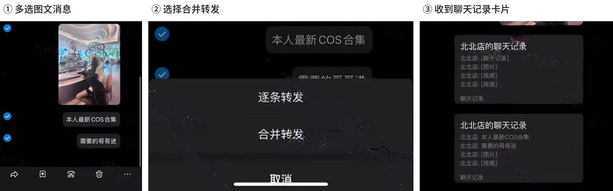

长按消息后多选，把预览、说明和购买码合并转发；收到后点开检查内容是否完整。

## 检查卡片是否可见

点开测试卡片，检查图能否放大、文字是否完整、码能否识别。确认后，由管理员发到免费承接群，公告留一句“本期目录与购买说明见最新聊天记录卡片”。

有“新成员可查看最近聊天记录”的功能就开启，再用新成员账号检查卡片是否可见；看不到时管理员补发。别让新人进群以后只看到禁言提示。

## 第八步：搭好付费进群系统，付款后交付

前面已经把人接进 QQ 免费群，也放好了写真预览。接下来，把付费系统生成的商品链接或购买码放进群里的合并转发卡片，用户看完预览，愿意买就付款进群。

## 系统怎么准备，知道这两条路就够了

买一个／开通一个现成系统，或者用 GPT 辅助搭建。功能只需要：展示写真商品、收款、查订单、付款后开放进群或领取入口。

填好介绍、价格和交付内容，接通收款，确认购买到领取能走通。系统的开发和后台操作，这篇不展开。

## 域名也要提前准备

准备多个自有或获授权的域名，让系统支持轮询与故障切换。也可租用系统商的二级域名服务，核对授权、备案主体与用途；中国内地服务器部署的网站须先完成备案。

遇到“红名”或安全提示，先排查页面、跳转和投诉，再走申诉。不能把它简单归因于用的人多，也不能把备案、换域名当成免拦截保证。

## 用户怎么买

QQ 免费群看预览 → 点购买链接或识别商品码 → 看清内容、价格和有效期 → 付款 → 按提示进付费群或领取内容。

系统支持自动交付，就由付款成功页给入口；不支持自动邀请，就由管理员核对真实订单后拉群。群里只放商品购买入口，别把付费群邀请链接提前公开。

## 付费后交付什么

交付三类：

- 完整高清写真套图
- 同系列短视频
- 约定范围内的后续更新合集

素材来自自己的拍摄、取得付费交付授权的合作作者，或自己制作的 AI 写真系列。

小红书、微博可以找写真作者谈授权；AI 套图按第三、四步制作。把对应文件放进付费群的群文件、网盘或领取页，群内固定一份目录。外面展示哪一期，付款后就能找到那一期的完整内容。

## 第九步：进群以后，还有更牛逼的二转、三转

前面收的是写真内容的钱。用户进入私域以后，如果有其他明确需求，可以再接后端业务。

地陪： 做看展、打球、城市游玩等实际陪同服务。简单搭建就是“真实服务团队＋城市项目目录＋客服＋预约入口”，靠约定的服务费或合作佣金变现。

正规 SPA： 对接实际经营的门店，整理项目、价格和授权素材，用门店已有的订单系统承接，再按完成的订单结算合作收入。

这两项适合另开教程，详细讲资源怎么找、业务怎么搭、客户怎么接。这篇先把美女写真获客、私域承接和付费进群跑通，后面再把地陪和 SPA 单独拆。

## 相关页面

- [[concepts/selfmedia-compound-model]]
- [[concepts/wechat-image-post-account]]
- [[concepts/ai-content-pipeline]]
- [[sources/missle8z-information-arbitrage-8-business-models]]
