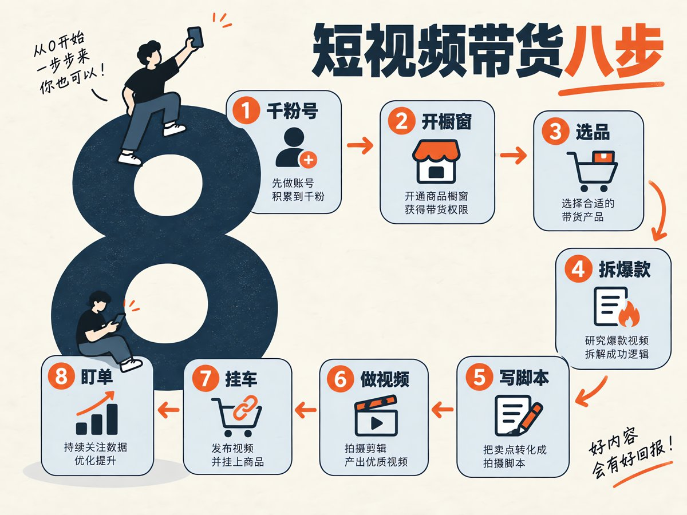
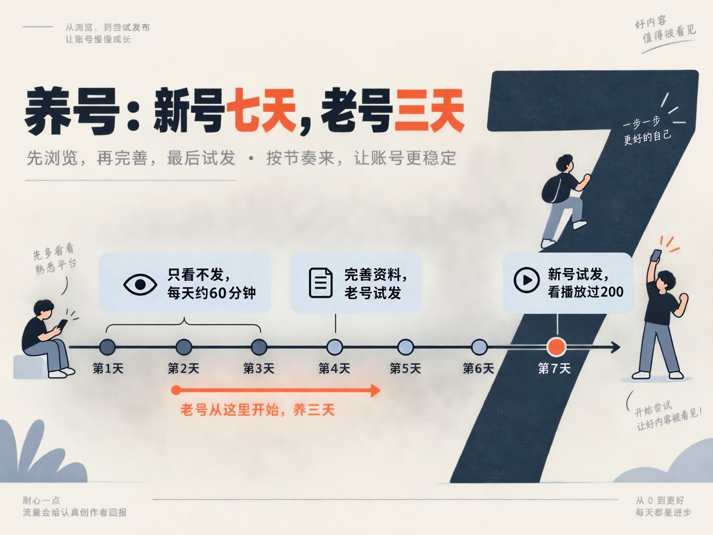
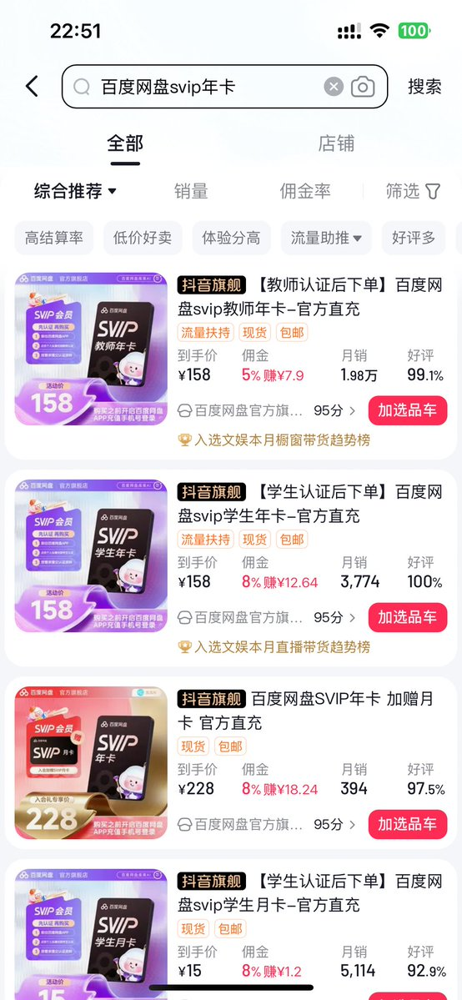
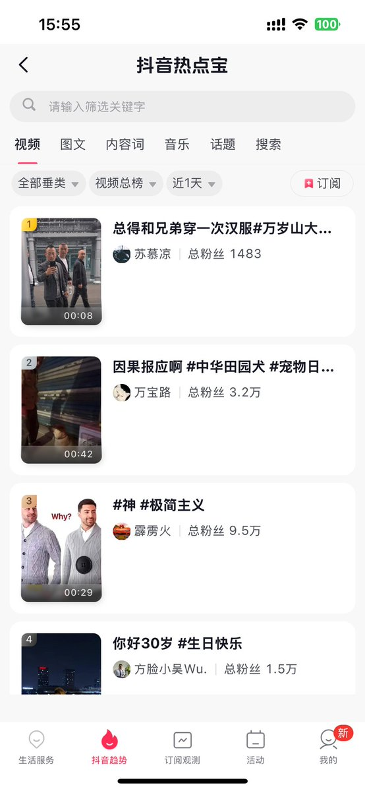
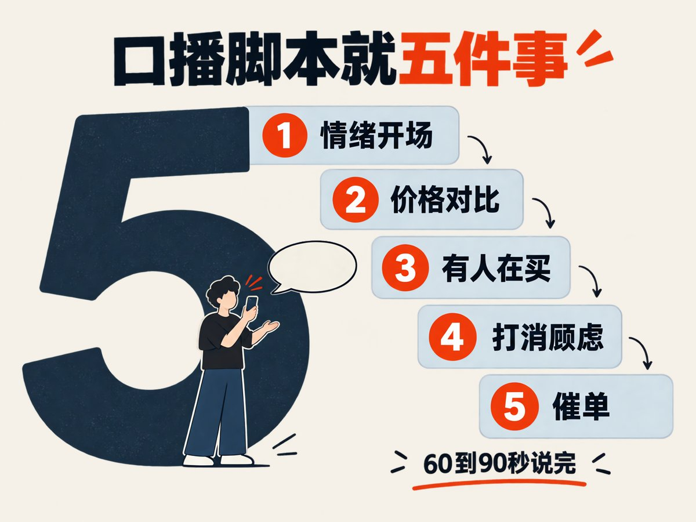
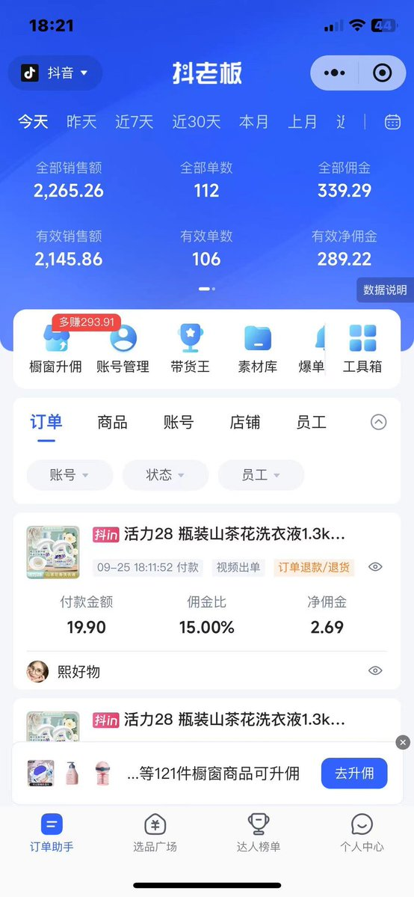
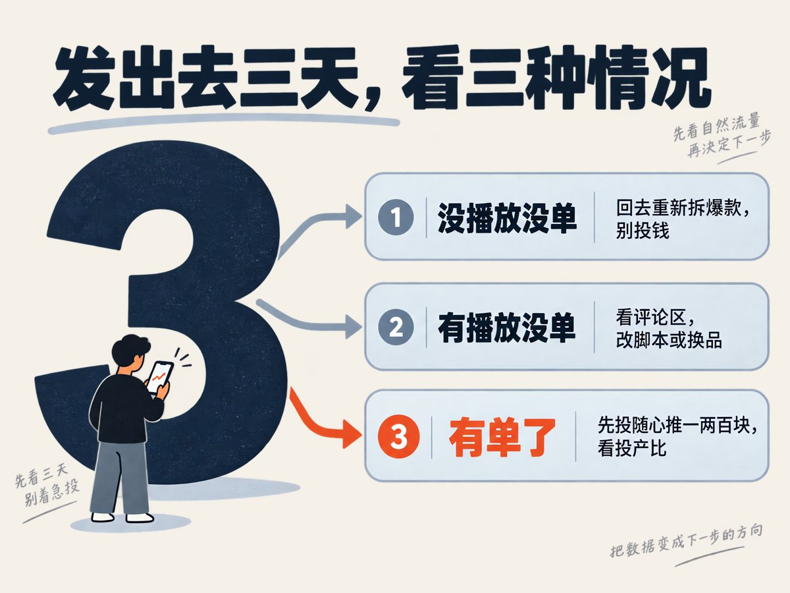
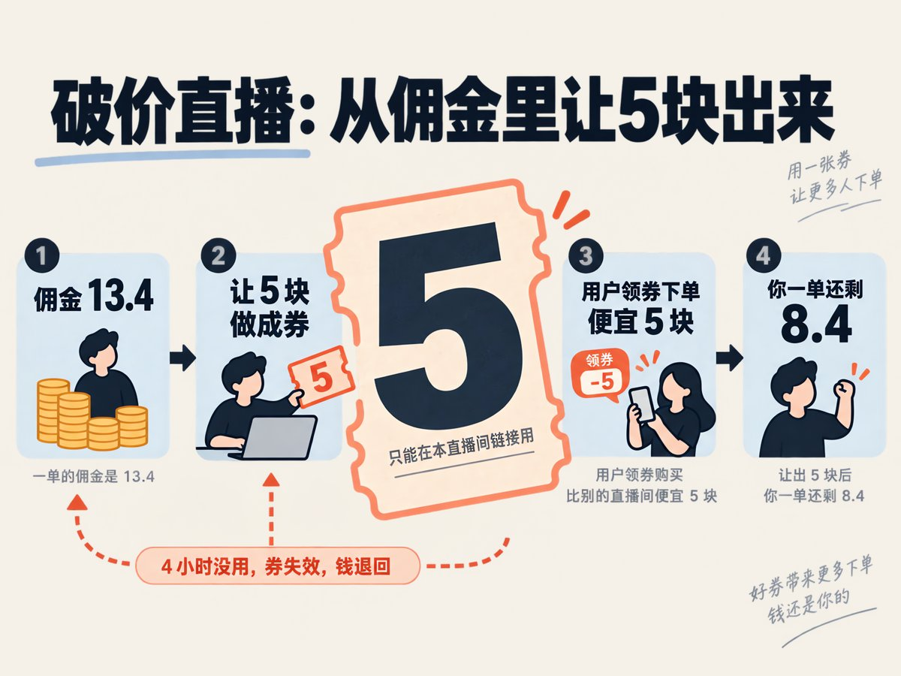

# 老杨啊（@yhslgg）：剪映/百度网盘 SVIP 年卡会员短视频&直播带货 0~1 保姆级教程

> 虚拟电商暴利硬通货——数字工具 VIP 年卡分销全景实操：详解剪映专业版与百度网盘 SVIP 的官方渠道准入与分佣比例；从短视频切片引流、直播间场景话术搭建、自动化发货履约到私域客户复购沉淀的标准化 0 到 1 运营全流程，提供可规模化复制的实操 SOP。

<!-- more -->

上一篇讲了佩琪：3.6 万粉，靠口播带剪映会员年卡，30 天带了 7500 单。评论区问得最多的一句话是——具体怎么干？

引用推文：老杨啊 | AI 产品商业化 (@yhslgg)

https://t.co/BupgfFCQWn

https://x.com/yhslgg/status/2106388709243511024

这篇就是答案。从一个没有粉丝的新号开始，到视频挂上车出第一单，再到开直播间做破价，每一步要做什么、在哪做、做到什么程度算过关，全部写出来。

你要带的不是纸巾洗衣液，是剪映、网盘、视频会员、音乐会员这类软件会员卡。不发货、不囤货、填号直充，一单佣金十几块。

分两部分：前八步是短视频带货，后面是直播带货。短视频门槛低，先跑通；直播门槛高一点，但坐得住的人收入上限更高。

## 短视频带货一共八步

1. 搞一个千粉号（买，或者自己做）
2. 开橱窗、实名认证、绑定收款
3. 去选品广场选品：销量高、佣金高的会员卡
4. 拆爆款：选品广场的带货视频、关键词搜索、热点宝
5. 照着爆款写脚本，五件事一个不少
6. 做视频：真人口播、剪映图文，或者 AI 虚拟人
7. 发布时挂车，提醒买家填对账号
8. 在抖老板或猿推推看订单和佣金，决定要不要投随心推

直播带货单独放在第八步后面讲。下面一步一步拆。

短视频带货八步：千粉号、开橱窗、选品、拆爆款、写脚本、做视频、挂车、盯单。

## 第一步：千粉号怎么来

开橱窗的前提是账号有 1000 粉，这是硬门槛。两条路：买，或者自己做。

买号：直接买千粉号最快。买回来别急着发带货视频，先按下面的养号流程走三天，让系统重新认一下这个设备和这个人。

自己做：用 AI 内容涨粉是目前最容易到千粉的路。做视频的人本来就是你的目标用户，粉丝涨起来还精准。

能发的内容有四类，挑一类死磕：

- 提示词分享：一条视频讲一个能直接复制的提示词，配上出图或出视频的效果
- 场景应用：用 AI 解决一件具体的事，比如一分钟做一条口播、三分钟出一张海报
- 工具测评：新出的 AI 视频、AI 配音、AI 剪辑工具，第一时间上手讲清楚能干嘛
- 美女类：可以搞美女跳舞，美女写真，美女无人直播，这个我之前就写过，也要吧搞一些简单的图文类的，涨粉也是快快的

引用推文：老杨啊 | AI 产品商业化 (@yhslgg)

https://t.co/0bezw416QV

https://x.com/yhslgg/status/2104418460919058651

这四类内容和你后面要带的品是一回事。等你开始带剪映、带 AI 应用会员的时候，粉丝不会觉得突兀。

## 养号：新号七天，老号三天

这套流程我在教辅资料那篇里写过，照搬过来，只把搜索词换成软件赛道。

用手机号注册，设备和号码固定。新号按七天走，老号从第二天的浏览步骤开始，养三天左右再试发。

新注册的号先不急着把昵称、头像、简介填完，第四天再集中完善。养号期间简介和背景图不放联系方式。

养号时间轴：前三天只看不发，第四天完善资料、老号试发，第七天新号试发。

## 养号第一到三天：只看，不发

第一天：先刷推荐约 10 分钟，可以点赞，先不评论。再看同城、直播约 10 分钟。然后搜赛道关键词，看 30 到 50 分钟。

搜什么词：剪映教程、AI 视频、AI 口播、数字人、提示词、网盘会员。相关内容完整看完，按真实兴趣互动。

第二天、第三天：每天约 60 分钟，继续用关键词找同类视频，完整看完有用的，适度点赞、评论、收藏、关注。

看的时候重点记三样：封面怎么做的、口播第一句说什么、评论区在问什么。

## 养号第四到七天：完善资料，试发一条

第四天：先刷 30 分钟，然后设置昵称、头像、简介、背景图，定位统一，之后别频繁改。

老号这天发一条原创试水视频，等一天看播放能不能过 200。过了就持续发，没过继续养。

第五到第七天：新号每天继续刷 30 到 60 分钟，第七天发第一条原创试水。

看两条参考线：首页推荐里同赛道内容有没有到一半左右；试水视频一天播放能不能过 200。到了就开始日更，没到继续养。

这两个数只是观察点，不是平台给的认证结果，别当铁律。

## 第二步：开橱窗、认证、绑收款

粉丝到 1000 以后，在抖音的创作者服务里找到商品橱窗，按页面提示开通。中间要做三件事：

1. 实名认证：身份证、人脸，按提示走
2. 缴保证金：金额以页面当前显示为准，这笔钱不带货了可以退
3. 绑定收款：绑好银行卡或者支付账户，佣金结算到这里

开完橱窗，精选联盟就能用了。这一步没什么技巧，唯一要提醒的是：实名用谁的，收款就绑谁的，别混。

## 第三步：选品，先学会看字段

选品广场在抖音创作者端里，电脑上也可以用百应。搜一个品牌名，比如“夸克网盘”“腾讯视频 svip”“百度网盘 svip 年卡”，列表就出来了。

每个品先看这几个字段：

- 到手价：买家实际付的钱
- 佣金：一个百分比，后面直接跟着“赚¥多少”，这就是你一单能拿的
- 月销：最近 30 天卖了多少单
- 好评：低于 95%的要留意
- 标签：高结算率、流量扶持、需要佣金发票、现货

点进商品详情，还能看到“已售”和“带货人数”。已售是总盘子，带货人数是有多少达人在带——两个数一除，大概知道竞争有多挤。

## 搜出来长什么样

下面三张是选品广场里搜“夸克网盘”“百度网盘 svip 年卡”“腾讯视频 svip”的结果页，字段位置照着对一遍就会看了。

选品广场搜夸克网盘的结果页：到手价、佣金、月销、好评四个字段一行排开。

选品广场搜百度网盘的结果页：教师卡、学生卡标题里带“认证后下单”。

选品广场搜腾讯视频的结果页：同一个品牌有年卡、季卡多个链接。

点开任意一个链接就是商品详情页，预估每单赚多少、已售、带货人数都在这里。

商品详情页：到手价、预估每单赚、佣金率在上面，已售和带货人数在下面。

两个提醒：标题里带“认证后下单”的卡，只有认证过的老师、学生能买，视频得对着这群人讲；同一个品牌多个链接时，挑活动期内、月销高的那个。

## 选品的三条硬标准

1. 一单佣金 10 块以上优先。佣金率低没关系，看“赚¥多少”那个数，客单价高的品 5%也比低价品 15%赚得多
2. 月销过千。没人买的品别碰，你不是来教育市场的
3. 活动期内。软件会员是几个商家轮着放活动的，标题带“双节”“限时”“首年特惠”的，就是现在能讲价格对比的

还有一个加分项：标签带“流量扶持”。这类品平台在推，同样的视频更容易起量。

## 第一个品从哪开始

刚起号别一上来铺十个品。先挑一个和你粉丝最贴的：

- 粉丝是靠 AI 视频、剪映教程涨起来的，第一个品就是剪映 SVIP 年卡，用户场景完全重合
- 粉丝偏家长、学生、上班族，先带网盘：夸克、百度，谁在活动期带谁。网盘的买家不是为了存照片，是为了装课程和资料，后面脚本那节细讲
- 粉丝是追剧的，腾讯视频这类视频会员月销大，转化也直接
- AI 应用的会员卡也在陆续上精选联盟，搜“AI 会员”“AI 年卡”能翻到，适合 AI 账号第二个品

一个品至少发三到五条视频再换。换品不换人设，你的号始终是“帮做视频的人省钱”这件事。

## 第四步：拆爆款，三条路

选完品，别急着拍。先找到这个品已经跑出来的视频，照着拆。

第一条路：选品广场里看带货视频。

商品详情页里有这个品的带货视频入口，电脑端百应里也有。它会列出哪些视频在出单、出了多少单。

按销量排一下，前几条就是你的教材。佩琪那条 259 万播放、2.5 千单的视频，就是这么翻出来的。

## 第二条路：关键词直接搜视频

第二条路：关键词直接搜视频。

在抖音搜“剪映会员”“夸克网盘年卡”“腾讯视频年卡”，筛选最近发布，看哪些点赞和评论高。

点进去看它有没有挂车，挂的是哪个链接，评论区有没有人问“怎么买”“填什么号”。有人问就说明在出单。

## 第三条路：热点宝蹭软件热点

第三条路：热点宝蹭软件热点。

热点宝的入口不用找，在抖音搜索框直接搜“热点宝”，第一个结果就是，点进去是“抖音热点宝”页面。

抖音热点宝页面：上面是视频、图文、内容词、音乐、话题、搜索六个榜，可以按垂类和时间筛。

进去以后这么用：

1. 顶部切到“视频”或“内容词”榜，筛选条件选近 1 天
2. 搜索框输入筛选关键字：剪映、AI、网盘、会员、腾讯视频，看最近什么在涨
3. 右上角可以“订阅”关键词，之后有相关热点它会在“订阅观测”里提醒你
4. 翻到的热点视频，点进去看它的开头和挂没挂车

软件类的热点特别多：某个 AI 工具刷屏、某个软件涨价、某个会员搞活动。热点一出，当天就拍一条，结构不变，只把开头换成热点那句话。

## 拆的时候记这五样

拿一条爆款视频，别只看播放量，把这五样写下来：

1. 第一句话说了什么，几秒钟说完的
2. 价格怎么对比的，官方多少、这个链接多少
3. 用什么证明有人在买
4. 怎么打消“是不是代充、能不能用”的顾虑
5. 最后一句怎么催的

写下来以后你会发现，不管谁拍的，这五样基本都有。这就是脚本。

## 第五步：写脚本，五件事一个不少

把佩琪那条 78 秒的口播拆出来，就是五件事：情绪开场、价格对比、有人在买、打消顾虑、催单。

口播脚本的五件事，按这个顺序填空，60 到 90 秒说完。

你写自己的脚本，照这个顺序填空就行。下面拿夸克网盘年卡举个例子，价格用的是截图上的 138：

开场：夸克是不是疯了，我刷到这个链接的时候差点以为看错了。

价格对比：你自己打开夸克看一眼年卡多少钱，再看这个链接，138，12 个月，6TB 空间。

有人在买：这个品月销 9000 多单，我后台今天也出单了。

打消顾虑：下单填你绑定的手机号，直接充到你自己账号上，不是代充。

催单：双节活动价，商家什么时候收活动我不知道，刷到就是现在。

几个写的时候要守的规矩：

- 价格只写你在选品广场和官方页面看到的数，别凭印象说“官方卖多少”，拿不准就让买家自己去 APP 里看
- “我后台出单了”这种话，自己真出单了再说
- 全程不出现“保证”“稳赚”“最后一天”这种词，容易被判违规

脚本控制在 60 到 90 秒。再长，没人听到催单那句。

## 网盘类的脚本：先讲装什么，再讲多少钱

剪映会员的买家很清楚自己要什么，所以脚本直接讲价格就行。网盘不一样，买家要先被提醒“我需要它”。

想一想谁在为网盘付费：

- 给孩子找视频课、纪录片、英语启蒙资料的家长
- 考研、考公、考证的人，手里一堆资料包
- 买了教辅资料、网课的，老师发过来的都是网盘链接
- 装机、办公的人，老版本软件、办公模板，别人分享过来的都存在网盘里

这些人共同的痛点是：别人分享给你的东西，不开会员要么下不动，要么存不下，要么过几天就过期了。

## 网盘脚本示例：开场换成场景

所以网盘的口播，第一句不是价格，是场景。还是五件事，只是开场换成场景：

开场：给孩子存的英语课、纪录片，一个链接几十个 G，不开会员下到明年。

价格对比：你自己打开 APP 看一眼年卡多少钱，再看这个链接，138，12 个月，6TB。

有人在买：这个链接月销 9000 多单，说明现在是活动价。

打消顾虑：下单填你绑定的手机号，直接充到你自己账号上，不是代充。

催单：活动是商家轮着放的，这一波收了就是原价。

同一个品，换一个人群就是一条新视频：今天对家长讲，明天对考研的讲，后天对装机的讲。开场换了，后面四句不用动。

两条红线：别在视频里说“去哪下盗版片”“哪有免费课”这类话，网盘本身没问题，但引导侵权内容会被下架甚至封号；资料类的卖点只说“存”和“传”，不说“我这有”。

## 第六步：做视频，三种做法

做法一：真人出镜口播。

效果最好的就是这种。佩琪那条就是晚上走在路边，一只手举着手机，边走边说，全程没出现过产品。

要点就三个：别用稿子念，像跟朋友说话；环境真实，路边、车里、办公桌前都行；字幕一定要有。

字幕用剪映自动识别就行，识别完检查一遍数字和品牌名有没有错。

## 做法二：不露脸，用剪映做图文口播

做法二：剪映做图文口播。

不想露脸，用剪映也能做。素材就三样：

1. 选品广场里这个品的商品页截图，把价格和佣金那行框出来
2. 官方 APP 里的价格截图，和链接价放一起对比
3. 一段你自己念的配音，或者用剪映的文字转语音

把截图按脚本顺序排好，配音贴上去，加字幕，一条视频就出来了。这种视频胜在信息密度高，适合价格对比特别明显的品。

## 做法三：AI 虚拟人，MiniMax H3 或 Seedance 2.5

做法三：AI 虚拟人复刻。

既不想露脸，又想要真人口播那种感觉，就用 AI 生成一个数字人来说。

流程是这样：

1. 脚本按上面的五件事写好，控制在 60 到 90 秒
2. 准备一个形象：一张正面人像图，或者直接用工具里自带的形象
3. 把脚本丢给 MiniMax H3 或者 Seedance 2.5，让它生成口播视频；一次生成不理想就改脚本重来，别硬用
4. 生成的视频导进剪映，加字幕、加商品截图、调节奏
5. 发布前自己完整看一遍，重点查口型、数字、品牌名

AI 做的视频，最大的问题是“假”。解决办法不是把形象做得多逼真，而是脚本够口语、够具体——你说的东西是真的，看的人就不会太在意是不是真人。

做视频的三种做法：真人口播、剪映图文、AI 虚拟人。

## 第七步：发布挂车

视频做好，发布的时候把商品挂上去：

1. 先在选品广场把这个品“加选品车”或者加橱窗
2. 发视频的时候选择添加商品，从选品车里选它
3. 标题写清楚品名和活动，比如“剪映 SVIP 年卡双节活动，填剪映号秒到账”
4. 封面或者前三秒里提醒一句：填对账号

第四条特别重要。金金做家政那条视频直接把“切记是填剪映号”做成了封面，就是因为填错号是这类品最常见的售后。

发布节奏：同一个品，一天一条，换开头不换结构。连发三天没动静就换品，别死磕。

## 第八步：挂车之后，订单和佣金在哪盯

视频挂车发出去，接下来就是盯单。抖音自己的后台能看订单，但要一层层点进去，手机上看着费劲。

做这行的基本都绑一个第三方工具：抖老板或者猿推推，两个选一个就行。绑定的步骤：

1. 下载安装，用手机号注册
2. 进“账号管理”，选抖音，授权绑定你的带货账号；几个号就绑几个
3. 绑完回首页，订单、佣金就会同步进来，之后不用再进抖音后台看

抖老板首页：顶部是今天、昨天、近 7 天、近 30 天的销售额、单数、佣金，下面是逐笔订单。

## 盯单的时候看什么

首页顶部一排数，按天切换。要分清两组：

- 全部销售额 / 全部单数 / 全部佣金：所有付款的订单
- 有效销售额 / 有效单数 / 有效净佣金：刨掉退款以后真正能结算到你手里的

两组数的差就是退款吃掉的部分。软件会员是填号直充，退款很少，这两组数基本一样；带实物的差距会大很多。

往下翻是逐笔订单。每一笔能看到付款金额、佣金比、净佣金，还有标签告诉你是视频出单还是直播出单，以及有没有退款。

每天看三样就够了：哪条视频在出单、出的是哪个品、有没有退款。出单的视频记下来，这是第九步决定投不投的依据。

## 第九步：要不要投，看这两个数

视频发出去，先看自然流量跑三天。三种情况：

没播放没单：问题在内容，回到第四步重新拆爆款，别投钱。

有播放没单：问题在脚本或者品。看评论区在问什么，是价格没讲清，还是不信任。

有单了：这时候才考虑投。小预算先投随心推，一两百块试，看投产比。

发出去三天后的三种情况，只有第三种才考虑投钱。

## 投产比怎么算

投产比怎么算：投了多少钱，带来多少单，乘以一单佣金。佣金大于投放成本，就接着加；小于，停。

比如一单佣金 13.4，投 200 块带来 20 单，佣金 268，打正了，可以加。带来 10 单，佣金 134，亏了，停下来改视频。

随心推跑得通，再考虑千川。千川门槛高一些，适合已经有稳定出单的视频。

## 随心推和千川的几条规则

投之前把这几条记住，都是跑出来的经验：

- 保本线：1 ÷ 佣金率 = 保本 ROI。佣金 5%，ROI 要到 20 才不亏；佣金 10%，到 10 就保本
- 新号一定投，老号看情况。一条视频自动投 15 到 20 块测，一天两条，一个月下来大概 900 到 1200 块预算
- 自动还是手动：自动省事，一天看一次；手动费力，出价按一单佣金的 0.8 到 1.4 倍
- 看 20 到 50：一个计划花到 20 块左右看有没有单，到 50 还没单就停；跑得好的加预算，不复制
- 一天只能改两次价，别来回折腾
- 24 小时流量会重新分配，昨天跑得好的今天不一定好，空跑两倍价格还没单直接停
- 千川和随心推没有谁更好，有空两个都开，参数差不多就行

投流的心态：投 99 个亏，1 个赚回全部，就是赚。前提是素材要过得去，实拍原创为主。

## 直播带货：破价直播是什么

短视频跑通以后，可以上直播。虚拟会员卡的直播有一种专门的打法，叫破价直播。

大白话：把佣金提前让一部分出来，做成优惠券，直播间里发给用户。用户领了券，在你橱窗的链接里下单，直接抵扣。

比如剪映 SVIP 年卡一单佣金 13.4，你让出 5 块做成达人券。用户领券以后买，比别的直播间便宜 5 块，你一单还剩 8.4。

这个券是你自己用钱充的。用户领了券 4 小时内不用，券失效，钱退回给你，成本就没花出去。领了用了，才真正从你佣金里扣。

券只能在你这个直播间的链接里用，别的地方用不了。所以用户要便宜，就只能在你这下单。

破价直播的钱怎么走：佣金 13.4，让 5 块做成券，用户便宜 5 块，你一单还剩 8.4。

## 破价直播的门槛

相对短视频，直播门槛高一点，但不是技术门槛，是时间门槛：

1. 1000 粉丝，开通电脑直播权限
2. 开通橱窗，能挂车、能直播
3. 一台电脑：设置券只能在电脑端做
4. 坐得住。有的团队是号不下播、人轮流播；个人做一天播 1 到 4 小时也行

剪映会员福利那个号，主页写的开播时间是每日早 8 点到晚 24 点，就是号不下播的打法。QQ 音乐会员 vip 那个号写的是早 8 点到晚 12 点。

## 券怎么设置、怎么发

设置和发放是两个地方，别搞混：

设置券，只能在电脑端：打开巨量百应，进“营销”，找到“达人券管理”，新建券。在这里定面额、数量、领取时间、领取条件（可以无条件领）。

发券，只能在手机端：开直播以后，点“商品”，进“设置”，选“发券”。手机端只能发，不能设置。

所以流程是：开播前在电脑上把券建好，开播后在手机上按节奏发。

发券的节奏参考直播间里的做法：固定几分钟发一轮，口播里反复说“领券再下单”；每个用户限领两张，防止一个人把券薅完。

## 直播间长什么样

直播间不用多花哨，三样东西固定住：

- 画面：一张大贴片，写清楚品名、到手价、划线价，比如“豪华绿钻双年卡 折合 125.5/年”“超级会员年卡 188”
- 券：贴片角上一个券的标识，比如“超值券包 ¥3 领券”，让人一眼看到有券
- 讲解中商品：右下角挂着当前讲的那个链接，用户点就能买

主播就坐在贴片前面讲，内容和短视频的五件事一样，只是循环讲：价格对比、领券、填号、秒到账、限时。

QQ 音乐会员 vip 直播间：左边是近 7 天 2.5 千+单、结算 50 万+，右边是直播画面，大贴片写价格，角上挂券。

网盘会员 VIP 直播间：近 30 天 5 千+单、结算 100 万+；中间是这个品的带货达人列表，320 个达人带过。

剪映会员福利直播间：近 30 天 1 万+单、结算 100 万+；主页写着每日早 8 点到晚 24 点开播，简介提醒会员充到自己账号。

## 直播间的几个细节

这三个直播间有几个共同点，照抄就行：

1. 账号名就是品名：“QQ 音乐会员 vip”“网盘会员 VIP”“剪映会员福利”，刷到的人不用猜你卖什么
2. 简介写清楚怎么买：剪映那个号简介是“点头像进入直播间下单，所以会员充到您自己的账号”，一句话把入口和顾虑都解决了
3. 一个号只播一类品：QQ 音乐的号橱窗 23 件全是 QQ 音乐，网盘的号全是网盘，不混
4. 同一个品挂多个规格：年卡、双年卡、季卡、月卡、学生卡都挂，不同预算的人都能下单
5. 贴片上的价格和券对得上：用户领完券算出来的价，就是贴片写的价，别让人算半天

起号阶段不用追求 12 小时。先固定每天同一时段播 2 小时，把话术循环顺了，有稳定出单再加时长。

## 跑起来以后，一天怎么安排

链路跑通以后，日常就是一个循环，一天大概两三个小时：

1. 早上打开抖老板，看昨天的单、退款和佣金，顺手看评论区有没有人在问
2. 去选品广场看一眼在带的品还在不在活动期，价格有没有变，链接有没有下架
3. 翻一遍带货视频榜和热点宝，有新爆款就拆，有软件热点就记下开头
4. 按五件事写一条新脚本，拍一条或者生成一条，加字幕挂车发出去
5. 有自然单的视频，看投产比决定今天要不要给它追一两百块随心推
6. 做直播的，开播前在电脑上把券建好，固定时段开播，播完看抖老板里直播出单和视频出单各多少

每天就这五件事。做满一个月，哪个品出单、哪种开头有效、什么时间发合适，你自己的数据就有了，比任何教程都准。

## 容易踩的坑

- 活动过期：软件会员的活动价是商家轮着放的，视频里的价格和链接对不上，评论区马上翻车。发布前再看一眼链接价
- 没库存：活动品有库存上限，佩琪口播最后一句就是“没库存了我也没办法”。链接下架了，视频记得隐藏
- 认证类卡：教师卡、学生卡要认证才能买，视频必须讲清楚对象，不然一堆人下不了单来骂你
- 需要佣金发票：有些品标了这个标签，结算的时候要开票，没有资质的先避开
- 搬运视频：直接下载别人的口播发出去，一是违规，二是出不了单。要拆结构，不要搬画面
- 一个号带所有品：软件会员号就带软件，突然插一个拖鞋，粉丝画像就乱了

## 最后说一句

这条链路里没有一步是难的。难的是第五步和第六步要重复做：拆一条、写一条、拍一条，发出去，看数据，再来。

佩琪的号剪映链接挂了一堆，真正出量的就两个。她也不是条条都爆，只是一直在拍。

短视频先跑通，再上直播。软件会员带货现在做的人还不多，门槛是你得会拆、会写、会做视频、坐得住。这几样，上面都给你了。

## 相关页面

- [[sources/stanley-soda-music-monetization-reality-check]]
- [[sources/clanhj-channels-elderly-blessing-ai-video-pitfalls]]
- [[concepts/selfmedia-compound-model]]
- [[concepts/b2c-conversion]]
