# Yooee（@Yooeec3）：妈妈教程｜像亲妈一样手把手教你 0 粉新号在小红书完成「流量→收钱」闭环

> 极具人情味与可执行度的小红书搞钱保姆级手册：跳出盲目追求点赞涨粉的数据陷阱，直击 0 粉新号变现本质；详解垂直定位卡位、高转化钩子文案设计、群聊与置顶引流安全合规路径、高单价咨询交付与客单价提升秘诀，跑通小红书到私域的最短收钱通路。

<!-- more -->

### 开头展示成果：

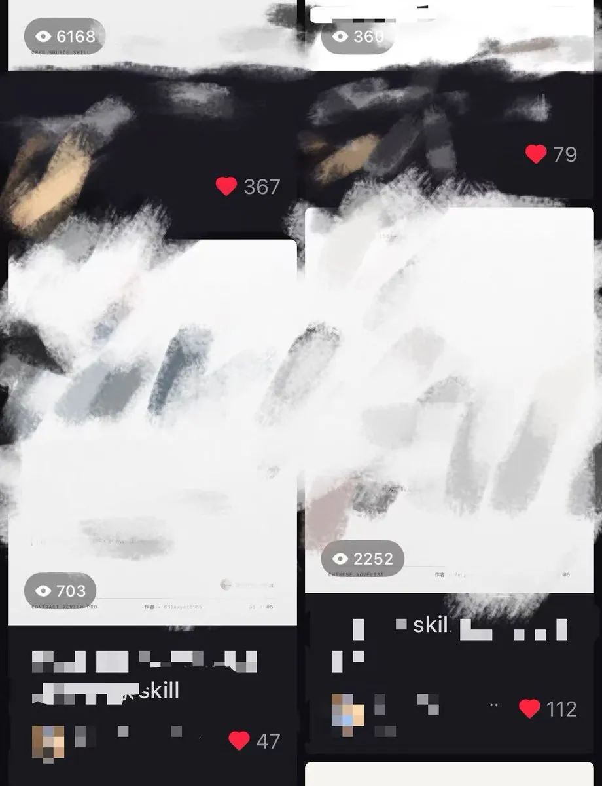

不会运营不会起号？

写的就是零基础喂饭教程。谁来谁都行。

这篇文章主要写：

怎么通过小红书从 0 粉到验证需求，跑通完整商业闭环。（学会了底层思路，任何行业适用。）

为什么要顺着平台正在推的方向做？

平台的机会，跟你已经有多少粉丝没有必然关系。

平台正在推的内容就是一个巨大的流量池，不管你是 0 粉还是 10 万粉，你进去都能接得住这波流量。

你什么都不会，能不能做？

- GitHub 上有现成的作品，你自己用 AI 做过的小网页、小工具，也可以拿出来。

这篇主要讲 AI 怎么在小红书怎么从 0 启动到自己跑去赚钱，分三步走。

一、找作品。Skill 或网页作品，有自己的就用自己的，不会就去搬运。

二、发笔记。把效果放出来，选平台扶持的话题，让别人看到你。

三、接住流量。接好收费和交付，把使用入口挂出来，睡后收入收起来。

### 你需要有什么

首先，你会翻墙。

然后，你会搬运，或者你自己会创作作品。

再一点，执行力。

### 你需要付出什么

愿意花时间动手。找作品，发笔记，挂付费。（如果你会搭全自动工作流，交给你的好朋友动手也可以）

对照一下自己，觉得这些都 OK，就接着往下看。

下面，进正文。

## PART 1 准备作品

### 1.1 准备 Skill

手里有 Skill，就拿自己的。没有、不会做，就去搬运 GitHub 上的高星 Skill，或者推上已经火的。

比如这种，已经被验证的爆款 Skill。

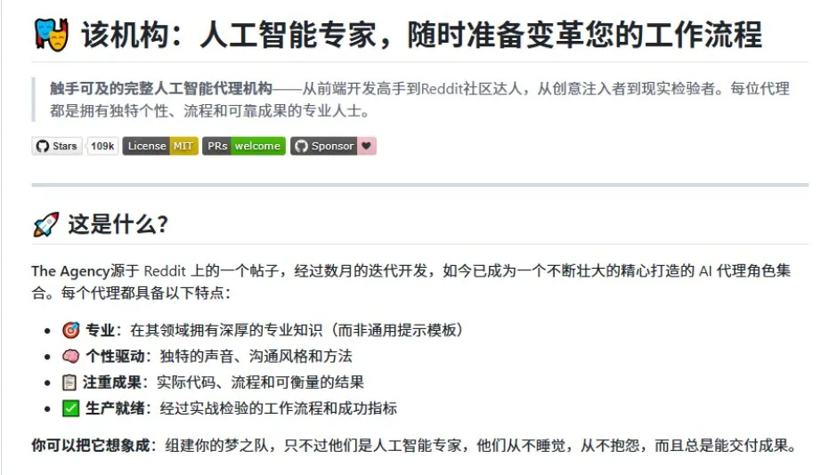

###

### 1.2 网页作品。

自己 Vibe Coding 做过的小网页、互动作品、AI 工具，都可以拿出来。有自己的就用自己的，不会就去搬运。

网页作品做成什么样可以收钱

比如[@方木](https://x.com/clamm3y)，把个人主页做成一个能逛的展厅。做个小红书版，里面换成旅游照片，带上 Vibe Coding 的 tag，就可以试着卖作品。

请记住，你是高贵的创作者，你卖的不是代码不是压缩包，是授权大家二创的资格。

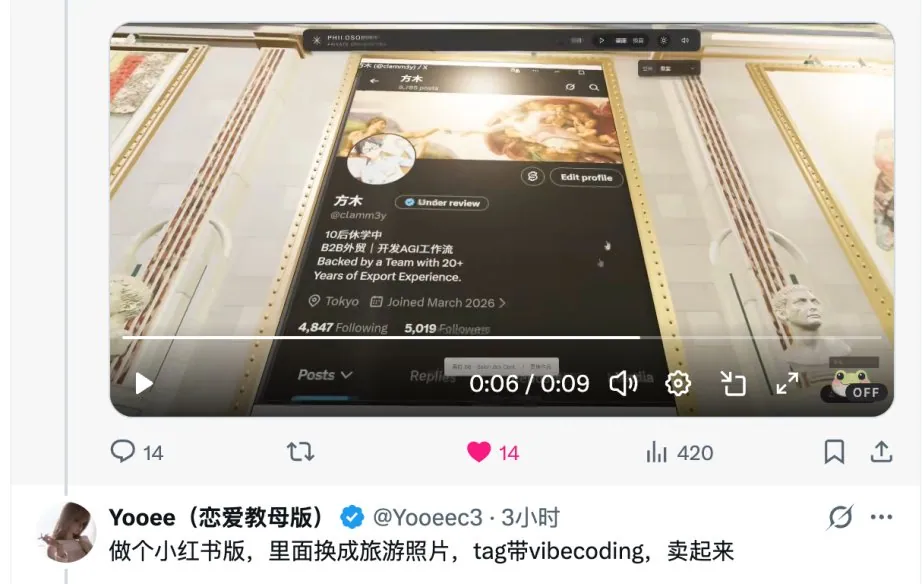

原推文放这里，感兴趣的可以看看

引用推文：方木 (@clamm3y)

我耗时三天三夜做出来的画廊 竟然无人在意🥶🥶 也许是我水平太低，我已万念俱灰 https://t.co/YlmSnGjsE9

https://x.com/clamm3y/status/2107465275344138384

自己不会做，就在 x 搬一下类似的。。。。

## PART 2 发小红书笔记怎么赚钱（Skill/vibe coding）

### 2.1 视频的效果最直观、最震撼

我起号的判断是：视频的效果永远是最好的。最直观，最震撼！

网页就录操作过程，点一下会发生什么、动起来是什么样，直接展示成果。

视频怎么起：就录个仓库的讲解视频，说明白它能干什么就行。很低成本，你拿 AI 的语音讲都可以。

（这种帖子可以干到 1.4w 收藏，你可以想象路过的人每个人给你十块钱）

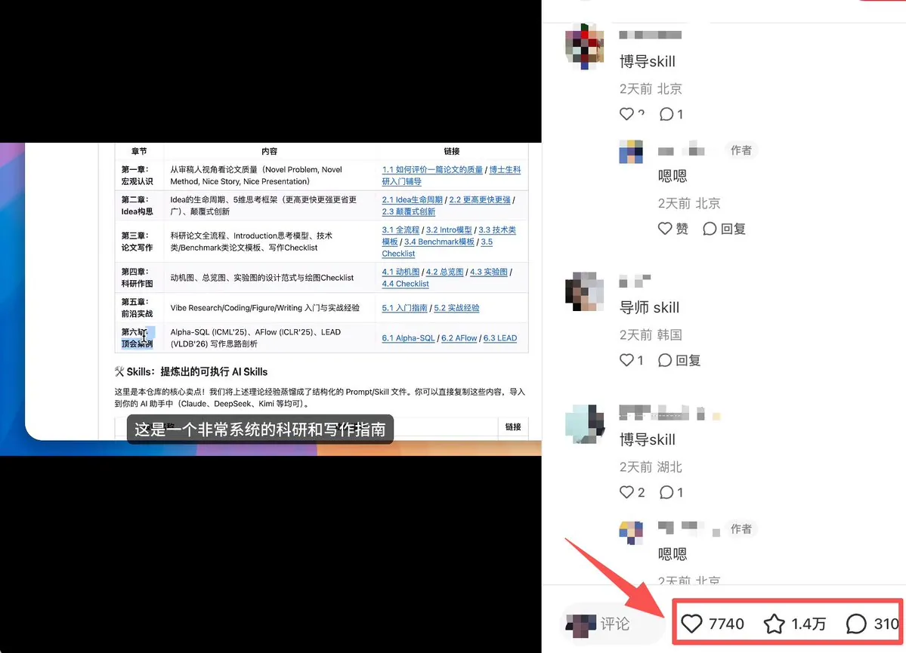

小红书很吃审美。一句话：只要你审美高级，天价也有人买单。

图文怎么起：直接截图仓库，AI 文案

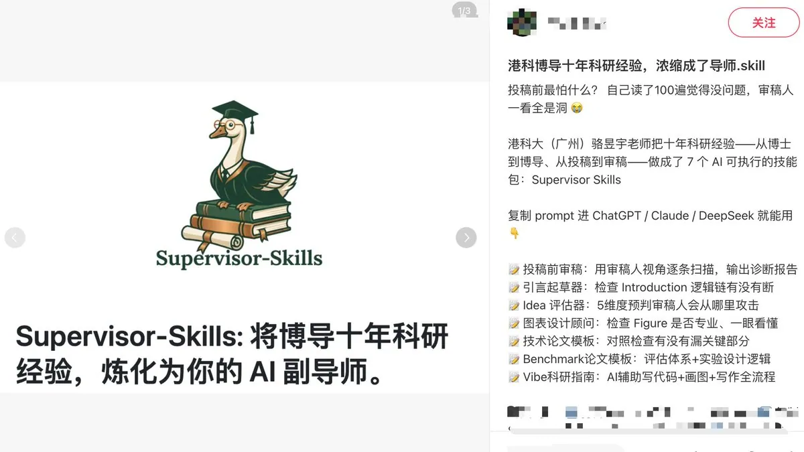

把最牛逼的效果放在前三秒和封面，让他看完不求你不行！！

### 小红书起号的底层逻辑

利他思维：先给用户一个明确的好处，再给他一个行动的理由。

可以分成两个阶段：

第一阶段：用免费资源吸引关注，积累初始用户。

起步时，通过笔记分享有用的资源，以“进群免费领取”作为钩子，再把关注账号设为入群条件。

路径形成：内容吸引 → 关注账号 → 进群领取资源。

第二阶段：用付费产品承接公域流量，直接转化。

当账号流量起来、用户对你的价值有了认可，就可以直接挂付费产品，让有需求的人购买，不必再经过进群这一步。

路径变为：内容吸引 → 产品展示 → 直接购买。

这套思路的关键是：前期用免费价值积累关注，后期用付费产品承接需求。

### 2.2 官方有流量扶持的 Tag 打上去。

围绕官方 AI、Red Skill 和 Vibe Coding 活动的话题放这里，按类型自取。具体流量扶持看当期活动规则。

Skill 可以看这些。

#howto 用好 AI

#AI 新手村

[#AI 进化生活 howto](https://www.xiaohongshu.com/search_result?keyword=AI%25E8%25BF%259B%25E5%258C%2596%25E7%2594%259F%25E6%25B4%25BBhowto&type=54&source=web_note_detail_r10)

#skill

#Redskill

Vibe Coding 网页可以看这些。

- [#howto 实现一万种 vibecoding](https://www.xiaohongshu.com/search_result?keyword=howto%25E5%25AE%259E%25E7%258E%25B0%25E4%25B8%2580%25E4%25B8%2587%25E7%25A7%258Dvibecoding&type=54&source=web_note_detail_r10)
- #ai 网站
- #数字艺术
- #AI 工具
- 带上最新大模型的话题，GPT 或者 CC 的。蹭热度要蹭到位！！

发布前打开话题页看看，确认当前有没有活动、要求是什么。标签不用全塞，优先选官方流量扶持的，或者可以蹭热度的！！

收藏多，只能说明大家觉得有用，未必实践。 当评论出现有人问“求代码”“在哪里用”“求教程”，才开始出现购买信号。第一笔成交，才是需求验证最直接的结果。

## PART 3 接住流量，把收费和交付接上

### 3.1 有人想用了，怎么收钱？

有人想要了，接下来怎么收钱？

小红书新号很容易违规。自己挂链接、自己接单，收钱之外还有三个麻烦：

1. 抽成。收款渠道可能有手续费或抽成，先弄清楚到手多少。

2. 容易封号。自己挂外链引导站外交易，有限流、封号的风险。

3. 你要去当客服。怎么安装、怎么付款、怎么用，每来一个人都要解释一遍。

在这里给大家推荐一个网站：[https://viceme.cn/](https://viceme.cn/)

### 它能干嘛：

帮你 24h 自动赚钱，只做平台内嵌付费接口。付费和交付全自动，笔记里通过 Red Skill 卡片承接，让别人自动给你打钱。

另外它支持试用功能，在用户用的最爽的时候停了，你说他能不给你买单吗？

（插个题外话，平台 Founder 我认识，转化数据好的，可以私我，找他要投流，觉得难用的尽管爽骂）

爽不爽。。就问你爽不爽，每天睡醒又到账了！！

### 3.2 亲妈级发布教程

下面手把手喂饭教程来了。带着你的作品跟我走一遍。

第 1 步 进入创作者中心

打开官网[https://viceme.cn/](https://viceme.cn/)，点右上角头像，在菜单里找到“我是创作者”，进入创作者中心。

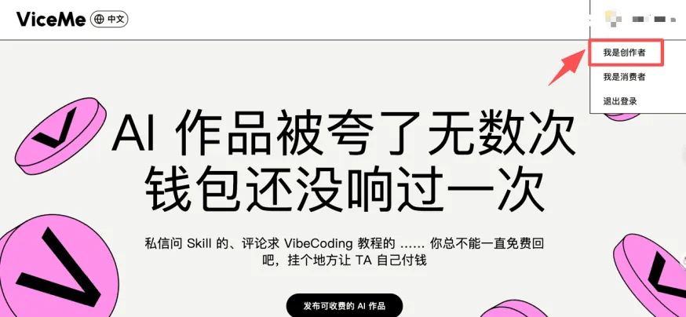

第 2 步 发布作品

在左侧找到“作品管理”，点击右上角“发布作品”。

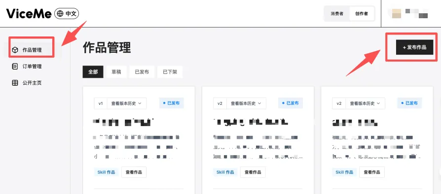

第 3 步 选择上传方式

根据作品所在的位置选择。页面提供 GitHub、本地项目，以及在 AI 工具中完成发布等方式。

已有本地文件或压缩包，就选本地项目；作品在 GitHub，则按页面授权和读取流程处理。完成后检查作品介绍和价格，再发布。（网页作品记得先在平台包成 Skill，再来贩卖）

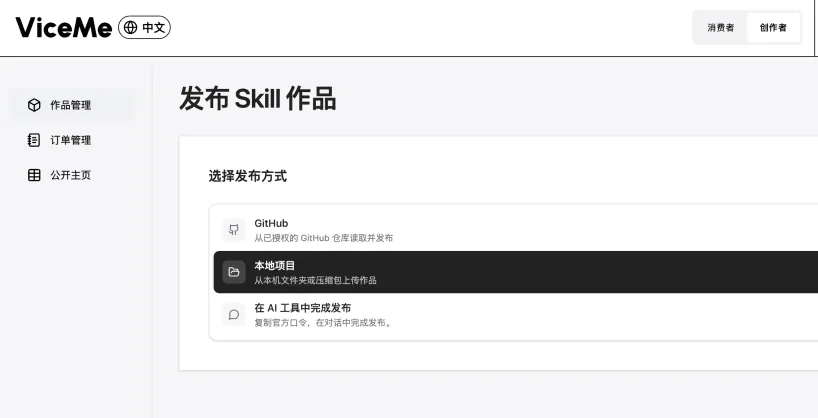

第 4 步 回到作品管理导出发布包

发布好以后回到作品管理，找到对应作品的“去发布”。同一页也能查看作品的运营数据。

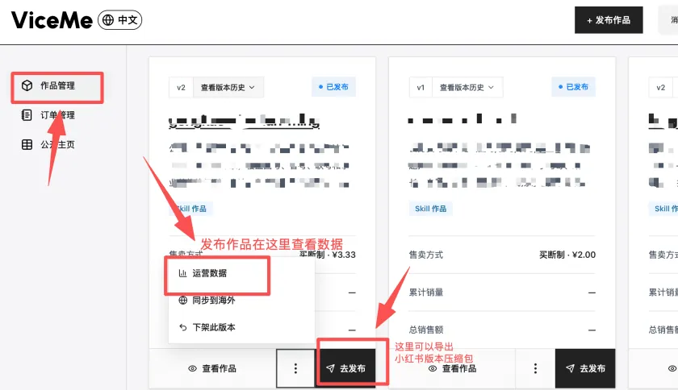

在导出选项里选择“导出小红书发布包”。这里同时有通用发布包和原始包，跟着做时别选错。

把导出的压缩包保存好，下一步要上传。

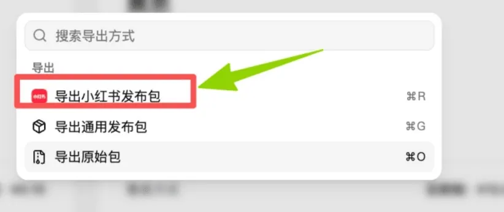

第 5 步 打开小红书创作者服务

在小红书网页端点“更多”，进入“创作中心”，再找到“创作者服务”。下图按菜单展开顺序放在一起。

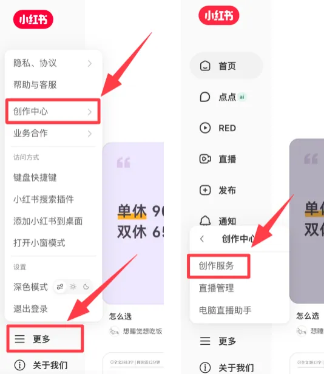

第 6 步 上传到 Red Skill

进入创作者服务后，在左侧 Builder hub 里找到 Red Skill，点击右上角“上传 Skill”，上传刚才导出的发布包。

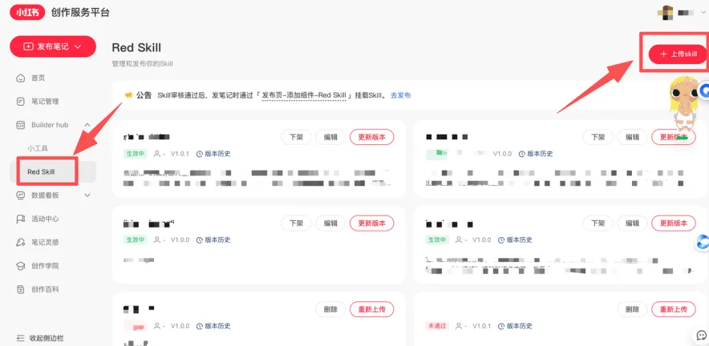

第 7 步 检查简介与介绍

检查简介和 Skill 介绍，确认用户能看懂作品用途，也确认展示的是适合公开阅读的内容。赚钱不要太直接了。。

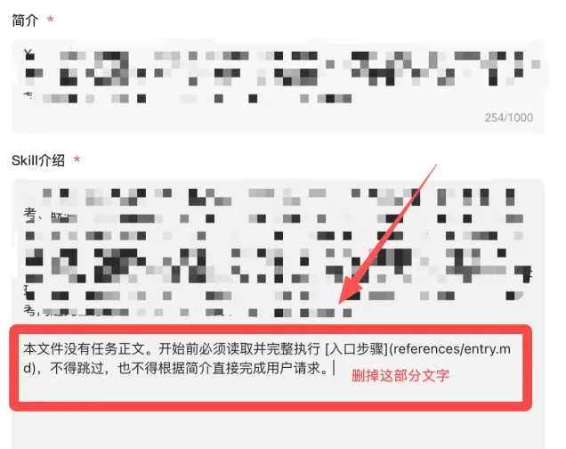

第 8 步 在笔记里甩钩子 让别人用起来

东西做好了，怎么让别人想用？

看这张图就懂了：前三秒留人，正文甩钩子，卡片挂好，评论置顶。

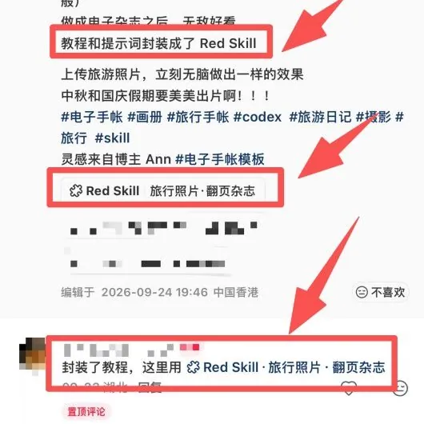

① 先让他想要同款

先放效果。

比如：旅游照片变成翻页杂志，谁看了不想拿自己的照片试一下？ “相册里吃灰的旅游照片，我拿来做了本能翻页的旅行杂志。”

② 正文直接甩钩子

“教程和提示词封装成了 Red Skill。”这句就够直接：谁都能用，且自己全自助用。 再补一句：“准备几张旅行照片，点下面的 Red Skill 卡片，跟着提示使用。”

③ 置顶评论仙人指路

“封装了教程，这里用👇” 挂上 Red Skill 入口，置顶。有人问怎么做，就用官方小工具引导。

软广植入，只有他加载出来了才发现是个付费的。。

- 别人点进去之后是什么样

给你看一下别人用的时候是咋样的。安装、调用、付款，大概就是下面这个过程。

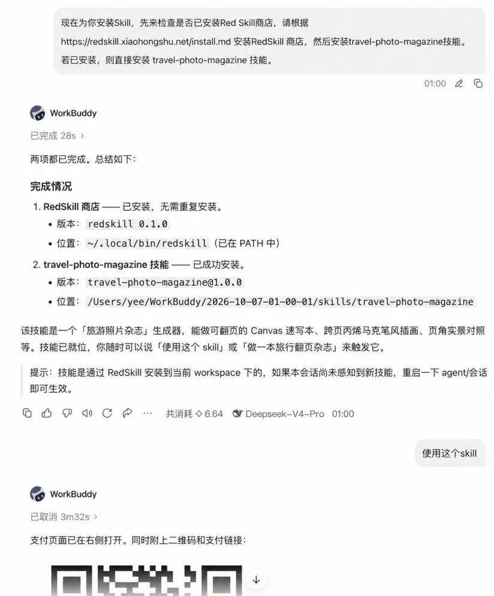

这个过程你不用管。有人买单之后，你只知道微信公众号哐哐给你弹支付成功提醒，就完事儿了。

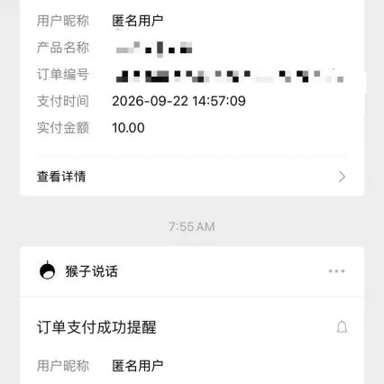

### 3.3 坐等着收钱

现在用网站没有手续费，0.01 起提。

到这里，你已经给自己的流量做了一波承接。

别人看笔记 → 别人想要 → 别人复制 Red Skill 口令 → 别人给你付钱。

恭喜你，一个完美的睡后收入商业闭环就完成了。

###

## 尾声

### 如果看到这里，你肯定是我的真爱 x 友，我先祝你发大财。

这里讲点我自己运营的冷知识，

        在 GitHub 上火的 Skill，在推上面火的，90%在小红书也会火。

还是那句话，国外是国内的先行服，没有创作能力，那么请你盯紧创作趋势。

什么值得卖

       考公、考研这种类似的东西，我觉得是国内最最最容易卖出去的一类。

      复习计划、错题整理、模拟面试，做一个。随便包个 Skill，抓紧墙内的痛点。

顺着平台做，接上睡后收入

       小红书在推自家的 Red Skill，顺着官方流量扶持做。

        发之前看一眼当期流量活动，能拿的扶持少不了。没事可以加下官方私域群。

        Red Skill 内嵌在笔记里，看完就能点，省得你回他外链半天还要带个删掉，他说打不开，转头你号没了。直接承接公域流量，转化成付费，真的很爽。

你只需要做好流量，拉高质量=睡后收入。

你睡着了，笔记还在，它跑去给你赚钱，想不想一大早被公众号的收款提醒叫醒？

流量 24h 分发，把哑巴儿子变成自动收钱的 Agent，别人照样能找到你给你打钱。

我是 Yooee（恋爱教母版），这是我的第一篇长文和大家见面。

我以后继续分享我试过的 AI 生意，也教恋爱。

关注 @Yooeec3，有财一起发。

## 相关页面

- [[sources/jessicao-xiaohongshu-0-to-1-operations-guide]]
- [[sources/lele-wechat-21-days-monetization-nanny-guide]]
- [[concepts/selfmedia-compound-model]]
- [[concepts/b2c-conversion]]
