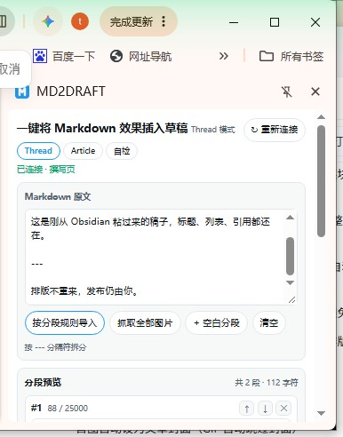
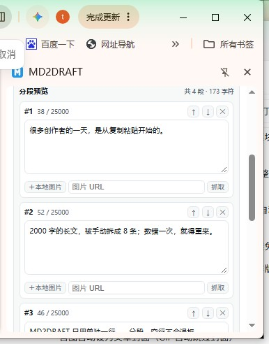
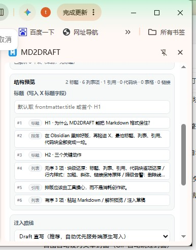
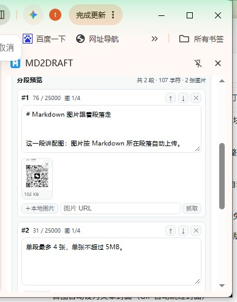
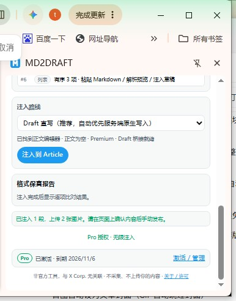
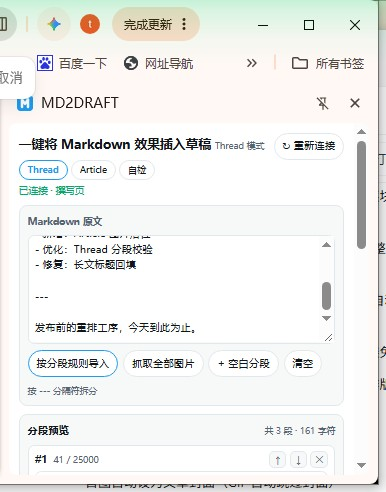
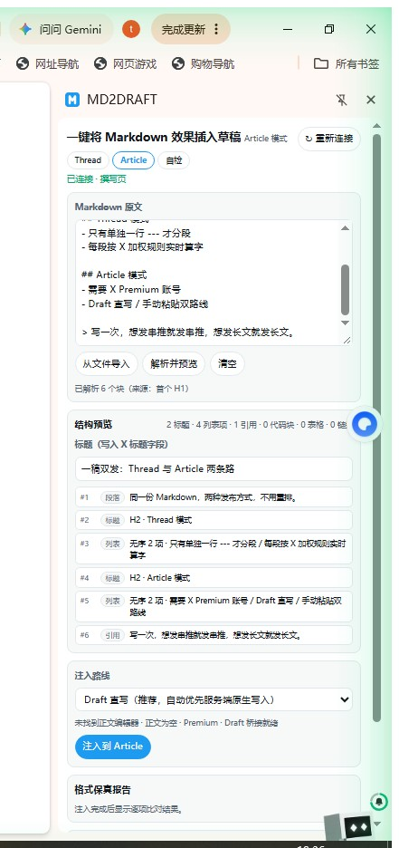
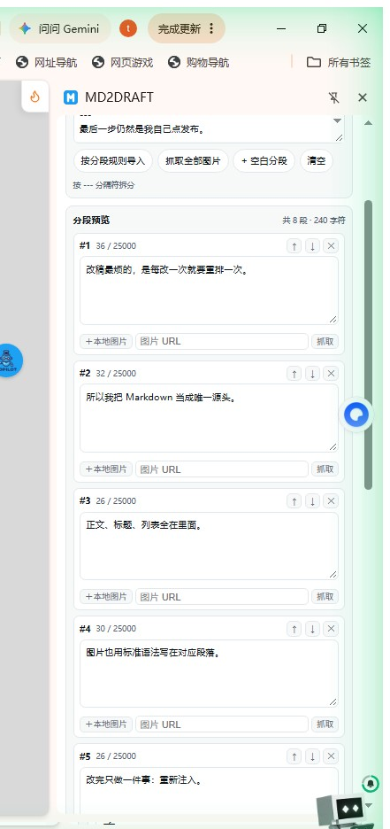

# 云天明 AI（@yuntianming10）：Markdown 一键直达 X 草稿——MD2DRAFT 解决 Thread 串推分段与 Article 长文排版痛点

> 告别手工复制、算字超限与格式塌陷：深度评测 Chrome 扩展 MD2DRAFT 在 X 上的创作成效。以「单独一行 ---」为明确分段边界、每段独立加权字数统计、Obsidian 块级与行内样式高度还原、图片自动归位分段，以及「只注入草稿绝不替你自动发布」的安全边界认知。

<!-- more -->


这篇是我自己从「手搬」到「一键注入」的过程记录。

你能看到每个环节的真实界面截图，也能看到我踩过的那些坑。

如果你也在 X 上写连载或长文，看完大概大幅你对着草稿区域口吐莲花。

## 0. 先说清楚它是什么

MD2DRAFT 是一个 Chrome 扩展，打开方式是侧边栏。

它只做一件事：把你写好的 Markdown，按 X 的规则塞进草稿里。

它不做的事也很清楚：不登录你的 X 账号、不读私信、不替你点发布。

你可以把它理解成一个「排版搬运工」：你写好内容，它负责搬，搬完还站在原地等你检查。



上图就是全部入口了。侧栏顶部三个按钮——Thread、Article、自检，下面一大块 Markdown 输入区。

我第一次打开时的想法是：就这？也太朴素了。

用了三天之后的想法是：就这挺好，因为我需要的本来也不是花活。

## 1. 场景一：一条 Thread 把我拖到凌晨一点

先说痛点，必须具体，不然显得我在编。

那天我写完一篇两千字的稿子，准备拆成串推。

流程是这样的：

1. 在第 3 段末尾找个「看起来像断句」的地方，按回车；
2. 复制第一段，粘进 X 输入框；
3. 数数，超了，删两句；
4. 点「加号」加下一条，再粘第二段；
5. 发现第二段只剩三个字，又回去把第一段的话拆回来；
6. 循环，直到脾气耗尽。

最要命的是字数。X 的字数不是简单数汉字：

中文、英文、URL、emoji 的权重都不一样 ⚖️

我肉眼觉得「差不多」，发出去偏偏被截；我为了保险删掉半段，结果又短得可惜。

两千字的稿子，硬是折腾了四十分钟。

问题的本质不是我不会分段，而是我在用一个纯手工的输入框，做一件本该自动化的事。

## 2. 它怎么解决：只认 `---` 的分段规则

MD2DRAFT 的规则非常克制：

只有单独一行 `---` 才是分段符。空行不参与分段。

什么意思？你正文里为了好读敲的空行，不会被工具当成「这里该断」。

分段边界由你决定，工具只负责算字和提醒。



粘贴完点「按分段规则导入」，就得到上面这张图：

一共几段、每段用了多少字、离上限还有多远，全摆在明面上。

三个细节值得单独说：

🟢 每段独立计数

不是整篇算一个总数，而是每段单独显示「已用 / 上限」。

蓝 V 账号单段上限是 25,000 加权字符（约 12,500 中文字），普通账号 280，侧栏会跟着账号给提示。

🟢 可以后悔

每段右上角有 ↑ ↓ ✕，能上移、下移、删除。

我经常干的事就是：先让它拆，拆完再看哪段太长，手动挪两句过去。

🟢 不硬切

它绝不会「按 280 字自动切」。因为自动切的边界一定是难看的，

工具如果替你断句，读者第一眼看到的就是「这人在哪儿断的？」。

一句话总结这一节：

分段是你的事，算字是它的事，谁也不越界。

## 3. 场景二：从 Obsidian 粘过来，格式就崩了

这个痛点应该不用我多解释，用过的人都懂 😭

在 Obsidian 里明明是小标题、有序列表、引用块、代码块，

粘进 X 的那一刻：标题没了、列表粘成一大坨、引用变成普通文字、代码块变成一坨纯文本。

所谓「一键搬运」，最后变成了「一键重排」。

MD2DRAFT 的处理方式是分两层：

🧱 块级还原

标题、有序/无序列表、引用、代码块逐项还原，分割线以分隔段落的形式保留。

🎨 行内还原

加粗、斜体、链接原样保留，不会在正文里留下一堆星号和括号。

🗂️ 先预览骨架

解析完先给你一张「结构清单」：



「2 标题 · 6 列表项 · 1 引用 · 0 代码块」——

数字对不上，说明你原文写错了，趁早改，别等发出去。

⚠️ 会降级的提前告诉你

删除线、行内代码在 X 编辑器里没有对应样式，会降级为纯文本并在预览阶段告警。

H3 及以下的小标题会变成加粗段落——层级不丢、内容不丢，只是样式做了适配。

这点我觉得挺实在：它没有假装「全部 100% 还原」，而是提前告诉你哪些会打折。

## 4. 场景三：配图十分钟，正文三分钟

带图教程的朋友应该都熟悉这个流程：

在编辑器里一张一张拖图，拖完再回头核对「这张是在代码前面还是后面」。

更惨的是拖错了位置，删掉重拖，图片还得重新上传一遍。

MD2DRAFT 的图片逻辑是：跟着 Markdown 走。

你在哪一段写了图片语法 `! [说明](地址)`，图片就落在哪一段。



它会做这几件事：

- 自动识别 Markdown 图片语法，按所在段落归位；
- 提供「抓取全部图片」，也可以对单段点「＋本地图片」；
- 每段标着「图 1/4」，一眼看清这一段带了几张、还剩几个名额；
- 遵守 X 的硬规则：每段最多 4 张、单张不超过 5MB、支持 JPEG / PNG / WebP / GIF；
- GIF 不能与其他图片混发，这条也会提前拦；
- 跨域图片首次抓取要先经你授权，它不偷偷下载；
- 抓取失败不硬撑，缩略图上点 ↧ 单独重试，或者换成本地图、直接移除。

我最喜欢的是「每段 4 张」这个提示。

以前是发到一半被 X 拒绝，现在是在注入前就知道超了。

## 5. 场景四：X 长文，搬砖搬到怀疑人生

写长文是另一套折磨。

在本地写完三千字，打开 Article 编辑器，然后开始无限循环：

复制标题 → 粘贴段落 → 重建列表 → 把图片一块块拖到对应位置。

半小时过去，正文还没搬完，表达欲先耗光了 😮‍💨

Article 模式给了两条路：



🛣️ Draft 直写（推荐）

走 X 原生块写入，块级还原最完整，表格也按原生块写。

🛣️ 手动粘贴（兜底）

复制 HTML，自己 Ctrl+V。表格会输出 HTML 表格。

缺点是不会自动上传图片，图得自己补。

另外还有几个细节：

- 标题自动取 frontmatter 的 title 或首个 H1，写进 X 标题字段；
- 注入后输出「格式保真报告」，预期块数 vs 实际块数，逐项比对；
- 前提是账号得有 X Premium，没有的话 Article 按钮用不了。

说实话，前三次用 Article 模式我都盯着「保真报告」看了半天。

不是不信它，是长期被各种「看着填好了其实没填」的工具有过心理阴影。

## 6. 场景五：注入完了，然后呢？

这是我最想强调的一点，也是这个工具和「自动发帖机器人」最大的区别：

注入完成后，它停在那儿，等你自己点发布。


上图是侧栏的完成提示：「已注入 4 段。请在页面上确认内容后手动发布。」

左边是 X 的草稿框，最后一段已经填好，发帖按钮亮着——

但按不按，是你的事。

我一开始觉得这有点「多此一举」，为什么不能顺手发掉？

后来想明白了：账号是我的，风险也是我的。

工具替你写草稿，是效率；工具替你发出去，是替你承担后果。

这两件事的边界，最好别混。

## 7. 场景六：写作流没变，只是最后 10% 变快了

我真正的写作流程没打算改，也不会为了一个扩展换编辑器。

字还是在 Obsidian 里敲，大纲还是在备忘录里列。



所以我用它的方式很朴素：

1. 在 Obsidian 写完 Markdown；
2. 打开 `x.com/compose/post`，点工具栏图标开侧栏；
3. 粘贴，导入，看一眼分段；
4. 注入；
5. 在页面上检查，手动发布。

一整套下来，比我原来的「复制粘贴改格式」省了大概三十分钟——按我这种写两千字要喝两杯咖啡的人来说，这半小时挺值。

顺便说个隐藏好处：改稿只改源头。

Markdown 是唯一真相，X 草稿随时可以重建。两边不同步这种事，从此基本没发生过。

## 8. 场景七：一稿两发，Thread 和 Article 都能走

同一篇稿子，有时候适合拆成串推，有时候适合发长文。

以前我为了两种形态，会各排一次版，等于同一份内容写了两遍 🤦

现在侧栏顶部两个按钮，点一下就切：



正文一个字都不用重写。

我常用的组合是：

先用 Thread 拆成五条做预告，再切 Article 把完整版发成长文。

反过来也成立——长文沉淀深度，串推负责把人引过来。

## 9. 场景八：多段注入那次，我差点以为要重来

多段 Thread 最怕三件事：顺序错、内容丢、中途卡住。

尤其是 X 的编辑器会复用输入框，还会悄悄截断超限内容。

表面看着填好了，实际已经少了一段。



八段内容，一次导入，全部摊开：每段字数、上下移、删除，一屏看清。

实际注入的时候是这样：

- 逐段写入 → 每段写完回读编辑器真实内容，而不是只看界面显示；
- 追加模式校验不匹配，就整段重建，避免缺段或重复；
- 带进度、可中止，卡住随时停，不用等它跑完再收拾残局。

有一次我重复点了注入，侧栏立刻弹了个选择框：


「继续追加 / 清空并重填 / 取消」——

还好它先问了，不然我那条已经改过的草稿就被五段新内容盖掉了。

一个会先问一句的工具，比一个闷头干活的工具可靠。

## 10. 免费版够不够用？先别急着掏钱

我的建议是：先用免费版验证它配不配留在你的流程里。

免费版给的东西不算抠：

- 每月 30 次注入，本地计数、跨月自动重置，不用注册；
- Thread 拆分、自动推进、逐段回读全都可用；
- Thread 配图可用，图片按位置进对应帖子；
- 草稿和偏好保存在本地。

唯一的「代价」是草稿末尾会追加一行推广语，手动删掉就行，不会被补回来。

30 次是什么概念？

按我一周发三四条的频率，够用一个月还有剩。

如果你一天发五条，那就直接看 Pro。

## 11. Pro 到底买的是什么

我不想把这段写成广告，所以只说事实。


现在 Pro 真实提供的是两件事：

1. 不限注入次数——高频写作者不用再算额度；
2. Article 图片落位 + 首图自动封面——长文的图不用再一张张摆。

价格：US$4.9/月 或 US$39/年（美元计价、不含税）。

首次订阅可以走 7 天全功能试用（按邮箱判重），14 天内可申请退款。

激活方式有点复古但很直接：

结账成功后拿到 `ord_xxx` 订单号，粘进侧栏「激活 / 管理」，点激活。

一个订阅最多绑 3 台设备，换电脑前记得先在旧设备点「解绑本机」。

⚠️ 提醒一句：试用期也会追加那行推广语，这是预期行为，不是 bug。

另外，表格转图、模板库、注入记录、批量导入这几项还在「即将上线」——

没上线的东西我不会拿来当卖点，你也别拿它去测。

## 12. 几个我踩过的坑，你可以直接跳过

写在这里，是因为它们都真实发生过：

| 现象 | 原因 | 怎么办 |
| :--- | :--- | :--- |
| 侧栏提示「未连接到页面」 | 当前标签不是 x.com | 切到 x.com，点「↻ 重新连接」，或刷新页面 |
| 注入后内容变少 | 触及单帖字数上限 | 用单独一行 `---` 拆成多条后重注入 |
| 显示「格式保真 N/M 项通过」 | 有样式降级 | 看报告逐项核对，删除线/行内代码降级是正常的 |
| Article 按钮点不动 | 账号没有 X Premium | 换账号，或先用 Thread 模式 |
| 图片没上传 | 抓取失败 / 超 4 张 / 超 5MB / GIF 混发 | 按提示重试、换本地图、或删到 4 张以内 |
| 手动加载版和商店版数据不通 | 扩展 ID 不同 | 换装后需要重新激活，草稿和额度不迁移 |
| 反复重装后提示设备上限 | 设备哈希变了，占用了新槽位 | 先在旧设备解绑，或联系 support@md2draft.com |

还有一条最重要的：装完或更新完扩展，记得刷新 x.com 页面。

不刷新的话，你可能还在跑旧版本，然后在心里骂一个不存在的 bug。

## 13. 一页速查

```
安装 → 刷新 x.com → 打开 x.com/compose/post → 点图标开侧栏

Thread：粘贴 → 按分段规则导入 → 抓取图片 → 注入到 Thread → 回读 → 手动发布
Article：需 X Premium → 粘贴/导入 → 解析并预览 → 选路线 → 注入到 Article → 看保真报告 → 手动发布

激活：侧栏底部「激活 / 管理」→ 输入 ord_xxx → 激活 Pro
额度：免费 30 次/月，本地计数、跨月重置；Pro 不限
推广语：免费/试用自动追加，可手动删除
```

## 14. 最后一点感想

我用了大概两周，最直观的变化不是「发得更快了」，而是——

我不再因为「排版太麻烦」而放弃发长文了。

以前写好一篇稿子，想到还要搬半小时，就会有那种「算了明天再说」的拖延。

现在这个理由消失了，因为最后那 10% 的脏活被接走了。

工具最好的状态，大概就是这种：它不是让你多做点什么，而是让你少放弃点什么。

## 📢 加入 MD2DRAFT 交流群

- 微信群：扫码添加客服微信，发送：md2draft 进群
- Telegram 群：扫描二维码加入


官网：https://www.md2draft.com/

商店：https://chromewebstore.google.com/detail/md2draft/bdhjfofjkchcefmmjbmfgfdcdckcpded

支持：support@md2draft.com ｜ 隐私政策 https://www.md2draft.com/privacy ｜ 退款政策 https://www.md2draft.com/refund

MD2DRAFT 为非官方工具，与 X Corp. 无任何关联，也未获得其授权或认可。

## 相关页面

- [[sources/leo-xiaolei-10-chrome-extensions-for-x-twitter]]
- [[sources/awe0-frontend-layout-standard-terminology-for-ai]]
- [[concepts/selfmedia-compound-model]]
