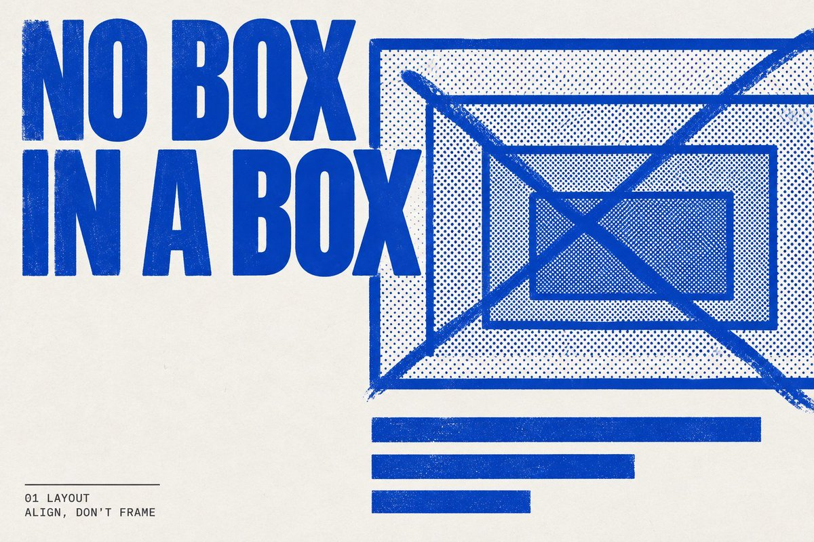
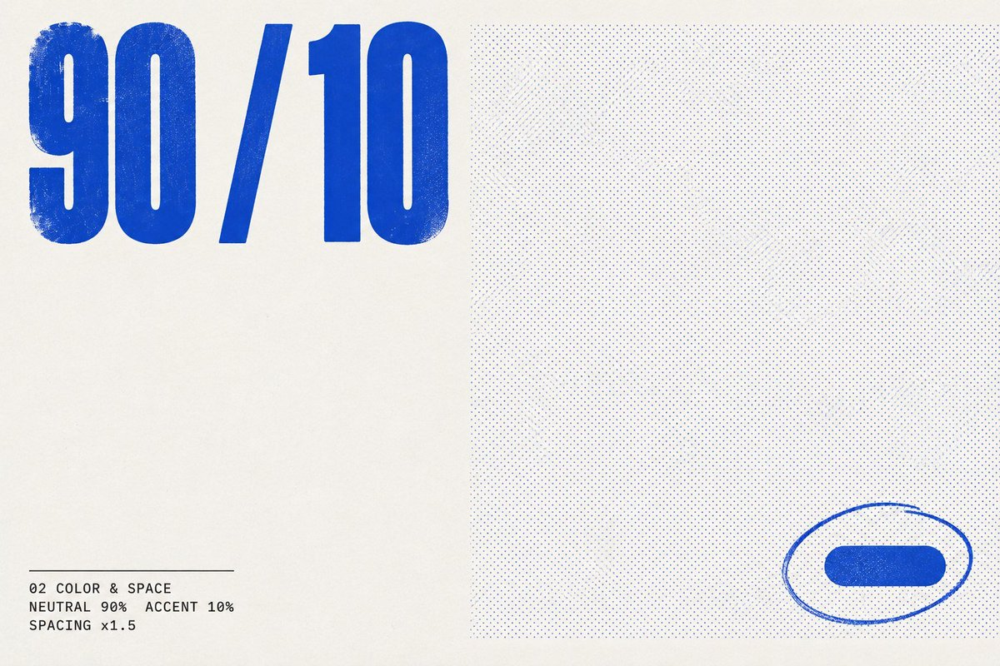
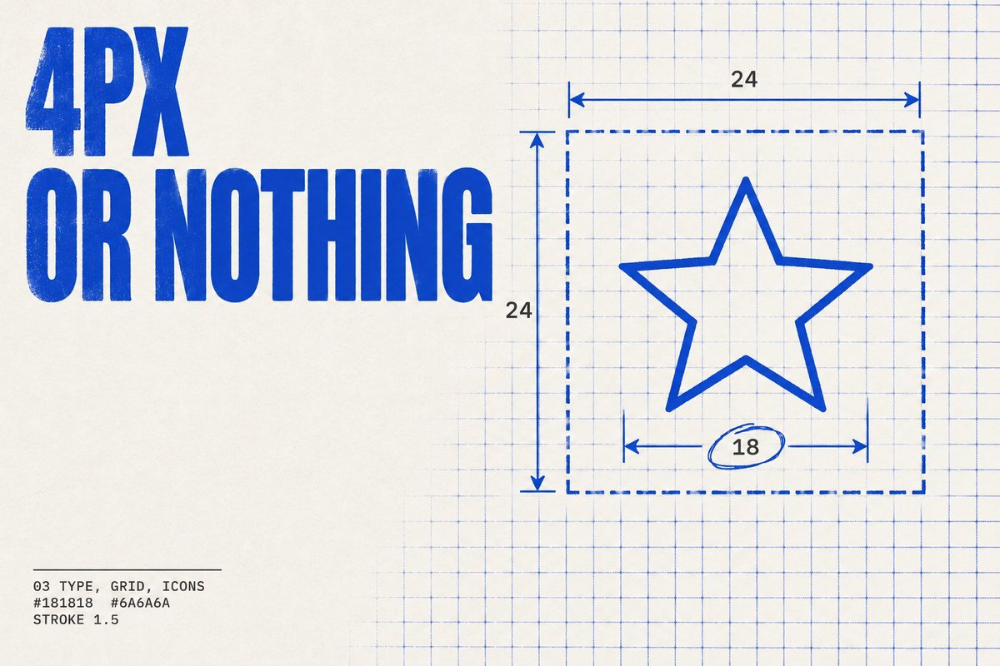
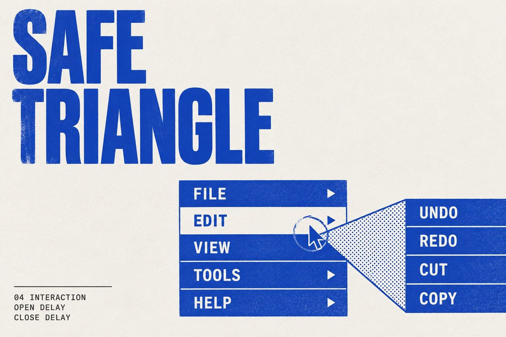
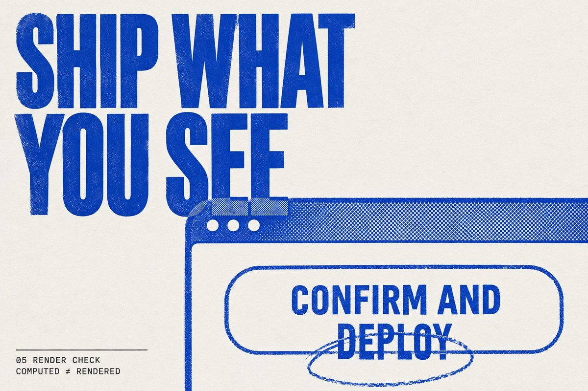

# Zachary：让 AI 写出干净界面的前端规范——5 个模块 + 可直接复制的完整文件

> 在做精细化 UI 之前，让 AI 第一版不那么丑的最基本规则。**不要使用任何 UI Skill**（作者认为都没用）；AI 生成前端有四个通病：外框套内框、满屏解释文字、高饱和渐变色、多级菜单一碰就乱跳——「做简洁一点」AI 听不懂，要把模糊审美词换成具体数字、比例和禁令。5 个模块：① **布局与信息层级**（禁止大框套小框/嵌套卡片/多余分割线，禁止标语副标题解释文字，靠排版对齐与间距区分层级）；② **视觉色彩留白**（参照苹果官网，90% 黑白灰 + 10% 单一强调色，禁渐变/高饱和/霓虹/复杂阴影，标题加粗正文变细，内外边距取常规 1.5 倍）；③ **字体栅格图标**（Geist 字体，标题 18px/600-700、正文 16 或 14px/400-500，主文字 #181818 次文字 #6A6A6A，间距一律 4px 倍数，圆角 8–40px，Reicon 图标 18px 线条 1.5px 装进 24×24 透明框）；④ **动效与交互**（含桌面多级菜单「安全三角区」：鼠标从父菜单移向子菜单时，以当前坐标与子菜单上下边缘连成三角形，鼠标在三角内就暂缓切换）；⑤ **落地步骤**（把 DESIGN.md 放项目根目录 → 任务里让 AI 先读它、先装 Geist 与 Reicon 再写代码 → 让 AI 调浏览器截图核对，改掉不合规处再提交）。作者强调这不是直接出成品的 Prompt，只是让第一次出稿不那么丑、后续打磨返工少。附 6 张图与原文博客链接。

<!-- more -->

也可以在我的 Blog 查看原文：

[https://zacharyzhang.com/blog/ai-frontend-design-rules](https://zacharyzhang.com/blog/ai-frontend-design-rules)

之前在全自动化开发流程中说了，会在后续更新 UI 是怎么做的。当然，这个帖子只是单纯的在做精细化 UI 之前，让 AI 出的第一版不那么丑陋的一些最最最最简单的一节最基本的 Rule。在这个第一版做完之后，你需要去类似 Dribbble、Pinterest、landing.love、Mobbin、Awwwards 等寻找你网站的灵感，然后去对你的产品进行微调，不要指望能一次性出一个好看的 UI，这是不现实的！

开始之前，记住，不要使用任何 UI SKILL，他们都没什么用处。

AI 生成的前端页面有四个通病：外框套内框、满屏解释文字、高饱和渐变色、多级菜单一碰就乱跳。

只对 AI 说“做简洁一点”，AI 听不懂。把模糊的审美词换成具体的数字、比例和禁令，拆成独立的规则模块，AI 才能写出干净的界面。

下面先把整套前端设计规范精简为 5 个模块，逐条拆解背后的原理，最后附上可直接复制的完整文件和使用步骤。

## 一、拆分后的 5 个规则模块

### 模块 1：布局与信息层级



```
【布局与信息】
- 禁止大框套小框，禁止嵌套卡片与多余分割线。
- 禁止标语、副标题、次级标签和解释性描述文字。
- 用排版对齐和间距区分内容层级，不靠文字解释界面。
```

AI 默认会给每一块内容加边框和阴影，大卡片里面再套三个小卡片，线条会把页面切碎。它还喜欢在每个标题下面塞一句口号或说明文字。删掉嵌套外框和多余文字，只靠对齐和空白距离把内容分组。

### 模块 2：视觉、色彩与留白



```
【视觉、色彩与留白】
- 整体参考苹果官网极简风格。
- 色彩比例：90% 面积使用黑、白、灰中性色；10% 面积使用单一强调色标出核心操作或关键数据。
- 禁止渐变色、高饱和色、霓虹色和复杂阴影卡片。
- 字重与明度对比：标题加粗加深，正文变细变浅。
- 放大留白：组件内边距与外边距设为常规页面的 1.5 倍，宁可留空也不塞满。
```

新手做网页容易堆砌颜色，把所有空间填满。这条规则定死了九比一的配色比例：九成画面只有黑白灰，剩下一成只选一种颜色，用在主按钮或关键状态上。再把元素之间的距离拉大到常规网页的 1.5 倍，不用画框，人眼也能分清主次。

### 模块 3：字体、栅格与图标参数



```
【字体、栅格与图标】
- 字体：全局使用 Geist 字体。
- 字号与字重：标题 18px 并加粗（字重 600 或 700）；正文使用 16px 或 14px，字重取常规（400）或中等（500）。
- 文字颜色：主文字用 #181818，次要文字用 #6A6A6A。
- 间距栅格：所有间距取 4px 的整数倍，不留例外。
- 圆角：按组件尺寸与层级，在 8px 到 40px 之间取值（小按钮用小圆角，大弹窗用大圆角）。
- 图标：使用 Reicon 图标库（https://reicon.dev/docs）。图标本体 18px，线条粗细 1.5px，放在 24px × 24px 的透明外框内。
```

1. 色号 #181818 与 #6A6A6A：白底配纯黑（#000000）刺眼。#181818 是深灰黑，用来写标题和正文；#6A6A6A 是中灰，用来写时间、备注等次要信息。
2. 4px 栅格：页面里所有的距离只能填 4、8、12、16、24、32 这类 4 的倍数，不允许出现 7px、13px 这种随机数字。尺寸成倍变化，所有组件的边缘才能对齐。
3. 24px 外框装 18px 图标：有的图标宽，有的图标窄。给每个图标套一个固定的 24×24 透明方框，图标在框内占 18px、线条粗细统一为 1.5px，一排图标摆在一起时大小和中心点才会一致。

### 模块 4：交互与桌面端菜单



```
【交互与桌面端菜单】
- 按意图显示控件：平时隐藏次要操作按钮；当用户鼠标悬停、光标聚焦、滚动靠近或开始操作该区域时再显示。
- 桌面端多级菜单：同时实现开启延时、关闭延时、安全三角区。当鼠标从父菜单 A 移向子菜单 B 时，以当前鼠标坐标和子菜单 B 的上下边缘端点连成三角形区域；鼠标处于该三角形内时，保持子菜单 B 打开，暂缓切换到途经的其他菜单项。
```

1. 按照意图显示控件：如果列表每一行后面都摆着“编辑、复制、删除”三个按钮，满屏都是图标。平时把次要按钮藏起来，鼠标移到那一行或点进输入框时再显示，能减少干扰。
2. 安全三角区：电脑网页上，一级菜单在左，展开的二级菜单在右。人移动鼠标去点右边菜单时，路线是斜线，中途会扫过下方的其他一级菜单。普通菜单一扫过就会切走，导致想点的二级菜单消失。把“鼠标当前位置”和“右侧子菜单的上下两个角”连成一个三角形，只要鼠标在这个三角形里移动，系统就知道用户要去点子菜单，不会误切换。配合几百毫秒的开启延时和关闭延时，菜单操作会稳定很多。

### 模块 5：渲染验收标准



```
【渲染验收】
- 以浏览器真实视觉渲染结果为准，不以代码计算属性值为准。写完代码必须检查真实画面中的对齐、换行、留白与遮挡。
```

代码里写的样式数值叫“计算状态”，浏览器画在屏幕上的样子叫“渲染状态”。比如代码里写了高度 40px、文字居中，但实际文字太长折成了两行，挤出了边框；或者播放键的三角形在圆圈里看着偏左。只查代码看不出这些问题。这条规则强制 AI 打开真实网页检查画面，不能只看代码数值就提交。

## 二、完整合并版 Prompt

在项目根目录新建一个 DESIGN.md 文件，把下面整段规范复制进去：

```
# 前端界面设计规范

## 1. 布局与信息
- 禁止大框套小框，禁止嵌套卡片与多余分割线。
- 禁止标语、副标题、次级标签和解释性描述文字。
- 用排版对齐和间距区分内容层级，不靠文字解释界面。

## 2. 视觉、色彩与留白
- 整体参考苹果官网极简风格。
- 色彩比例：90% 面积使用黑、白、灰中性色；10% 面积使用单一强调色标出核心操作或关键数据。
- 禁止渐变色、高饱和色、霓虹色和复杂阴影卡片。
- 字重与明度对比：标题加粗加深，正文变细变浅。
- 放大留白：组件内边距与外边距设为常规页面的 1.5 倍，宁可留空也不塞满。

## 3. 字体、栅格与图标
- 字体：全局使用 Geist 字体。
- 字号与字重：标题 18px 并加粗（字重 600 或 700）；正文使用 16px 或 14px，字重取常规（400）或中等（500）。
- 文字颜色：主文字用 #181818，次要文字用 #6A6A6A。
- 间距栅格：所有间距取 4px 的整数倍，不留例外。
- 圆角：按组件尺寸与层级，在 8px 到 40px 之间取值（小按钮用小圆角，大弹窗用大圆角）。
- 图标：使用 Reicon 图标库（https://reicon.dev/docs）。图标本体 18px，线条粗细 1.5px，放在 24px × 24px 的透明外框内。

## 4. 交互与桌面端菜单
- 按意图显示控件：平时隐藏次要操作按钮；当用户鼠标悬停、光标聚焦、滚动靠近或开始操作该区域时再显示。
- 桌面端多级菜单：同时实现开启延时、关闭延时、安全三角区。当鼠标从父菜单 A 移向子菜单 B 时，以当前鼠标坐标和子菜单 B 的上下边缘端点连成三角形区域；鼠标处于该三角形内时，保持子菜单 B 打开，暂缓切换到途经的其他菜单项。

## 5. 渲染验收
- 以浏览器真实视觉渲染结果为准，不以代码计算属性值为准。写完代码必须检查真实画面中的对齐、换行、留白与遮挡。
```

## 三、在项目里使用的 3 个步骤

1. 按平台裁剪文件：做电脑网页或后台系统时，保留全部 5 条；做纯手机端页面时，删掉第 4 条里的“桌面端多级菜单”一段，把文件存为 DESIGN.md（也可以放进 CLAUDE.md、AGENTS.md 或 .cursorrules）。
2. 先装依赖再写页面：发任务时告诉 AI：“先读取 DESIGN.md，安装 Geist 字体和 Reicon 图标库，再开始写页面代码。”
3. 打开浏览器验收：AI 写完代码后，要求它调用浏览器工具打开本地页面截图核对，把不符合 4px 栅格、多出嵌套边框和文字折行错位的地方改掉，再提交代码。

## 相关页面

- [[sources/zachary-ai-coding-workflow-cindy-t3code]]
- [[patterns/progressive-disclosure]]
