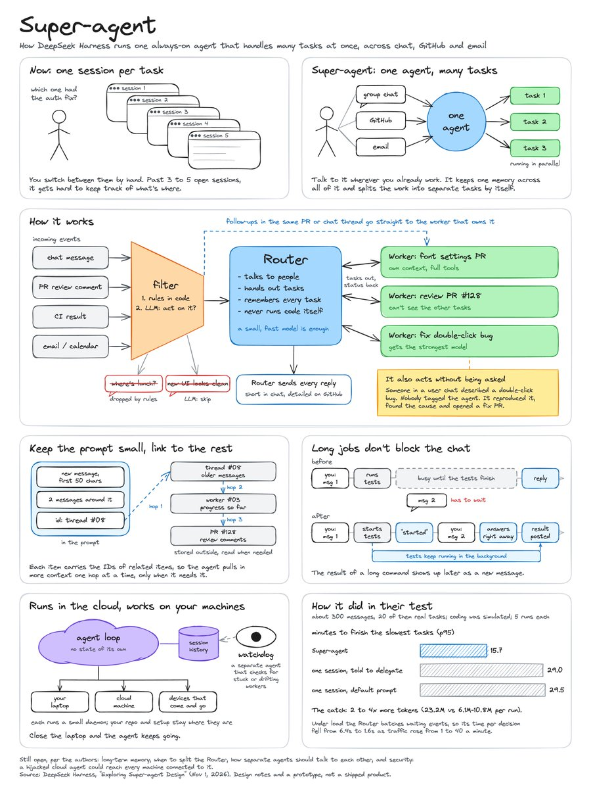

# 山景城小路（@Zen_with_AI）：细读 DeepSeek Super-agent 架构长文——把计算机经典机制搬进 Agent 系统

> DeepSeek Harness 团队 Super-agent 架构细读：多任务 Agent 瓶颈不是模型而是人的注意力（单人活跃 session 上限 3~5 个）。系统借用计算机系统老办法——快慢路径、缓存、推测执行、计算存储分离、看门狗。中心位置的 Router 用小模型做接话/分派/记账，真正吃力的活交给 Worker；实测 p95 完成时间压至 15.7 分钟；指出长期记忆、Router 拆分与安全三大未解问题。

<!-- more -->

DeepSeek Harness 团队今天发了一篇讲 Super-agent 架构的长文，是我最近读到最有条理的 Agent 系统设计文章。

它几乎不谈模型多强，讲的是模型够强之后，系统该怎么搭。而且全文借用的都是计算机系统里的老办法：快慢路径、缓存、推测执行、计算存储分离、看门狗。

小路把全文读完了，想带您顺着作者的思路走一遍。文末的配图是我对全文的整理。

先说问题。现在的 Agent 以单个 session 为工作单位，session 之间互相隔离。同时跑几个任务，人就得手动在 session 之间切换，还要记住每个里面有什么。作者的经验是，一个人同时能跟住的活跃 session 大约 3 到 5 个。单个任务受限于模型能力，多任务则受限于人的注意力。

作者给出的解法叫 Super-agent：一个持续在线的 Agent，跨 session 保持上下文，同时处理多个复杂任务，任务之间互不干扰。他们认为它要有四个特性：Continuous（连续）、Productive（高产）、Proactive（主动）、Persistent（常驻）。

整篇文章的骨架可以压成一条链：

两层架构 -> 事件驱动 -> 全双工多渠道 -> 计算/状态/环境分离 -> Watchdog （Router 和 Worker 分工 -> 环境事件当输入 -> 长任务不堵对话 -> 云端常驻 -> 外部看门狗）

下面一块一块看。

两层架构。 只用一个 session，上下文最连贯，但一步一步跑，吞吐上不去，不同任务的中间过程还会混在一起。每个事件开一个新 session，吞吐有了，任务之间又断了联系。作者的办法是拆成两层。Router 是长期存活的全局层，负责和人对话、分派任务，自己不执行任务，甚至可以没有 Bash 工具。Worker 是执行层，每个 Worker 只做一个任务，有独立上下文和完整工具。Worker 不直接和人说话，进度统一报给 Router，由 Router 回复用户。作者说，Router 的活比想象的简单，小而快的模型通常就够，Worker 才需要最强的模型。

事件驱动。 Agent 的主要输入不再是人敲的 prompt，而是环境里的事件，比如群消息、邮件、日历提醒、代码评审评论、CI 结果。论文里把这些叫 Trigger。真实的群聊里绝大多数消息不需要 Agent 动手，所以先过两道筛：第一道是代码里的确定性规则（来源、群、白名单），第二道才交给大模型判断要不要处理。同一个 PR 或同一个聊天话题里连续的事件叫一个 Thread。Router 给 Thread 创建 Worker 之后，Worker 订阅这个 Thread，后续事件由代码直接送到 Worker，不再经过 Router。

上下文当缓存用。 作者把有限的上下文窗口看成缓存，有两个操作。Inline 是把马上会用到的信息直接放进窗口，Spill 是把放不下的留在窗口外，只留一个引用。每个对象都带着相关对象的 ID，模型可以顺着 ID 一跳一跳往外找，论文称之为 Chain of Recall。比如从当前消息的 Thread，找到相关的 Worker，再找到另一个 PR 的评审 Thread。

提前动手。 借用了推测执行的思路。他们内部用户群里配了一条“静默复现并修复”的策略：有人报问题，Agent 先在后台试着复现、找修法，确认了问题并且修法简单，才出来交付结果，否则全程不出声。

全双工。 经典的 ReAct 循环里，同步调用工具时整个 session 都在等。作者把耗时的调用换成异步的 start() 和 stop()，start() 立刻返回“Started”，工具跑完再以新消息的形式把结果送回来。这样人在测试还在跑的时候，就可以继续发下一条指令。文中说明，DeepSeek Harness 已经实现了这个机制，但还没有默认开启。

不同渠道不同说法。 IM 里尽量少打扰，只在需要决策或签字时才找人，他们验证过的一条硬规则是每条回复不超过 100 个字。GitHub 和邮件这类异步渠道则要信息密集，写 PR 时把问题背景、改动和验证结果写全。

计算、状态、环境三者分离。 本地 Agent 通常把这三样绑在一台设备上，电脑一休眠，Agent 就停了。作者先把 Agent Loop 放进无状态的云端容器，会话状态存数据库，所以本地设备离线也不影响 Agent。再往下一步，环境本身（未提交的改动、私有凭证、内网依赖）很难同步到云端，那就不搬，让每台设备只跑一个轻量 daemon，负责执行命令、返回结果。他们称之为 BYOM（Bring Your Own Machine）。设备断线后重新连上，云端 Agent 会自动把需要在这台设备上跑的任务补上。

Watchdog。 长期运行的 Agent 系统，很多故障不是崩溃，而是进程还活着，模型却陷进了没有进展的循环，或者偏离了目标。所以需要一个独立的 Watchdog session，由定时消息驱动，既处理 API 报错、状态恢复失败这类基础设施故障，也用模型判断每个 Worker 有没有实质进展。因为它本身就是带完整工具的 Agent，维护者还可以直接用自然语言问它为什么失败。

再看实验。作者强调这是初步实验，用的是合成负载和简化环境，结果只作参考。设置是：约 300 条群聊和 GitHub CI 消息，其中约 20 条是真正的工作请求，编码工作用一个只消耗时间的工具模拟，每种设计跑 5 次。

完成时间。 Super-agent 的任务完成时间 p50 是 12.4 分钟，p95 是 15.7 分钟。单 session 加 subagent 工具，用中性提示词时是 20.4 和 29.5 分钟，而且 5 次里模型一次都没有调用 subagent，活全在主 session 里干，不断被新消息打断。换成“优先交给 subagent”的提示词，是 13.8 和 29.0 分钟，5 次里有 1 次模型觉得活“小”，自己干了，拉出一条长尾。作者的解读是，单 session 要靠提示词和模型当场的判断来决定要不要分派，两层架构则把这个问题放到系统层解决。

代价。 Super-agent 每次运行的 cache-read token 是 23.2M，单 session 方案是 6.1M 到 10.8M。用更多 token 换更短更稳的完成时间。

透传。 去掉订阅透传，完成时间几乎没变（12.6 和 15.5 分钟），但 Router 的决策次数多了约 30%，cache-read token 从 23.2M 升到 31.8M，多了约 37%。所以透传的价值是减轻 Router 的负担，而不是让任务更快。

Router 批处理。 Router 单独压测，Trigger 到达速率从每分钟约 1 条升到约 40 条，平均批大小从 1.0 升到 2.8，每次请求的时间只从 2.5 秒增加到 3.9 秒，摊到每个决策上的推理时间从 6.4 秒降到 1.6 秒。原因是排队的 Trigger 会被合并进下一次调用，在 Prefill 阶段并行计算。结论是，以他们现在的团队规模，不需要急着拆分 Router。

作者自己列出的开放问题也值得看。

长期记忆。 Router 加 Chain of Recall 能覆盖近期的任务，系统跑上几个月之后，长期记忆会成为主要瓶颈。

Router 什么时候拆、拆多细。 拆得越细吞吐越高，共享的上下文就越少，这个取舍目前还没有定论。

安全。 云端 Agent Loop 不断接收外部事件，终端设备上又有私有代码和本地凭证。一旦 Agent Loop 被入侵或被提示词注入，所有连着的设备都可能被接管。凭证即使云端没被攻破，只要能进模型上下文，也可能泄露。作者的想法是，Agent 需要一种用凭证但看不到凭证的办法。

我读下来最有感觉的是 Router 那一层。我们平时和 Agent 合作，总想着把最强的模型放在最中心的位置。但这篇文章里，中心位置的活是接话、分派、记账，不碰执行，反而可以用小模型。真正吃力的活放到边上，一个任务一个 Worker。

简单总结一下就是，作者认为多任务 Agent 的瓶颈是人的注意力，所以让 Router 负责连续，让 Worker 负责并行，让 Trigger 把 Agent 从等指令变成看环境，再用云端状态加外部 Watchdog 保证它一直在线。实验显示，在他们的模拟负载下，这套设计把 p95 完成时间压到了 15.7 分钟，代价是 2 到 4 倍的 token。长期记忆、Router 拆分和安全，作者说都还没解决。

## 相关页面

- [[sources/sujingshen-deepseek-harness-super-agent-reading]]
- [[sources/khazix-agent-automation-system]]
- [[concepts/deepseek-harness-agent-formula]]
- [[concepts/durable-execution]]
- [[sources/addyosmani-the-orchestration-tax]]
