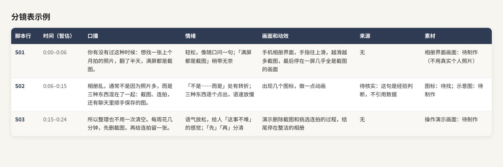
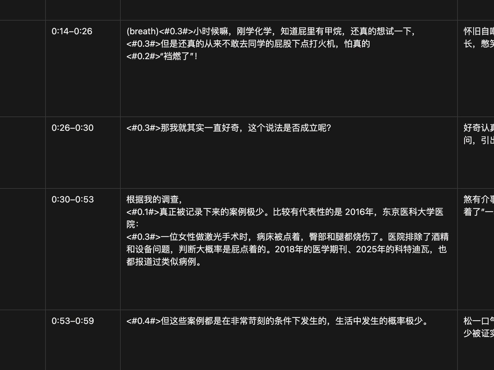

# Zerber（@Zerber_）：开源日赚 4 位数剪辑工作流——零基础 1 小时搓出科普视频

> 低门槛高转化科普短视频全自动剪辑流水线：结合文字脚本、AI 语音合成与高质感分镜图片，配合 Remotion / 剪映自动化工程批量产出科普视频，1 小时成片，支持跨平台矩阵分发与知识带货。

<!-- more -->

不会剪辑，不懂设计，0 基础的小白一个人用 AI，1 - 2 个小时就能做出一条能接 1K 商单的科普视频。

这篇我把从选题到出片的整套 SOP 都写出来了，照着搭一遍，你也能每天快速出一条。

其实我用 AI 已经有一两年了。说句实在话，在没有 AI 的时候，我一直很排斥自己去做内容。可能是程序员的性格使然，不管是写文章，还是剪视频拿出来分享，我心里都很抵触。原因有几方面：一方面，那时候的我放不下对技术的那份骄傲和执拗；另一方面是专业上的抵触，我没办法静下心去学那些专业名词，自己也不擅长做美感和交互，怎么都设计不出好看的页面，越看越不顺眼……

但是今天！！不管是视频生成模型，还是让大模型写代码做动效，出来的画面往往已经自带不错的美感。想做一条有自己风格的视频，门槛比以前低太多了。

所以我第一条视频其实磨了两三天，但是后来把流程慢慢理顺，选题、分镜、口播、动效都交给 AI 去跑，我自己只管把关，现在一条差不多 1 - 2 个小时就能搓出来。

当然，想做一条非常棒的视频还是很麻烦的，该有的环节一个都少不了。但我们发现，用 AI 做一条纯动效视频，其实简单很多。今天这篇文章算是做高质量视频的一个入门门槛：先把这一步走通，之后再去研究更复杂的场景设计，就会越来越得心应手。不过在这之前，你得先了解用 AI 出一条视频的整体流程是什么样的。

其实对于出视频来说，无非就是下面这几步：

- 找选题
- 设计分镜
- 设计口播语言
- 找素材
- 拼接素材（包括语音素材和画面素材）

那么这是最简单的 workflow，如果把这些调整好你就会做得非常的快了。

## 视频运用

### 运营小剧场

现在网上很火的一些视频，其实就是纯 AI 动效做出来的，比如小红书上火起来的比特新语、B 站的鲸鱼娘运营等等。靠现在 Oups 的能力，已经能做出简单又很好看的动画了。如果你把自己的 workflow 搭好，一天出一条这样的小视频来跑运营，整体效果会非常好。（我最近就在摸索这个，所以上 X 的时间少了很多，结果被人催着发做视频的文章，笑死。）

这种快速出片的视频，质量不一定很高，但一定够快，而且信息塞得很满。这里推荐 Muse 的一篇文章：[https://x.com/zmdsb259414/status/2114548308568154142?s=20](https://x.com/zmdsb259414/status/2114548308568154142?s=20)

这是一篇偏立人设的教程。其实大部分用户看运营内容，不一定在乎画面质量，更在乎内容本身和互动的形式。所以做得粗糙一点也没关系，只要形象丰富、人设丰满，故事再讲得好，就非常适合起号，能短平快地做起来。

### 运营知识类科普

这里我要推荐几个账号，都是非常好的学习对象：小红书上的浙大猫学长，还有 Xilo 今天 Ai 了吗。

Xilo 今天 Ai 了吗的这一篇是非常好的学习资料：[xhslink.cn](https://xhslink.cn/o/1qtxSkisFtK)，它教会了我怎么录一条 AI 口播视频。

浙大猫学长的视频则非常丰富、很有想象力：[xhslink.cn](https://xhslink.cn/o/6tvpI6ZxHiD)。这条的口播很简单，但能把动效很好地融进去。我个人觉得，对大部分普通人来说，做到这样就足够了。

最后我要推荐一下 Mozi ( @lilililiMozi )大佬。他的视频非常非常高级，把动效和视频大模型生成的镜头融在了一起。（我记得他在评论里说过用的是 sd？而且还挺贵，一条 10 分钟的视频要几百块钱，是真能烧。）整体有很强的动漫感。当然，以前 Oups 的动效还没这么好的时候，估计全是靠视频大模型抽卡抽出来的。（只能说，真牛啊～）

你可以去他的 B 站看视频，拆一拆他的镜头和分镜，我自己就是这么学的。主页在这：[space.bilibili.com](https://space.bilibili.com/3546922421848327?spm_id_from=333.337.0.0)。如果你想提高视频质量，就一定要想清楚每一个镜头怎么设计，A-roll 和 B-roll 怎么穿插才不突兀，还有怎么卡节奏，让整条视频看起来更流畅。

### 总结

目前来看，除了直接用视频模型生成动画做小剧场，做得最多的还是科普类视频。因为光靠动效就能直接做出一条视频，这不是非常轻而易举嘛。

## 制作视频

制作视频其实就是前面说的那 5 步。但在动手之前，除了想好选题，更重要的是先想清楚你要做的视频是什么形式、什么节奏，这样你心里才有底。3 分钟视频和 10 分钟视频的讲法完全不一样，快餐式的和精品花的时间也完全不一样。所以最好先找几条你想对标的视频，让 AI 帮你分析它们的节奏、分镜，还有内容是怎么穿插的。如果是带口播的，最好再去听听它说话的语气和节奏。

### 找选题并设计脚本

我把找选题、设计口播分镜和设计口播语言合在一起说比较好。

在想清楚要做什么视频之前，先用选题把整个大纲搭起来。拿我那条「放屁」的视频来说，我会先给出选题、大纲，还有一条完整的科普链，然后让 AI 帮我设计完整的分镜。

选题的话自己想清楚做什么系列的就可以了。

因为我之前那份分镜太复杂了，这里就举个简单的例子：

当然，这只是一个很初级的版本。你要知道，每一个脚本行大概对应一句话，有时候几句话会共用一个镜头。每个镜头怎么跳、怎么构思，中间怎么转场，你都得先在脑子里想清楚。所以这张表会跟着你不停修改，尤其是时间这一列，后面讲录口播的时候我会再细说。

为什么设计 7 列呢？

- 每一个脚本行对应一句话，这句话可长可短，可以拆成几个分镜，也可以直接切镜头。但有了这一行，你就知道这句话想表达什么、要怎么过渡，节奏也就出来了。
- 口播和情绪就不用多说了。画面和动效这一列，可以决定前后几句话要不要用同一种动效，这样你就能算清楚自己大概有多少个关键帧，脑子里的大纲也会非常清楚。
- 科普有个特殊的地方，就是不能乱说，所以我一般会把信息来源的网站也写进去。
- 素材这一列，是因为到最后，每一个脚本行都会生成不同的分镜。你起码得知道每个分镜是用哪些文件、哪些代码生成的，这样最后合在一起的时候 AI 才不会乱。不然上下文这么长，前面做了那么多操作，到最后 AI 要怎么合并都会成问题。

### 代码动画的特殊性

因为我们设计的时候是拿代码生成的镜头当主镜头，所以会出现一个挺特别的情况。一般的科普视频里，B-roll 其实用得不多。但用 AI 做视频，动效特别多，结果反过来了：B-roll 的讲解成了主镜头，A-roll 反而变成了中间穿插的过渡。

但代码生成的镜头也有它的短板，就是不太擅长做那种自然流畅的动画。想让动物或者人物动起来，它更多是靠剪纸、拆成零件，一帧一帧拼出来的那种感觉。所以如果你想把视频做得质量高一点，中间用 A-roll 来穿插，可以考虑这几种做法：

- 用 grok image 以绿幕的方式做动图，把人像抠出来做成动画，或者再和 Oups 大模型结合起来用这块我推荐 @HaileyAILabs 大佬，在这方面很有经验：[Hailey on Twitter / X
](https://x.com/HaileyAILabs/status/2114940685082337561?s=20)

- 也可以先用 Codex 设计分镜，再让 grok image 生成连续的动画，比如：我首页那个爆炸就是这么做出来的

- 我们也可以把这些分镜做成剪纸贴纸风：角色拆成可换的零件，一帧一帧换表情和动作，连成短 GIF，当成 A-roll 过渡。

上面这些，就是想把视频做得更好时可以用的过渡技巧。像 Mozi（@lilililiMozi）大佬，他的 A-roll 就是用自己的虚拟形象讲课来过渡的，整个视频质量非常高，很值得去学他的节奏、风格和技巧。（不过说实话，要做出他那种视频，真的挺耗费骨血的～）

这里我特别推荐用 Codex 来帮你设计分镜和表情包，别问为什么，问就是效果太好了！

到了 B-roll 这边，就该考虑你自己的风格，以及要配哪种动效了～

### 选择动效模版进行搭配

选模版有两种思路：一种是找现成的模版来搭配，另一种是自己去扒别人的模版来复刻。我觉得这两种最好都会一点。

不管用哪种，都别只是把模版拿来直接套。颜色、视频和视频之间怎么过渡，甚至里面的小动画，你都可以自己去改。说到底，模版只是工具，更重要的是先想清楚你的视频是什么定位。如果你觉得定位已经找准了，那直接做一个比特新语那样的动画也完全没问题。

找现成的模版进行搭配

这是我最推荐的方式。如果你不是专业的动效设计师，那就直接用别人调好的动效。毕竟专业设计师对镜头、对那些专业名词的理解，肯定比我们丰富得多。

这里首先要推荐 @lemomo_ai 和 @EianLu。他们做的动效给了我很大的启发，也让我多了很多设计思路，大家直接去翻他们的推就好了。

最经典的就是 @lemomo_ai 大佬的 [lemomo-ai/lemo-opuscar](https://github.com/lemomo-ai/lemo-opuscar)。里面的模版非常多，选哪个就看你自己的场景。@EianLu 那条很出名的成都城市解说视频，用的也是他这里的白模模版。除此之外，[lemomo-ai/lemo-wake](https://github.com/lemomo-ai/lemo-wake) 的效果也非常好。

@EianLu 则是靠 [eian-riso-broll](https://github.com/YIAN6557/eian-riso-broll) 起家的，《一座城的年轮》让他在 X 上一下子火了起来。我觉得他的想象力和创造力真的非常强。

之前我和 @lemomo_ai 聊过一些用代码写模版的想法。他现在很多创意模版，会利用 3D 场景的纵深，把 2D 和 3D 混在一起做，我觉得这件事特别有意思，这也是他的模版看起来很与众不同的原因。

另外再列几个我收藏的模版，大家挑的时候可以多几个选择：

- [Vincentwei1021/mg-styles-15](https://github.com/Vincentwei1021/mg-styles-15)
- [Alisa0808/vox-director](https://github.com/Alisa0808/vox-director)
- [threerocks/sweety-handdraw-video](https://github.com/threerocks/sweety-handdraw-video)

自己设计模版风格和扒模版

别听有些博主说「想要这整个 skill 就来加我吧」。其实只要你有 Codex，完全可以直接跟它说：「xx 秒到 xx 秒这个镜头我很喜欢，你帮我看看这是什么风格，帮我复刻出来，再生成一个对应风格的 skill。」这样基本就能解决问题。

不过我觉得，比起单纯把风格复刻出来，更重要的是想清楚你要用什么样的风格，让整个视频看起来是一个完整的整体。

最后还要强调一下，我们视频里用的模版也是大佬设计的，来自 @RadishBille，希望大家多多关注他。

### 如何设计 AI 口播

大部分视频都是有口播的，当然我这里说的是不用真人出镜的口播。你也可以不要口播，看起来好像更简单，但其实画面的要求会更高，动画得更丰富，不然很容易显得单调。所以要不要口播，最好一开始就想清楚！！！

因为一旦决定用口播，你就得先把口播录出来。只有录完了，才知道表格里每一行真实的时间，才能对上具体的镜头。

所以在脚本表格的草稿做完以后，第一件事就是去想每一段口播怎么说，然后回头改草稿上的时间。前面说的那些都算准备工作，从这一步开始才真正要紧。

如何让 AI 口播听起来不那么怪异

如果直接用视频生成模型，声音和画面它会一起帮你生成好。但是用代码做动效的视频，说话和画面基本都是分开做的，所以口播的语气就得我们自己来设计。

最省事的办法是直接拿普通的 TTS 读稿，但是听起来会很生硬。想让 AI 读得自然一点，最起码要有气口。

我的经验就是在句子之间加停顿。普通的 TTS 做不太到，我用的是 MiniMax。具体怎么加，最简单的办法就是你自己先把每句话读一遍，感受一下哪里要停长一点，哪里要停短一点。如果是一句话还没说完，中间的小停顿大概在 0.1s～0.2s；如果是一句话说完接下一句，一般停 0.3s～0.4s 左右。这个没有标准答案，自己听着舒服就行。

我截了个图，大家可以看看我平时大概是怎么卡节奏的：

口播分镜里的 MiniMax 停顿标记

在你觉得会停顿、转换的地方，自己先读一遍，然后丢到 MiniMax 网页版里生成，听听停顿和节奏是不是你想要的。顺便说一句，我当时的语速设的是 1.12 倍，而且中间没有加任何情绪。因为 MiniMax 的情绪衔接很怪，一句话后面要是换了个情绪，听起来就不像正常人在说话了。所以我的建议是用原生的语气，再加上适当的停顿，听起来就已经很自然了。

另外生成的时候，我建议两三句话合成一段来生成，别一大段一大段地生成。连着读效果才好，但一大段生成很费钱，而且中间要是错了一个字或者一个词，整段重来就太亏了。分成小段的话，哪句多字少字，单独重新生成那一句替换掉就行。

还有就是，口播真正录完以后，你才能把表格里每一行的时间定下来。

### 开始出片

到这一步，其实你就算真正开始制作视频了。

我们可以根据之前的构想，把表格直接交给 Oups，让它出视频。但是我自己的习惯是不会一下子把整个表格都丢给它，而是先让它做前面两三行，出一小段样片，我看完觉得没问题了再让它接着往下做。因为老实说，等它一口气做完你再去改，那个成本是非常高的。

这里有几个点我觉得要注意一下：

1. 镜头和镜头之间怎么切换，你最好自己在脑子里先过一遍。Oups 其实很会接，但是它接出来的节奏不一定是你心里想的那个，所以你自己得先有个数。
2. 样片出来以后，我一般会看画面和口播的气口有没有对上，转场会不会很突兀，还有模版的风格是不是我想要的那种。如果有哪里不对，我会先回去改表格或者改提示词，然后再让它继续做后面的部分。
3. 背景音乐也要和口播、画面对上。口播的停顿前面已经调好了，那么配乐就尽量别卡在一句话的中间，在段落切换或者情绪起来的地方和音乐对一下点，整个视频看起来就会流畅很多。

另外还有一点很重要，就是表格最后一列的素材。前面我们在测试分镜和特效的时候，往往会反复生成很多次，文件一多就会非常乱，到最后你根本分不清哪个是哪一行用的。所以在看完分镜以后，我会把每一行用到的是哪段特效代码、哪个分镜 demo，或者是哪张 GIF 动画，都记在素材这一列里，写个文件名或者路径就可以。这样最后交给 Oups 合成的时候，它就知道每一行该用哪个文件，不会乱，你自己也省事很多。

我在交表格的时候也会顺便跟它说清楚，用的是哪几个模版，A-roll 大概在哪里穿插，有哪些地方不要让它自由发挥，时间就按表格来，不要自己随便拉长。

其实我觉得做到以上几点，如果是纯动效的视频，Oups 基本上就能出一个效果很不错的片子，因为它剪自己做出来的动画是非常顺手的。但是如果你加入了自己的素材，或者用 SD 之类的视频生成大模型去做更复杂的剧情，那就没那么简单了，很多镜头需要你自己去更精确地调整，返工也会多不少。

## 相关页面

- [[sources/lufzzliz-infinite-digital-human-koubo]]
- [[sources/leo-xiaolei-369-video-agent-tools]]
- [[patterns/story-studio-video-pipeline]]
