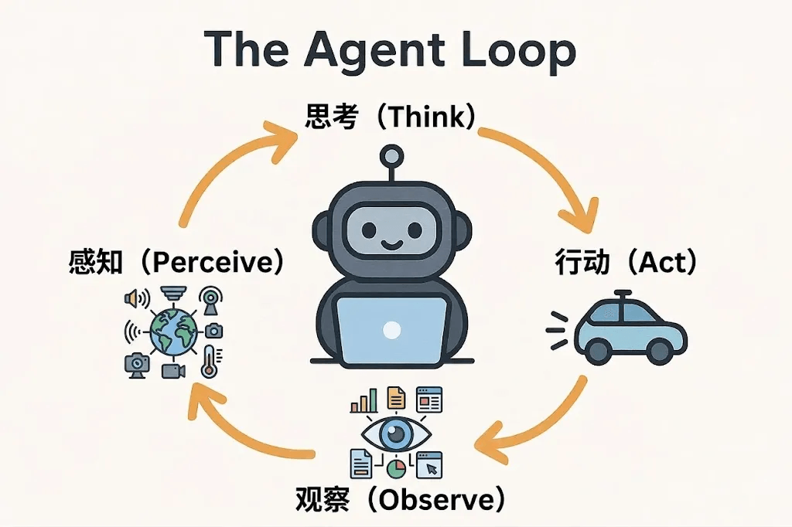
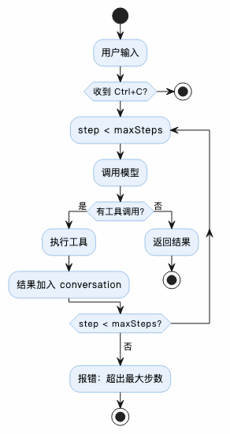

# 从零构建 Agent（三）：Agent Loop 与 ReAct

> 本文是「从零构建 Agent」系列的第 3 篇：Agent Loop。
> Agent 的核心就是一个 `while` 循环——准确说是 **ReAct 循环**。本文拆解感知→思考→行动→观察四阶段闭环、Responses API 的完整 SSE 事件序列、模型侧 SSE 到 Agent 侧 Event 的解耦映射，以及三种终止条件。

<!-- more -->

上一篇介绍了如何使用 OpenAI Responses API 与大模型进行交互。从本节开始，真正开始构建 Agent 了。

**任何 Agent 的核心都是 Agent Loop**，包括我们熟知的 Claude Code、Codex、OpenCode、Hermes 等，没有例外，皆是如此。

### 1. 什么是 Agent Loop

实际上 Agent Loop 没有什么神秘，本质就是一个 `while` 循环，准确地说就是 **ReAct 循环**——ReAct 理论来自论文 [arXiv:2210.03629](https://arxiv.org/abs/2210.03629)。

简单说，我们人类做事时都有一个「内心小剧场」。比如你要喝可乐，心里会想：「我要买可乐，然后拉易拉罐……」大模型也是类似。加上 Thinking 步骤后，它做事的准确率会提高很多。

#### 1.1 ReAct 交互流程

基于此，ReAct 已经成为 Agent 与模型交互中的一种标准范式。它通常要求 Agent 和模型的每一轮迭代内部都包含四个职责明确的阶段：

**感知（Perceive）→ 思考（Think）→ 行动（Act）→ 观察（Observe）**

这四个阶段构成一个闭环，缺一不可。

| 阶段 | 核心问题 | 输入 | 输出 |
|---|---|---|---|
| 感知 Perceive | 现在发生了什么？ | 用户输入 / 上轮观察 | 结构化状态 |
| 思考 Think | 我该做什么？ | 当前状态 + 历史 | 推理 + 决策 |
| 行动 Act | 具体怎么做？ | 决策 | 工具调用 / 输出 |
| 观察 Observe | 结果是什么？ | 工具返回 / 环境反馈 | 新信息 + 状态更新 |



#### 1.2 模型对 ReAct 的实现

半年前实现 ReAct 的时候，依靠的是系统提示词，通过提示词指导模型结构化的输出满足 ReAct 要求的内容。其提示词一般是如下的形式：

```markdown
你是 ReAct 任务解决专家。你的核心能力是**规划**（推理）与**执行**（调用工具）解耦，通过多轮迭代获得最终答案。

# 核心工作流

1. 理解 `<question>` 中的用户意图。
2. 审视当前可用的工具列表和技能列表，拆解子任务。
3. 每轮严格输出 `Thought` + `Action` 或 `Thought` + `Final_Answer`。
4. 等待真实的系统 `<observation>` 返回，绝不臆造观察结果。

# 输出格式（必须严格遵守 XML 标签）

每轮输出**必须且仅包含**以下两种组合之一：

- **未完成时**：`<thought>` + `<action>`
- **完成时**：`<thought>` + `<final_answer>`

... 省略

## 可用技能

{toolList}

# 环境上下文

- 工作目录：{skillSection}

# 可用工具

{workingDirectory}`;
```

> ⚠️ 这段提示词模板在**原文公众号里带冗余的 markdown 转义**（如 ``\<question\>``，反斜杠是作者写在代码块内的多余转义）与**末尾的残留分隔符**（`{workingDirectory}` 后多出的 `` `; ``，是代码围栏闭合符泄漏进正文）。归档已去掉转义反斜杠，末尾 2 个字符按原文保留。

但随着模型能力的增强，**模型正在吃掉 harness**——很多内容模型早已经预训练好了，有些 harness 的工作便可以省略掉了。再叠加 Responses API 对 ReAct 的结构化支持，模型已经不再需要这样的陈词滥调，**可以将提示词精简为一句话，且不会影响模型的输出效果**。

### 2. 如何实现 Agent Loop

之前实现过一个基于 Chat Completions API 的 Agent Loop，相比较而言，**基于 Responses API 要优雅和简单很多**，因为其通过 `type` 把 reasoning、function calling、text output 都做了结构化区分。实际上 OpenAI 在 Responses API 之上还封装了 OpenAI Agent SDK，进一步简化了 Agent 的开发。但为了展示 Agent Loop 的实现细节，本文还是基于 Responses API 来做实现。

#### 2.1 Loop 实现

Agent Loop 的核心是一个 `while` 循环，其使命就是把用户交代的任务，通过循环不断地和模型进行交互，直到问题解决、退出循环。其伪代码如下所示：

```ts
while step < maxSteps:
    step += 1
    state = perceive(conversation)              # 感知：准备输入
    thought, calls, finalAnswer = think(state)  # 思考：模型推理 + 决策
                                                #   （内部消费事件流）
    if shouldEnd(finalAnswer, calls):           # 终止：无需行动
        return finalAnswer
    results = act(calls)                        # 行动：执行工具
    observe(results, conversation)              # 观察：结果回填上下文
return error("Reached maxSteps")
```

完整代码参见 `chapter3/src/agent-loop.ts`。代码本身不难，唯一需要注意的是 JavaScript 的异步编程，例如源码中处理 MaaS 服务器返回的 Streaming Event 代码：

```ts
for await (const event of this.#client.stream(request, signal)) {
  if (event.type === 'response.reasoning_text.delta') {
    ...
  }
  if (event.type === 'response.output_text.delta') {
    ...
  }
  if (event.type === 'response.completed') {
    ...
  }
}
```

`await` 是 JS 为了解决传统异步编程回调地狱问题产生的新关键字（语法糖），旨在用同步的方式写异步的代码。字面上 `await` 会等待异步函数 yield 消息出来，但其背后是异步非阻塞的，底层机制是 NodeJS V8 引擎的事件循环。不熟悉 JavaScript / TypeScript 异步编程的同学需要自己补课，不然不好理解 Responses API 的 SSE（Server-Sent Events）流式处理逻辑。

#### 2.2 Responses API 的 SSE

查看 Responses API 文档中 Server-Sent Events (SSE) 部分，会发现 Event 的类型非常多，**如何处理这些 Event，是 Agent Loop 的关键所在**。为了把交互过程看清楚，把 Agent 交互过程中的 Event type 都打印出来：

```text
// 一轮（turn）模型调用开始
response.created
response.in_progress

// 开始推理
response.output_item.added
response.content_part.added
response.reasoning_text.delta
...
response.reasoning_text.delta
response.reasoning_text.done
response.content_part.done
response.output_item.done

// 结束推理

// 开始输出文本
response.output_item.added
response.content_part.added
response.output_text.delta
...
response.output_text.delta
response.output_text.done
response.content_part.done
response.output_item.done

// 结束输出文本

// 开始输出调用工具参数
response.output_item.added
response.function_call_arguments.delta
...
response.function_call_arguments.delta
response.function_call_arguments.done
response.output_item.done

// 结束输出调用工具参数

// 执行调用工具
response.completed

// 一轮（turn）模型调用结束

// 开启下一轮调用，直到没有工具调用，Loop结束
```

可以看到，虽然类型很多，但最关键的 Event 是：

- `response.reasoning_text.delta` 代表 reasoning 增量
- `response.output_text.delta` 代表文本增量（final answer 也是这个）
- `response.output_item.done` 代表 item 结束，推理、文本、函数调用都是 item
- `response.completed` 代表一轮结束，接下来可能继续循环，也可能交互结束，取决于是否产生了 final answer

其相关代码就是上一节看到的通过 `await` 异步处理 SSE event 的代码。

#### 2.3 Agent Event

上述是模型侧的 Event。使用过 Agent 的同学都知道，Agent 在执行任务时会在 TUI 或 GUI 上实时输出模型的推理文本、工具调用、最终答案等信息。这些都源于对 SSE 的加工处理。**为了和 SSE 解耦，需要设计一套 Agent 侧的 Event**，其映射关系如下：

| SSE Event（模型侧） | AgentEvent（Agent侧） | 说明 |
|---|---|---|
| `response.reasoning_text.delta` | `reasoning_delta` | 推理文本增量，透传 delta |
| `response.output_text.delta` | `content_delta` | 最终回答文本增量，透传 delta |
| `response.output_item.done` | `tool_call`（间接） | 从 `event.item` 中识别 `function_call` 类型 |
| `response.completed` | `token_usage` | 从 `event.response.usage` 中提取 Token 用量 |
| —（无对应 SSE 事件） | `step_start` | Loop 自身产生，标记每步开始 |
| —（无对应 SSE 事件） | `step_end` | Loop 自身产生，标记每步结束 |
| —（无对应 SSE 事件） | `tool_result` | Loop 执行工具后产生，非模型事件 |
| —（无对应 SSE 事件） | `run_end` | Loop 自身产生，标记整个循环结束 |
| —（无对应 SSE 事件） | `error` | 网络异常、maxSteps 超限等 |

因为本章主要是讲解 Agent Loop，所以对于 Agent Event 的处理比较简单，只是输出到 console 上，其实现如下：

```ts
function render(event: AgentEvent): void {
  switch (event.type) {
    case AgentEventType.StepStart:
      console.log(`\n[step {event.delta}\x1b[0m`);
      break;
    case AgentEventType.ContentDelta:
      process.stdout.write(`\x1b[34m{event.inputTokens}, output {event.totalTokens}`);
      break;
    }
    case AgentEventType.ToolCall:
      console.log(`\n[tool_call] {event.call.arguments})`);
      break;
    case AgentEventType.ToolResult:
      console.log(`\n[tool_result] {event.step} done: {event.steps} step(s)]`);
      break;
    case AgentEventType.Error:
      console.error(`\n[error] ${event.message}`);
      break;
  }
}
```

> ⚠️ 这段代码在**原文公众号里就是残缺的**——多处模板字符串缺失开头的 `$`（如 `{event.delta}` 应为 `${event.delta}`）与结尾反引号，且 `case ContentDelta` 后多出一个 `}` 提前闭合了 switch。从上下文可还原其本意：`StepStart` 打印步号，`ContentDelta` 直接 `write` 输出增量文本，`ToolCall` 打印工具名与参数，`ToolResult` 打印工具执行结果，`Error` 打印错误信息。归档时保留原文原样以便核对。

注意 `reasoning_delta` 使用 `\x1b[90m...\x1b[0m`（ANSI 灰色转义码），让推理文本和最终回答在视觉上区分开。`content_delta` 直接 `write` 不换行，实现逐字输出的「打字机效果」。

### 3. 如何结束 Agent Loop

最后来看 Agent Loop 启动之后是如何停下来的。**无限循环的 Agent 很可怕，会把你的 tokens 都烧光。**



总共有三种情况可以终止循环，其代码实现如下：

```ts
shouldEndLooping(calls, signal, step, maxSteps): boolean {
  if (signal?.aborted === true) return true;
  if (step >= maxSteps) return true;
  if (calls.size === 0) return true;
  return false;
}
```

通过 `shouldEndLooping` 方法，三个终止条件一目了然：

- **用户取消**（`signal.aborted`）：Ctrl+C 中断。
- **达到最大步数**（`step >= maxSteps`）：防止无限循环。
- **无工具调用**（`calls.size === 0`）：本轮没有请求任何工具调用，说明可以直接结束。

### 4. 总结

本文介绍了 Agent 的核心——Agent Loop，并说明了它本质上是一个 ReAct 循环。ReAct 将 Agent 与模型的交互划分为感知、思考、行动、观察四个阶段，构成一个闭环。**理解这四个阶段的职责与输入输出，是设计健壮 Agent Loop 的基础**。

在实际工程中，通常还需要处理上下文膨胀、工具调用失败、死循环检测、安全权限控制和可观测性等问题。这些内容会在后续文章中逐步展开。

---

## 相关链接

- 系列前篇：[从零构建 Agent（一）：技术选型](/md/wiki/sources/zeroagent-01-tech-stack)、[从零构建 Agent（二）：大模型交互](/md/wiki/sources/zeroagent-02-llm-interaction)
- 系列已有：[从零构建 Agent（八）：可复用的 Slash Commands](/md/wiki/sources/zeroagent-slash-commands)、[从零构建 Agent（十二）：长期 Memory 管理](/md/wiki/sources/zeroagent-12-longterm-memory-management)
- Demo 源码：[significantfrank/ZeroAgent](https://github.com/significantfrank/ZeroAgent)
- 交叉参考：[Agent Loop](/md/wiki/patterns/agent-loop)、[Harness Engineering](/md/wiki/concepts/harness-engineering)、[Loop Engineering](/md/wiki/concepts/loop-engineering)
