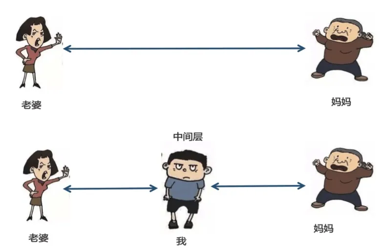
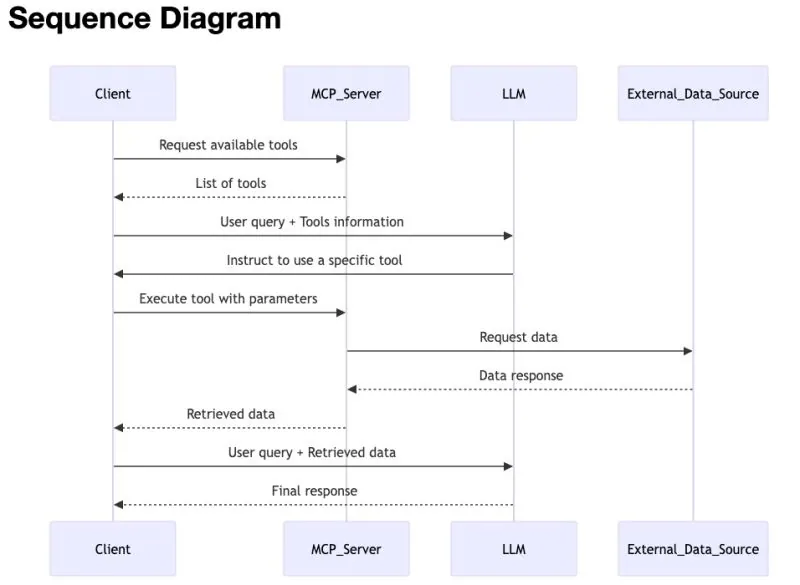

# 从零构建 Agent（五）：MCP 工具协议

> 本文是「从零构建 Agent」系列的第 5 篇：MCP。
> 上一篇实现的本地工具全部硬编码在 Agent 内部，加一个工具就要改代码、改 switch、加测试、重新部署。本文引入 **MCP（Model Context Protocol）**——把工具接入从「N×M 定制适配器」简化为「N+M 标准接口」，并完整实现 MCP Client、MCP Server、命名空间隔离与 In-Memory 测试。

<!-- more -->

上一篇为 Agent 实现了一组本地 Function Calling 工具——文件读写、命令执行、代码搜索。这些工具让 Agent 从「只会聊天」变成了「能干活」的实干家。但**所有工具都是硬编码在 Agent 内部的**：加一个工具就要改代码、改 switch、加测试、重新部署。

如果工具能像 USB 设备一样即插即用呢？启动一个进程，Agent 自动发现它暴露的工具，注册到工具列表里，无需改一行代码。

这正是 **MCP（Model Context Protocol）** 试图解决的问题，但它要应对的远不止单个 Agent 的工具扩展。在 MCP 出现之前，每一个 AI 应用想要连接某一个外部工具，都需要单独编写一套集成代码。如果有 N 个 AI 应用和 M 个外部工具，理论上就需要 **N × M 套定制适配器**。数据被锁在信息孤岛和遗留系统里，每接入一个新数据源都要做一次定制实现，连接真正的外部系统变得难以规模化。MCP 要解决的，就是这种「N×M 集成噩梦」。

本文在 Function Calling 的基础上，为 Agent 增加 MCP 客户端支持，并实现一个 MCP Server，让 Agent 能够动态连接外部工具服务器。

---

## 1. 什么是 MCP

### 1.1 中间层解耦

「计算机科学中的所有问题都可以通过增加一个间接层来解决」——这也是解耦的精髓，比如依赖倒置解耦，就是加入了新的抽象层。



MCP 也是**中间层解耦**。不要让 Agent 直接持有工具的实现，而是在 Agent 和工具之间插入一个中间层——**Agent 只负责「描述我需要什么能力」，中间层负责「找到并提供这些能力」**。这样，工具的增删改就不再牵动 Agent 的代码，Agent 也不用关心工具到底跑在本地、远程还是别人的服务器上。

这层中间层就是 MCP Client/Server 架构。Agent 通过 MCP Client 与外部 MCP Server 通信，工具的具体实现被隔离在 Server 一侧。加一个工具，只需要启动一个实现了对应能力的 MCP Server；Agent 侧无需改代码、无需重新部署，只需要在运行时发现并注册这个 Server 暴露的工具即可。

### 1.2 MCP 协议

MCP 协议由 **Anthropic 于 2024 年 11 月开源**。它的定位可以用一个类比概括：**AI 领域的 USB-C**。设备（Agent）和配件（工具/数据）各自实现标准接口，而不是每对组合都焊一根定制线。工具只需要实现一次 MCP Server，所有支持 MCP 的 AI 应用都可以直接连接使用，**集成方程从 N×M 简化为 N+M**。

MCP 的规范基于 **JSON-RPC 2.0**，采用客户端-服务器架构。Host（如 Claude Desktop、Cursor 等 AI 应用）管理多个 MCP Client，每个 Client 与一个 MCP Server 建立连接。MCP Server 可以向 Client 暴露三类核心能力：

| 能力 | 含义 |
|---|---|
| **Tools** | 可供模型执行的函数 |
| **Resources** | 可供读取的上下文数据 |
| **Prompts** | 可复用的交互模板 |

如下图所示，Agent（MCP Client）不需要知道工具的具体实现，只需要知道：**有哪些工具（`listTools`）、怎么调用（`callTool`）**。工具的实际执行发生在 Server 侧，结果通过协议返回。



---

## 2. MCP Client 实现

### 2.1 McpClientManager 设计

`src/mcp-client.ts` 中的 `McpClientManager` 是 Agent 侧的 MCP 客户端管理器，负责管理多个 MCP Server 连接：

```ts
export class McpClientManager {
    readonly #clients = new Map<string, Client>();
    readonly #transports = new Map<string, Transport>();
    readonly #toolIndex = new Map<string, { serverName: string; originalName: string }>();
}
```

三个核心数据结构：

- **`#clients`**：Server 名称 → MCP Client 实例的映射，每个连接对应一个 Client。
- **`#transports`**：Server 名称 → Transport 的映射，管理传输层生命周期。
- **`#toolIndex`**：Prefixed 工具名 → `{ serverName, originalName }` 的反向索引，用于在 `callTool` 时路由到正确的 Server。

### 2.2 连接 MCP Server

MCP SDK 提供了两种传输方式：**stdio**（通过子进程通信）和 **in-memory**（同进程通信，用于测试）。`connectTransport` 是统一的连接入口：

```ts
async connectTransport(serverName: string, transport: Transport): Promise<void> {
    if (this.#clients.has(serverName)) {
        throw new Error(`MCP server "{serverName}__{mcpTool.name}`,
                parameters: mcpTool.inputSchema as Record<string, unknown>,
                strict: false,
            };
            entries.push({ originalName: mcpTool.name, prefixedName, serverName, tool });
            this.#toolIndex.set(prefixedName, { serverName, originalName: mcpTool.name });
        }
    }
    return entries;
}
```

> ⚠️ 这段代码在**原文公众号里本身就是残缺的**——中间缺了客户端创建、`client.connect(transport)`、以及工具声明到 `FunctionTool` 的转换逻辑。原文可确证的只有三件事：① 重复连接同名 Server 会抛错；② 工具声明转换时 `parameters` 直接透传 `inputSchema`；③ `strict` 固定为 `false`；④ 工具以 `serverName__toolName` 前缀注册进 `#toolIndex`。
> 另注：原文小节编号从 `2.2` 直接跳到 `2.4`，缺失 `2.3`。

**命名空间隔离**是关键设计。如果两个 Server 都暴露了一个叫 `echo` 的工具，Agent 怎么区分？答案是加前缀：`serverA__echo` 和 `serverB__echo`。前缀格式是 `serverName__toolName`，用双下划线分隔（因为工具名本身不会包含双下划线）。

MCP 工具的 `inputSchema` 是 JSON Schema 格式，和 `FunctionTool.parameters` 兼容，直接透传即可。但 `strict` 统一设为 `false`——MCP Server 的 schema 可能包含可选参数。

### 2.4 工具调用

当模型请求调用一个 MCP 工具时，`callTool` 通过 `#toolIndex` 找到对应的 Server 和原始工具名，然后转发调用：

```ts
async callTool(prefixedName: string, args: Record<string, unknown>): Promise<McpCallResult> {
    const index = this.#toolIndex.get(prefixedName);
    if (index === undefined) {
        return { output: `Unknown MCP tool: {index.serverName}" is not connected`, error: 'server_disconnected' };
    }
    try {
        const result = await client.callTool({
            name: index.originalName,
            arguments: args,
        });
        // Extract text from content blocks
        // ...
        return { output, error };
    } catch (error) {
        return {
            output: error instanceof Error ? error.message : String(error),
            error: 'mcp_call_error',
        };
    }
}
```

**任何异常都不会 crash Agent**，而是转成 `McpCallResult` 传回模型。MCP 协议本身也有 `isError` 标志位——Server 可以正常返回 HTTP 200 但标记 `isError: true`，表示工具执行失败（区别于协议层面的错误）。

---

## 3. MCP Server 实现

### 3.1 Demo Server

`src/mcp/server.ts` 实现了一个 demo MCP Server，暴露三个工具：`echo`、`add`、`upper`：

```ts
export function createDemoServer(): McpServer {
    const server = new McpServer(
        { name: 'zero-agent-demo', version: '0.1.0' },
        { capabilities: { tools: {} } },
    );
    server.registerTool('echo', {
        description: 'Echo back the provided text. Useful for testing MCP connectivity.',
        inputSchema: { text: z.string().describe('The text to echo back') },
    }, async (args) => {
        return {
            content: [{ type: 'text' as const, text: args.text }],
        };
    });
// 省略add和upper
    return server;
}
```

`McpServer` 是 MCP SDK 提供的 Server 类，`registerTool` 接收三个参数：工具名、配置对象（含 `description` 和 `inputSchema`）、回调函数。`inputSchema` 使用 Zod schema 定义，SDK 自动将其转换为 JSON Schema 暴露给 Client。

工具返回值是 `{ content: ContentBlock[] }`，其中 `ContentBlock` 的 `type` 必须用 `as const` 断言为字面量类型——这是 TypeScript 类型系统的要求，否则会推断为 `string` 导致类型不匹配。

### 3.2 stdio 运行模式

Demo Server 支持以独立进程运行，通过 stdio 与 Agent 通信：

```ts
async function main(): Promise<void> {
    const server = createDemoServer();
    const transport = new StdioServerTransport();
    await server.connect(transport);
    process.stderr.write('[mcp-server] zero-agent-demo running on stdio\n');
}
```

`StdioServerTransport` 监听当前进程的 stdin，解析 JSON-RPC 消息，将响应写入 stdout。注意 **Server 的日志输出到 stderr**——stdout 是协议通道，任何非协议内容都会破坏 JSON-RPC 解析。

启动方式：

```bash
pnpm --filter @zero-agent/chapter5 mcp-server
```

---

## 4. Agent 集成 MCP

### 4.1 工具列表合并

`src/tools.ts` 中新增了全局 `mcpManager` 实例和 `getAllToolsWithMcp` 函数：

```ts
export const mcpManager = new McpClientManager();
export async function getAllToolsWithMcp(): Promise<readonly FunctionTool[]> {
    const mcpEntries = await mcpManager.listAllTools();
    const mcpTools = mcpEntries.map((e) => e.tool);
    return [...allTools, ...mcpTools];
}
```

每次 Agent Loop 请求模型前，都会调用 `getAllToolsWithMcp()` 获取完整的工具列表：**本地工具 + 所有已连接 MCP Server 的工具**。模型看到的是一个统一的工具列表，不需要知道哪个是本地的、哪个是远程的。

### 4.2 工具调度

`executeTool` 在原有的 switch 之前增加了一个 MCP 检查：

```ts
export async function executeTool(call: FunctionCallItem): Promise<ToolResult> {
    // Check if this is an MCP tool
    if (mcpManager.isMcpTool(call.name)) {
        const args = parseArgs(call);
        const mcpResult = await mcpManager.callTool(call.name, args);
        return {
            callId: call.call_id,
            name: call.name,
            output: mcpResult.output,
            error: mcpResult.error,
        };
    }
    // ... 本地工具 switch 分派
}
```

调度逻辑是：**先查 MCP，再查本地**。`mcpManager.isMcpTool(call.name)` 通过检查 `#toolIndex` 判断工具名是否属于某个 MCP Server。如果是，解析参数后转发给 `mcpManager.callTool`；如果不是，进入原有的 switch 分派本地工具。

---

## 5. 测试策略

MCP 测试不需要启动子进程。MCP SDK 提供了 `InMemoryTransport.createLinkedPair()`，创建一对通过内存通信的 Transport：一端给 Server，一端给 Client，无需网络和进程间通信。

```ts
const [clientTransport, serverTransport] = createInMemoryTransportPair();
const server = createDemoServer();
await server.connect(serverTransport);
await manager.connectTransport('demo', clientTransport);
```

这种方式既快又可靠，适合单元测试和集成测试。

---

## 6. 总结

本文为 Agent 增加了 MCP 支持，让 Agent 能够动态连接外部工具服务器，实现了工具的即插即用。核心要点：

- **MCP 是工具的 USB 协议**：Server 暴露工具，Client 发现并调用，通过 JSON-RPC 通信。Agent 不需要知道工具实现，只需要知道有哪些工具、怎么调用。
- **命名空间隔离**：通过 `serverName__toolName` 前缀避免不同 Server 的同名工具冲突。这是多 Server 共存的基础。
- **In-Memory 测试**：用 `InMemoryTransport` 创建同进程通信的 Server-Client 对，测试快且可靠，无需子进程和网络。

至此，Agent 已经具备了「大脑」（Agent Loop）、「双手」（本地工具）和「外接设备」（MCP Server）。下一篇讲解 Skills 功能的实现。

---

## 相关链接

- 系列前篇：[从零构建 Agent（一）：技术选型](/md/wiki/sources/zeroagent-01-tech-stack)、[从零构建 Agent（二）：大模型交互](/md/wiki/sources/zeroagent-02-llm-interaction)
- 系列已有：[从零构建 Agent（八）：可复用的 Slash Commands](/md/wiki/sources/zeroagent-slash-commands)、[从零构建 Agent（十二）：长期 Memory 管理](/md/wiki/sources/zeroagent-12-longterm-memory-management)
- Demo 源码：[significantfrank/ZeroAgent](https://github.com/significantfrank/ZeroAgent)
- 交叉参考：[Harness Engineering](/md/wiki/concepts/harness-engineering)、[Agent Loop](/md/wiki/patterns/agent-loop)
