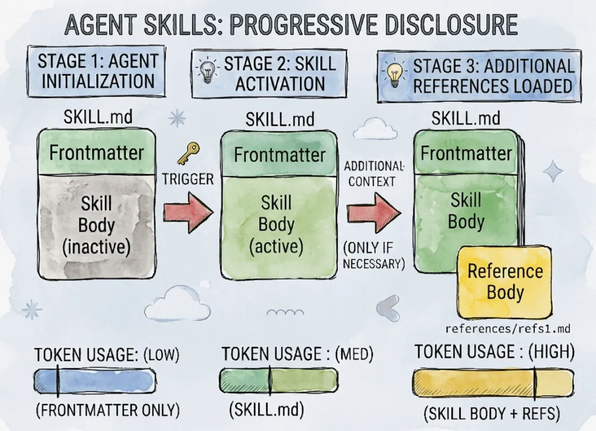

# 从零构建 Agent（六）：Skills 与渐进式披露

> 本文是「从零构建 Agent」系列的第 6 篇：Skills。
> MCP 让 Agent 有了「外接设备」，但光有工具还不够——工具是锤子锯子，领域知识与操作流程才是施工图纸。本文实现 Anthropic 的 **Skills 规范**，核心是**渐进式披露（Progressive Disclosure）**的三级加载机制：前言（Frontmatter）→ 全文（Body）→ 引用（Reference），从根本上解决上下文过载与注意力稀释。

<!-- more -->

上一期为 Agent 接通了 MCP，让工具像 USB 设备一样即插即用。但很快大家就会发现一个现实问题：**给了 Agent 一把锤子和一把锯子，它依然盖不出一栋漂亮的房子**。

要把领域的「行医指南」或「施工图纸」教给 Agent，最土的办法就是把所有指南都写进 System Prompt。但这就好比让一个人把全科医学百科全书时刻背在脑子里去应诊——不仅脑容量（Token）受不了，脑子（LLM 推理）也容易被繁杂的信息搅混。**信息过载和信息不足一样有害**，所谓过犹不及是也。

Skills 是**上下文工程（Context Engineering）**的重要创新，本文将带你拆解 Agent 如何构建完整的 Skill 功能。

---

## 1. 什么是 Skill

和 MCP 一样，**Skills 也是 Anthropic 制定的一个规范**，它并不意味着一定要和 Claude Code 绑定。只要遵从 Skills 规范，其核心是关于 Skills 的**文件系统结构**：

```text
my-skill/
├── SKILL.md          # Required: metadata + instructions
├── scripts/          # Optional: executable code
├── references/       # Optional: documentation
├── assets/           # Optional: templates, resources
└── ...               # Any additional files or directories
```

其中最重要的是 `SKILL.md`，其中 `name` 和 `description` 是必选项，是为了把 Skill 能力暴露给大模型：

```yaml
---
name: skill-name
description: A description of what this skill does and when to use it.
---
```

Skills 规范的内容非常简洁，关键是定义 Skills 的文件结构和发现机制。

---

## 2. 为什么需要 Skill

大模型主要依靠 prompt 工作，每次模型交互，模型接收到的 prompt 叫 Context（上下文）。在 Agent Loop 中，经常出现的问题**不是 Context 内容不够，而是信息太多**，导致：

- **上下文过载（Context Bloat）**：浪费极高的 Token 成本。
- **注意力稀释（Attention Dilution）**：模型被大量无用信息干扰，出现幻觉或忽略关键指令（即「信息过载导致推理质量下降」）。

Skills 就是解决这一难题的优雅答案。**Skills 的底层灵魂在于「渐进式披露（Progressive Disclosure）」**：

就像一个优秀的图书馆员，平时只看**图书检索目录**（元数据）；只有当读者明确要查某种资料时，才去书架上**取出具体的操作手册**（完整指令）；如果书中提到某个附录，再**翻开附录**（辅助资源）。

借由这种设计，上下文窗口永远只保留当前任务最核心的信息。这种渐进式的披露过程可以分为三级：

**前言（Frontmatter）→ 全文（Body）→ 引用（Reference）**



---

## 3. 实现 Skill 功能

### 3.1 Skill 类型定义

创建一个新的 `skills` 包，把 skill 相关代码都放在这里。首先需要定义 TypeScript 类型，skill 的数据结构比较简单，被定义在 `src/skills/types.ts`：

```ts
export type SkillDefinition = {
    /** Unique name of the skill (kebab-case). */
    name: string;
    /** Human-readable description of what the skill does. */
    description: string;
    /** Instruction text injected into the system prompt when the skill is used. */
    instructions: string;
};
```

三个核心字段：`name` 是唯一标识，`description` 用于让模型判断「该不该用这个技能」，`instructions` 是完整的指令正文。

### 3.2 Skill 加载

在 Claude Code 中，它支持两种 Skill 来源：

- 全局 Skills：`~/.claude/skills/`
- 项目 Skills：`{workdir}/.claude/skills/`

为了实现类似的能力，实现方式是在 request 中加入 `role` 为 `developer` 的 item 信息：

```ts
const requestBuilder = new PromptRequestBuilder(options.model ?? this.#model)
  .addDeveloperMsg(`Working directory: ${this.#workdir}`)
  .addUserMsg(input)
  .setInstructions(this.#skills.buildPromptInstructions())
  .setParallelToolCalls(true)
  .setStore(false)
  .setReasoning(options.reasoning ?? { effort: 'low' });
```

注意，在 Responses API 中，`developer` role 和 `instructions` 与传统的 system prompt 作用类似。其效果就是，在每一次模型交互中，都会带上 working directory 的信息。为了区分 user prompt，其 role 是 `developer`：

```json
"input": [
    {
      "role": "developer",
      "content": "Working directory: ~/ZeroAgent/chapter6"
    },
    {
      "role": "user",
      "content": "请问，当前有哪些可用的skill?"
    }
  ],
```

对于我们的 Agent 而言，参考 Claude Code 的实现，需要把 `~/.zeroagent/skills/` 作为全局目录、`{workdir}/.zeroagent/skills/` 作为项目目录。实现方式是通过**先后顺序**来实现优先级——**后加载的优先级更高**：

```ts
export async function loadAllSkills(workdir: string): Promise<{
    registry: SkillRegistry;
    loaded: LoadedSkill[];
}> {
    const registry = new SkillRegistry();
    const loaded: LoadedSkill[] = [];

    const dirs = [userSkillsDir(), projectSkillsDir(workdir)];

    for (const dir of dirs) {
        const skills = await loadSkillsFromDirectory(dir);
        for (const entry of skills) {
            registry.register(entry.skill);
            loaded.push(entry);
        }
    }

    return { registry, loaded };
}
```

### 3.3 渐进式披露：三级加载机制

前面提到，Skills 解决「上下文危机」的关键设计叫**渐进式披露**。这是上下文工程中的一项核心实践：**不要一次性把所有信息塞给 LLM，而是根据任务进展分阶段注入**。

如果没有 Skills，将多个专业领域的操作指南全部塞入 System Prompt 会导致上下文爆炸。Skills 通过三级加载机制优雅地解决了这一问题。

#### 第一级——Skill 发现

会话启动时，Agent **只加载所有可用 Skill 的 `name` 和 `description`**，通常在几十到几百个 Token 内。这相当于在 Agent 的认知中建立一个「技能目录」，让它知道有哪些能力可用，但不了解具体操作细节。

这正是 `SkillRegistry.buildPromptInstructions()` 的职责——只输出目录，这段目录被放入 Responses API 的 `instructions` 字段，作为全局指令注入给模型。几百 Token 的目录开销可控，模型也因此具备了「技能意识」。

#### 第二级——Skill 理解

当用户提出任务后，Agent 判断需要调用某个 Skill，此时才加载该 Skill 的完整的 `skill.md` 指令。

例如用户要求「请从这个 PDF 中提取所有表格，并统计每个表格的行数和列数」，Agent 识别匹配 pdf Skill，于是通过 `load_skill` 工具加载其完整指南（可能几千 Token），获取详细的操作方法论——包括如何定位 PDF 中的表格对象、如何解析表格结构、如何处理跨页表格等。

这个**两步分离**的设计——先看目录选择技能，再获取完整指令——是渐进式披露的核心。这样做的好处是：

- **节省上下文**：10 个技能的目录可能只有 200 Token，但 10 个技能的完整指令可能有 10000 Token。
- **按需注入**：模型只获取与当前任务相关的技能指令，其他技能的指令不会干扰推理。
- **聚焦推理**：上下文窗口只包含当前任务真正需要的信息，LLM 不会因信息过载而降低质量。

#### 第三级——资源按需加载

在执行 Skill 过程中，如果需要额外的资源（如脚本、模板、参考文档），Agent 再按需加载这些文件。

例如 PDF 处理 Skill 可能需要执行一个表格提取的 Python 脚本模板、一个处理加密 PDF 的解密工具、或一个针对扫描件 PDF 的 OCR 配置模板。这些资源存放在技能文件夹内，`skill.md` 的指令中会引用它们的相对路径：

```text
~/.zeroagent/skills/pdf/
  skill.md              ← 第二层加载
  templates/
    extract-tables.py   ← 第三层按需加载
    ocr-config.json     ← 第三层按需加载
  scripts/
    decrypt.sh          ← 第三层按需加载
```

Agent 在执行指令时，通过 Skill 中 Instructions 的指引，决定加载哪些额外资源、执行哪些脚本命令——**有一段时间鼓吹的「推荐用 CLI 代替 MCP」，用到的就是 Skill 能力指引 CLI 执行**。

---

## 4. 实际运行

完成以上实现之后，就可以在 Agent 中使用 Skill 能力了。创建一个技能目录 `~/.zeroagent/skills/tech-writer/skill.md`，Agent 启动时自动加载：

```text
$ pnpm --filter @zero-agent/chapter6 start "分析当前代码仓，写一篇技术文章"

[skills] Loaded 1 skill(s): repo-tech-writer

[step 1]
[tool_call] load_skill({"name":"repo-tech-writer"})
[tool_result] ## Skill: repo-tech-writer
...
[step 2]
[tool_call] run_terminal_command({"command":"git clone --depth 1 ..."})
[tool_call] read_file({"path":"package.json"})
...
[run_end after 8 step(s)]
```

模型在第一步先调用 `load_skill` 获取完整指令，然后按照指令流程克隆代码仓、分析架构、撰写文章、保存到 Obsidian。

---

## 5. 总结

本文讲述了 Agent Skills 的构建与**渐进式披露**机制。Agent 光有 MCP 工具还不够，还需要领域知识和操作流程。把指南全塞进 System Prompt 会导致 Token 过载、推理混乱。**Skills 是 Anthropic 提出的上下文工程规范**，通过 `SKILL.md` 及配套文件（`scripts`、`references`、`assets`）来组织可复用技能，让 Agent 真正会做事。

---

## 相关链接

- 系列前篇：[从零构建 Agent（一）：技术选型](/md/wiki/sources/zeroagent-01-tech-stack)、[从零构建 Agent（二）：大模型交互](/md/wiki/sources/zeroagent-02-llm-interaction)
- 系列已有：[从零构建 Agent（八）：可复用的 Slash Commands](/md/wiki/sources/zeroagent-slash-commands)、[从零构建 Agent（十二）：长期 Memory 管理](/md/wiki/sources/zeroagent-12-longterm-memory-management)
- Demo 源码：[significantfrank/ZeroAgent](https://github.com/significantfrank/ZeroAgent)
- 交叉参考：[Harness Engineering](/md/wiki/concepts/harness-engineering)、[Agent Loop](/md/wiki/patterns/agent-loop)
