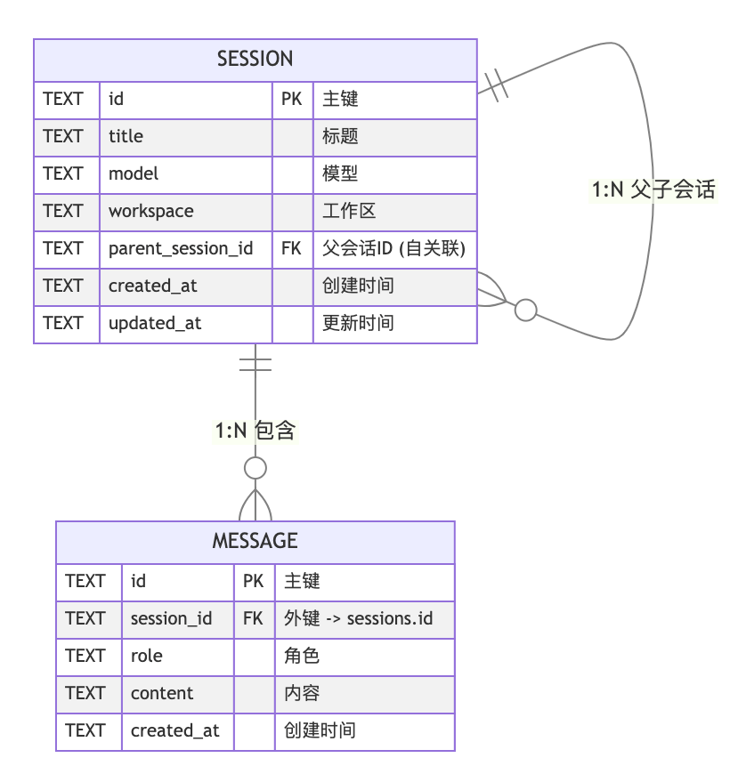

# 从零构建 Agent（七）：Session 管理

> 本文是「从零构建 Agent」系列的第 7 篇：Session 管理。
> 大模型本质上是无状态的数学函数，Agent 必须自己充当「外部记忆硬盘」。作者用 **SQLite + `node:sqlite`** 实现零依赖持久化，设计 `sessions` / `messages` 两张表，在 Agent Loop 前注入历史、循环结束后回写消息，并用三个斜杠命令覆盖会话的枚举、恢复与新建。

<!-- more -->

大模型本质上是**无状态的数学函数**，不包含任何持久化的记忆机制。每发送一次 Prompt，对模型来说都是一次完全独立的「单次计算」——它既不知道「你是谁」，也不记得「1 分钟前我们聊了什么」。

正因为模型无状态，Agent 的 Session 管理才变得至关重要：它必须承担起**「外部记忆硬盘」**的角色。每次请求模型时，Agent 需要主动携带历史消息，把它们塞进新的 Prompt 上下文里。

也就是一个完整的 Prompt 公式：

```text
当前Prompt = System Prompt + (历史Messages列表) + 当前User Question
```

---

## 1. 持久化选型

对于 Agent 场景，开源数据库 **SQLite** 是最佳选择，也是当前主流 Agent 的共同选择。理由有四条：

**其一，它是嵌入式数据库**。不需要像 MySQL / PostgreSQL 那样单独启动守护进程（Daemon）或容器，Agent 进程启动时直接读写 `.db` 文件，进程结束时释放。省去了网络连接池、认证鉴权等繁琐步骤，部署极其简单。

**其二，内存占用极低**。Agent 通常运行在用户的个人电脑或小型网关设备上，内存资源有限。SQLite 核心库仅占用 **1 MB 左右**内存，而 MySQL / Redis 动辄占用几百 MB。

**其三，原生内置全文搜索**。SQLite 是少数原生内置 **FTS5（Full Text Search 5）** 的嵌入式数据库。对 Agent 而言，用户经常提问「之前关于那个 API 密钥的对话在哪？」。SQLite + FTS5 可以直接在本地 `sessions.db` 中毫秒级检索历史会话内容；如果换成 MySQL，还要额外引入 Elasticsearch 或 Meilisearch，架构复杂度陡增。

**其四，零运行时依赖**。在 Node.js 22.5+ 中，`node:sqlite` 作为内置模块直接可用，无需 `npm install` 任何第三方依赖。这意味着 Agent 项目依然保持**零运行时依赖**的核心优势。

---

## 2. 数据模型设计

Session 管理的核心是两张表：`sessions` 和 `messages`。它们是**一对多**的关系——一个 Session 包含多条 Message。

### 2.1 表结构设计

一次对话是由 Agent Loop 的多轮 Message 组成的，所以 Session 和 Message 是显而易见的 1 对多关系。其实体联系图如下：



### 2.2 类型定义

在 `src/session/types.ts` 中，定义了三个核心类型：

```ts
/** sessions 表的行结构 */
export type SessionRow = {
    id: string;
    title: string;
    model: string;
    workspace: string;
    parentSessionId: string | null;
    createdAt: string;
    updatedAt: string;
};

/** messages 表的行结构 */
export type MessageRow = {
    id: string;
    sessionId: string;
    role: string;
    content: string;
    createdAt: string;
};

/** 带消息数的 Session 元信息（list/get 操作使用） */
export type SessionMeta = SessionRow & {
    messageCount: number;
};
```

`SessionRow` 的各字段含义：

| 字段 | 用途 |
|---|---|
| `id` | UUID v4，主键 |
| `title` | 会话标题，由第一条用户消息自动生成（截取前 50 字符） |
| `model` | 创建会话时使用的模型名称 |
| `workspace` | 工作目录路径，用于按项目隔离会话 |
| `parentSessionId` | 父会话 ID（自关联），为未来「会话分支」功能预留 |
| `createdAt` / `updatedAt` | ISO 8601 时间戳 |

`MessageRow` 则非常精简——`role` + `content` 就够了。

注意：**只持久化 user 和 assistant 的文本消息**，不存 `function_call` 和 `function_call_output`。原因是：跨轮对话恢复只需要对话上下文（谁说了什么），工具调用是单次 `stream()` 内的临时行为，由 `PromptRequestBuilder` 在运行时管理，不需要跨会话持久化。

---

## 3. Session 操作

会话能力分成两层：底层是纯粹的数据访问，上层是面向领域的操作。

### 3.1 Session Store

`SessionStore`（`src/session/store.ts`）是纯粹的数据访问层，负责 SQLite 连接管理、Schema 迁移和 CRUD 操作。这部分比较简单，就是 CRUD 的 SQL 操作，比如获取 workspace 下的所有 session：

```ts
getSessionsByWorkspace(workspace: string): SessionRow[] {
    const rows = this.#db.prepare(
        'SELECT * FROM sessions WHERE workspace = ? ORDER BY updated_at DESC'
    ).all(workspace);
    return rows.map(rowToSession);
}
```

### 3.2 Session Manager

`SessionManager`（`src/session/manager.ts`）包装 `SessionStore`，提供面向 Agent 和 CLI 的领域方法。这一层的存在让 Agent 循环和 CLI 不直接接触 SQL。

大部分方法都比较直观，需要注意的是 `appendMessage`：如果这是第一条 message，需要具备自动生成标题的能力。因为每一个 session 都需要有 title，用户才能据此选择想要恢复的会话。

```ts
appendMessage(sessionId: string, role: string, content: string): MessageRow {
    const msg = this.#store.insertMessage({ sessionId, role, content });
    this.#store.updateSessionTimestamp(sessionId);

    // 第一条 user 消息自动设为会话标题
    const session = this.#store.getSessionById(sessionId);
    if (session !== undefined && session.title === '' && role === 'user') {
        const title = content.length > 50 ? content.slice(0, 50) : content;
        this.#store.updateSessionTitle(sessionId, title);
    }

    return msg;
}
```

`appendMessage` 有两个副作用：一是刷新 `updated_at`（让 `getLatestSessionByWorkspace` 能找到最近活跃的会话），二是从第一条用户消息自动生成标题——就像 ChatGPT 的会话列表一样，用户不需要手动命名。

---

## 4. 与 Agent 集成

为了让 Agent 具备记忆外挂能力，需要把上面的 Session 管理能力与 Agent 集成。主要是两个方面：一是在 Agent Loop 中使用持久化的 Session，二是通过 CLI 管理 Session。

### 4.1 让循环拥有记忆

这是最关键的一步——让 Agent 的 `stream()` 方法感知 Session。需要在 Agent `stream()` 的 loop 前做 session 预备，在 loop 结束时做 session 持久化：

```ts
async *stream(input: string, options: AgentOptions = {}): AsyncGenerator<AgentEvent> {
    // ... 加载 skills ...

    const sessionManager = options.sessionManager ?? this.#sessionManager;
    const sessionId = options.sessionId ?? this.#sessionId;
    const hasSession = sessionManager !== undefined && sessionId !== undefined;

    const requestBuilder = new PromptRequestBuilder(model)
        .addDeveloperMsg(`Working directory: ${this.#workdir}.`)
        .setInstructions(this.#skills.buildPromptInstructions())
        .setParallelToolCalls(false)
        .setStore(false)
        .setReasoning(options.reasoning ?? { effort: 'low' });

    // ① Session 模式：注入历史 + 持久化用户消息
    if (hasSession) {
        const history = sessionManager.getMessages(sessionId);
        for (const msg of history) {
            requestBuilder.addInputItem({
                role: msg.role as InputMessage['role'],
                content: msg.content,
            });
        }
        sessionManager.appendMessage(sessionId, 'user', input);
    }

    // ② 共同路径：添加当前用户消息
    requestBuilder.addUserMsg(input);

    // ... agent loop（工具调用循环）...

    // ③ 运行结束：持久化 assistant 回复
    if (hasSession) {
        sessionManager.appendMessage(sessionId, 'assistant', responseText);
    }
    yield { type: AgentEventType.RunEnd, steps: step, text: responseText };
}
```

与原来的逻辑相比，主要涉及三处关键修改：

| 时机 | 操作 | 目的 |
|---|---|---|
| 请求构建前 | 从 DB 加载历史消息，注入 builder | 让模型看到完整对话上下文 |
| 请求构建前 | `appendMessage('user', input)` | 持久化用户消息 |
| 运行结束后 | `appendMessage('assistant', responseText)` | 持久化 assistant 回复 |

### 4.2 基于 CLI 的 session 管理

对 session 的要求并不高，只需要能**枚举、恢复、清除**即可。对当前的 CLI Agent 而言，通过斜杠命令实现这几个能力并不难：

```ts
// /sessions — 列出当前 workspace 的所有会话
if (prompt === '/sessions') {
    const sessions = sessionManager.listSessions(workspace);
    if (sessions.length === 0) {
        console.log('No sessions found.');
    } else {
        for (const s of sessions) {
            console.log(`  ${s.id}  ${s.title || '(untitled)'}  [${s.messageCount} msgs]  ${s.updatedAt}`);
        }
    }
}

// /resume <id> — 切换到指定会话
if (prompt.startsWith('/resume ')) {
    const id = prompt.slice('/resume '.length).trim();
    const session = manager.getSession(id);
    if (session === undefined) {
        console.log(`Session not found: ${id}`);
    } else {
        agent.setSessionId(id);
        console.log(`Resumed session ${id} — ${session.title} [${session.messageCount} messages]`);
    }
}

// /clear — 新建会话
if (prompt === '/clear') {
    const session = manager.createSession(workspace, model);
    agent.setSessionId(session.id);
    console.log(`New session: ${session.id}`);
}
```

---

## 5. 实际运行

**1、创建新 session**

```text
$ pnpm --filter @zero-agent/chapter7 start

[session] New session: a1b2c3d4-...
Interactive mode — type your prompt and press Enter. Ctrl+C to exit.

❯ 我叫 Frank
[step 1]
你好，Frank！有什么可以帮你的吗？
[run_end after 1 step(s)]

❯ 我叫什么名字？
[step 1]
你叫 Frank。
[run_end after 1 step(s)]
```

第二轮对话中，Agent 准确回答了「Frank」——**Session 管理生效了**。

**2、恢复老 session**

```text
$ pnpm --filter @zero-agent/chapter7 start

[session] Resumed: a1b2c3d4-... — 我叫 Frank [2 messages]
Interactive mode — type your prompt and press Enter. Ctrl+C to exit.

❯ 我刚才说了什么？
[step 1]
你刚才说你叫 Frank。
[run_end after 1 step(s)]
```

Agent 重启后自动加载了上次的会话，无需任何手动操作。

注意：这个功能只是为了演示，真实的 Agent 不需要自动恢复会话，重启后都是全新的会话，用户可以选择手动恢复想要恢复的会话。

**3、查看与切换会话**

```text
❯ /sessions

Sessions (newest first):
  a1b2c3d4-...  我叫 Frank  [4 msgs]  2026-10-16T10:30:00.000Z
  e5f6g7h8-...  查询天气    [2 msgs]  2026-10-16T09:15:00.000Z

❯ /clear
New session: i9j0k1l2-...

❯ /resume e5f6g7h8-...
Resumed session e5f6g7h8-... — 查询天气 [2 messages]
```

---

## 6. 总结

本文为 ZeroAgent 构建了完整的 Session 管理能力，**SQLite 嵌入式数据库是做 Agent 持久化的最佳选择**。

Session 管理的代码逻辑不复杂，其操作可以从 CLI 发起，也很简单。但 Session 能力本身对 Agent 而言却非常重要：**它是 Agent 从「单次问答工具」进化为「持续对话助手」的关键一步**。没有记忆的 Agent 就像一个每 5 秒钟就会失忆的助手——能力再强也无法完成需要跨轮上下文的任务。

完整源码可在 `https://github.com/significantfrank/ZeroAgent` 的 `chapter7` 中获取。

---

## 相关链接

- 系列前篇：[从零构建 Agent（一）：技术选型](/md/wiki/sources/zeroagent-01-tech-stack)、[从零构建 Agent（二）：大模型交互](/md/wiki/sources/zeroagent-02-llm-interaction)
- 系列后续：[从零构建 Agent（八）：可复用的 Slash Commands](/md/wiki/sources/zeroagent-slash-commands)、[从零构建 Agent（十二）：长期 Memory 管理](/md/wiki/sources/zeroagent-12-longterm-memory-management)
- 完整源码：[significantfrank/ZeroAgent](https://github.com/significantfrank/ZeroAgent)
- 交叉参考：[Agent Token 架构](/md/wiki/concepts/agent-token-architecture)、[Agent 斜杠命令注册表](/md/wiki/patterns/agent-slash-command-registry)、[Agent Loop](/md/wiki/patterns/agent-loop)
