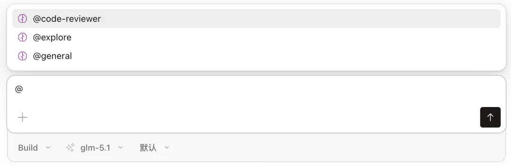
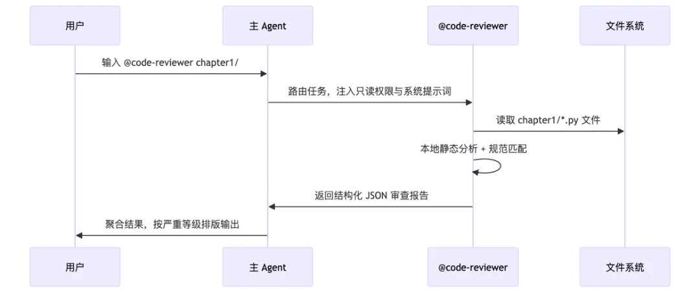

# 从零构建 Agent（九）：SubAgent

> 本文是「从零构建 Agent」系列的第 9 篇：SubAgent。
> 核心：**SubAgent 不是「在当前对话里加指令」，而是启动一个全新的 Agent Loop**——上下文隔离、工具白名单、模型可覆盖。本文实现 Markdown 定义、两级加载、`@name` 显式触发与「子 Agent 干活、父 Agent 汇报」的协作闭环，标志着 ZeroAgent 从单体 Agent 跨入多 Agent 协作系统（Multi-Agent System）的门槛。

<!-- more -->

本文是「从零构建 Agent」系列第 9 篇。上一篇《从零构建 Agent（八）：Commands》中，我们用斜杠命令把高频 Prompt 固化为可复用的模板。本文将拆解如何为 Agent 实现任务委派能力——SubAgent。

试想一下：你让 Agent 审查一段代码，它需要先读懂文件、分析逻辑、查找潜在问题，再给出改进建议——这些步骤全挤在一个 Agent Loop 里跑，上下文越堆越长，模型注意力被稀释，最后给出的审查意见泛泛而谈。

又或者，你让 A 模型写完代码后，想再用 B 模型做一轮交叉 Review。交叉 Review 需要不同的 System Prompt（「你是资深代码审查专家，请独立判断，不要预设这段代码是对的」）、不同的工具集（只需要 `read_file` 和 `file_search`，不需要 `write_file`），需要用不同模型的不同「视角」互相校验，比同一个模型自查更容易发现盲区。

这些场景的共同诉求是：**把一项子任务交给一个「专家」Agent 独立完成，再把结果带回来**。这就是 SubAgent。

---

## 1. 什么是 SubAgent

SubAgent 的核心思想是**任务委派**。就像一个团队负责人（父 Agent）把一项具体工作交给一位专业工程师（子 Agent），工程师独立完成后把结果汇报回来，负责人再综合结果做决策。

Claude Code 的 SubAgents 是这一模式的典型实现。每个 SubAgent 是一个 Markdown 定义文件，包含专属的 System Prompt、可选的模型覆盖和工具白名单。一个典型的 Claude Code SubAgent 配置示例如下：

```markdown
---
name: code-reviewer
description: Reviews code for quality and best practices
tools: Read, Glob, Grep
model: sonnet
---

You are a code reviewer. When invoked, analyze the code and provide
specific, actionable feedback on quality, security, and best practices.
```

### 1.1 SubAgent 的触发方式

SubAgent 的触发方式可以整理为「隐式」与「显式」两大类，显式再细分为 Prompt 点名和 `@agent-name` 两种。

**1、隐式触发**：在处理较长或复杂的任务时，Agent 会根据当前上下文自动判断是否需要启用 SubAgent。用户无需在提示词中指定代理名称。例如：

> "请全面检查项目中的所有 API 路由，找到所有缺少的类型定义，并批量为它们补全类型声明和单元测试。"

**2、显式触发**：由用户显式介入，明确要求或指定 SubAgent 来执行特定任务，主要分为两种形式：

- **通过 Prompt 明确指引**：在 Prompt 中主动建议主 Agent 将某部分独立任务交给「子任务 / 子 Agent」去完成，以维持主会话上下文的简洁。例如："请作为调度员重构认证模块，你可以启动一个 SubAgent 专门扫描 `src/auth/` 的依赖关系，主流程中只保留架构决策。"
- **通过 `@agent-name` 语法指定**：在输入框中用 `@` 选择或手写 `@agent-<name>`，确保该 SubAgent 为当前任务运行。如下图所示，在 OpenCode Agent 中可以通过 `@` 符号直接唤起特定的 Agent。



### 1.2 SubAgent 使用过程解析

我们以 OpenCode Agent 为例，当需要进行 Code Review 时，可以在 OpenCode 的控制台中输入：

```text
@code-reviewer 帮我审查一下 chapter1 目录下的 Python 脚本。
```

主 Agent 接收到指令后，首先解析 `@code-reviewer` 这一显式声明，识别出目标 SubAgent 的角色与能力边界。随后，主 Agent 将当前任务上下文（包括目录路径、文件类型、审查目标）进行封装，并路由至对应的 code-reviewer SubAgent。

该 SubAgent 在**隔离的上下文中**执行专项任务——扫描指定目录、加载相关编码规范、逐文件分析代码质量，并生成结构化审查报告。若过程中需要额外信息（如依赖关系或历史变更记录），SubAgent 可向主 Agent 发起请求，由主 Agent 协调其他工具或 SubAgent 予以补充。

最终，审查结果返回至主 Agent，由其整合并呈现给用户。整个过程中，主 Agent 负责全局调度与异常处理，SubAgent 专注于领域任务，形成「你只管说目标，我来调度专家」的协作闭环。完整流程如下图所示：



---

## 2. SubAgent 和其他技术的区别

| 维度 | Skills | Commands | SubAgent |
|---|---|---|---|
| 核心作用 | 注入领域知识 | 复用 Prompt 模板 | 委派独立子任务 |
| 执行方式 | 在当前 Loop 中加载指令 | 在当前 Loop 中展开模板 | 启动独立的 Agent Loop |
| 上下文 | 共享当前上下文 | 共享当前上下文 | 隔离的独立上下文 |
| 工具范围 | 不改变工具集 | 不改变工具集 | 可限定工具白名单 |
| 模型 | 使用当前模型 | 使用当前模型 | 可覆盖为不同模型 |

**关键区别在于上下文隔离**。Skills 和 Commands 都在当前 Agent Loop 内工作，共享对话历史。SubAgent 则启动一个全新的 Agent Loop——它看不到父 Agent 的对话历史，只接收一条任务描述，独立执行完毕后返回最终文本。这带来了三个好处：

- **上下文洁净**：子任务的中间步骤（读文件、搜索、试错）不会污染父 Agent 的上下文窗口。
- **权限收敛**：通过工具白名单，可以给子 Agent 最小权限——审查代码的子 Agent 不需要 `write_file`。
- **成本可控**：子 Agent 可以用更便宜的模型执行简单任务，贵模型只用在需要综合推理的父 Agent 上。

补充一点：SubAgent 与 MCP 工具并不冲突——`run_subagent` 本身就是一个工具，因此模型可以像调用其他工具一样调用它；而 MCP 工具是否对子 Agent 可见，同样受工具白名单约束。

---

## 3. 实现 SubAgent 功能

### 3.1 类型定义

实际上 SubAgent 也是 Agent，其结构和功能都和已有的 Agent 有同构性，那为什么我们还要重新定义一个新类型呢？主要是两点：

- SubAgent 的定义来自于 Markdown 文档，我们需要一个和其完全匹配的结构；
- SubAgent 在有些逻辑上和 Agent 不同，区分开会让代码更加清晰。

因此，我们在 `src/subagent/types.ts` 中定义了 SubAgent 的新数据结构：

```typescript
export interface SubAgentDefinition {
    /** Agent identifier, kebab-case. */
    name: string;
    /** Human-readable description. */
    description: string;
    /** Must be "subagent". */
    mode: 'subagent';
    /** Optional model override, e.g. "deepseek/deepseek-chat". */
    model?: string;
    /** Tool-name whitelist (tool name → enabled). */
    tools?: Record<string, boolean>;
    /** System prompt body (Markdown content after front matter). */
    systemPrompt: string;
}

export type LoadedAgent = {
    definition: AgentDefinition;
    source: string;
};
```

字段解读：

- `name`：kebab-case 唯一标识，也是 `@name` 调用时使用的名字。
- `description`：描述，用于在加载时展示和未来可能的模型自动选择。
- `mode`：固定为 `'subagent'`，与未来可能的其他 Agent 类型区分。
- `model`：可选。不指定则继承父 Agent 的模型。
- `tools`：可选。工具白名单，只有值为 `true` 的工具才会注入子 Agent。⚠️ 原文此处写「不指定则继承全部工具」，但与 3.3 节的 `copyFrom` 实现**矛盾**——按实现，未指定 `tools` 时实际不会复制任何工具（即默认无工具）。以实现为准，详见 3.3 节。
- `systemPrompt`：Markdown 正文，作为子 Agent 的 System Prompt 注入 instructions 字段。

### 3.2 Frontmatter 解析与两级加载

SubAgent 的定义文件与 Skill、Command 一样，使用 YAML frontmatter + Markdown 正文的格式：

```yaml
---
name: reviewer
description: 代码审查专家
mode: subagent
tools:
  read_file: true
  file_search: true
---

你是一名资深代码审查工程师。你擅长分析代码质量，提出最关键的两个问题。
```

加载路径与 Skills、Commands 完全同构——**全局先加载，项目后覆盖**：

```text
~/.zeroagent/agents/*.md           # 全局 SubAgent 定义
{workdir}/.zeroagent/agents/*.md   # 项目级定义（覆盖同名全局定义）
```

### 3.3 Agent 类改造：createSubAgent

SubAgent 的核心是 Agent 类新增的 `createSubAgent` 方法。它创建一个子 Agent 实例，**继承父 Agent 的客户端、工作目录和 Skills，但使用自己的 System Prompt、模型和工具白名单**：

```typescript
export class Agent {
    readonly #agentType: 'agent' | 'subagent';
    readonly #agentDefinition: AgentDefinition | undefined;
    // ...

    createSubAgent(definition: AgentDefinition): Agent {
        const child = new Agent(this.#client, {
            model: definition.model ?? this.#model,
            maxSteps: this.#maxSteps,
            workdir: this.#workdir,
        }, 'subagent', definition);
        child.#skills.copyFrom(this.#skills);
        child.#tools.copyFrom(this.#tools, definition);
        return child;
    }
}
```

这里有几个设计决策值得展开：

**模型继承与覆盖**：`definition.model ?? this.#model` ——子 Agent 定义中指定了 model 就用指定的，否则继承父 Agent 的。这让你可以为简单任务指定一个更便宜的模型。

**Skills 继承**：`child.#skills.copyFrom(this.#skills)` 把父 Agent 已加载的 Skills 复制给子 Agent。子 Agent 同样可以通过 `load_skill` 工具按需加载技能指令。

**工具白名单**：`child.#tools.copyFrom(this.#tools, definition)` 是关键——它不是全量复制，而是只复制 `definition.tools` 中值为 `true` 的工具：

```typescript
copyFrom(source: ToolRegistry, agentDefinition: AgentDefinition): this {
    for (const [name, handler] of source.#handlers) {
        if (agentDefinition.tools?.[name] === true) this.register(name, handler);
    }
    return this;
}
```

如果 `definition.tools` 未定义（`undefined`），则不会复制任何工具——这意味着**未指定 tools 的 SubAgent 定义实际上没有工具可用**。这是一个「最小权限」设计：子 Agent 默认无工具，必须显式声明需要的工具。

### 3.4 System Prompt 注入

在 Agent Loop 启动时，构建 instructions 字段的逻辑也做了调整：

```typescript
const instructions = [this.#agentDefinition?.systemPrompt, this.#skills.buildPromptInstructions()]
    .filter((part) => part !== undefined && part.length > 0)
    .join('\n\n');
const requestBuilder = new PromptRequestBuilder(model)
    .addDeveloperMsg(`Working directory: ${this.#workdir}. Resolve relative paths from this directory.`)
    .setInstructions(instructions)
    // ...
```

对于父 Agent（`#agentDefinition` 为 `undefined`），instructions 只有 Skills 目录。对于子 Agent，instructions 是 **SubAgent System Prompt + Skills 目录**的组合。Skills 目录被保留是因为子 Agent 也继承了 Skills，需要知道有哪些技能可按需加载。

### 3.5 触发 SubAgent 执行

在 ZeroAgent 的实现中，我们对齐了 OpenCode 的 SubAgent 触发方式，即可以用 `@` 符号显式调用 SubAgent。

在 CLI 中输入 `@` 开头的消息时，`isSubAgentInput` 会识别它：

```typescript
export function isSubAgentInput(input: string): boolean {
    return input.startsWith('@');
}
```

`parseSubAgent` 解析 `@name task` 格式，从 registry 中查找对应的 AgentDefinition：

```typescript
export function parseSubAgent(
    input: string,
    registry: AgentRegistry,
): { task: string; definition: AgentDefinition } {
    const match = /^@(\S+)(?:\s+([\s\S]*))?$/.exec(input);
    if (match === null) throw new Error('Expected @<agent-name> <task>.');

    const name = match[1]!;
    if (!/^[a-z0-9]+(?:-[a-z0-9]+)*$/.test(name)) {
        throw new Error(`Invalid agent name "${name}".`);
    }

    const definition = registry.get(name);
    if (definition === undefined) throw new Error(`Unknown agent: ${name}`);

    const task = match[2]?.trim();
    if (task === undefined || task.length === 0) throw new Error(`Usage: @${name} <task>`);

    return { task, definition };
}
```

在 `cli.ts` 的 `runPrompt` 中，这个路径被接通：

```typescript
async function runPrompt(agent: Agent, registry: AgentRegistry, prompt: string): Promise<void> {
    if (!isSubAgentInput(prompt)) {
        await runOnce(agent, prompt);
        return;
    }

    let invocation;
    try {
        invocation = parseSubAgent(prompt, registry);
    } catch (error) {
        console.error(`[subagent] ${error instanceof Error ? error.message : String(error)}`);
        return;
    }

    console.log('\n[step 1]');
    let result: string;
    try {
        result = await runSubAgent(agent, invocation.task, invocation.definition);
    } catch {
        return;
    }
    const parentPrompt = buildSubagentParentPrompt(invocation.definition.name, invocation.task, result);
    await runOnce(agent, parentPrompt, true);
}
```

注意最后一行——子 Agent 返回结果后，**并不是直接输出给用户**，而是用 `buildSubagentParentPrompt` 包装成一段新的 Prompt 发给父 Agent：

```typescript
export function buildSubagentParentPrompt(name: string, task: string, result: string): string {
    return [
        `The user invoked @${name} with this task:`,
        task,
        '',
        'Use the SubAgent result below to answer the user。',
        '<subagent_result>',
        result,
        '</subagent_result>',
    ].join('\n');
}
```

这个设计很重要：父 Agent 拿到子 Agent 的结果后，有机会做**综合加工**——比如用更强大的模型提炼要点、补充上下文、或者结合其他信息给出最终回答。子 Agent 负责「干活」，父 Agent 负责「汇报」。

### 3.6 事件系统扩展

为了在终端中区分父 Agent 和子 Agent 的输出，新增了两个事件类型：

```typescript
export const AgentEventType = {
    // ... 原有事件 ...
    SubagentStart: 'subagent_start',
    SubagentEnd: 'subagent_end',
} as const;
```

在 `agent-event.ts` 的 render 函数中：

```typescript
case AgentEventType.SubagentStart:
    console.log(`[${event.name} subagent]`);
    break;
case AgentEventType.SubagentEnd:
    console.log(`[${event.name} subagent end]`);
    break;
```

这样在终端中，用户可以清晰地看到子 Agent 的起止边界：

```text
[step 1]
[reviewer subagent]

[step 1]
[tool_call] read_file({"path":"src/agent-loop.ts"})
[step 2]
代码质量良好，建议关注以下两点：
1. shouldEndLooping 方法可以提前返回...
[reviewer subagent end]

[step 2]
审查完成。reviewer 子 Agent 发现了两个关键问题...
[run_end after 2 step(s)]
```

---

## 4. 实际运行

### 4.1 前置准备

确保已安装依赖，并在 chapter9 目录下启动：

```bash
pnpm install
pnpm --filter @zero-agent/chapter9 start
```

启动后，CLI 会扫描全局与项目级 agents 目录，并打印已加载的 SubAgent 列表：

```text
$ pnpm --filter @zero-agent/chapter9 start

[workdir] /Users/frank/Desktop/code/ZeroAgent/chapter9
[skills] Loaded 1 skill(s): repo-tech-writer
[subagents] Loaded reviewer
[commands] Loaded 2 command(s): review, commit
[session] New session: a1b2c3d4-...
Interactive mode — type your prompt and press Enter. Ctrl+C to exit.
```

### 4.2 创建自定义 SubAgent

项目自带了一个示例定义 `.zeroagent/agents/reviewer.md`：

```yaml
---
name: reviewer
description: 代码审查专家
mode: subagent
tools:
  read_file: true
  file_search: true
---

你是一名资深代码审查工程师。你擅长分析代码质量，提出最关键的两个问题。
```

这个 SubAgent 只有 `read_file` 和 `file_search` 两个工具——它只能读和搜索，不能写文件、不能执行命令、不能委派子 Agent。**最小权限**。

你也可以在全局目录创建 SubAgent 定义供所有项目使用：

```text
# 全局：所有项目可用
~/.zeroagent/agents/security-auditor.md

# 项目级：仅当前项目可用（同名覆盖全局）
{workdir}/.zeroagent/agents/security-auditor.md
```

### 4.3 使用 @ 调用

在交互模式中输入 `@reviewer` 审查 `src/agent-loop.ts`：

```text
❯ @reviewer 审查 src/agent-loop.ts 的错误处理逻辑

[step 1]
[reviewer subagent]

[step 1]
[tool_call] read_file({"path":"src/agent-loop.ts"})

[step 2]
审查完成。代码中错误处理有以下两个关键问题：

1. stream() 方法的 catch 块在 signal.aborted 时直接 return，
   但未向上层调用者传递任何信息，调用方无法区分"正常结束"和"被中断"。

2. shouldEndLooping 在 step >= maxSteps 时返回 true，
   但后续会触发 "Reached maxSteps" 错误事件，
   调用者需要同时处理 RunEnd 和 Error 两种结束情况，语义不清晰。

[reviewer subagent end]

[step 2]
根据 reviewer 子 Agent 的审查结果，src/agent-loop.ts 的错误处理有两个值得关注的点：

第一，当用户通过 Ctrl+C 中断（signal aborted）时，stream() 会静默返回，
调用方无法感知中断发生了……

[run_end after 2 step(s)]
```

注意执行流程：

- `@reviewer` 触发 SubAgent，输出 `[reviewer subagent]` 标记。
- 子 Agent 独立运行两个 step：读文件 → 分析并输出结果。
- `[reviewer subagent end]` 标记子 Agent 结束。
- 父 Agent 拿到子 Agent 的结果，用自己的上下文做综合加工，输出最终回答。

### 4.4 热重载

与 Skills 和 Commands 一样，`/reload` 也支持重新加载 SubAgent 定义：

```text
❯ /reload
[reload] 2 command(s), 1 skill(s), 1 subagent(s)
```

新增或修改 `.zeroagent/agents/` 下的定义文件后，不需要重启 Agent。

---

## 5. 总结

本章我们为 Agent 实现了任务委派能力——SubAgent。核心可以概括为三点：

- **独立 Loop**：SubAgent 不是「在当前对话里加指令」，而是启动一个全新的 Agent Loop，只接收一条任务描述，执行完返回最终文本。
- **上下文隔离**：子任务的中间步骤不污染父 Agent 的上下文窗口，带来上下文洁净、权限收敛、成本可控三个好处。
- **可覆盖**：通过 `SubAgentDefinition` 的 `model` 与 `tools` 字段，子 Agent 可使用不同模型、限定工具白名单，实现最小权限与成本优化。

SubAgent 的加入，标志着我们的 ZeroAgent 框架正式从**单体 Agent** 跨越到了**多 Agent 协作系统（Multi-Agent System）**的门槛。下一篇文章中，我们将实现 Model 管理，主要包括模型认证配置与动态模型切换。

读者可以在 [significantfrank/ZeroAgent](https://github.com/significantfrank/ZeroAgent) 的 chapter9 中获取本文的完整源码。

参考：[Claude Code SubAgents](https://docs.claude.com/en/docs/claude-code/sub-agents)

---

## 相关链接

- 系列前篇：[从零构建 Agent（一）：技术选型](/md/wiki/sources/zeroagent-01-tech-stack)、[从零构建 Agent（二）：大模型交互](/md/wiki/sources/zeroagent-02-llm-interaction)
- 已归档系列：[从零构建 Agent（八）：可复用的 Slash Commands](/md/wiki/sources/zeroagent-slash-commands)、[从零构建 Agent（十二）：长期 Memory 管理](/md/wiki/sources/zeroagent-12-longterm-memory-management)
- Demo 源码：[significantfrank/ZeroAgent](https://github.com/significantfrank/ZeroAgent)（chapter9）
- 交叉参考：[Agent Skill](/md/wiki/concepts/agent-skill)、[Isolated Sub-Agent 模式](/md/wiki/patterns/isolated-sub-agent)、[Harness Engineering](/md/wiki/concepts/harness-engineering)
