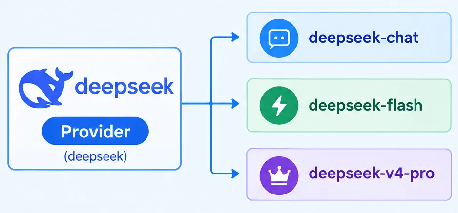
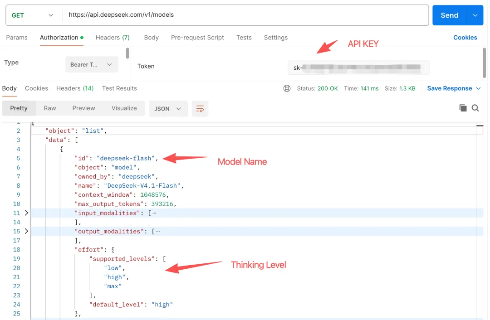
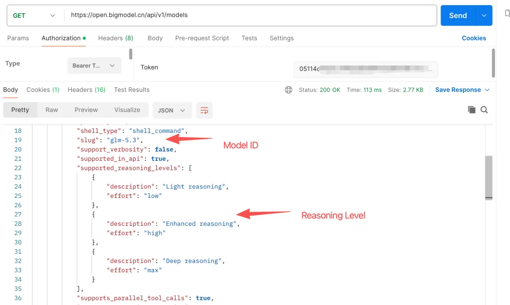

# 从零构建 Agent（十）：Model管理

> 本文是「从零构建 Agent」系列的第 10 篇：Model 管理。
> 核心：**通用 Agent 不应被单一模型或供应商绑定**。本文用 `auth.json` / `models-config.json` / `settings.json` 三个用户级配置文件统一管理 Provider 鉴权、Model 定义与运行状态，按 model 动态路由客户端并支持运行时切换与 Session 状态持久化，最后借助 OpenSpec 走完一轮完整的 SDD（规格驱动开发）流程。

<!-- more -->

本文是「从零构建 Agent」系列的第 10 篇。

在之前的实现中，我们通过 `.env` 保存 MaaS（Model as a Service）的 baseUrl 和 apiKey，并在构造 ResponsesClient 时固化成一个 OpenAI 实例。这种「焊死」的做法导致 Agent 启动后只能使用配置中的单个模型，无法在运行时切换。

**通用 Agent 不应该被单一模型或供应商绑定**。它应该能够统一管理不同供应商提供的模型，根据任务选择合适的模型，并在运行时切换模型。

本文将围绕这些目标，为 ZeroAgent 实现一套完整的 Model 管理机制，包括 Provider 配置、模型注册、客户端路由、运行时切换，以及 Session 中的模型状态持久化。

---

## 1. 什么是 Model 管理

Model 管理，简单来说，就是让 Agent 能够统一配置、查询、选择和切换不同的模型，并处理不同模型供应商之间的差异。

首先，我们需要区分两个概念：Provider 和 Model。

- **Provider**：模型供应商，例如 DeepSeek、智谱。
- **Model**：供应商提供的具体模型，例如 DeepSeek 的 `deepseek-chat`、`deepseek-flash` 和 `deepseek-v4-pro`。

一个 Provider 可以提供多个 Model，二者通常是一对多的关系。



通常我们在开通一个 MaaS 服务的时候，都能从供应商那里获取的 API Key 来作为访问凭据。以 DeepSeek 为例，我们可以通过 `https://api.deepseek.com/v1/models` 获取到其支持的所有模型，以及模型在推理时支持的思考等级（Thinking Level）。



如果是智谱的话，我们可以通过 `https://open.bigmodel.cn/api/v1/models` 获取其支持的模型信息。



对比不同供应商的接口可以发现，它们在模型命名、元数据结构和能力描述等方面可能存在差异。尤其需要注意的是，**模型列表接口并不一定会返回模型支持的全部能力，也不一定会提供推理等级信息**。如果需要了解模型是否支持推理、支持哪些推理档位，以及具体的参数格式，还需要结合供应商的 API 文档进行确认。

因此，**Agent 在接入不同供应商时，不能简单地将各家的 API 响应原样暴露给上层，而应该建立一套统一的内部模型描述，并在必要时将其转换为供应商实际支持的参数**。

Model 管理需要解决的核心问题包括：

- **统一配置**：管理 Provider 的访问端点、鉴权信息，以及 Model 的元数据。
- **模型注册与校验**：统一加载模型定义，检查配置之间的关联是否有效。
- **动态路由与切换**：根据当前选中的 Model，找到对应的 Provider，并使用正确的客户端发送请求。
- **能力适配**：处理不同模型在推理能力、参数格式和接口行为方面的差异。
- **状态持久化**：保存当前使用的模型和推理档位，并在恢复 Session 时还原相关状态。

本章先完成这些能力的基础框架。更复杂的供应商协议差异，可以在后续章节中逐步完善。

---

## 2. 三个配置文件

本章的设计参考了开源项目 Pi 的 Agent 实现。Pi 是一个设计相对克制、结构简洁的 Agent 项目，很适合作为 ZeroAgent 教程的参考对象。

参考其模型管理思路，我们在 `~/.zeroagent/` 下设计三个用户级配置文件，分别负责 Provider 鉴权、Model 定义和当前运行状态。需要注意：**这里采用的是适合 ZeroAgent 的配置划分，并不意味着文件名和字段结构与 Pi 完全一致**。

| 文件 | 作用 |
|---|---|
| `auth.json` | 保存 Provider 的访问端点和鉴权信息 |
| `models-config.json` | 保存 Model 的元数据和个性化配置 |
| `settings.json` | 保存当前选中的 Model 和推理档位 |

前两个文件负责描述「如何访问模型」和「模型具备哪些配置」，第三个文件负责记录「当前使用哪个模型」。

### 2.1 auth.json：Provider 的鉴权与端点

`auth.json` 以 Provider ID 为键，保存对应的 API 端点和鉴权信息。

```json
{
  "deepseek": {
    "baseUrl": "https://api.deepseek.com/v1",
    "type": "api_key",
    "key": "sk-..."
  },
  "glm": {
    "baseUrl": "https://open.bigmodel.cn/api/v1",
    "type": "api_key",
    "key": "..."
  }
}
```

这里的 `deepseek` 和 `glm` 是 Provider ID，后续 Model 定义会通过 `provider` 字段引用它们。

需要注意，`baseUrl` 应当填写与实际 API 协议匹配的服务端点。**不同供应商的端点可能不同，不能仅通过替换域名来保证兼容**。示例中的 URL 应以对应供应商当前的 API 文档为准。

### 2.2 models-config.json：Model 的定义

`models-config.json` 以 Model ID 为键，保存模型的元数据和个性化配置。这里的 Model ID 同时也是发送给模型 API 的 `model` 参数值。

```json
{
  "deepseek-flash": {
    "provider": "deepseek",
    "name": "DeepSeek Flash",
    "reasoning": true,
    "thinkingLevelMap": {
      "minimal": null,
      "low": "low",
      "medium": null,
      "high": "high",
      "max": "max"
    },
    "maxTokens": 384000
  }
}
```

各字段的含义如下：

- `provider`：所属 Provider，必须能够在 `auth.json` 中找到对应配置。
- `name`：模型的显示名称，用于 CLI 展示。
- `reasoning`：表示该模型是否启用本项目定义的推理能力标记。
- `thinkingLevelMap`：将 Agent 内部统一的推理档位映射为模型实际使用的值。
- `maxTokens`：模型输出长度的配置上限，具体含义应与实际请求参数保持一致。

这里需要特别说明两个设计决策。

**第一，`baseUrl` 只在 `auth.json` 中维护**。这样可以避免同一个 Provider 的端点在多个 Model 定义中重复出现，减少配置不一致的问题。

**第二，`thinkingLevelMap` 中的 `null` 表示该档位没有直接映射值**，而不是一个可以原样发送给 API 的参数值。例如，当请求 `high` 档位但对应值为 `null` 时，Agent 可以按照预先定义的回退规则选择其他可用档位。具体规则需要在实现和测试中保持一致。

### 2.3 settings.json：当前运行状态

`settings.json` 保存当前选中的 Model 和推理档位。

```json
{
  "currentModel": "deepseek-flash",
  "currentThinkingLevel": "high"
}
```

与前两个文件不同，`settings.json` 不是模型定义，而是**当前状态的持久化记录**。

例如，用户通过 `/model` 切换模型，或者通过 `/thinking` 修改推理档位后，Agent 可以将新的选择写入该文件。下一次启动时，再读取这些设置作为默认运行状态。

这里需要区分两个概念：

- **用户级默认状态**：由 `settings.json` 保存，用于初始化新的运行环境或 Session。
- **Session 级状态**：由 Session 持久化机制保存，用于恢复已有会话。

当两者发生冲突时，**应该明确优先级：恢复已有 Session 时，通常应优先恢复该 Session 记录的模型状态，而不是无条件使用最新的全局设置**。

三个文件各司其职：`auth.json` 管访问端点和凭据，`models-config.json` 管模型定义，`settings.json` 管默认运行状态。它们共同构成 Model 管理的基础。

本章暂不展开更完整的供应商兼容层，例如不同 API 的参数名称、请求结构和响应格式差异。这些问题需要在统一模型配置的基础上进一步处理。

---

## 3. 实现 Model 管理

### 3.1 类型定义

首先，新建 `src/model/types.ts`，定义统一的模型类型。

```typescript
export const EFFORT_LEVELS = ['minimal', 'low', 'medium', 'high', 'max'] as const;

export type EffortLevel = (typeof EFFORT_LEVELS)[number];

export type ProviderAuth = {
    baseUrl: string;
    type: 'api_key';
    key: string;
};

export type ThinkingLevelMap = Partial<Record<EffortLevel, string | null>>;

export type ModelDefinition = {
    id: string;              // 也是发给 API 的 model 值
    provider: string;        // 精确匹配 auth.json 的键
    name?: string;           // /models 的显示名
    reasoning?: boolean;     // 默认 false
    thinkingLevelMap?: ThinkingLevelMap;
    maxTokens?: number;      // → max_output_tokens
};

export type ProviderCredentials = {
    baseUrl: string;
    key: string;
};
```

这里使用 `as const` 将 `EFFORT_LEVELS` 定义为只读元组，再通过索引访问类型生成 `EffortLevel`。这样，推理档位的类型可以直接从常量中推导出来，避免在多个地方重复定义。

`ThinkingLevelMap` 使用 `Partial<Record<EffortLevel, string | null>>`，主要有两个原因：

- `Record` 表示每个标准档位都可以映射到一个字符串或 `null`；
- `Partial` 表示模型不必显式定义全部五个档位，因为不同模型支持的档位可能不同。

这里的 `Partial` 只是放宽了 TypeScript 类型约束，**并不意味着运行时配置可以不经过校验**。读取 JSON 后，仍然需要检查字段类型、档位名称和映射值是否合法。

### 3.2 客户端改造：按 model 路由

原来的 ResponsesClient 在构造阶段就创建了一个 OpenAI 客户端。这种方式适合只使用一个固定端点的场景，但无法满足多 Provider 的需求。

现在，我们改为**根据请求中的 model 动态解析对应的 Provider，并按端点和凭据缓存客户端实例**。核心逻辑如下：

```typescript
    #clientFor(model: string): OpenAI {
        const credentials = this.#resolveProvider(model);
        if (credentials === undefined) {
            throw new Error(`No provider credentials configured for model "${model}" in ~/.zeroagent.`);
        }
        const cacheKey = `${credentials.baseUrl}\u0000${credentials.key}`;
        let client = this.#providerClients.get(cacheKey);
        if (client === undefined) {
            client = new OpenAI({
                apiKey: credentials.key,
                baseURL: credentials.baseUrl,
                fetch: this.#fetch,
            });
            this.#providerClients.set(cacheKey, client);
        }
        return client;
    }
```

这里的关键变化是：**客户端不再依赖构造阶段固定的 Provider，而是在请求时根据 Model 进行路由**。整个过程可以概括为：

1. 从请求中获取 Model ID；
2. 查询模型注册表，找到对应的 Model 定义；
3. 根据 Model 定义中的 `provider` 字段，查询 `auth.json` 中的凭据；
4. 根据端点和凭据获取缓存客户端；如果不存在，则创建新的客户端；
5. 使用对应客户端发送请求。

### 3.3 Agent 改造：动态切换

完成客户端路由后，Agent 还需要支持修改当前模型。我们为 Agent 新增 `modelRegistry` 选项、可变的 `#model` 字段，以及 `setModel` 方法。核心代码如下：

```typescript
get model(): string {
    return this.#model;
}

setModel(model: string): void {
    this.#model = model;
}
```

这里需要注意：**`setModel` 只负责修改 Agent 当前持有的模型 ID，本身并不完成配置校验，也不负责 Session 持久化**。因此，模型切换入口必须先验证目标模型是否存在，再执行切换和状态更新。

例如，在 CLI 层可以封装统一的切换逻辑：

```typescript
export function switchModel(agent: Agent, registry: ModelRegistry, manager: SessionManager | undefined, id: string): boolean {
    if (registry.get(id) === undefined) return false;
    agent.setModel(id);
    const sessionId = agent.sessionId;
    if (manager !== undefined && sessionId !== undefined) {
        manager.setSessionModel(sessionId, id);
    }
    return true;
}
```

当用户输入 `/model` 命令时，CLI 调用 `switchModel`。如果目标模型不存在，则拒绝切换；如果模型存在，则更新 Agent 当前使用的模型，并在存在有效 Session 的情况下将其写回。

### 3.4 Session 闭环补全

前面已经实现了运行时切换，但如果只修改 Agent 内存中的模型字段，当前 Session 的记录就不会自动更新。

这会产生一个问题：**用户切换模型后退出，再通过 `/resume` 恢复会话，系统可能仍然使用旧模型**。

因此，需要为 SessionStore 新增更新方法：

```typescript
updateSessionModel(id: string, model: string): void {
    const now = new Date().toISOString();
    this.#db.prepare('UPDATE sessions SET model = ?, updated_at = ? WHERE id = ?').run(model, now, id);
}
```

随后，在 SessionManager 中封装 `setSessionModel`，由它调用 SessionStore 的更新方法。

这样，模型切换就形成了一个完整的状态链路：

1. `/model` 更新 Agent 当前模型；
2. SessionManager 将新模型写入 Session；
3. `/resume` 读取 Session 中保存的模型并恢复。这一步补齐了之前「状态已经保存，却没有在恢复时真正使用」的问题。

### 3.5 CLI 命令

接下来，在 `cli.ts` 中加入模型管理相关命令，并将 `/reload` 和 `/resume` 接入新的配置体系。

- `/models`：列出所有 model，`*` 标记 active，显示 provider、reasoning 与可用档位。
- `/model <id>`：切换 active model 并写回当前 session。
- `/thinking <level>`：切换 thinking level 并写回 `settings.json`。
- `/reload`：同时重载 `auth.json` 与 `models-config.json`。
- `/resume`：恢复 session 时同时恢复其记录的 model。

---

## 4. 实际运行

### 4.1 配置

在 `~/.zeroagent/` 下准备好三个配置文件：`auth.json`、`models-config.json`、`settings.json`，然后启动本章对应的项目：

```bash
pnpm --filter @zero-agent/chapter10 start
```

启动时，系统会加载模型注册表，并根据配置确定当前模型和推理档位。示例日志如下：

```text
[workdir] /Users/frank/Desktop/code/ZeroAgent/chapter10
[models] Loaded 2 model(s): deepseek-flash, glm-5.3
[model] Using model: deepseek-v4-pro , thinking level: high
[skills] Loaded 1 skill(s): repo-tech-writer
[subagents] Loaded reviewer
[session] New session: a1b2c3d4-...
Interactive mode — type your prompt and press Enter. Ctrl+C to exit.
```

这里假设 `models-config.json` 中配置了两个模型，且 `settings.json` 中的 `currentModel` 为 `deepseek-flash`。**实际日志应以当前配置和程序的真实输出为准**。

### 4.2 列出与切换

启动后，输入 `/models` 可以查看当前可用的模型：

```text
❯ /models

Models:
  * deepseek-flash  provider: deepseek  reasoning: on  levels: low,high,max
    glm-5.3         provider: glm       reasoning: off  levels: -

❯ /model glm-5.3
Active model: glm-5.3
```

其中，`*` 表示当前正在使用的模型；`provider` 表示模型所属的供应商；`reasoning` 表示配置中声明的推理能力标记；`levels` 列出当前模型可直接映射的推理档位。

切换到 `glm-5.3` 后，再次执行 `/models`，`*` 就会移动到对应的模型。

---

## 5. SDD 驱动开发

本章的整个实现过程，我没有「打开编辑器直接开写」，而是走了一条 Spec-Driven Development（SDD，规格驱动开发）的流程，工具是 OpenSpec。

### 5.1 什么是 SDD

SDD 的核心思想可以概括为一句话：

> **先明确要做什么，再设计如何实现，最后验证实现是否符合规格，并持续维护规格与代码之间的一致性。**

直接编码有一个常见风险：需求尚未澄清，就开始实现；当开发到一半才发现理解有误时，相关代码和测试往往都需要返工。

SDD 将需求理解和设计决策前置。开发者先产出可以评审的规格文档，明确系统应该具备哪些行为、有哪些边界条件，以及如何判断功能是否完成，再根据规格逐步实现。

在 AI 辅助开发中，这种方式尤其有价值。**规格文档为人和 AI 提供共同的上下文，任务清单则将整体目标拆解为可执行、可检查的步骤**。

需要注意的是，**规格本身并不能自动保证实现正确**。只有将规格落实为测试、校验和评审，才能有效降低遗漏需求或偏离设计的风险。

### 5.2 OpenSpec 的工作流

本章采用的 OpenSpec 工作流主要包含四个阶段：

- **explore（探索）**：澄清需求、讨论方案并分析问题。该阶段用于收敛方向，不要求立即产出代码或正式变更制品。
- **propose（提案）**：形成正式的变更提案，包括 `proposal.md`、`design.md`、`specs/` 和 `tasks.md`。其中，提案说明为什么要做，设计文档说明如何实现及方案取舍，规格定义系统必须满足的行为，任务清单则按照依赖关系组织实现步骤。
- **apply（实现）**：按照 `tasks.md` 中的任务逐步实现功能，并跟踪任务完成情况。
- **archive（归档）**：将变更中新增或修改的规格增量同步到主规格目录 `openspec/specs/`，再归档已完成的变更记录。

### 5.3 本章的 OpenSpec 实践

Model 管理这个 change，最终产出了 6 个 capability 的规格——3 个新增、3 个修改：

| Capability | 类型 | 内容 |
|---|---|---|
| model-registry | 新增 | auth/models 的加载、校验、查询 |
| model-aware-agent | 新增 | provider 路由、reasoning 映射、可切换 model |
| model-cli | 新增 | `/models`、`/model`、`/reload` |
| session-store | 修改 | 新增 `updateSessionModel` |
| session-manager | 修改 | 新增 `setSessionModel` |
| session-cli | 修改 | `/resume` 恢复 model |

一条规格的形态长这样（节选自 model-aware-agent）：

```markdown
### Requirement: reasoning effort translated through level map
When the active model has a `thinkingLevelMap`, the agent SHALL translate the
requested effort level (`high` by default) using the map...

#### Scenario: Requested level is null, fall back down
- **WHEN** the map has `low: "low"`, `max: "max"`, and `high: null`, and effort `high` is requested
- **THEN** the request SHALL send `reasoning.effort = "low"` (highest available not above `high`)
```

### 5.4 SDD 带来的三个好处

- **先想清楚再动手**：`design.md` 强制我写下每个关键决策的备选方案与取舍——比如「客户端路由」是放在 client 层还是 CLI 层、「映射」是放在 agent 层还是 CLI 层。这些在动手前就辩清楚了。
- **规格即测试**：WHEN/THEN 场景直接映射到测试用例，写完代码后「规格是否满足」是可验证的，不是感觉。
- **AI 可执行**：`tasks.md` 的 checkbox 格式可以被 apply 阶段解析、跟踪进度，AI 逐条实现、逐条勾选，不会漏也不会跑偏。

---

## 6. 总结

本章通过统一管理 Provider 鉴权、Model 配置、推理档位映射和客户端路由，实现了模型的动态切换、配置校验与 Session 状态持久化，并借助 SDD 流程提升了开发过程的可控性与可验证性。

在 SDD 实践中，发挥最大作用的是 **explore 阶段**。最初的「Model 管理」只是一个比较笼统的需求，涉及配置划分、Provider 路由、推理档位映射、Session 恢复等多个需要提前决策的问题。通过与 AI 反复讨论和迭代，才逐步收敛为可以实现和验证的规格。

从这个角度看，explore 与 Plan-Execute 模式中的 plan 有相通之处：二者都强调在执行之前先明确目标和方案。不过，它们并不是完全相同的机制——**SDD 更强调规格的形成、验证与长期维护，而 plan 更侧重于组织一次具体任务的执行步骤**。

因此，下一篇我会尝试使用更轻量的 plan 推进实现，与本章的 SDD 工作流进行对比，看看在不同复杂度的任务中，哪种方式更合适。

读者可以在 [significantfrank/ZeroAgent](https://github.com/significantfrank/ZeroAgent) 的 chapter10 中获取本文的完整源码。

参考：

- [Pi Agent](https://pi.dev/)
- [OpenSpec](https://github.com/Fission-AI/OpenSpec)

---

## 相关链接

- 系列前篇：[从零构建 Agent（一）：技术选型](/md/wiki/sources/zeroagent-01-tech-stack)、[从零构建 Agent（二）：大模型交互](/md/wiki/sources/zeroagent-02-llm-interaction)
- 已归档系列：[从零构建 Agent（八）：可复用的 Slash Commands](/md/wiki/sources/zeroagent-slash-commands)、[从零构建 Agent（九）：SubAgent](/md/wiki/sources/zeroagent-09-subagent)、[从零构建 Agent（十二）：长期 Memory 管理](/md/wiki/sources/zeroagent-12-longterm-memory-management)
- Demo 源码：[significantfrank/ZeroAgent](https://github.com/significantfrank/ZeroAgent)（chapter10）
- 交叉参考：[Token 架构](/md/wiki/concepts/agent-token-architecture)、[Loop Engineering](/md/wiki/concepts/loop-engineering)、[Harness Engineering](/md/wiki/concepts/harness-engineering)
