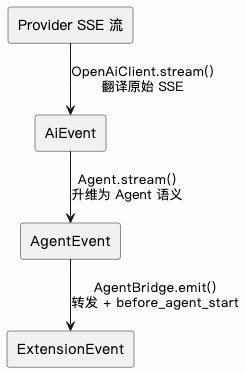

# 从零构建 Agent（十一）：Extension 扩展

> 本文是「从零构建 Agent」系列的第 11 篇：Extension 扩展。
> 要实现跨 Session Memory，就必须能动态向 Agent 注入上下文，而扩展点正好提供这种能力，所以先补上 Extension。为此做了两项基础架构改造：**模型解耦**（`AiClient` + `AiEvent`）与**事件分层**（`AiEvent` → `AgentEvent` → `ExtensionEvent`），再以 `ExtensionAPI` + `ExtensionRunner` 撑起一个极简扩展机制——外部 `.ts` 模块即可监听生命周期、改写 System Prompt、注册工具与命令。

<!-- more -->

本来打算在这一篇实现跨 Session 的 Memory 功能。要实现 Memory，需要能够动态地向 Agent 注入上下文，而扩展点（Extension）正好可以提供这样的能力。不过，当前的 ZeroAgent 还不具备扩展机制，于是决定先实现 Extension，为后续 Memory 的实现打好基础。

所谓 **Extension**，就是允许外部代码参与 Agent 的运行过程：观察 Agent 的生命周期、动态注入上下文、注册工具和命令，而不需要修改 Agent 核心代码。

此前分析过 **DeepSeek Harness（dsh）** 的 Plugin 实现机制：dsh 把扩展机制做得比较极致，甚至提出了「**Everything is plugin**」的理念。不过本文的 Extension 实现并没有采用 dsh 的思路，而是选择了类似 **Pi Agent extension** 的极简实现。

---

## 1. 模型解耦

在实现 Extension 之前，首先需要做一件事：**模型解耦**。

为什么 Extension 的实现需要先进行模型解耦？原因在于，Extension 依赖 Agent 生命周期事件，而这些事件中的一部分来自模型端的流式响应。如果 Agent 直接依赖某个模型供应商的 SDK 和事件格式，那么模型供应商的差异就会传递到 Agent 核心，进而影响整个事件体系。

在此之前，`openai-client.ts` 中的 `stream()` 方法直接将 OpenAI SDK 返回的流式事件交给 Agent 处理。这意味着，如果要接入使用不同协议的 Provider（比如 Anthropic），就需要在 Agent 核心中增加针对不同 Provider 的处理逻辑。这显然不是想要的设计。

因此，需要引入一个统一的抽象层：**屏蔽不同 Provider 的接口和流式事件差异，让 Agent 只依赖统一的模型客户端接口**。

### 1.1 AiClient 接口

抽象层的核心是模型无关的 `AiClient` 接口，Agent 只依赖接口；具体实现（`OpenAiClient`）通过工厂函数创建后注入：

```ts
// src/ai/ai-client.ts

export interface AiClient {
    stream(request: AiRequest): AsyncGenerator<AiEvent>;
}
```

`AiClient` 只有一个方法 `stream()`：接收模型请求，返回一个事件异步迭代器。

Agent 不关心底层使用的是 OpenAI SDK，还是其他模型供应商的 SDK。它只需要通过 `for await...of` 消费统一的 `AiEvent` 即可。这样，Agent 核心就不再依赖具体的模型 SDK。

### 1.2 工厂函数

`OpenAiClient` 实现 `AiClient` 接口，内部根据 `baseUrl` + `key` 缓存 OpenAI 客户端实例，并通过 `ProviderResolver` 获取对应的连接凭据。

`src/ai/index.ts` 中的 `createAiClient` 工厂函数，根据 Provider 名称选择具体实现：

```ts
export function createAiClient(provider: string, options: AiClientFactoryOptions): AiClient {
    if (!openAiCompatibleProviders.has(provider.toLowerCase())) {
        throw new Error(`Unsupported AI provider "${provider}".`);
    }
    return new OpenAiClient(options);
}
```

目前，ZeroAgent 接入的部分 Provider 可以通过 OpenAI 兼容接口复用 `OpenAiClient`，因此不需要为每个 Provider 单独实现客户端。

需要注意的是，**OpenAI 兼容并不意味着所有供应商都完整实现了 OpenAI 的所有 API**。具体能否复用 `OpenAiClient`，还取决于它所使用的 API 接口、请求格式和流式事件格式是否兼容。

未来接入不兼容协议的 Provider 时，只需要新增一个 `AiClient` 实现，并在工厂函数中增加对应的分支，Agent 核心逻辑不需要跟着修改。

### 1.3 AiEvent

`AiEvent` 是模型客户端向 Agent 输出的统一事件，也是屏蔽不同 Provider 流式事件差异的关键。

举个例子：工具调用（Tool Call）在不同模型供应商的协议中可能有不同的表达方式。在 OpenAI 的 Responses API 中，函数调用对应 `function_call` 类型的输出；在 Anthropic 的消息流中，则使用 `tool_use` 等事件表达工具调用。但是经过中间层转换之后，在 ZeroAgent 内部统一使用 `toolcall` 相关事件表达这一过程。

完整的模型响应流式事件定义如下：

```ts
// src/ai/ai-client.ts

export type AiEvent =
    | { type: 'start' }
    | { type: 'text_start' }
    | { type: 'text_delta'; delta: string }
    | { type: 'text_end'; content: string }
    | { type: 'thinking_start' }
    | { type: 'thinking_delta'; delta: string }
    | { type: 'thinking_end'; content: string }
    | { type: 'toolcall_start' }
    | { type: 'toolcall_delta'; delta: string }
    | { type: 'toolcall_end'; toolCall: ToolCall }
    | { type: 'done'; reason: string }
    | { type: 'error'; reason: string };
```

`OpenAiClient` 作为 `AiClient` 的具体实现，其主要职责就是将底层 API 返回的流式事件转换为统一的 `AiEvent`。例如：

- `response.output_text.delta` → `text_delta`
- `response.function_call_arguments.delta` → `toolcall_delta`

其他事件也按照相同的思路进行转换。

这里需要强调：**`AiEvent` 并不是 Provider 原始事件的简单转发，而是经过归一化之后的内部事件模型**。它保留了 Agent 所需要的语义，同时屏蔽了底层协议的具体细节。

未来即使接入 Anthropic 等使用不同协议的 Provider，也只需要实现一个新的 `AnthropicAiClient`，将其流式响应转换为相同的 `AiEvent` 即可。这样，Agent 核心就不需要关心底层究竟使用了哪一家模型供应商。

---

## 2. 事件分层

模型解耦之后，我们得到了模型无关的 `AiEvent`。不过，`AiEvent` 主要关注的是 Agent Loop 过程中模型返回的流式响应，包括文本、思考内容和工具调用等信息。

一个完整的 Agent 不仅仅是消费模型响应，还需要管理轮次（Turn）、消息（Message）、工具执行以及整个 Agent 的生命周期。因此，仅仅依赖 `AiEvent` 是不够的，还需要在它的基础上建立更高层次的事件体系：`AgentEvent` 和 `ExtensionEvent`。

### 2.1 AgentEvent

`AiEvent` 表达的是模型层面的语义，并不能很好地表达 Agent 自身的运行过程。

例如，一次 Agent 执行可能包含多个 Turn，但这个概念在 `AiEvent` 中并不存在。另外，`AiEvent` 中的 `toolcall_end` 表示模型已经生成完毕工具调用信息，并不代表工具已经执行完成——工具执行属于 Agent 层面的行为，需要由更高层次的事件来表达。

鉴于此，需要定义一个能够描述 Agent 运行时语义的事件类型：`AgentEvent`。

```ts
export type AgentEvent =
    | { type: 'agent_start' }
    | { type: 'agent_end'; message: AgentMessage; }
    | { type: 'turn_start' }
    | { type: 'turn_end'; message: AgentMessage; toolResults: ToolResultMessage[] }
    | { type: 'message_start'}
    | { type: 'message_update'; message?: AssistantMessage; aiEvent: AiEvent }
    | { type: 'message_end'; message?: AssistantMessage }
    | { type: 'tool_execution_start'; toolCallId: string; toolName: string; args: any }
    | { type: 'tool_execution_end';toolCallId: string;result: any;}
```

可以看到，`AgentEvent` 在 `AiEvent` 的基础上增加了 Agent 自身的运行语义。例如：

- `agent_start` / `agent_end`：表示一次完整的 Agent 执行开始和结束。
- `turn_start` / `turn_end`：表示一次模型交互轮次的开始和结束。
- `message_start` / `message_update` / `message_end`：表示消息的生命周期。
- `tool_execution_start` / `tool_execution_end`：表示工具实际执行的开始和结束。

这里有一个值得注意的设计：`message_update` 事件同时携带了 `aiEvent` 字段，保留了原始的第一层事件。这样做的好处是，**不同消费者可以根据自己的需求选择事件粒度**。

### 2.2 ExtensionEvent

`AgentEvent` 虽然从 Agent 的视角对 `AiEvent` 进行了封装，但它主要关注的还是 Agent Loop 内部的运行过程，无法覆盖完整的 Agent 生命周期。

从 Extension 的视角来看，需要的扩展点应该超出 Agent Loop 的范围。例如，希望在 Agent 正式运行之前就有一个扩展点（`before_agent_start`），让外部代码能够修改 System Prompt、注入上下文。

后续要实现的跨 Session Memory，就需要利用这样的扩展点，在 Agent 发起模型请求之前，将历史记忆动态注入当前上下文。

因此，还需要一个与扩展机制对应的事件体系：`ExtensionEvent`。在类型定义上，可以利用 TypeScript 的联合类型，在 `AgentEvent` 的基础上增加 Extension 所需的事件：

```ts
ExtensionEvent = BeforeAgentStartEvent | AgentEvent
```

这里的 `BeforeAgentStartEvent` 就是一个典型的扩展层事件。它发生在 Agent 生命周期的起点，早于 `agent_start` 和 Agent Loop。

因此，**`ExtensionEvent` 实际上是 `AgentEvent` 的超集**，既包含 Agent 运行过程中的事件，也包含 Extension 自身需要的生命周期钩子。

### 2.3 三层事件体系

事件流的处理是 Agent 中比较复杂的逻辑之一。面对复杂问题，一个常见的设计思路就是分而治之。

这里的事件分层也是如此：每一层只关注自己需要的语义粒度，层与层之间通过明确的类型转换衔接。每一层的消费者只需要关注自己关心的事件，不必直接处理其他层的实现细节。

| 层级 | 类型名 | 消费者 | 粒度 |
|---|---|---|---|
| 第一层：模型层 | `AiEvent` | `Agent.stream()` | 最细粒度：每个 SSE delta |
| 第二层：Agent 层 | `AgentEvent` | 界面、扩展器 | Agent Loop 语义 |
| 第三层：扩展层 | `ExtensionEvent` | Extension 钩子 | `AgentEvent` 超集 |

说实话，事件体系是目前在 ZeroAgent 上花费时间最多的部分。主要原因是很多设计一开始并不清晰，不知道什么样的抽象才是合理的。最后参考了 Pi Agent 的实现，结合 ZeroAgent 当前的架构，才逐渐确定了这样的分层设计。



---

## 3. Extension 实现

前面介绍了模型解耦和事件分层，接下来再看本章真正要实现的功能：Extension。

ZeroAgent 的 Extension 设计比较简单，主要由三个部分组成：

- **`ExtensionAPI`**：提供给扩展使用的 API。
- **`ExtensionRunner`**：负责加载扩展、管理注册表和分发事件。
- **Agent 生命周期钩子**：在合适的时机触发扩展，让外部代码参与 Agent 的运行。

### 3.1 ExtensionAPI 与一个最小扩展

Extension 是一个 `.ts` 模块，default export 一个工厂函数，接收 `ExtensionAPI`：

```ts
export interface ExtensionAPI {
    on(type, handler): void;                 // 事件钩子
    registerCommand(name, command): void;    // 注册命令
    registerTool(definition, handler): void; // 注册工具
}
```

三个 API 覆盖 Extension 的全部能力。一个最小但完整的扩展：

```ts
// .zeroagent/extensions/demo.ts
export default function (zeroagent) {
    zeroagent.on('before_agent_start', (event) => {
        event.systemPromptOptions.sections['project_context'] = 'Project context.';
    });

    zeroagent.registerCommand('hello', {
        description: 'Show a greeting',
        async handler(args) { console.log(`Hello, ${args || 'world'}!`); },
    });

    zeroagent.registerTool(
        { type: 'function', name: 'get_answer', description: 'Return the answer.',
          parameters: { type: 'object', properties: {} }, strict: true },
        async () => '42',
    );
}
```

### 3.2 ExtensionRunner 与两层加载

`ExtensionRunner` 是整个扩展系统的核心。它持有 handler、command、tool 三个注册表，负责扩展的加载、事件分发以及相关资源管理。

在事件分发上，ZeroAgent 将其分为两种方式：

- **`emit(event)`**：通用事件分发，用于通知型事件。Handler 的返回值会被忽略。
- **`emitBeforeAgentStart(input, options)`**：专门处理 `before_agent_start` 事件。Handler 除了可以修改传入的配置对象，还可以通过返回值注入消息。

为什么要将 `before_agent_start` 单独处理？因为普通事件主要用于通知消费者，消费者监听事件后执行自己的逻辑即可，不需要改变 Agent 的执行流程。但 `before_agent_start` 不一样，它需要允许 Extension 参与请求组装过程，修改 System Prompt，甚至注入额外的消息。因此，它需要一个专门的执行入口来处理 Handler 的返回值。

在扩展加载方面，与 Skills、Commands、SubAgents 一致，Extension 也采用「**用户级 → 项目级**」两层加载机制：

| 层级 | 路径 |
|---|---|
| 用户级 | `~/.zeroagent/extensions/*.ts` |
| 项目级 | `{workdir}/.zeroagent/extensions/*.ts` |

### 3.3 before_agent_start：修改 System Prompt

`before_agent_start` 是唯一能「塑造」行为的钩子，在请求组装前触发。它携带可变对象 `systemPromptOptions`：

```ts
export type SystemPromptOptions = {
    sections: Record<string, string>;  // 命名段落，按插入顺序渲染
    appendSystemPrompt: string;        // 追加在所有段落之后
};
```

Agent 在 `#prepareRequest` 里先创建初始 options（base 指令占首个 section），交给扩展修改，再渲染成最终 instructions：

```ts
const systemPromptOptions = createSystemPromptOptions(instructions);
if (this.#extensions) {
    const before = await this.#extensions.emitBeforeAgentStart(input, systemPromptOptions);
    injectedMessages = before.messages ?? [];
}
const finalInstructions = composeSystemPrompt(systemPromptOptions);
```

### 3.4 参考 Pi Agent 的 Extension

ZeroAgent 的 Extension 主要参考了 **Pi Agent**——一个极简、可扩展的 Agent Harness。

Pi 的扩展同样采用 `default export function (pi)` 的 `.ts` 模块形式。它的 ExtensionAPI 除了 `on`、`registerCommand`、`registerTool` 之外，还提供了 TUI、快捷键、命令行参数、Provider、MCP 等扩展能力，以及消息发送等接口。

ZeroAgent 当前并没有照搬 Pi 的全部能力，而是重点借鉴了两个设计：

- **ExtensionRunner 的事件分发设计**：普通事件使用 `emit()`，而 `before_agent_start` 这种具有特殊返回值语义的钩子，使用独立的 `emitBeforeAgentStart()`。
- **可变的 `systemPromptOptions`**：通过可变的 `sections` 对象管理 System Prompt，而不是要求 Extension 每次返回一份完整的新 Prompt。这样既能保留基础指令，也方便多个 Extension 在不同位置增加自己的上下文。

ZeroAgent 目前还是一个以学习和理解 Agent 架构为主的项目，没有必要一开始就实现 Pi 那样完整的扩展能力。等后续实现 TUI 之后，再逐步增加 TUI 相关的扩展接口。

---

## 4. 总结

本章为了实现 Extension，实际上做了两项基础架构改造：**模型解耦和事件分层**。整个实现过程可以归纳为以下几个步骤：

- **需要扩展点**：为了让 Agent 支持运行时可插拔的能力，需要允许外部代码观察和塑造 Agent 的行为。
- **梳理 Agent 生命周期**：Extension 必须依附于 Agent 的生命周期。我们梳理了一次 Agent 执行的完整流程，从 `before_agent_start` 到 `agent_start`，再到 ReAct 循环，最后以 `agent_end` 结束。
- **建立事件分层**：不同阶段需要不同粒度的事件，因此设计了 `AiEvent`、`AgentEvent` 和 `ExtensionEvent` 三层事件体系。
- **实现模型解耦**：为了避免第一层事件依赖具体 Provider，抽象出 `AiClient` 接口和 `AiEvent` 类型，将 Agent 核心与具体模型 SDK 解耦。

最终，三层事件体系与 `ExtensionAPI`、`ExtensionRunner` 配合，实现了一个轻量级的扩展机制。Extension 可以监听 Agent 生命周期、修改 System Prompt、注入上下文、注册工具和命令，而不需要修改 Agent 核心代码。

至此，ZeroAgent 从一个主要依靠内置功能实现能力的 Agent，进一步演进为一个**能够通过外部扩展塑造自身行为的 Agent 框架**。

本章也为下一篇实现跨 Session Memory 做好了准备：Memory 可以作为一个独立的 Extension，在 Agent 启动之前检索历史记忆，并将其动态注入当前上下文。

完整源码可在 `https://github.com/significantfrank/ZeroAgent` 的 `chapter11` 中获取。

---

## 相关链接

- 系列前篇：[从零构建 Agent（一）：技术选型](/md/wiki/sources/zeroagent-01-tech-stack)、[从零构建 Agent（二）：大模型交互](/md/wiki/sources/zeroagent-02-llm-interaction)
- 系列已有：[从零构建 Agent（八）：可复用的 Slash Commands](/md/wiki/sources/zeroagent-slash-commands)、[从零构建 Agent（十二）：长期 Memory 管理](/md/wiki/sources/zeroagent-12-longterm-memory-management)
- 完整源码：[significantfrank/ZeroAgent](https://github.com/significantfrank/ZeroAgent)
- 交叉参考：[Plugin-first Agent Runtime](/md/wiki/patterns/plugin-first-agent-runtime)、[Harness Engineering](/md/wiki/concepts/harness-engineering)、[Agent Loop](/md/wiki/patterns/agent-loop)
