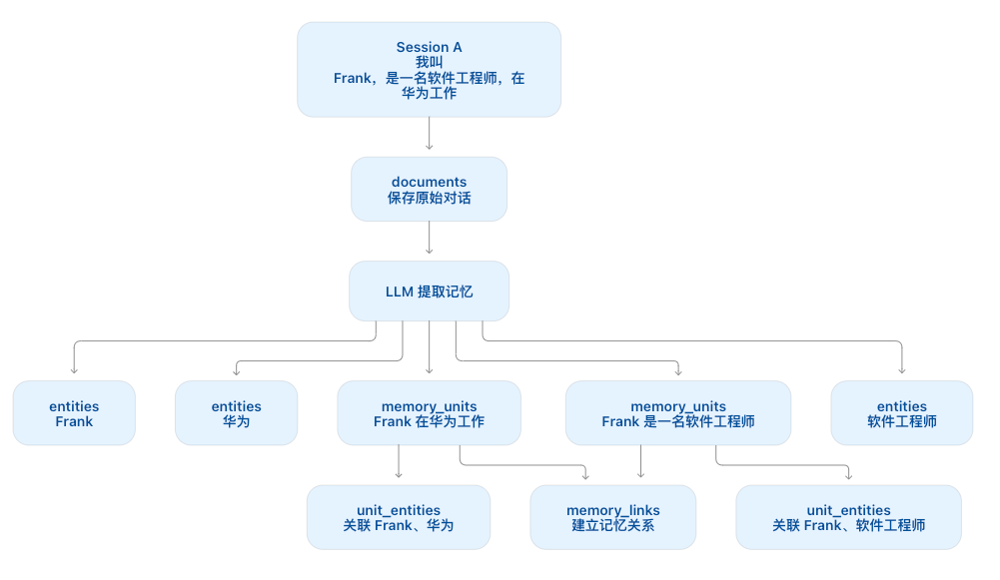
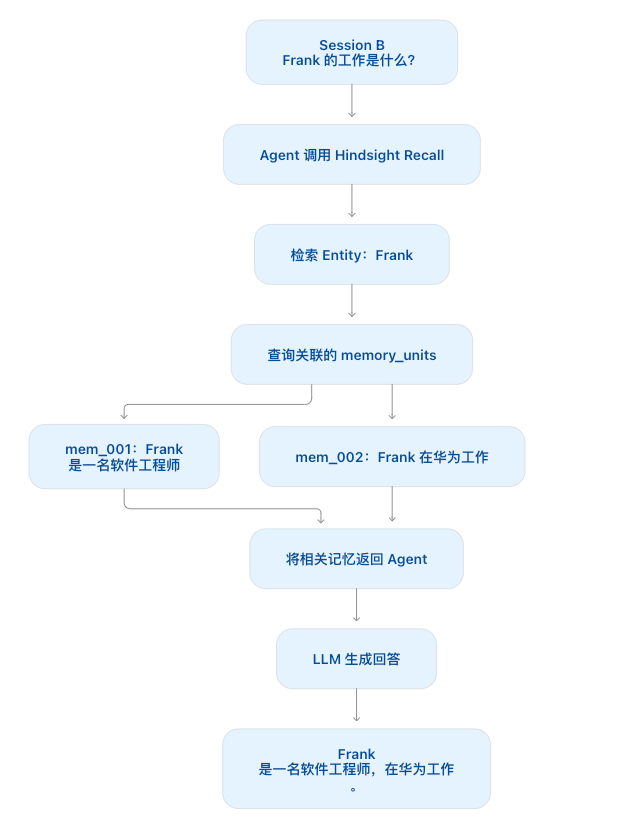

# 从零构建 Agent（十二）：长期 Memory 管理

> 本文是「从零构建 Agent」系列的第 12 篇：长期 Memory 管理。
> 长期 Memory 是体现 Agent 差异化能力的关键。本文深入剖析 Hermes Agent 的四层记忆架构（Markdown 精简层、FTS5 全文搜索、外部 Memory Provider、Skill 程序性记忆），并基于 Extension 机制为 ZeroAgent 接入统一的 Memory Provider 接口，最终结合开源记忆系统 Hindsight 实现跨 Session 的结构化长期认知与召回。

<!-- more -->

本文是「从零构建 Agent」系列的第 12 篇：长期 Memory 管理。我想写这篇文章很久了。长期 Memory 是 Agent 非常有意思的一个话题，也是体现 Agent 差异化能力的关键。

有段时间，大家热衷于“养马”——所谓“养马”，就是 Hermes Agent 用得越多，就越“聪明”。这种能力背后，离不开 Agent 的记忆与学习机制。

本文将分析 Hermes 的长期 Memory 设计，并基于上一篇实现的 Extension，为 ZeroAgent 增加一个通用的 Memory Provider 机制，最终通过 Hindsight 实现跨 Session 的长期记忆。

---

## 1. Agent 的长期记忆

Agent 的上下文窗口并不等于长期记忆。

- **上下文窗口**：包含当前请求发送给模型的内容；
- **Session**：通常保存一段对话的消息历史；
- **长期记忆**：需要在 Session 结束后仍然保留，并能够在后续交互中按需检索出来。

### 1.1 为什么 Memory 很重要

当前 ZeroAgent 的记忆主要依赖 Session 上下文。

虽然我们已经支持 Session 持久化，但如果每次对话都将所有历史消息重新放进 Prompt，会带来几个问题：

1. **上下文和成本不断增长**：历史越长，模型每轮需要处理的内容越多。
2. **噪音累积**：大部分旧消息与当前问题无关，可能干扰模型判断。
3. **重要信息被淹没**：稳定偏好、项目约定和一次性闲聊混在一起，难以区分。
4. **记忆难以维护**：事实可能过期或相互矛盾，也可能包含不应长期保存的敏感信息。

因此，Memory 系统处理的不只是“保存”，还包括：**选择什么值得记、存在哪里、何时检索、如何更新和淘汰**。

从用途上看，Agent 的记忆可以分为几类：

- **语义记忆（Semantic Memory）**：相对稳定的事实、偏好和约定，例如用户使用的操作系统。
- **情景记忆（Episodic Memory）**：过去发生过的对话或事件，例如某次排错过程。
- **程序性记忆（Procedural Memory）**：完成某类任务的步骤、检查点和注意事项，通常适合封装成 Skill。

还需要注意：**记忆并不等于指令**。被检索的旧文本应当作为有来源、可能过时的上下文，而不是自动获得高于当前用户要求或系统策略的权限。

在正式实现之前，我们先看看 Hermes 的设计。

---

### 1.2 Hermes 的 Memory：四层能力模型

在研究 Agent Memory 时，我参考了 Hermes Agent 的设计。

Hermes 的记忆管理并不依赖单一机制，而是通过不同能力解决不同的问题。这里我将其归纳为四个层次：

| 层级 | 机制 | 作用 |
|---|---|---|
| **Layer 1** | `MEMORY.md` / `USER.md` | 保存精简的长期记忆 |
| **Layer 2** | Session Search（SQLite + FTS5） | 检索历史对话原文 |
| **Layer 3** | Memory Provider（如 Hindsight） | 提供语义召回与更丰富的记忆管理能力 |
| **Layer 4** | Skills | 保存可复用的操作知识和流程 |

这四层并不是互相替代的关系，而是分别解决不同类型的信息管理问题。

#### Layer 1：MEMORY.md 与 USER.md

Hermes 使用 `MEMORY.md` 和 `USER.md` 保存精简的持久化记忆：

- `MEMORY.md`：保存项目背景、技术约定和经验。
- `USER.md`：保存用户偏好和长期需求。

这类记忆通常会在 Session 开始时加载到上下文中。它的优点是简单直接，但记忆文件必须保持精简，否则每次请求都会产生额外的 Token 开销。

#### Layer 2：FTS5 会话搜索与记忆整理

对于没有进入 Memory 文件的历史信息，可以通过 Session Search 按需查找。

Hermes 使用 SQLite 保存历史 Session，并利用 FTS5 提供全文检索能力。

Memory 与 Session Search 的区别在于：
- **Memory**：保存提取后的长期信息，解决「记住什么」；
- **Session Search**：保存并检索原始历史对话，解决「找回过去发生的事情」。

#### Layer 3：Memory Provider——可替换的外部记忆后端

当记忆需要语义召回、跨设备共享、独立扩容或专门的记忆处理能力时，可以把存储与检索委托给外部 Provider，例如 Hindsight。

Agent 不应直接依赖每个后端的 SDK。可先定义统一接口：

```typescript
export interface MemoryProvider {
  retain(content: string): Promise<void>;
  recall(query: string): Promise<readonly string[]>;
}
```

生命周期扩展只依赖 `MemoryProvider`，由具体 Provider 负责将调用映射到服务 API。未来增加另一个后端时，可以保持 Agent 的读写时机不变。

不同层可以共存，而不是互相替代：
- **Markdown**：适合人工审阅和明确维护的事实。
- **FTS5**：适合精确搜索本地历史。
- **外部 Provider**：适合语义检索或集中管理。

#### Layer 4：Skill——程序性记忆

严格来说，Skill 并不是传统意义上的 Memory。

- **Memory**：记录的是「过去发生了什么」或者「我们知道什么」；
- **Skill**：则描述「遇到某类任务时应该如何做」。

Memory 和 Skill 的边界可以这样理解：记忆提供背景事实，Skill 提供可复用的操作方法。Skill 也需要维护和验证，不能因为它被保存下来就假定步骤永远正确。这种自修复能力，是 Hermes 变“聪明”的关键。

---

### 1.3 关于 Hindsight

Hindsight 是 Vectorize 推出的开源 Agent 记忆系统。它的目标不是简单地保存聊天记录，而是让 Agent 能够记住过去的经历、理解事实之间的关系，并利用历史信息改善未来的回答。

在选择 Memory Provider 时，我最终选择了 Hindsight。Hindsight 的核心操作可以概括为三个：

| 操作 | 作用 |
|---|---|
| **Retain** | 从交互中提取并保存记忆（事实与实体关联） |
| **Recall** | 检索与当前问题相关的结构化事实 |
| **Reflect** | 基于已有记忆进行综合推理与反思 |

例如，用户告诉 Agent：
> “ZeroAgent 使用 TypeScript 实现，目前已经支持 SubAgent 和 Extension。”

经过 Retain，这些信息会被提取为独立的记忆事实单元。

当用户在后续会话询问：
> “ZeroAgent 目前已经实现了哪些能力？”

Agent 就可以通过 Recall 检索相关记忆，并将结果注入当前上下文。

如果用户进一步提问：
> “根据之前的讨论，ZeroAgent 接下来应该优先实现什么？”

则可以利用 Reflect 对已有记忆进行多维综合分析。

一句话总结：**Hindsight 是一个通过事实提取、关联、整合和反思，让 Agent 从历史交互中逐渐形成长期认知的记忆系统。**

---

## 2. ZeroAgent 的 Memory 实现

上一篇文章中，我实现了 Extension 能力，就是为了让后续功能更容易扩展。

在 Extension 中，我们提供了 `before_agent_start` 扩展点，可以在 Agent 发起模型请求之前修改 System Prompt，并注入额外的上下文。

这正好为 Memory 提供了两个关键入口：
1. **请求开始前**：检索相关记忆并注入上下文（Recall）。
2. **一轮对话结束后**：将本轮对话保存到记忆服务（Retain）。

### 2.1 Memory Provider 接口

为了避免 ZeroAgent 与具体记忆系统绑定，我们先定义一个统一的 `MemoryProvider` 接口：

```typescript
export interface MemoryProvider {
  retain(content: string): Promise<void>;
  recall(query: string): Promise<readonly string[]>;
}
```

`retain` 用于存储记忆，`recall` 根据查询召回相关记忆。具体的记忆服务通过实现该接口接入 ZeroAgent。

### 2.2 HindsightMemoryProvider

`HindsightMemoryProvider` 封装 Hindsight Client，将记忆存储和召回操作统一到 `MemoryProvider` 接口中：

```typescript
export class HindsightMemoryProvider implements MemoryProvider {
  constructor(private readonly client: HindsightClient) {}

  async retain(content: string): Promise<void> {
    await this.client.retain({ content });
  }

  async recall(query: string): Promise<readonly string[]> {
    const results = await this.client.recall({ query });
    return results.map(r => r.fact);
  }
}
```

Provider 将 Hindsight 的具体调用细节封装起来。对于 ZeroAgent 来说，记忆后端只是一个实现了 `MemoryProvider` 的对象。

### 2.3 注册 Memory Extension

有了 Memory Provider，接下来只需要利用 Extension 生命周期，在 Agent 执行前召回记忆，在一轮对话结束后存储记忆。

这里有两个关键机制：
- **Recall**：在 `before_agent_start` 阶段，根据用户输入召回相关记忆，并注入 `long_term_memory` 的 Prompt Section，让模型在生成回答前获得必要的历史上下文。
- **Retain**：在 `turn_end` 阶段，将用户输入和 Assistant 的最终回复存入记忆。对于工具调用消息、非 Assistant 消息以及空内容，不进行存储。

记忆服务的异常不会直接中断 Agent 主流程，而是通过 `reportMemoryError` 统一降级处理。

至此，ZeroAgent 的 Memory 能力就通过 Extension 接入了现有 Agent 流程。Agent 本身不需要关心记忆存储在什么地方，也不需要了解 Hindsight 的具体 API。后续如果需要接入其他记忆服务，只需要实现 `MemoryProvider` 即可。

---

## 3. Hindsight 背后原理解析

### 3.1 长记忆效果测试

先看一个跨 Session 的简单例子：

**Session A：**
> **User**：我叫 Frank，是一名软件工程师，在华为工作。

**Session B（新开启的会话）：**
> **User**：Frank 的工作是什么？  
> **Agent**：根据记忆中的信息，Frank 是一名软件工程师，在华为工作。

两个问题发生在完全不同的 Session 中。Agent 能够回答，是因为 Hindsight 将 Session A 中的信息存储为长期记忆，并在 Session B 中精准召回。

那么，这些信息是如何存储和关联的？

### 3.2 背后原理解析

Hindsight 并不是简单地保存整段对话文本，而是将原始内容、提取出的事实、实体以及事实之间的关系组织起来。

核心由四个概念支撑：

1. **documents**：原始信息。保存输入的原始内容，作为记忆溯源的根基。
2. **memory_units**：事实单元。从原始内容中提取出的独立事实，是后续 Recall 的重要依据（例如「Frank 是一名软件工程师」）。
3. **entities**：实体。事实中涉及的对象，例如人物、组织或概念（例如「Frank」「华为」和「软件工程师」）。
4. **memory_links**：关系链。连接相关记忆，描述事实之间的关联。

以 Session A 为例：

Hindsight 对这段对话进行处理，将原始内容保存到 `documents`，并提取出相关记忆：



这里需要区分两个关键概念：
- **Entity**：是「谁或什么」；
- **Memory Unit**：是「关于它的事实」。

Entity 本身并不表达完整事实。只有将实体与 Memory Unit 关联起来，才能表达「Frank 是软件工程师」或「Frank 在华为工作」。

当用户在 Session B 中输入：
> **User**：Frank 的工作是什么？

此时是一个全新的 Session，Agent 上下文中并没有 Session A 的聊天记录。Hindsight 执行 `recall`，从已有记忆图谱中检索出与 Frank 相关的事实：



由此可见，**跨 Session 记忆的关键，不是 Agent 记住了 Session A 的全部原始文本，而是 Hindsight 将 Session A 转化为持久化的结构化事实图谱，并在 Session B 中按需重新检索注入。**

---

## 4. 总结

本文介绍了 Agent 长期 Memory 的价值，并参考 Hermes 的四层记忆机制，为 ZeroAgent 实现了一个通用的 Memory Provider 架构：

1. 通过 **Extension 机制**，ZeroAgent 可以在请求开始前（`before_agent_start`）Recall 相关记忆注入上下文，并在对话结束后（`turn_end`）Retain 新的信息。
2. 借助 **Hindsight**，我们进一步实现了跨 Session 的结构化长期记忆（Documents → Memory Units → Entities → Memory Links）。
3. Memory 让 Agent 不再局限于单个 Session 的上下文窗口，而是能够从过去的交互中提取事实、沉淀经验并重新利用。

完整源码可在 `https://github.com/significantfrank/ZeroAgent` 的 `chapter12` 中获取。

---

## 相关页面

- [[columns/agentic-engineer/zero-agent/index]]
- [[columns/agentic-engineer/zero-agent/agent-from-zero-function-calling]]
- [[columns/agentic-engineer/agent-production-notes/07-agent-memory-four-tier]]
- [[columns/agentic-engineer/industrial-agent-practice/06-agent-chat-memory-3-strategies]]
- [[columns/harness-engineering/hermes-agent-detail]]
- [[concepts/agent-autonomous-pipeline]]
