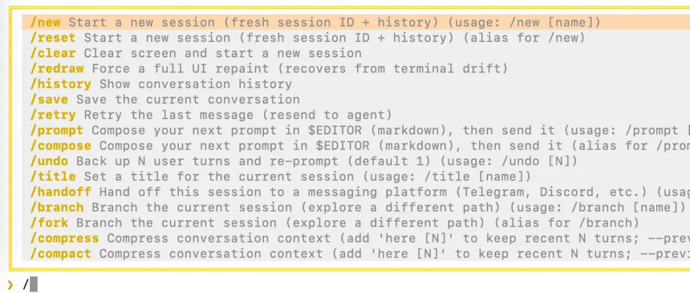
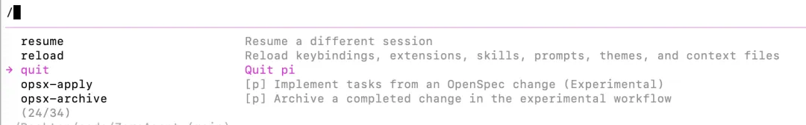
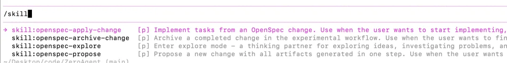

# 从零构建 Agent（八）：可复用的 Slash Commands

> 本文是「从零构建 Agent」系列的第 8 篇：Slash Commands。
> 斜杠命令是 Claude Code 的经典设计：把高频复用的 Prompt 存成带 YAML Frontmatter 的 Markdown 文件，像 Shell 别名一样用 `/review` 一键展开。本文实现命令定义、可复用的 frontmatter 解析器、全局/项目两级加载与同名覆盖，以及 `/reload` 热重载。

<!-- more -->

本文是 ZeroAgent 系列第 8 篇。上一篇《Session 管理》中用 `/resume` 恢复会话，其实已经用到了 Command。本文拆解如何为 Agent 实现一套可复用的斜杠命令系统。

斜杠命令来自 Claude Code 的经典设计，Command 除了可以控制 Agent 的行为外，还可以让用户自定义 Prompt 模板。

试想一下，每次想让 Agent「审查代码」，你都得手打一遍完整指令：「请审查 xxx 文件，重点关注安全性、性能和代码风格，给出改进建议…」。每次想让 Agent「提交代码」，又得输入：「请根据当前改动生成一条符合 Conventional Commits 规范的提交信息…」。

这些**高频复用的 Prompt**，能不能像 Shell 别名一样保存起来，用 `/review` 一个命令就自动展开呢？

---

## 1. 什么是 Slash Commands

经常使用 Agent 的同学对这个功能应该不陌生。下图是 Hermes Agent 的斜杠命令列表，可以用这些命令对 Agent 进行 Session 管理、上下文压缩等操作。



以下是 Pi Agent 的斜杠命令列表，除了系统自定义的命令之外，`opsx` 开头的命令是用 `OpenSpec init` 创建的 SDD 命令，属于用户自定义命令，在 Pi Agent 中也叫 prompt template。



Slash Commands 本质上是**用户自定义的 Prompt 模板**。使用时，每个命令是一个 Markdown 文件，包含 YAML frontmatter（元数据）和正文（Prompt 模板）。在交互模式中输入：

```text
/命令名 参数1 参数2
```

CLI 会将参数展开到模板中，生成完整的 Prompt 发送给 Agent。

一个典型的命令文件：

```markdown
---
name: review
description: Review a file or diff
---
Review the following file and suggest improvements:

File: $1

Focus on: ${2:-correctness, style, and performance}
```

调用方式：

```text
❯ /review src/cli.ts
# 展开后等价于直接发送：
# Review the following file and suggest improvements:
#
# File: src/cli.ts
#
# Focus on: correctness, style, and performance
```

与 Skills 的关键区别在于：**Skills 是给模型看的指令**（模型决定何时加载），**Commands 是给用户用的快捷方式**（用户决定何时触发）。Skills 影响模型何时、如何加载指令，Commands 影响用户如何发起任务。两者互补：可以用一个 Command 快速发起任务，Agent 在执行过程中再按需加载 Skill。

| 维度 | Skills | Commands |
|---|---|---|
| 触发者 | 模型 | 用户 |
| 加载时机 | 模型按需加载 | 用户输入时展开 |
| 作用对象 | 模型推理过程 | 用户输入操作 |
| 复用方式 | 跨任务复用领域知识 | 跨会话复用 Prompt |

需要注意的是，因为 Skill 本质上也是 prompt，有些 Agent（比如 Pi Agent）也支持通过 Command 触发 Skill。



---

## 2. 实现 Command 功能

### 2.1 类型定义

在 `src/command/types.ts` 中定义命令的数据结构：

```ts
export type CommandDefinition = {
    /** 命令名，调用时写作 /name */
    name: string;
    /** 描述，列出可用命令时展示 */
    description: string;
    /** Prompt 模板正文，支持 $1、${2:-default} 占位符 */
    template: string;
};
```

三个字段：`name` 是唯一标识，`description` 用于 `/help` 或错误提示时展示，`template` 是带占位符的 Prompt 模板。

占位符约定：`$1`、`$2` 表示第 1、2 个位置参数；`${2:-default}` 表示第 2 个参数缺省时使用 `default`。**模板整体保存为字符串，展开时再做替换**——这样命令文件可以原样落盘，便于阅读和版本管理。

### 2.2 Frontmatter 解析

鉴于命令文件使用与 Skill 文件相同的 frontmatter 格式，有必要把解析逻辑抽出来以便两边复用（Pi Agent 也是这么做的）。这类微重构可以交给 AI 完成，重构后在 `src/util/frontmatter.ts` 中的新实现如下：

```ts
export type Frontmatter = {
    name?: string;
    description?: string;
};

/**
 * Split Markdown content into flat name/description frontmatter and body.
 */
export function splitFrontmatter(content: string, source: string): { frontmatter: Frontmatter; body: string } {
    const match = content.match(/^---\r?\n([\s\S]*?)\r?\n---\r?\n([\s\S]*)$/);
    if (match === null) {
        throw new Error(`File "${source}" is missing YAML frontmatter. Expected "---" delimited block at the start of the file.`);
    }
    // ...省略
}
```

解析逻辑很直白：正则匹配 `---` 分隔的 frontmatter 块，提取 `name` 和 `description`，frontmatter 之后的正文就是模板。缺失必填字段或模板为空都会抛出错误——**错误要尽早暴露，不能等到用户调用时才发现命令文件有问题**。

### 2.3 两级加载路径

与 Skills 的加载机制一样，Command 支持全局和项目级两个加载路径：

```text
~/.zeroagent/commands/*.md           # 全局命令，所有项目可用
{workdir}/.zeroagent/commands/*.md   # 项目命令，仅当前项目可用
```

项目级命令与全局命令同名时，**项目级覆盖全局**（后加载覆盖先加载）。这个设计让你可以为不同项目定制同名命令的行为——比如全局有个通用的 `/review`，某个项目可以定义一个更具体的 `/review` 覆盖它。

```ts
const dirs = [userCommandsDir(), projectCommandsDir(workdir)];

for (const dir of dirs) {
    const commands = await loadCommandsFromDirectory(dir);
    for (const entry of commands) {
        registry.register(entry.command);
    }
}
```

加载顺序：全局先、项目后。`CommandRegistry` 内部是 `Map<string, CommandDefinition>`，`register()` 对同名 key 直接覆盖，自然实现了「后写胜出」的优先级。

### 2.4 热重载

这个功能也是借鉴 Pi Agent 的：交互模式中输入 `/reload` 可以重新加载命令和技能：

```ts
async function handleReloadCommand(agent: Agent, registry: CommandRegistry, workdir: string): Promise<void> {
    const loadedCommands = await loadCommands(workdir, registry);
    const loadedSkills = await loadSkills(workdir, agent.skills);
    console.log(`[reload] ${loadedCommands.length} command(s), ${loadedSkills.length} skill(s)\n`);
}
```

`loadCommands` 会先 `clear()` 清空 registry，再从磁盘重新加载。这意味着在运行中新增、修改、删除命令文件后，**不需要重启 Agent**——一个 `/reload` 即可生效。

---

## 3. 实际运行

### 3.1 前置准备

确保已安装依赖，并在 `chapter8` 目录下启动：

```bash
pnpm install
pnpm --filter @zero-agent/chapter8 start
```

启动后，CLI 会扫描全局与项目级命令目录，并打印已加载的命令列表。

### 3.2 创建命令

在项目目录下创建 `.zeroagent/commands/review.md`：

```markdown
---
name: review
description: Review a file and suggest improvements
---
Review the following file and suggest improvements:

File: $1

Focus on: ${2:-correctness, style, and performance}

Provide specific, actionable suggestions with code examples.
```

再创建 `.zeroagent/commands/commit.md`：

```markdown
---
name: commit
description: Generate a conventional commit message
---
Based on the current git diff, generate a commit message following the
Conventional Commits specification (type: scope: description).

Stage: $1
```

### 3.3 启动并使用

```text
$ pnpm --filter @zero-agent/chapter8 start

[commands] Loaded 2 command(s): review, commit
[session] New session: a1b2c3d4-...
Interactive mode — type your prompt and press Enter. Ctrl+C to exit.

❯ /review src/cli.ts
[step 1]
[tool_call] read_file({"path":"src/cli.ts"})
[step 2]
Here are my suggestions for src/cli.ts:
1. Extract the session command handlers into a separate module...
[run_end after 2 step(s)]

❯ /commit src/
[step 1]
[tool_call] run_terminal_command({"command":"git diff --cached -- src/"})
[step 2]
feat(chapter8): add slash command support for CLI
[run_end after 2 step(s)]
```

### 3.4 热重载

```text
❯ /reload
[reload] 3 command(s), 1 skill(s)
```

新增一个命令文件后，不需要重启 Agent，直接 `/reload` 即可。

### 3.5 未知命令

```text
❯ /refactor

[error] Unknown command: /refactor
Available commands: /sessions, /resume, /clear, /reload, /review, /commit
```

列出所有可用命令（内置命令 + 用户定义命令），帮你快速发现是拼写错了还是命令没加载。内置命令（如 `/sessions`、`/resume`、`/clear`、`/reload`）在启动时注册，用户命令随后合并，同名时以用户命令为准。

---

## 4. 总结

本文为 ZeroAgent 构建了 Slash Commands 能力：定义了 `CommandDefinition` 结构，抽取了可复用的 frontmatter 解析，实现了全局/项目两级加载与同名覆盖，并支持 `/reload` 热重载。至此，**高频 Prompt 可以像 Shell 别名一样被复用**。

### 可迁移实现原则（本文提炼）

1. 用 Markdown 保存模板，使 Prompt 可读、可审查、可版本管理。
2. Frontmatter 只承载结构化元数据，正文保持为原始 Prompt。
3. 参数在调用时展开，不在加载时破坏模板。
4. 全局提供默认能力，项目层提供局部定制。
5. 用明确加载顺序实现稳定覆盖规则。
6. 加载阶段严格校验，调用阶段提供可发现的错误信息。
7. 热重载应全量重建注册表，避免陈旧状态。

---

## 相关链接

- 系列前篇：[从零构建 Agent（一）：技术选型](/md/wiki/sources/zeroagent-01-tech-stack)、[从零构建 Agent（二）：大模型交互](/md/wiki/sources/zeroagent-02-llm-interaction)、[从零构建 Agent（三）：Agent Loop](/md/wiki/sources/zeroagent-03-agent-loop)、[从零构建 Agent（五）：MCP](/md/wiki/sources/zeroagent-05-mcp)、[从零构建 Agent（六）：Skills](/md/wiki/sources/zeroagent-06-skills)、[从零构建 Agent（七）：Session 管理](/md/wiki/sources/zeroagent-07-session-management)
- 系列后续：[从零构建 Agent（九）：SubAgent](/md/wiki/sources/zeroagent-09-subagent)、[从零构建 Agent（十）：Model 管理](/md/wiki/sources/zeroagent-10-model-management)、[从零构建 Agent（十一）：Extension 扩展](/md/wiki/sources/zeroagent-11-extension)、[从零构建 Agent（十二）：长期 Memory 管理](/md/wiki/sources/zeroagent-12-longterm-memory-management)
- Demo 源码：[significantfrank/ZeroAgent](https://github.com/significantfrank/ZeroAgent)
- 原文参考：<https://code.claude.com/docs/en/commands>、<https://pi.dev/docs/latest/prompt-templates>
- 交叉参考：[Skill 优于工具](/md/wiki/patterns/skill-over-tool)、[渐进式披露](/md/wiki/patterns/progressive-disclosure)、[Harness Engineering](/md/wiki/concepts/harness-engineering)
