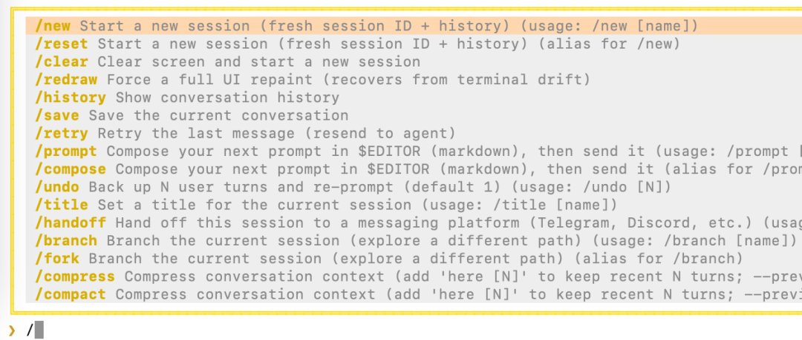
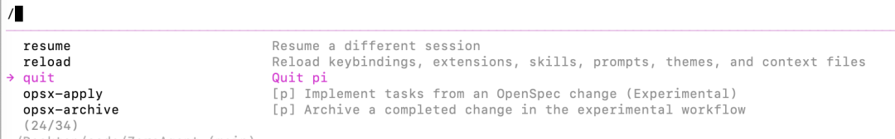
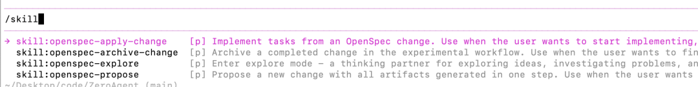

# 从零构建 Agent（八）：可复用的 Slash Commands

> ZeroAgent 将高频 Prompt 保存为带 YAML Frontmatter 的 Markdown 命令文件，通过位置参数、默认值、全局/项目两级加载、同名覆盖和热重载，提供类似 Shell 别名的用户入口。

<!-- more -->

作者：从码农到工匠

## Slash Commands 解决什么问题

代码审查、提交信息生成等任务往往需要重复输入相似的长 Prompt。Slash Commands 将这些 Prompt 保存为命令模板，让用户输入 `/review` 或 `/commit` 即可发起标准化任务。



文章还以 Pi Agent 为例说明：命令列表既可以包含会话管理等内置命令，也可以包含 OpenSpec 初始化后生成的用户 Prompt Template。



## Command 与 Skill 的区别

| 维度 | Skill | Command |
|------|-------|---------|
| 触发者 | 模型 | 用户 |
| 加载时机 | 模型按需加载 | 用户输入时展开 |
| 作用对象 | 模型推理过程 | 用户输入操作 |
| 主要复用 | 跨任务复用领域知识 | 跨会话复用 Prompt |

两者可以组合：用户通过 Command 快速发起任务，Agent 在执行过程中再按需加载 Skill。部分 Agent 也允许 Command 显式触发 Skill。



## 命令文件

每个用户命令是一个 Markdown 文件，由 YAML Frontmatter 和 Prompt 正文组成：

```markdown
---
name: review
description: Review a file or diff
---

Review the following file and suggest improvements:

File: $1
Focus on: ${2:-correctness, style, and performance}
```

调用 `/review src/cli.ts` 时，系统将 `$1` 替换为 `src/cli.ts`；第二个参数未传入时，`${2:-...}` 使用默认值。

## 数据结构与解析

文章为命令定义三个核心字段：

- `name`：唯一命令标识。
- `description`：用于帮助列表和错误提示。
- `template`：包含占位符的 Prompt 模板。

命令与 Skill 使用相同的 Frontmatter 格式，因此解析器应抽取为共享工具。解析阶段必须验证必填字段和非空模板，让错误在加载时暴露，而不是等到用户调用时才失败。

## 全局与项目两级加载

ZeroAgent 按两个范围扫描命令：

- 全局命令：跨项目复用。
- 项目命令：服务当前代码库。

加载顺序为全局在前、项目在后。注册表使用以命令名为键的 Map，同名命令后写覆盖前写，因此项目可以覆盖全局通用命令，为当前仓库提供更具体的工作流。

项目级命令示例路径：

```text
.zeroagent/commands/review.md
.zeroagent/commands/commit.md
```

## 热重载

交互模式中的 `/reload` 会先清空注册表，再重新扫描命令和 Skill。新增、修改或删除命令文件后，无需重启 Agent。

清空后全量重建有两个好处：

1. 被删除的文件不会残留为幽灵命令。
2. 覆盖关系每次都按确定的加载顺序重新计算。

## 内置命令与用户命令

内置命令如 `/sessions`、`/resume`、`/clear` 和 `/reload` 在启动时注册，用户命令随后合并。文章采用用户命令优先策略，同名时允许用户定义覆盖内置定义。

未知命令错误应列出所有可用命令，帮助用户判断是拼写错误还是文件没有成功加载。

## 可迁移实现原则

1. 用 Markdown 保存模板，使 Prompt 可读、可审查、可版本管理。
2. Frontmatter 只承载结构化元数据，正文保持为原始 Prompt。
3. 参数在调用时展开，不在加载时破坏模板。
4. 全局提供默认能力，项目层提供局部定制。
5. 用明确加载顺序实现稳定覆盖规则。
6. 加载阶段严格校验，调用阶段提供可发现的错误信息。
7. 热重载应全量重建注册表，避免陈旧状态。

## 信息边界

原文抓取结果没有保留完整 TypeScript 代码块，因此本页仅整理文章中可以确认的接口、路径、占位符和运行行为，不补写无法核对的源码。完整实现可在作者给出的 ZeroAgent 仓库 `chapter8` 中核验。

## 原文资源

- ZeroAgent：<https://github.com/significantfrank/ZeroAgent>
- Claude Code Commands：<https://code.claude.com/docs/en/commands>
- Pi Prompt Templates：<https://pi.dev/docs/latest/prompt-templates>
