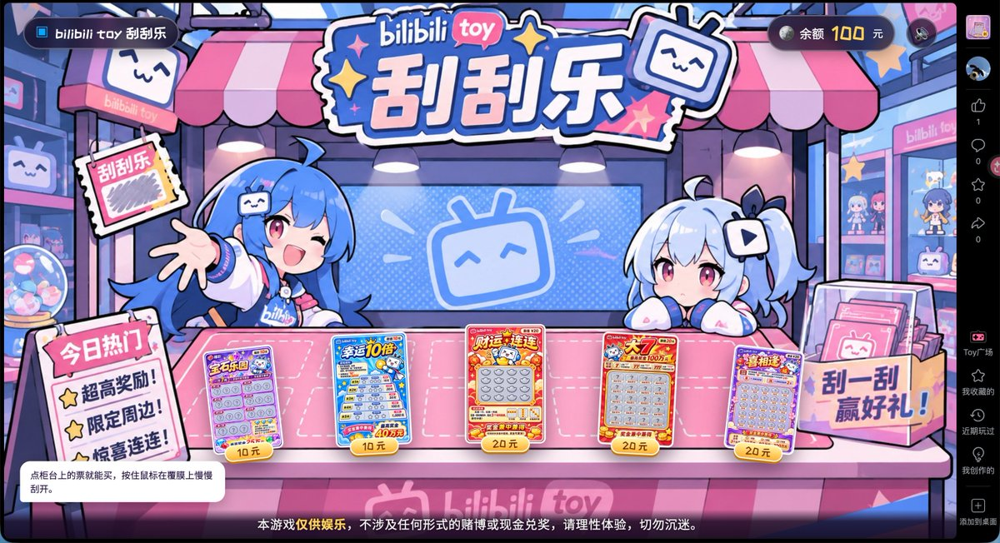
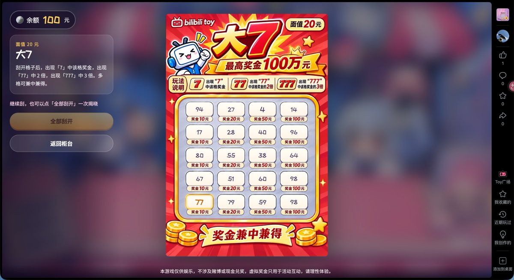
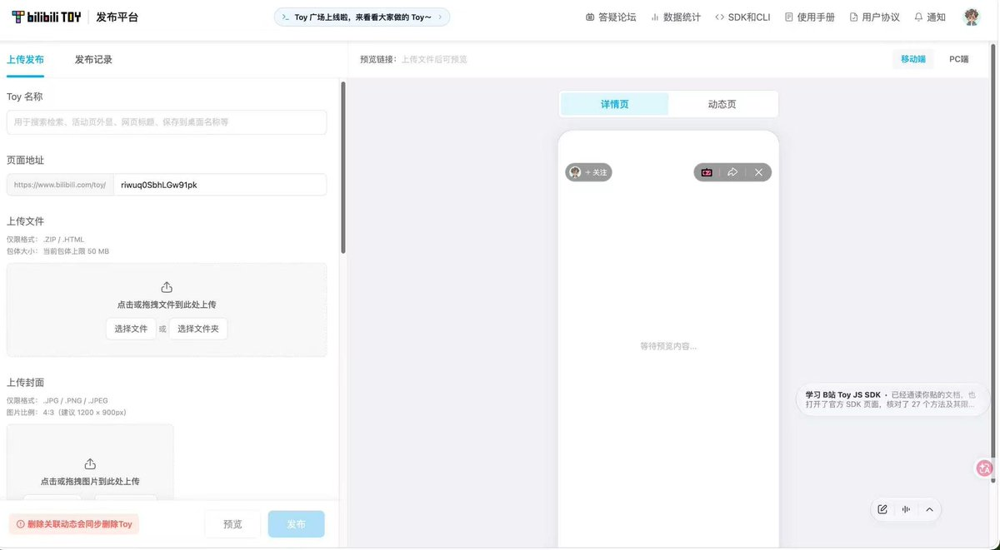
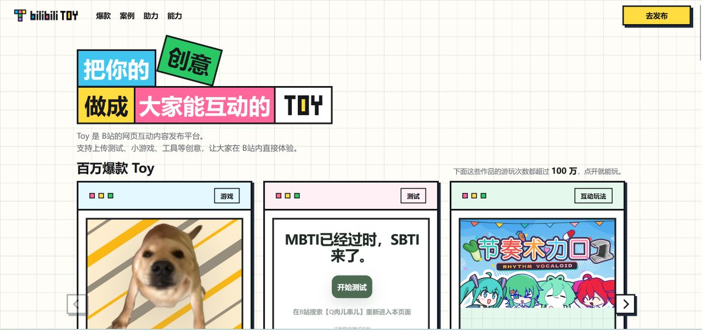
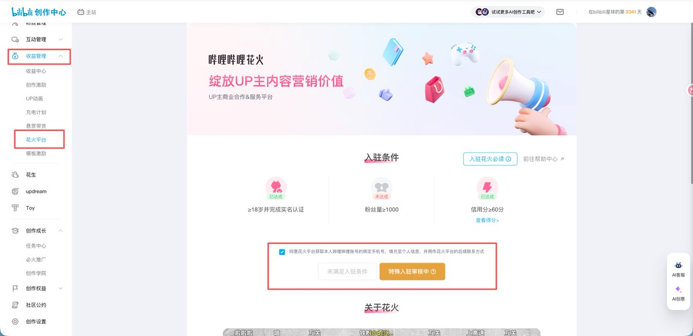
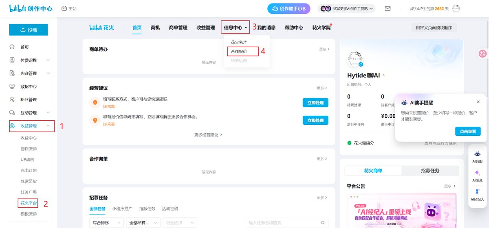
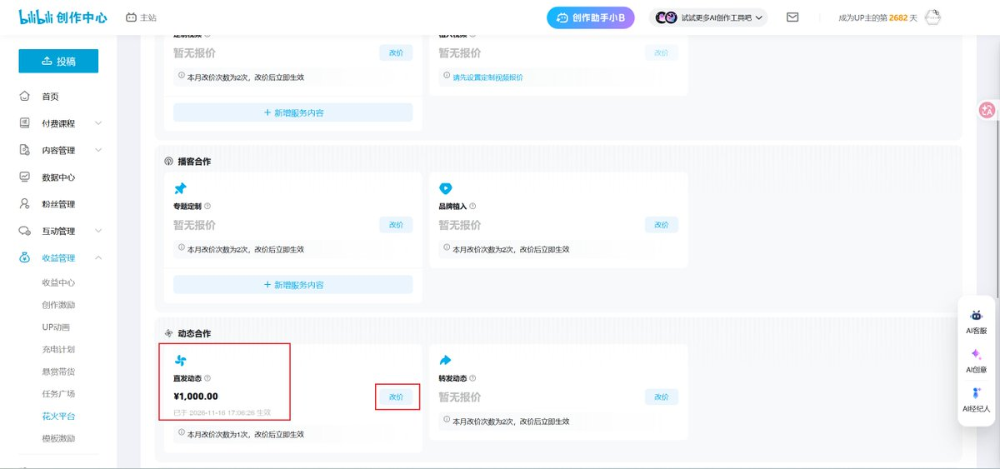
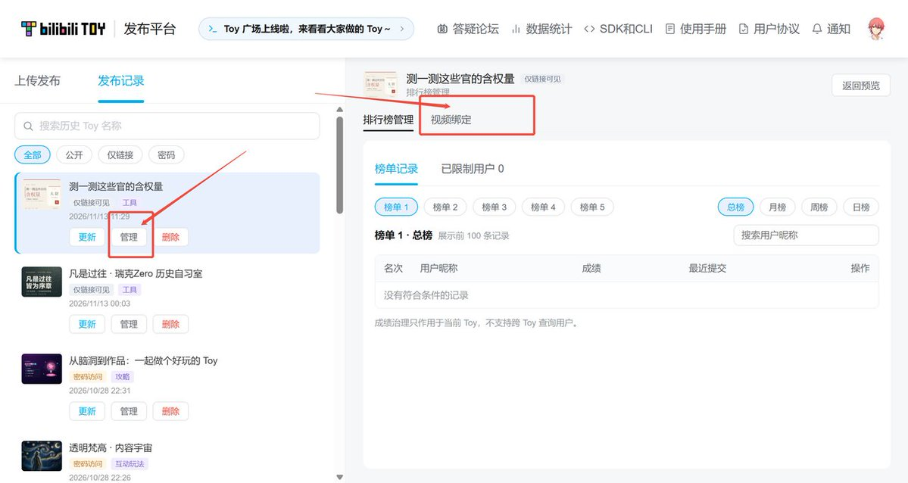
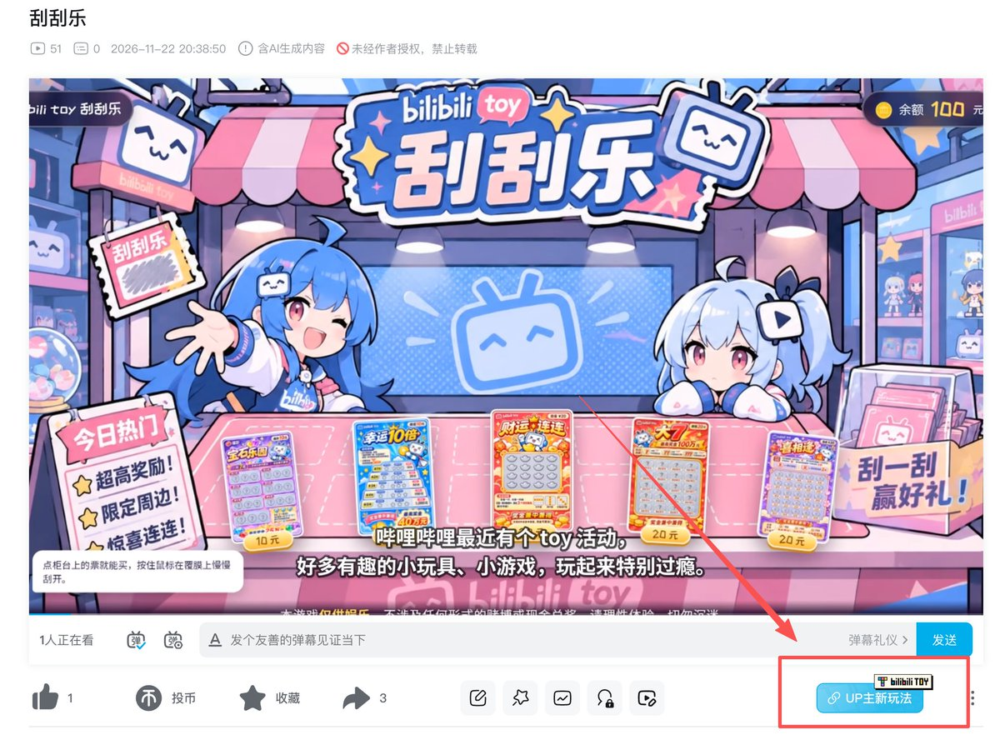
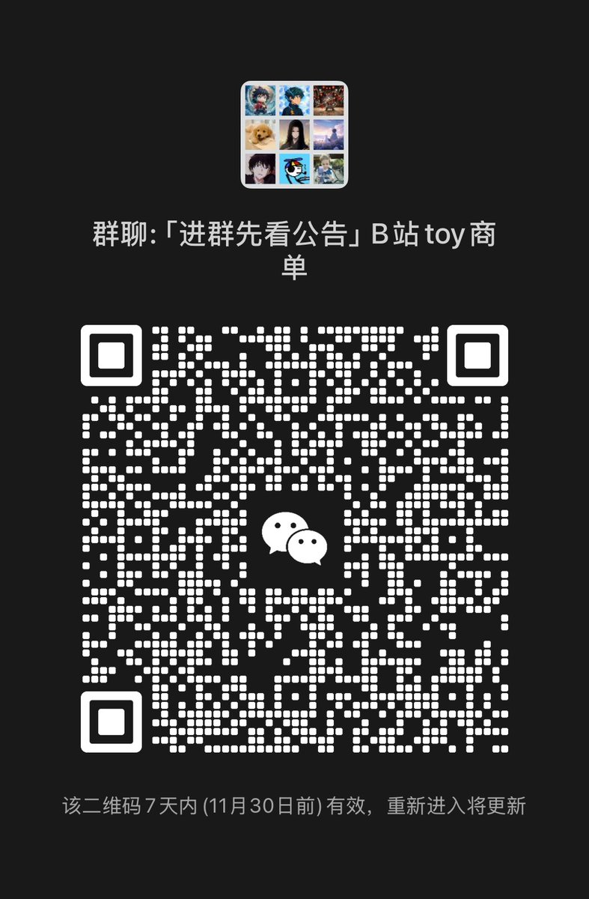

# Zh_Crypto：在 B 站 vibe coding 一个游戏/工具，一单拿 500 元

> B 站旗下创作者互动内容平台 Toy（类似 B 站生态版的 4399/7k7k）的商单机会：按 X 粉丝数结算——1000–9999 粉结 500 元、1 万粉及以上 1000 元，每人最多结 3 次（即 3 个 Toy + 对应视频）。**三步做法**：① B 站发布一个 Toy 和对应介绍视频；② 用 X 账号转发这两个链接；③ 按要求回填表格。作者以自做的刮刮乐游戏（五种刮刮乐：大 7、喜相逢、幸运 10 等）为交付样例，附 B 站视频、Toy 页面与推文链接。

<!-- more -->

Toy 是哔哩哔哩旗下面向创作者的网页互动内容发布平台，支持上传趣味测评、休闲小游戏、轻量工具类等网页互动作品。作品采用网页化运行形式，用户无需额外安装软件，即可在线直接体验。它相当于 B 站生态版的 4399/7k7k，优势在于和 B 站账号打通，可联动 B 站平台能力

报酬按 X 粉丝数算，1000 到 9999 粉结 500 元，1 万粉及以上结 1000 元，再多粉也不加价。结算单位是「一条独立 B 站内容 × 一个外部平台」，每人最多结 3 次，也就是 3 个 Toy 加对应视频

1k～9999 粉的可以拿 1500；1w 粉以上可以拿 3000

商单做法很简单，三步：

1. 在 B 站发布一个 Toy 和对应介绍视频
2. 用自己的 X 账号转发这两个链接
3. 再按要求回填表格

以我创作的刮刮乐为例，以下是我一单的交付物：

- B 站视频讲解：【刮刮乐】 https://www.bilibili.com/video/BV1PCy5zjEBu/?share_source=copy_web&vd_source=f060e5ebb0aae97875ca1e67570f414f
- 刮刮乐游戏：https://www.bilibili.com/toy/xx2BtdoZ5ou4CW8X/index.html?spm_id_from=333.40253.search.search_results.click
- 推特推文（就是本篇文章）

平时出门就会手痒买刮刮乐，于是就有灵感开发了这个小游戏。有五种刮刮乐大 7、喜相逢、幸运 10 倍、财运连连还有宝石乐园。

## 具体完成步骤

### 第一步：开通 Toy 权限

不需要自己在 B 站上申请，只需要在官方的文档中填写 X 账号、B 站账号信息，后面会有工作人员给大家开 Toy 的权限，进群填表。填写后不需要马上艾特群主，而是先等 12~24 小时，系统会自动开权限。

打开网址：https://www.bilibili.com/toy/publish

如果进入 Toy 发布平台，就是开通了

如果跳转到介绍页面，就是没开通。

### 第二步：入驻花火平台

本次商单费用通过 B 站的花火商单平台结算，未入驻的 UP 主（B 站博主）人需要入驻

入驻方式：https://b23.tv/mqZ6wIt

花火入驻的审核一般是 1~3 个工作日

B 站 1k 粉以上的博主，走花火平台的正常入驻流程即可。

B 站 1k 粉以下的博主，需要申请花火平台的特殊入驻。

第一步：进入 B 站花火平台

PC 端：创作中心-收益管理-花火平台

移动端：我的-商业服务-花火商单

第二步：点击【申请特殊入驻】，输入本人手机号与客户询单证明

第三步：客户询单证明来源：先添加群主的微信，向 Hytidel 发送“我确认参加 B 站的【站外传播活动】，在 B 站发布 Toy 和视频”，截图聊天记录，上传客户询单证明即可，添加的人多，会排队逐个通过，大家耐心等待

### 第三步：设置花火报价

打开链接：https://member.bilibili.com/platform/allowance/pick_up/price

或者在创作中心按这个路径找到：

往下滚动，找到【直发动态】（注意看，不要设置错项目了），修改报价：

X 1w+ 粉的报价设为 1000，1k ~ 9999 粉的报价设为 500

### 第四步：发布内容

开通 Toy 权限之后就可以开始做 Toy、B 站视频、转发到 X 了，不需要等花火。花火是结算用的，你在回填表单之前入驻花火并修改好报价就行。

开发 Toy 教程如下：https://www.bilibili.com/toy/vibe-toy/index.html

先按教程制作 Toy，并在 B 站发布 Toy 相关的视频

视频需要绑定 Toy，绑定方法：

然后将 B 站的 Toy 和视频的链接分享到 X，写一条推。

Toy、B 站视频、X 转发目前没有内容要求，简单介绍一下自己做了什么，附上链接让大家去 B 站玩即可。

绑定之后在视频的右下方就会有入口

### 第五步：等待结算

发布后需要回填群里的表

工作人员会在每周五审核回填的内容，给出修改意见。

需要修改的人我会在群内或私聊通知，没有通知的默认通过。

没问题就进行结算，结算需要等几天走花火的结算流程。

引用推文：Z 大诗 (@Zh_Crypto517)

这个世界就是一个巨大的信息差，有人靠 B 站的 Toy 活动已经月入过万了，全程只需要 AI 就能完成 先分享我的作品：财富自由计算器 灵感来自于著名财经博主「小 lin 说」一期关于“财富自由你需要多少钱？”的视频 按你理想的生活水平不工作，本金还不缩水，购买力也不降。日常开销记作 X，按 2.5% 的长期实际收益率来算，就需要 480 个 X；再把养孩子、医疗和住房一次性加进去。比如一线城市月花 1.5 万、两个孩子、医疗留 150 万、再买一套 700 万的房子，目标就是 1870w 我将里面的算法做成了一个财富自由计算器 Toy，算了一下按照我的标准来说也要...

https://x.com/Zh_Crypto517/status/2124374653431103649

具体细节可以进群拿资料，有不懂的也可以在群上跟大伙交流

## 相关页面

- [[sources/dongqing-bilibili-toy-cloud-disk-cps-playbook]]
- [[patterns/content-arbitrage-pattern]]
