# zhouluobo（@zhouluobo）：设计界的 Personal Agent 也来了——偷学我的作图风格，现在比我还熟

> 设计师探索专属 AI Agent 的工作流前沿记录：通过将历史设计作品、配色规范与排版审美沉淀为 Agent 记忆库与提示词模版，让 Agent 完美复刻并进化出个性化的视觉设计风格，实现专业设计资产的数字化永生与高效分身。

<!-- more -->

大家好，我是萝卜哥~

不知道大家还记不记得，我之前自己写过一个给文章配图的 skill，叫 article-visual-director，读文章、拆段落、出提示词、定比例，流程磨了挺久，我个人觉得这个 skill 还是挺给力的。

只不过有一个天然的缺点，就是最后出图那一步得靠生图模型。模型给力，配图就能用。模型差点意思，前面流程设计得再细，出来的图也撑不起一篇文章。

说白了 skill 管的是怎么想，画得好不好它管不了。

正好最近 Lovart 又出了一个新功能，主打的是个人设计 Agent，刚好把这块补上了。

它本身整合了好几个主流的图像和视频模型，我这边只管把需求讲清楚。更有意思的是它还会反过来从我的操作里总结方法，沉淀成 skill。等于我以前手搓的那套思路，现在有了一个能直接画出来的地方。

## 现在的 Agent，都在学着记住你

最近各家都在推 Personal Agent，大家卷的方向差不多，让 AI 记得你是谁，知道你手上在忙什么，然后自己往前推一步。

放到设计领域上，也成立。

就比如我现在做封面，每次都要把对应的提示词给到 Codex，虽然也不是很麻烦吧，但是总感觉蠢蠢的，AI 时代不应该是这样的流程。

而 Lovart Arti 就是来解决这个问题的，它会记住你的每次选择，下次再来就不需要重复了。

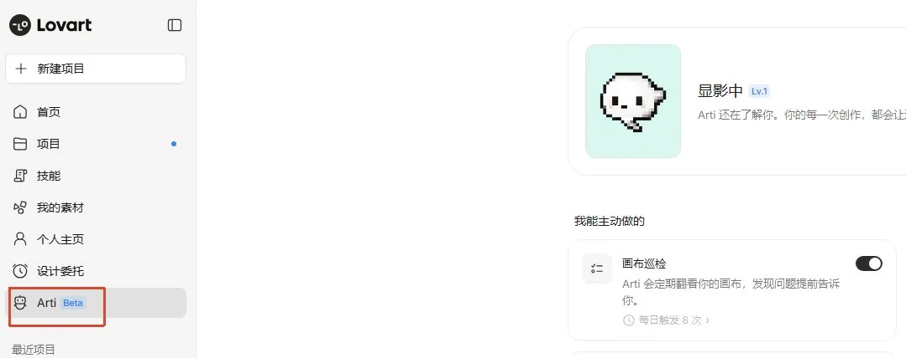

左侧菜单栏现在多了一个「Arti」入口，里面能上传作品集，也能直接跟它聊天补充偏好。我上传了 10 张萝卜 AI 笔记的历史封面，又说了几句我的习惯，比如标题一定要大，萝卜元素能有就有，不要那种紫蓝渐变的科技风等等。

比如我给到的主视觉是这些图片。

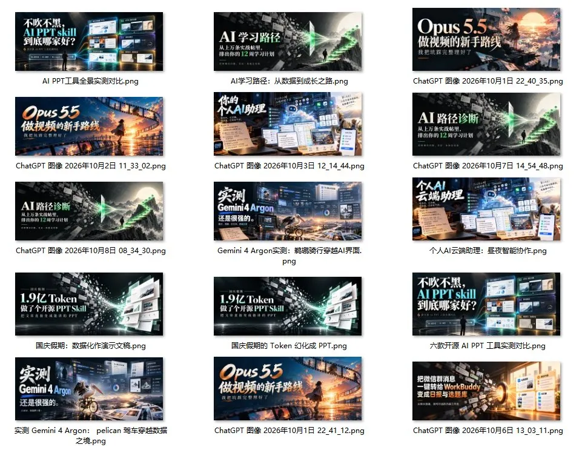

然后我的 IP 形象就是一个动漫人物+萝卜形象，哈哈哈。

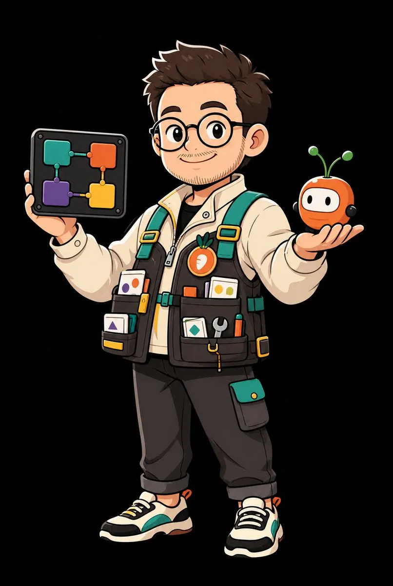

把这些素材一起上传给 Arti 就行。

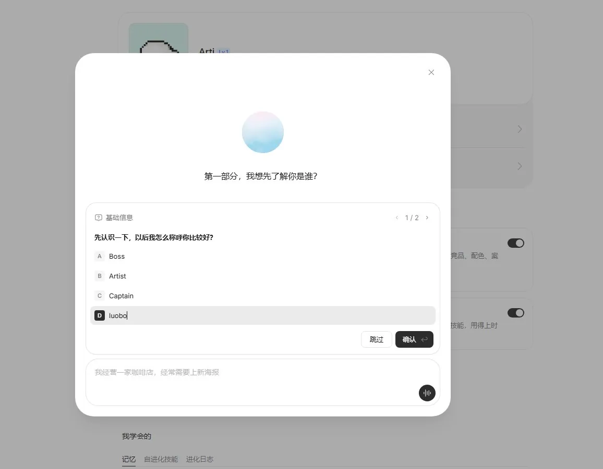

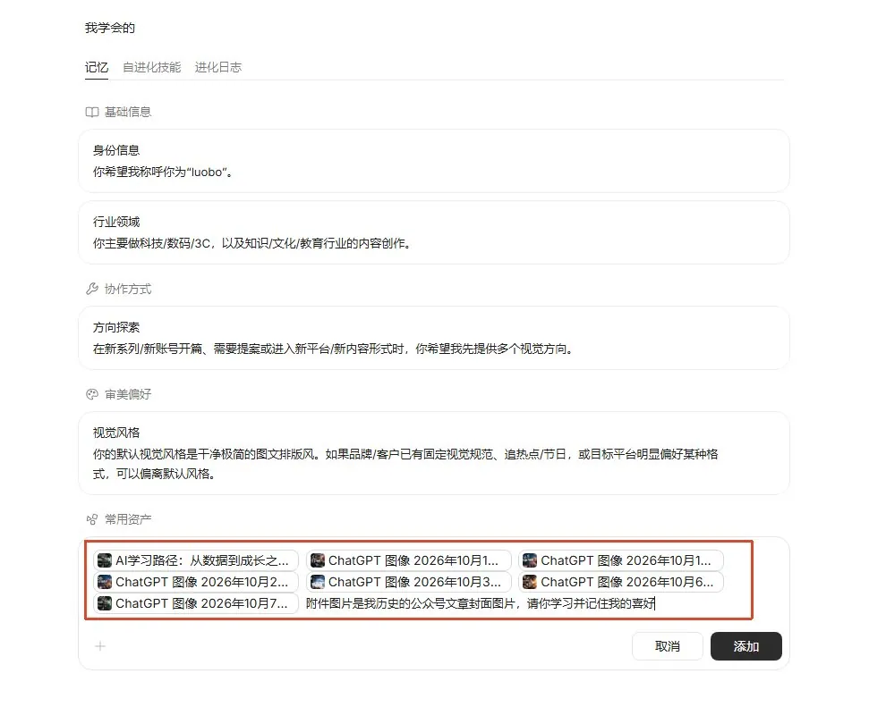

然后它就能记住了，以后再想要生成相关风格的图片，提示词里完全不需要提了，它会自动根据记忆里的内容来选择。

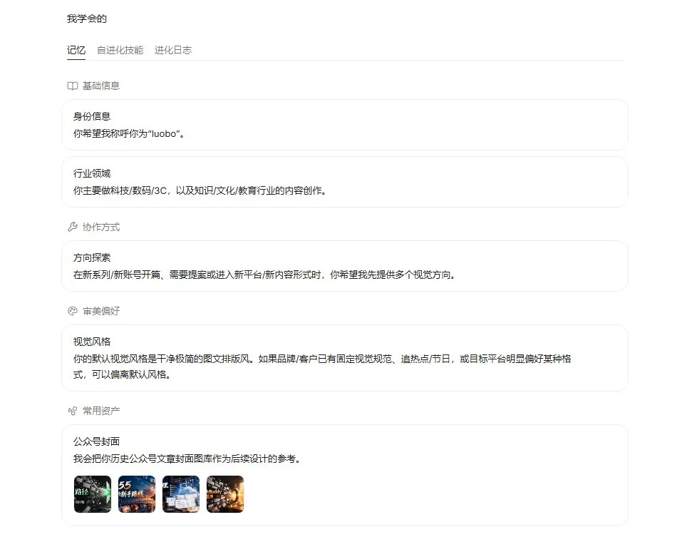

让 Arti 了解我们之后，就可以来进行真正的创作了。

## 先简单试一下文章配图

因为前面我已经把我以前的文章封面图片都给到 Arti 了，所以现在我们只需要把想要生成封面和配图的文章给到 Lovart 就好了。

```
这是我刚发的一篇公众号文章，链接【粘贴链接】。帮我配一张封面和适当数量的正文配图，封面 2.35:1，配图 16:9，放在你觉得读者最容易看懵的地方，告诉我分别放在哪一段后面。
```

风格我一个字没提。

封面出来是这样的，是不是和我平时的封面风格差不多呀。

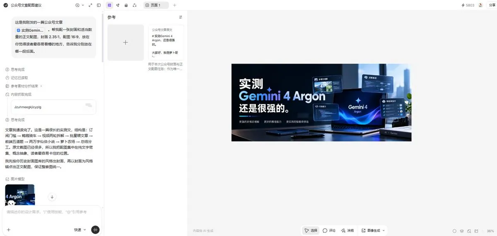

下面是配图，也延续了我前面上传的图片风格，但是其实有时候我倒是觉得配图风格可以轻松欢快明媚一些更好。

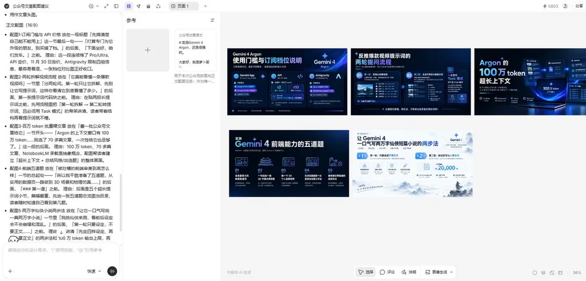

所以我就让它再生成一组配图来看看。

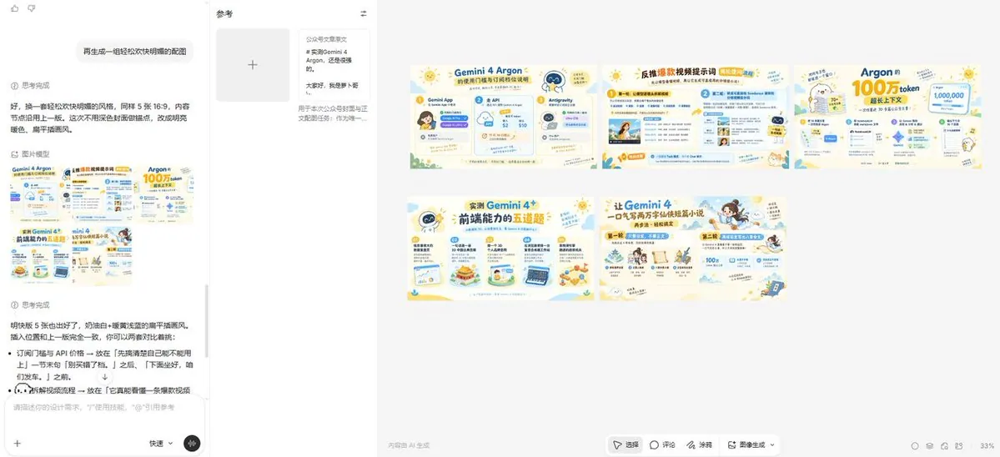

不知道大家更喜欢哪一组配图呢，我个人更喜欢后面这一组。

用下来我最大的感受是，记忆更像一个起点。它会按你的习惯起步，但你想换个方向，一句话就能拐过去，不用重新从头交代。

然后能看到它的进化过程，几乎每次项目运行都能学习到新东西，这就是越用越了解我呀。

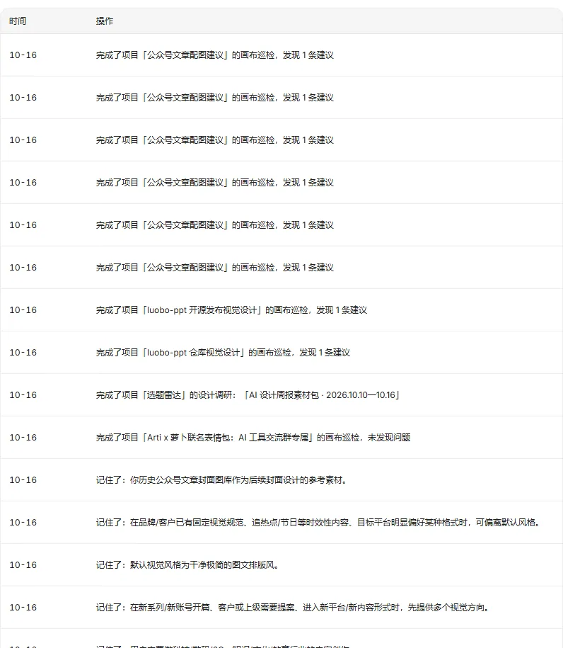

## 定时选题雷达，替我刷 X 和 Ins

我觉得这是这次 Lovart 2.0 最值得去体验的新功能，设计委托。

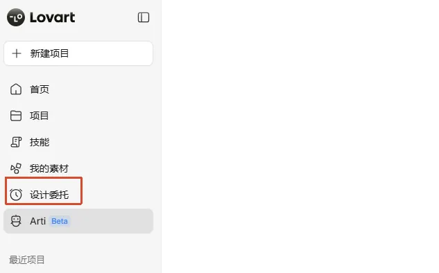

它的意思是你不用把活儿拆成一个个 prompt，直接把一件完整的事交出去，设定好执行周期和每次最多花多少积分，Arti 自己往下推进。

做 AI 工具号，我每周末有两件固定要做的事情。一件是刷各家官网和更新日志，看谁发了新模型、谁悄悄改了功能。另一件是翻 X 和 Instagram，看海外创作者又用 AI 玩出了什么新花样，刷到好的就先收藏。

这两件事其实都挺耗费时间的，而且有时候好东西太多了，收藏的越来越多，但是真正拆过的没几个。我手机里光 X 的书签就攒了快 1000 条了，想起来就有点绝望。。。

现在我把这个过程交给 Arti 了。

```
每周六 21:00，帮我整理一份周报，输出成 HTML，分两部分。

第一部分是本周 AI 工具动态。新发布或大更新的工具，重点看生图、视频和 Agent 这几类。每个工具写清楚更新了什么，附上发布海报或官网首屏截图，每条带来源链接。

第二部分是 X 和 Instagram 上这一周用 AI 做设计的有趣案例，8 到 10 个。我要的是让人看了想转发的那种，比如脑洞很大的海报、品牌拿 AI 做的小 campaign、用生图做的连续剧情、奇怪但好看的风格实验。纯炫技的高清美女图和换脸不要。
每个案例写清楚作者和原帖链接，配一张作品截图，一两句话说清好玩在哪，大概用了什么手法，看不出来就写看不出来，再说说我想借鉴到公众号或小红书上可以怎么改。

最后结合两部分，给我 3 个适合萝卜AI笔记的选题，每个选题配一个封面方向。
```

写这类任务我有两个小经验。“不要什么”一定要写清楚，我特意排除了美女图和换脸，这类内容在社交平台上量太大，不排除的话很容易把报告占满。另外每条都要求带来源链接，后面自己核对，或者真要写进文章引用的时候，能直接点回原帖。

这个定时任务不需要我每周再喂东西，它自己去找，会按照我设好的时间输出内容。积分上限记得设一下，定时任务是真的会每周按时跑、按时花的。

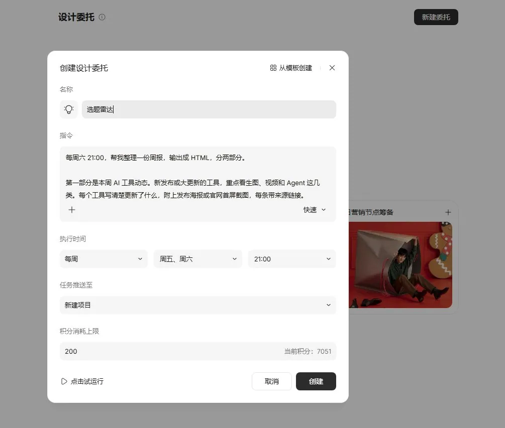

来看一下它给我的产物，真丰富啊。

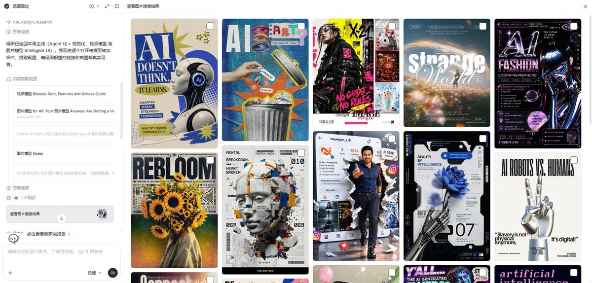

当然它不仅仅给了这些图片，还有一个非常详细的 HTML 类型的周报，详细说明了这一周都有哪些值得关注的大事件。

[video](https://video.twimg.com/amplify_video/2112013370807242752/vid/avc1/1900x916/mdwcF3KCMgdAt_Ci.mp4?tag=29)

可以看到这份周报所有的元素都是可以编辑了，非常方便完美进行微调。当然有些信息源它肯能还是抓取不到全部信息，这个没办法，只能再手工收集对应的素材了。

所以我对这份周报的定位是一个筛子。它把一周几百条信息先筛到二十来条，最后哪个值得做、怎么做，还是我自己拍板。

这份周报我是非常满意的，以前这个流程我得在三四个工具之间来回倒，没有几十分钟甚至几个小时是完不成的，现在周六晚上收一份周报，一周的信息和选题基本就有着落了，爽啊。

## 给开源项目配一身行头

熟悉萝卜哥的朋友应该知道，我最近开源了一个项目 luobo-ppt，一个做 PPT 和美化 PPT 的 skill。反响还是挺不错的，现在就想着给 GitHub 仓库做一些装饰，嘿嘿。

```
这是我在 GitHub 开源的项目 luobo-ppt，地址 github.com/zhouwei713/luobo-ppt，项目说明贴在最后面。请帮我做一整套开源发布用的视觉。

先做一点调研，看看 GitHub 上 star 比较多的 AI 工具类项目，README 首屏一般怎么设计，总结几条能用在我这个项目上的做法，然后再开始画。

需要的东西
1. 项目 logo，萝卜和 PPT 结合，缩到很小也要认得出来
2. README 顶部横幅，1280×400，带项目名和一句话介绍，出浅色和深色两版，GitHub 很多人开着深色模式
3. GitHub 社交预览图，1280×640
4. 功能示意图 3 张，分别讲从零生成、按参考图美化、可编辑的原生 pptx
5. 美化前后对比图一张，同一页内容，左边朴素右边美化后
6. 一段 5 秒左右的循环小动画，演示一页朴素的 PPT 慢慢变好看，放在 README 里
7. 安装步骤卡片一张，三步讲清楚怎么装进 Agent
8. 发布用的社媒图，X 横图一张，小红书 3:4 图组 4 页
9. 公众号开源介绍文章的封面

所有图里项目名统一写成 luobo-ppt。风格和我的账号保持一致。

项目说明
【这里粘贴 luobo-ppt 项目说明全文】
```

我让它先调研再动笔，是因为 README 的门道我自己也不想去用时间研究，所以直接看看别人怎么做最好。Arti 本身就带设计调研的能力，会去搜资料、看案例，整理成一份能追溯来源的小报告，再按这个思路往下画。

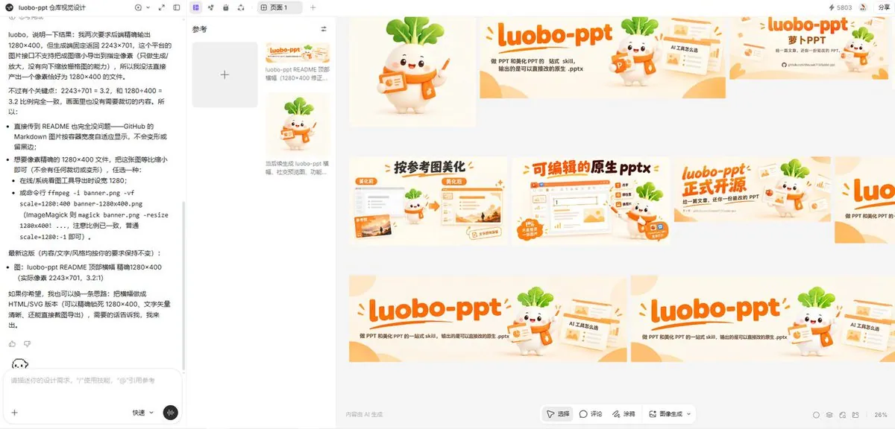

这一套设计风格我试着和你的挺喜欢的，以前我总是把精力都放在怎么更好的产物 skill 上，反而忽略了一些宣传素材，现在有 Lovart 来帮忙，效率快多了。

[video](https://video.twimg.com/amplify_video/2112014394267717632/vid/avc1/1900x916/CwPNz_fukgfTEsHI.mp4?tag=29)

指令里关于风格我只写了“和我的账号保持一致”八个字，出来的东西直接就是橙色系大标题，萝卜也在。换了一个跟公众号完全不搭边的项目，它还记得我是谁。

当然有些地方还是得自己把关。比如安装步骤卡片上的命令，我会再核一遍，这种东西错一个字符读者就装不上，不能全靠 AI。

## 萝卜和 Arti 凑一套表情包

正事做完，我又给它派了个好玩的活儿，来给社群做一波表情包。

```
用 Arti 的形象和我的萝卜 IP，做一套 8 张的联名表情包，适合在 AI 工具交流群里用。

情绪要贴着做内容的日常，比如 prompt 又没写对、终于跑通了、在等模型出图、被甲方改第五版。
画风统一，Arti 和萝卜同框，表情要夸张一点，每张配一句很短的字。
单次执行，先出 2 张我看看风格。
```

提示词里还是不用写风格，只需要写想要的动作就好，它自己带上了之前记住的橙色系和大字标题，这个确实很方便啊。

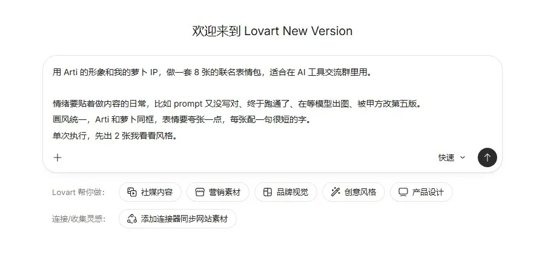

Lovart 会先给出两张样片，如果觉得没问题，就要继续生成其他图片。

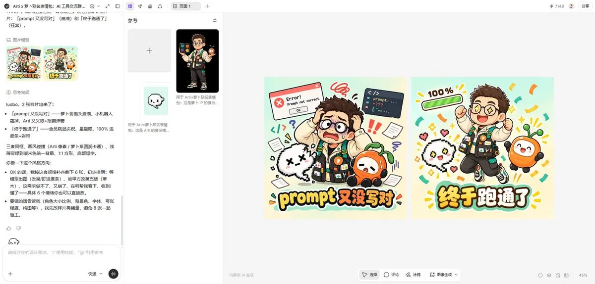

我觉得它不仅图片做的好啊，这个语言能力也一点都不差，这些表情包方向都是自媒体人的日常，苦中作乐吧。

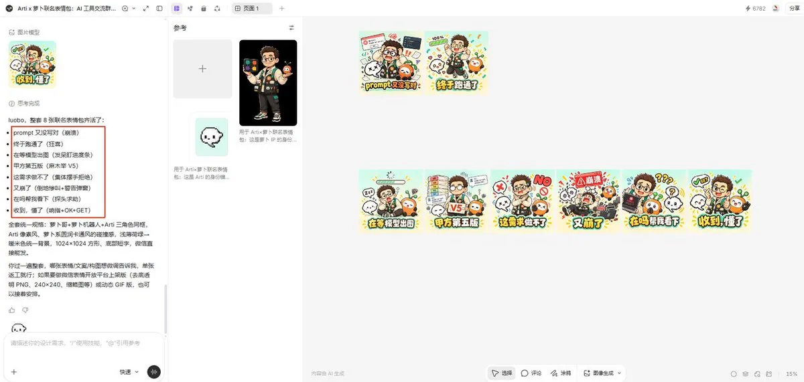

这一批都是跟做内容相关的，后来我又让它出了一批活跃社群用的，同样没再交代风格，出来还是熟悉的那个味道。

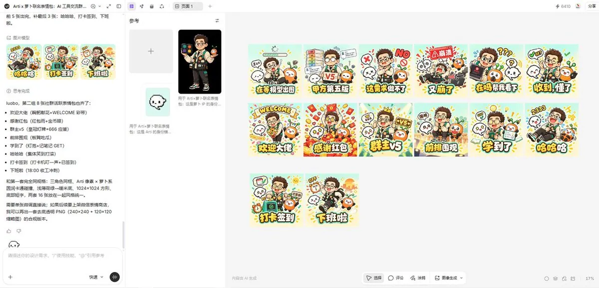

如果你也有自己的 IP 形象，这个玩法很值得试试，做一套专属表情包，在群里用起来比通用表情有意思多了。

## 写在最后

我那个配图 skill 写了挺久，一直觉得差的就是最后出图那一口气。这次在 Lovart 里跑完一轮，这口气算是补上了。

我觉得 Lovart 的新功能，最适合的是那种“重复但又不能乱做”的活儿。

做运营的朋友可以让它按内容日历提前出图，大促前批量做物料。做创意的可以委托它每周搜一次参考，整理成一份周报。市场团队拿它检查对外物料有没有用错字体和 logo，也挺合适。

官方案例里还有一个我挺喜欢的，每天早上把记下来的梦生成一张画，月底攒成一本梦境画册。这种就纯属给自己玩，但我觉得是个好用法。

提示词图像，大家可以也去试着玩一下，看看能不能激发自己的灵感。

每天早上，把我记下的梦境片段生成为画面，保留梦里的荒诞和不合逻辑，用我的审美和色调去画，不要画成常见的奇幻插画风格。每个梦出 1 张，标上日期和我记下的原话。每月最后一天，把这个月的梦整理成一本梦境画册。

## 相关页面

- [[sources/alswl-ai-native-workstyle-from-info-to-delivery]]
- [[sources/pamela-build-personal-website-from-scratch-60-ui-checklist]]
- [[concepts/agent-skill]]
- [[concepts/ai-content-pipeline]]
