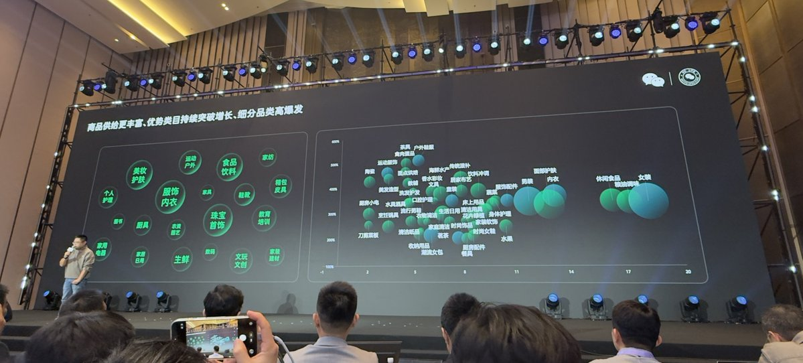
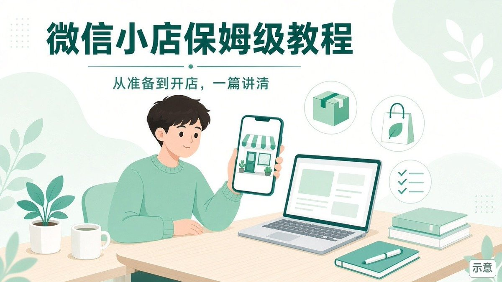
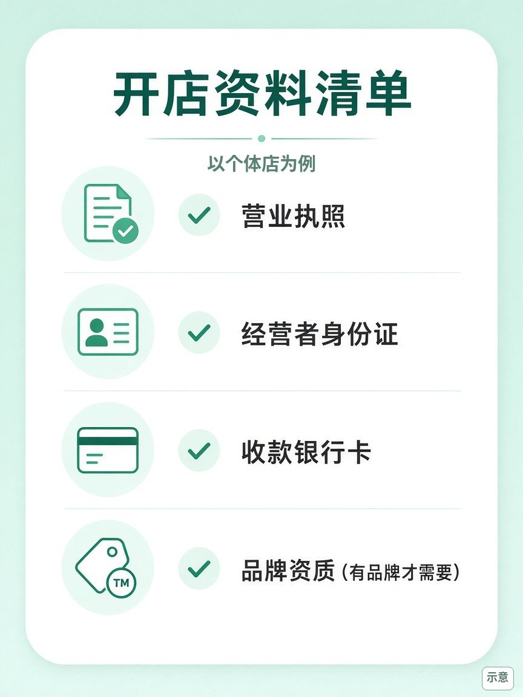
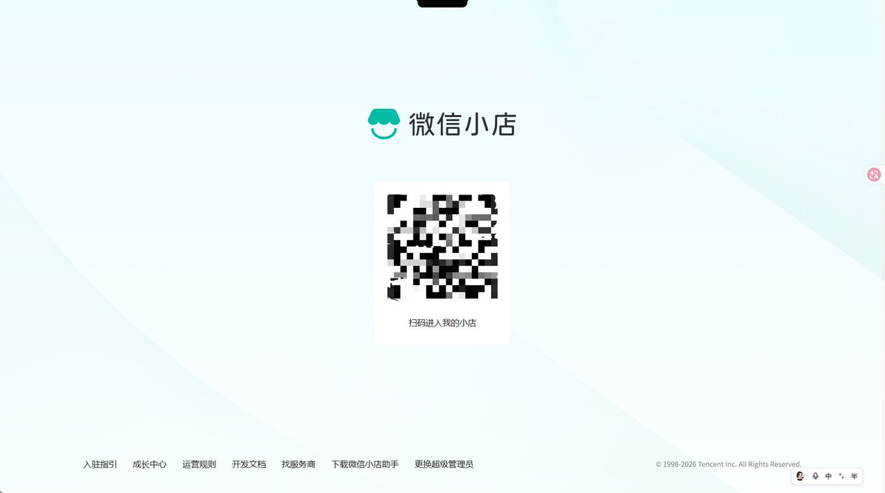
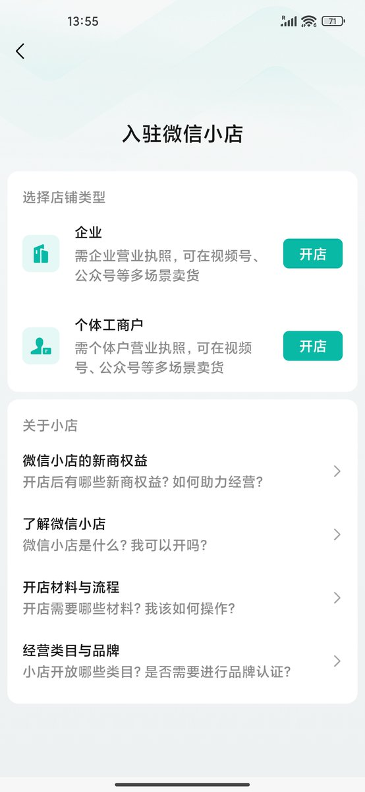
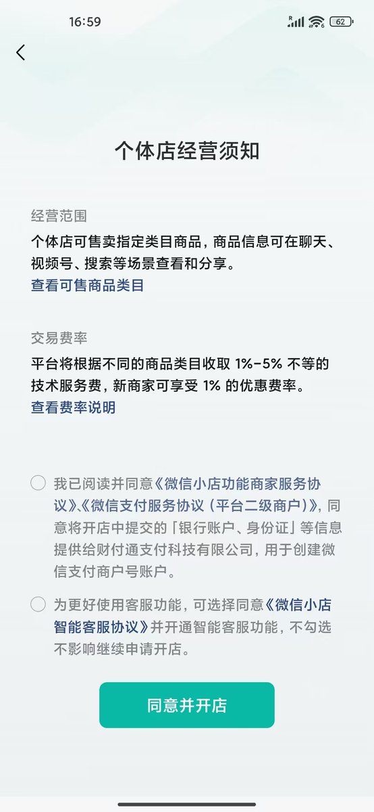
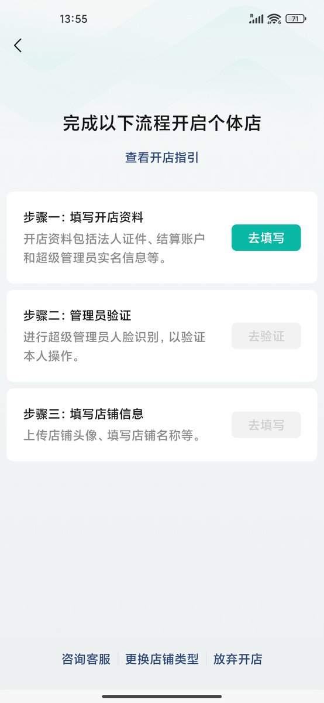
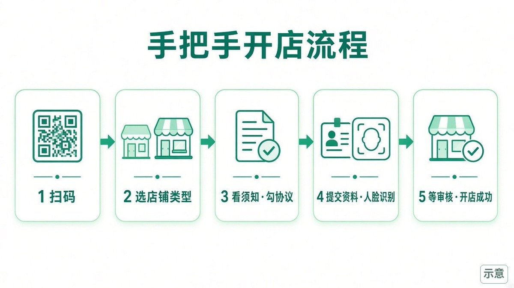
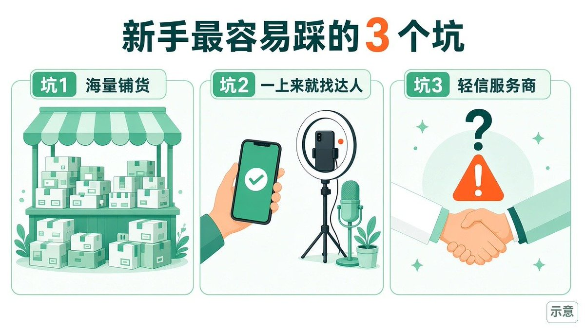

# 在下卓一航（@zhuoyihang0329）：微信小店搞钱保姆级教程（从准备到开店全流程）

> 微信小店商业闭环实操教程：对比拼多多与小红书，剖析微信小店基于熟人社交与公私域联动带来的万亿级市场红利，从主体资质准备、类目保证金缴纳、选品上架到公域流量触达全流程拆解。

<!-- more -->

如果你想做点副业，又不想囤货、不想上来就投很多钱，微信小店是一个值得了解的选择。在我看来，微信小店是腾讯电商这些年最有希望的一次尝试。

腾讯在电商上投入一直很多，之前也失败过不止一次。22 年 12 月的内部员工大会上，马化腾说视频号基本上是全公司的希望，希望能把电商闭环做好。25 年 5 月，微信事业群又成立了电商产品部。

我在微信生态做了这些年，见过太多人卡在开店第一步：不知道准备什么、要花多少钱，开完店也不知道下一步做什么。

开店不难，难的是开完之后不知道怎么办。

所以我打算写一个系列，一篇讲一个阶段，从开店一直讲到私域复购。今天是第 1 篇：开店前准备什么、怎么开、开完先做哪几件事，帮你避开新手常见的坑、选好赛道、开好小店。

## 一、微信小店适合谁

先说适合的三类人。以下都是从我的经验来看的判断。

1. 现在还想入局电商的人。 淘宝、京东、拼多多这些货架电商已经很卷了。在我看来，国内还有平台机会的，主要剩小红书和微信小店。小红书的用户更集中在女性，微信的用户不分老少，所以我更看好微信小店的前景。

2. 本身就有流量的人。 比如手里有私域、做过微商、写过公众号或做过视频号的。微信小店走的是社交链路成交，这些流量可以自然用上。电商转化比接广告更直接，利润也更好，老话说“宇宙的尽头是卖货”。

3. 想做公众号或视频号、希望低成本试水的人。

如果只想挂个链接、躺着等单的人，不适合。社交电商要用到社交关系，要发朋友圈，也要像做小红书那样持续输出内容、做营销，不是充钱就行。

还想沿用货架电商老打法的，也不适合。只买关键词、只抠头图和详情页、靠打价格战，这套在微信里不太好使。

## 二、开店前要想清楚的 3 件事

1. 开个体工商户店还是企业店。

微信小店没有纯个人店。入驻主体只有企业店和个体工商户店，没有营业执照开不了店。两种店打法不一样，比如想做品牌，从规则看，品牌认证只在企业店开放。所以开之前先想清楚，你是想先小成本试试，还是一开始就奔着品牌去。

2. 卖什么类目。

结合目标人群、自己的供应链优势、平台上当下卖得好的品类来定。根据我服务客户的经验，目前微信小店的主力消费人群偏中老年。在 2026 微信公开课现场看到，视频号里规模较大的品类是女装、休闲食品、粮油调味，这几类的信任门槛都比较低。增速比较高的有茶具、美发、运动服饰、传统滋补。一开始先定一个大类就行，怎么选品下一篇专门讲。

3. 第一批顾客从哪来

微信小店是社交电商，非常讲复购。冷启动的时候，光挂链接、等推流，很难自然出单，哪怕是基础销量，往往也要靠朋友圈、内容宣传和亲友购买。社交关系是第一批订单的来源，也是之后裂变和复购的核心。从功能角度看，小店每次宣传都会介绍直播间的“送礼物”、“一起买”和私域“点赞买”，这就是一种平台倾向，它希望你这么做，希望“社交不再只是‘把人带来’，而是直接被做成一种可复用的成交机制”。

## 三、开店要准备的资料和费用

以个体工商户店为例，要准备这几样：

- 个体户营业执照
- 经营者身份证正反面（企业店是法定代表人身份证）
- 一张收款用的银行卡：个体工商户用普通银行卡就行，企业店要用对公账户。（用个人卡时，开户名必须和营业执照上的经营者姓名一致，别拿家人的卡来填，这一项最容易被驳回）
- 有品牌、要做品牌认证的，再准备品牌资质，比如商标授权书；没有品牌就不用

另外两个前提：开店用的微信号要先完成实名认证；只凭个人身份证开不了店，必须有营业执照，个体户执照的注册号一般以 92 开头。所以动手之前先确认一下：没有营业执照，就开不了店。

可以卖哪些类目、各自要什么资质，开店前可以先在微信小店官方指引里查。https://store.weixin.qq.com/chengzhang/guide

保证金。 类目保证金和浮动保证金取较高的那个，不叠加。各类目的类目保证金金额不一样，开店时以后台显示为准。

技术服务费。 开店页面的《个体店经营须知》写着：平台根据商品类目收取 1% 到 5% 不等的技术服务费，新商家可以享受 1% 的优惠费率（这非常重要，开店要算利润）。计算方式是“费率 × 结算基数”，直接从货款里扣。具体类目对应多少、新商家优惠的条件，以开店页的费率说明为准。

## 四、手把手开店流程

手机端和电脑端都能开店，步骤基本一样。

手机上可以用“微信小店助手”App，或者在微信里搜“微信小店开店”。下面以电脑扫码为例。

第 1 步：电脑打开微信小店官网，用微信扫码。

网址是 store.weixin.qq.com/shop

建议用老板本人的微信来扫。因为扫码开店的这个微信号往往就成了店铺的超级管理员，也就是单店权限最高的人，提现资金这类操作都归他。

开店时也可以填写超级管理员的身份证、手机号和邮箱来绑定，可以是经营者本人，也可以是其他经办人，超级管理员只支持大陆身份证，具体以开店页面为准。

第 2 步：在微信里点“我要开店”，选店铺类型。

企业店要企业营业执照，个体店要个体户营业执照，两种都能在视频号、公众号等场景卖货

第 3 步：看经营须知，勾选协议。

《个体店经营须知》里可以分别查看个体店能卖的商品类目和费率说明。下面有两个勾选项：第一个是同意服务协议，并同意把银行账户、身份证等信息提供给财付通创建微信支付商户号，这个必须勾；

第二个是《微信小店智能客服协议》，页面上写着不勾也不影响开店。咨询量不大的话可以先不勾，原因第五节细说，因为是个大坑。

第 4 步：提交资料，完成开张任务。

顺序是：先填写商户信息-再由超级管理员做人脸识别-最后填写店铺名称、头像等信息。

如果超级管理员和经营者不是同一个人，可能还要做账户验证，方式是法定代表人微信扫码或公户汇款，30 天内没完成要重新提交商户信息。

第 5 步：等审核，开店成功。 官方写的正常审核时效是 1 到 3 个工作日。超级管理员收到“已开张成功”的服务通知，就是开店成功了，不过一般都是秒过。

钱怎么回到手里也提前了解一下：买家确认收货后再过 7 天（T+7），货款转入可提现，每天最多提现一次。

## 五、开完店先做的 5 件事

1. 起好店名，设好头像和简介。

 按《微信小店命名规则》，“旗舰、官旗、专卖、专营、官方、直营、官方认证、授权、特许经营”这类词不能用，除非你按平台规则认证成了特定类型的店铺。店名里不能带电话、邮箱、网址、二维码、微信号，也不能带“满减、折扣、打折、满赠”。

没做品牌认证的，店名里不能出现品牌名。审核通过后每年最多改 5 次，所以别随手起。

2. 把收款和结算弄明白。

企业店只能绑定对公账户，个体工商户店对公、对私账户都可以。

3. 设好运费模板和售后规则。

从我的经验来看，微信电商很看重服务，售后处理慢会拖累店铺。

官方的店铺体验分由商品、物流、服务三部分组成，服务体验的权重最高，一般类目占 50%。分数按近 30 天的数据滚动计算，满分 5 分，最低 3 分，有效支付订单到 10 单才开始显示，每天中午 12 点更新。

服务体验考平均回复时长、不回复率、售后首次操作时长、退款完结时长、商责纠纷率。分数会影响你能用哪些工具、能报哪些活动，排名末尾的店铺，平台有权终止合作。

4. 设置客服和自动回复。

官方的客服工具叫“微信小店客服”，可以设欢迎语、离线语和自动回复。我的建议是，如果每天来咨询的用户不多，先不要开微信小店智能客服。

从我的经验来看，这类功能目前还比较粗糙，经常答非所问。比如商品标题写着“买 B 款 SKU 才送赠品”，用户问“A 也送吗”，智能客服很容易回一句“A 也送”，结果就是投诉。

人工接待的同时要把知识库做好，比如退货要先退回仓库才能退款，这类规则提前写清楚。

按《微信小店商家客服服务管理规则》，人工客服平均回复时长要在 90 秒以内，不回复率要在 10% 以内，按近 7 天和近 14 天统计，只统计每天 8:00 到 22:59 的会话。

5. 把小店和自己的公众号、视频号关联起来。

在我看来，这是最关键的一步。关联之后，用户能从推文、公众号简介、视频直接进店。刷到视频号算一次，刷到公众号算一次，再加上朋友圈、社群、朋友推荐，同一件商品被反复看见，购买意愿就会上来，营销里有个说法叫“七次法则”。

操作是在小店后台进入“店铺管理 → 关联账号 → 去关联”，个体工商户店的视频号、公众号、服务号最多各关联 1 个。

## 六、新手最容易踩的 3 个坑

坑 1：海量铺货。

很多人一口气上一两千、甚至四-五千个链接。从我的经验来看，微信小店的商品卡成交占比还比较低，大部分成交靠直播。我服务过的品牌和客户里，几乎没有靠铺货做起来的。我的建议是集中资源打一个大单品。

坑 2：上来就找达人带货。

张小龙在 14 年 12 月的微信公开课 PRO 版上讲过“再小的个体也有自己的品牌”。我的理解是，微信的价值观偏向普通人和私域，这也是视频号达人生态还不那么卷的原因之一。但不卷不等于好找，有些达人要求偏高，比如全网最低价、专属佣金，也遇到过骗样。先用公众号和私域做冷启动，能持续出单了再找达人。达人只是一个放大器，不是一个救命稻草。

坑 3：轻信服务商。

现在服务商市场比较乱，很多服务商擅长的是私域，而电商需要的是公域、数据和商品模型的经验。先看对方有没有做过同类目的电商，能不能给出可以验证的案例。不少代运营能做的事，现在用 AI 也能做到，这个以后单独写一篇。

## 七、下一篇预告

店开好了，下一个问题就是卖什么。

第 2 篇讲选品：怎么结合货源、供应链和自己擅长的东西选赛道，怎么看利润、客单价和复购，以及为什么我不建议新手一上来就做女装。

## 相关页面

- [[sources/taowithsaas-ezmaker-traffic-analysis]]
- [[patterns/wechat-video-silver-economy-monetization]]
