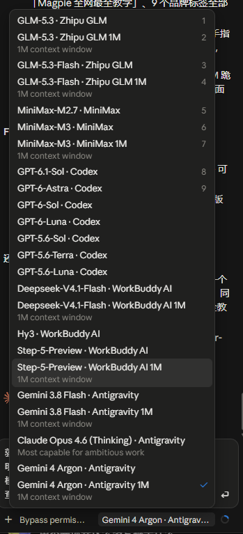
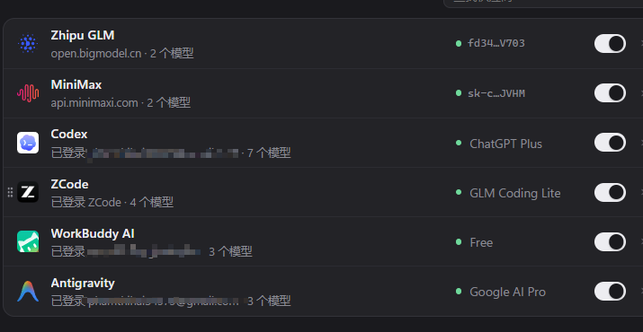
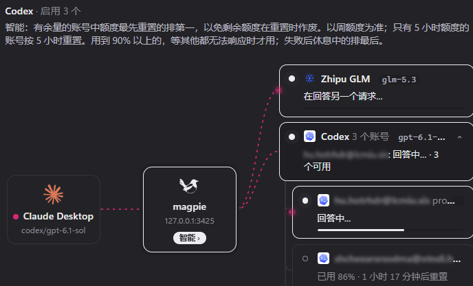
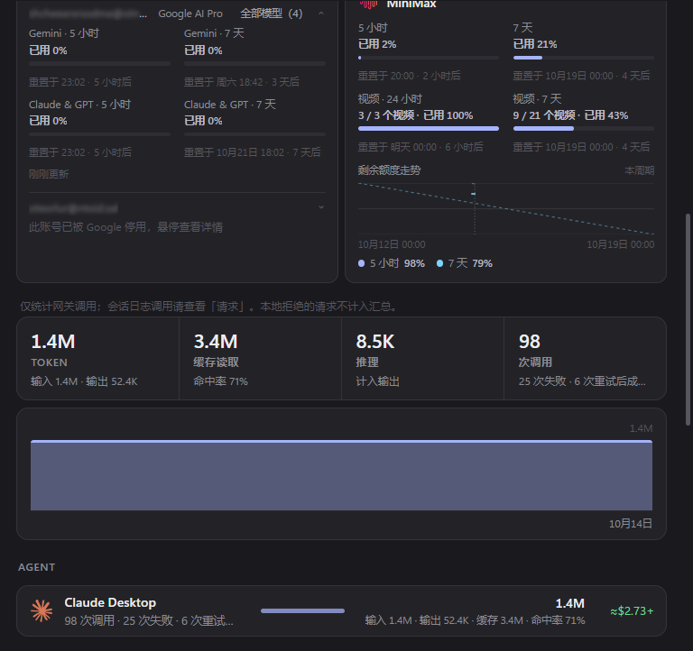
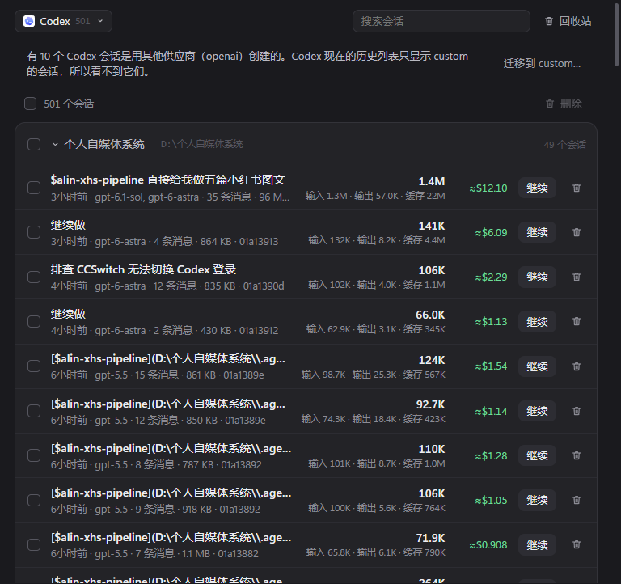
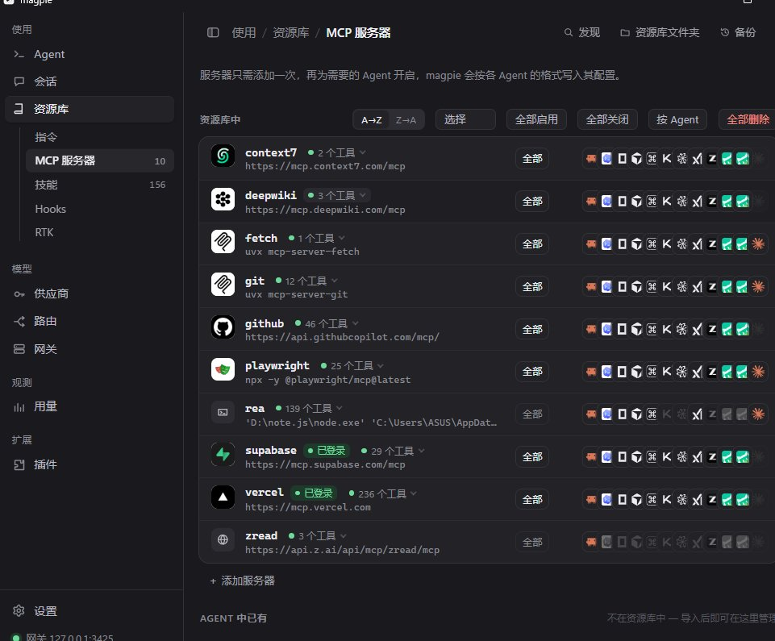
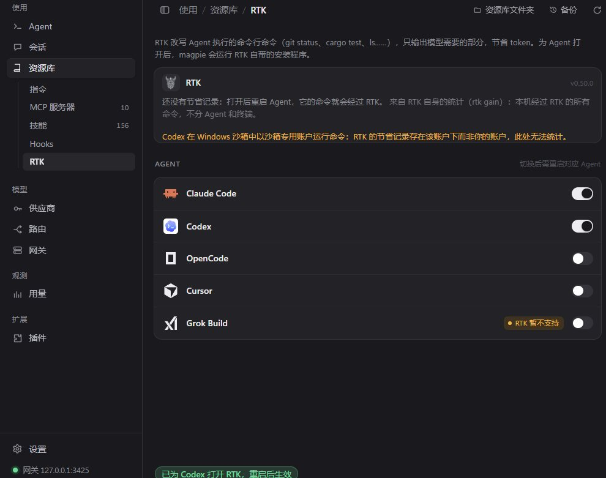
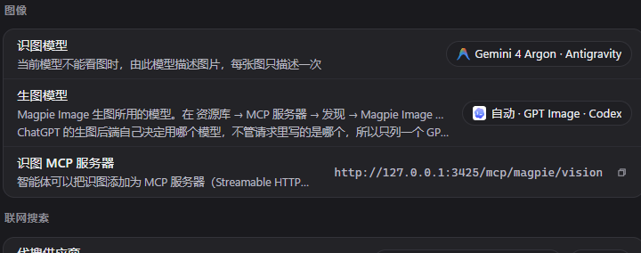

# 天不生邹子 Zihan：Magpie 把全网模型收进一个本地网关

> 订阅即供应商——把 ChatGPT / Claude / Gemini 等订阅挂进本地网关反代给任意 Agent，再加上费用、上下文、会话与资源库的全可视化。

<!-- more -->

半个月前，我还在 ccswitch 里因为不能正确轮询 gpt 账号发愁。然后我遇到 magpie 之后，就把 ccswitch 卸载了，也真正实现了 token 自由，不只是因为把所有订阅额度榨干了，还把一些模型反代出来做了轮询：

类似 Claude Code 里跑着 workbuddyAI 和 GPT，Codex 挂着 3 个 ChatGPT 账号自动轮询，Gemini、MiniMax 全在同一个本地网关后面排队干活——而我只是在菜单栏点了一下。

这一切是 Magpie（github.com/yetone/magpie）干的。

先说结论：它能把所有厂家的所有模型反代进你随便哪个 Agent——Claude Code 里跑 GPT、Codex 里跑 GLM 都行。但这只是第一层。真正让我留下来的，是它把 AI 编程工具里所有“看不见的地方”几乎全部做了可视化——上下文、费用、会话、资源库——而且丝滑到换一个 Agent 干活时，会话可以原样接力接着做。

## 一、先说最 nb 的：所有厂家的所有模型，反代进任何自选的 Agent

一句话：你可以在 Claude Code 里用 workbuddyai 的免费额度和 GLM，在 Codex 里用 antigravity——随便哪个 Agent，都能调用所有厂家的所有模型。

这就是“反向代理”：Magpie 把你接入的每一家供应商（Zhipu GLM、MiniMax、ChatGPT/Codex 订阅、Google Antigravity、第三方中转……）的全部模型，汇成同一张模型清单，发给每一个 Agent。于是任何 Agent 的模型下拉框里，看到的都是同一份“全网模型菜单”：



实际用起来就两句话：哪家出新模型，接进 Magpie，所有 Agent 当天就能用；想给不同活儿配不同模型——快活交给便宜的 Flash，硬仗交给 Opus——下拉框一切就换，环境变量一个都不用改。

## 二、Magpie 到底是个啥：一个跑在本机的网关

原理一句话：它在你电脑后台开一个“翻译局”（地址 127.0.0.1:3425）。主流 AI 工具说四种不同的“话”（OpenAI、Anthropic、Gemini 等接口格式），这个翻译局全都能听、全都能说，还能互相转——所以不管你的工具讲哪种方言，把地址指过去就能用，流式输出、工具调用、推理模式一个不少。

所以任何 Agent（Claude Code、Codex、Gemini CLI、OpenCode、Cursor CLI、Zed、Cline、Devin……官方清单 60+）只要把 base_url 指过去就完事（API key 随便填个 magpie）：

```bash
ANTHROPIC_BASE_URL=http://127.0.0.1:3425
OPENAI_BASE_URL=http://127.0.0.1:3425/v1
GOOGLE_GEMINI_BASE_URL=http://127.0.0.1:3425
```

它也可以直接帮你改写各 Agent 的配置文件，而且是只动要改的那一行——你的注释、顺序、格式全都原样保留，不会把配置文件搅成一锅粥。这种细节，一眼就能看出是认真做产品。

顺带一提：你现在读的这篇文章，就是我跑在 Magpie 网关后面的 Claude Code 写的。

## 三、订阅即供应商：多账号轮询确实爽，但这只是入场券

Magpie 最让我意外的一点：Claude 订阅、ChatGPT 订阅、GitHub Copilot、Gemini Code Assist、Grok SuperGrok，甚至 Antigravity，全部变成“供应商”，每个订阅还能挂多个账号。



然后是路由组，五种策略：

- smart：有余量的账号里，额度最先重置的排第一——免得剩余额度在重置时作废；
- order：固定顺序；
- rotate：纯轮询；
- usage：按用量分；
- pace：谁的额度快过期谁先上，别浪费；



还有两个我很喜欢的细节

- 每日预热：定时自动帮每个 Claude/ChatGPT 账号“开窗”（启动它们 5 小时的额度窗口）。早上出门前设好，回来时所有账号都热好了；
- 意图路由：它先读懂你这句话想干嘛，再决定派哪个账号上场。而且每次派单的理由都摆在页面上，随时可以查岗。

还有一个省钱细节：上下文缓存还能省钱的时候，对话就钉在原账号不乱跳——因为一换账号，缓存就作废，钱就白花了。这个设计后面第四节还会再见到。

在意隐私的话，账号发现可以一键关掉（magpie accounts discovery off）。

## 四、真正值钱的部分：把一切可视化

这是我用下来最大的感受：它把模型生态几乎所有“看不见的东西”都做成了看得见的界面。

1. 费用和用量，精确到每一次调用



token、缓存读写、推理、调用次数，全部按官方价格估算成美元或人民币；每个订阅的额度窗口有卡片和倒计时；终端里 magpie quota 随时查。

2. 上下文观测：我见过最狠的功能

*配图：上下文观测——它直接告诉你，你的 Agent 提示词里 83% 是工具定义、13% 是系统提示词，真正的会话内容只占 2%；我这台机器评分 74（良好），缓存命中 74%，最大单次 276K token*

如果你也好奇“为什么我的 AI 会话这么烧 token"，这个页面就是答案——工具目录才是隐形吞 token 的大户。它还按会话打分、贴标签（起步轻/会压缩/不稳定），窗口大小、每次增长量全部可见。

3. 会话管理：501 个会话，每一条都有标题和费用



而且——跨 Agent 接力。我从一个 agent 切到另一个 agent，会话可以直接复制过去接着做，上下文不断。这是我用下来最“丝滑”的体验，也是我把它当成日常主力而非玩具的原因。

## 五、资源库：写一次，所有 Agent 都有



我机器上的真实状态：10 个 MCP 服务器（github 46 个工具、playwright 25 个、vercel 236 个……）、156 个技能。我的 Claude skills 目录里那个 agent-reach，实际上就是 Magpie 技能库里的一个符号链接——技能库不是“又一个管理面板”，是真的落到了每个 Agent 的目录里。

RTK 也被整合了。RTK 干的事是“给命令行输出瘦身”：模型每跑一条命令（git status、cargo test、ls……），它把输出剪到只剩模型真正需要的部分，又省 token 又看得清。



任何模型联网搜索：Tavily、Brave、Exa、Firecrawl、You.com、SearXNG……写一次配置，所有 Agent 都能联网。

## 六、识图、生图、生视频：单独拎出来



这个设计我特别欣赏：

- 识图：当前模型看不了图时，由指定模型代为描述图片，每张图只描述一次；
- 生图：Magpie Image 统一入口，任何 Agent 都能调用；
- 视频：Grok 订阅可以生成视频，MiniMax 的视频额度（3/3、9/21）在用量页一目了然。

对我这种天天做图文和视频内容的人来说，这块等于白捡一条内容生产线。

## 七、和 CC Switch 比？我都用过，说点实话

CC Switch（github.com/farion1231/cc-switch，14 万+ Star）绝对不是玩具：10 个支持工具、50+ 供应商预设、MCP 统一管理、提示词管理、用量统计、会话管理、WebDAV 同步，它也早已不只是“配置切换器”。

我的真实迁移路径就是它俩的交接——我的会话列表里至今躺着“排查 CCSwitch 无法切换 Codex 登录”和“ccswitch 及其数据卸载”两条记录。Magpie 还能直接导入 CC Switch、Claude Code、Codex、Alma 的配置，迁移零成本。

选择建议（个人体验，非拉踩）：

- 你主力用 API key、想要轻量稳定 → CC Switch 完全够用；
- 你手里有一堆订阅（ChatGPT Plus、Claude Pro、Google AI Pro……）想榨干、想看清每个 token 花在哪、需要跨 Agent 接力会话 → Magpie 目前无可替代。

## 八、这个产品是“纯 AI 做的”——以及那场推特骂战

Magpie 最新颖的可能是它本身：建仓 19 天冲到 9000+ Star，累计 2800+ commit、1200+ 个版本 tag，85% 的 commit 来自作者 yetone 的 AI agent。

10 月初，同行开喷：“讲真不太敢用”“快餐式服务”。确实，它一天最多发过 168 个版本（51 小时 294 个 tag，CI 一轮都没跑完），这谁敢用。

yetone 的回应是公开工作流：“我没有任何魔法，甚至特别简陋”——Claude Code + 官方 Opus 5.5，并行跑 3 个 loop，他自己每晚“铲铲屎”（人工处理 UI/UX 和安全闸门）。人负责产品决策，AI 负责写代码。

真正的转折是一个很土但很有效的机制：LESSONS.md 错题本。agent 每晚复盘当天的 commit，把返工、误合并、验证不足记成教训；再配一条“事不过三”规则——同一条教训在 3 个不同日期的复盘里出现，就升级为 code-standards.md 的硬规则。引入之后，版本数从一天 168 个降到每天 15-26 个。刹车成功。

对比一下同期另一个 AI 项目：OpenClaw 头 19 天 1423 个 commit 全由 Peter Steinberger 手动提交，只有约 10 个 tag。magpie 的 commit 多一倍、版本多一百多倍——两种路线，一目了然。

骂战的评论区最后吵出了一个共识：争论焦点已经不是“AI 能不能写软件”，而是**“如何给全自动 AI 开发建立质量保障体系”**。Magpie 本身就是这个实验的活体标本——而且它一直在按推特上的用户反馈自动改版，我这两周眼看着功能一天一个样。

## 九、三步上手

### 1. 安装

```bash
curl -fsSL https://usemagpie.ai/install.sh | sh
```

1. 添加供应商/订阅（或直接导入你现有的 CC Switch / Claude Code / Codex 配置）；
2. 第一天就建议打开：路由组（订阅党选 smart）+ 用量观测 + RTK。

进阶玩法：插件系统（用 Bun 写网关中间件，官方有 param-override、model-map、system-prompt 等，社区还有插件库）、局域网共享网关（给每台设备发独立 key + 额度上限）、远程 magpie、Docker、WebDAV/S3 多机同步、WSL/Termux 支持，甚至还有 magpie tui 全功能终端版。

## 相关页面

- [[sources/magpie-kiro-claude-code-subscription]]
- [[sources/wquguru-magpie-ai-agent-dev]]
- [[sources/chasen-liao-magpie-gemini-proxy-grok-bot]]
- [[patterns/error-notebook-pattern]]
- [[patterns/agent-router-table]]
