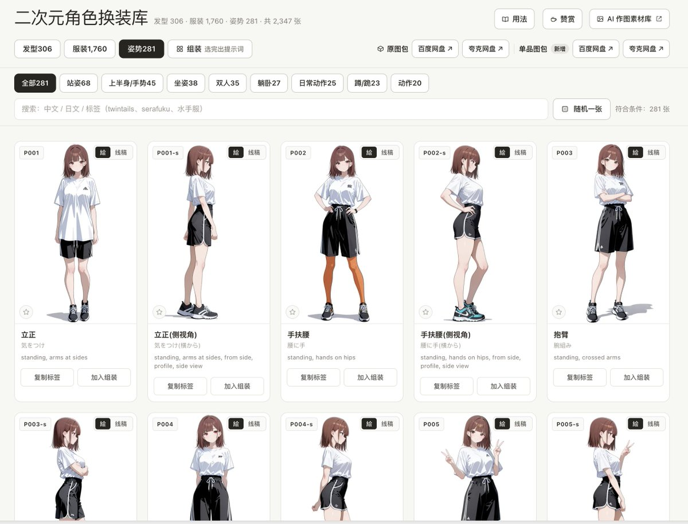

# SleepyZone（@zone__online）：开源 AI 作图参考库与二次元角色换装数据库的中文检索站设计

> 将日本创作者 giaaibusi 公开的 AI 作图参考素材与二次元角色换装数据做成开箱即用的中文 Web 检索界面，支持启动方式与本地预览，为 AI 图像创作者提供提示词设计与风格微调检索基建。

<!-- more -->

AI 作图素材库：https://sleepyzone.online/ai-ref-library-cn/

https://github.com/sleepy-zone/ai-ref-library-cn

二次元角色换装库：https://sleepyzone.online/char-db-cn/

https://github.com/sleepy-zone/char-db-cn

连夜给两个站点样式进行一波优化～

（能看出是参考了哪个站点的 Design 风格吗😂） https://t.co/hQFw5fmlOB

已开源至 Github：https://github.com/sleepy-zone/ai-ref-library-cn

把作者 あぎ / ギア（@giaaibusi） 公开的三套 AI 作图参考素材，做成了一套中文检索界面，方便使用；

页面头部指向原作者和原网站的链接；

仔细阅读 README，有启动方式和原图下载链接，原图下载仅为方便本地预览；

晚安 ～ https://t.co/h8hLQPekOm

## 相关页面

- [[concepts/openai-image-models]]
- [[concepts/ai-content-pipeline]]
