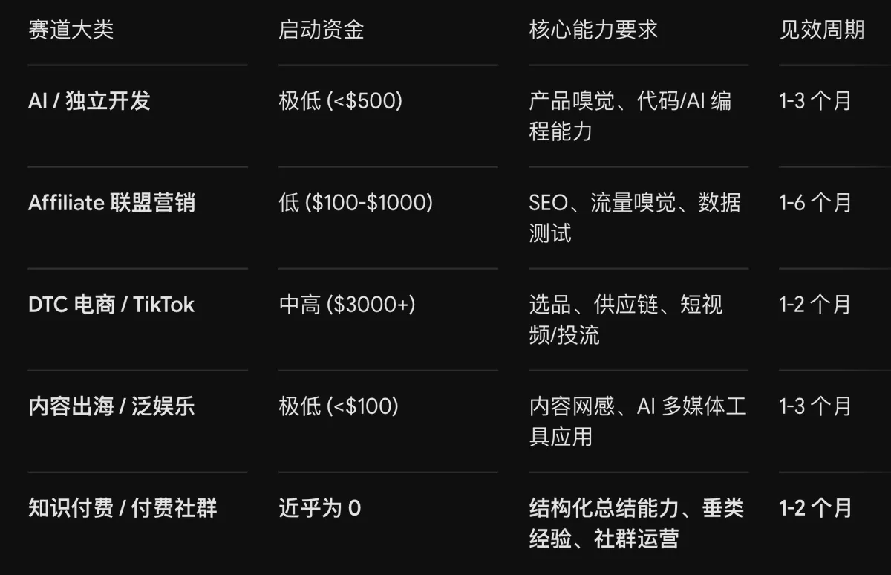

# 2026 全球化搞钱终极指南：五大赛道、三大套利逻辑与出海框架

> Roland 亲身经历的出海框架：为什么现在一个普通人能出海？——**AI 抹平了语言、文化、研发、客服四大壁垒**。三大底层套利 + 五大赛道 + 启动资金/能力/见效周期速查表。

<!-- more -->

## 核心结论

**出海搞钱的根本原因不是信息差，而是 AI 把门槛砍掉了。** 语言（自动翻译）、文化（本地化内容）、研发（Cursor 帮你写）、客服（AI）——四道过去拦住普通人的门槛都被 AI 填平了。正因为门槛被填平，套利空间才真正向个人开放。

地区差异构成**三个套利层**：

- **汇率与购买力套利**——赚美元、花人民币
- **付费意愿套利**——欧美更愿意为内容/软件/服务直接付钱，中国用户更倾向免费
- **时间差与模式套利**——中国在私域、直播切片、微短剧上已经跑出成熟模式，放到西方就是降维打击

## 五大赛道

| 赛道 | 代表案例（原文举例） | 关键词 |
|------|----------------------|--------|
| 一、AI 与数字产品 | 无尽冬日（点点互动 2025 年 $40 亿）、Monica AI 浏览器插件、CapCut（6.6 亿用户）、PictureThis 植物识别 SaaS、Shopify 插件 | 模式是「抄一个国内被验证的，做西方第一个」 |
| 二、流量变现与 Affiliate | SaaS/基建 CPS（域名主机、AI 软件）、高暴利垂直行业（交易所、德扑、金融）、程序化 SEO、小众垂直 Blog | 小众垂直 Blog 是 Roland 最推荐新人入场的——赛道多、竞争最小 |
| 三、跨境电商 | 品牌独立站（Shopify $1/月）、本土化店群（达人建联分销）、纯数字商品（Notion/Figma/笔刷）、直播带货 | 门槛排序：数字商品＜品牌独立站＜店群＜直播 |
| 四、内容出海与泛娱乐 | YouTube/TikTok（李子柒模式，养成系，地狱难度）、短剧/小说（狼人、霸总，需工作室级效率）、玄学与身心灵（八字/塔罗/水晶，高客单价变现） | Roland 明确不推荐普通人做内容赛道 |
| 五、知识付费与付费社群 | 国内暴利印钞机案例（$9999/人入群）→ 海外更香 | 两套玩法：**搬运与重构** + **诱饵漏斗** |

## 护城河与坑

- **程序化 SEO 与工具站**：目前 X 上最热的赛道，但「已经很卷了，新人机会很小」——Roland 判断对规模化站长仍是最佳赛道，但对新人来说不是轻松的入口
- **玄学与身心灵**：八字风水、塔罗、水晶疗愈在欧美年轻群体中高客单价，但要求「流量 → 私域 → 独立站」多层能力叠加
- **直播带货**：TikTok 美区账号环境就拦住 99% 的人；加上英语口语、镜头表现、运营、布景、配货——Roland 评语是「不适合普通人玩转的赛道」
- **知识付费法律线**：加密货币交易、电竞菠菜、德州扑克、彩票类 AFF 付费转发都在法线附近；点出「这块存在一些法律风险，我希望用户一股脑投进去之前先做好功课」

## 两种知识付费切入打法

1. **搬运与重构**——借力 AI 做「互联网级别」的搬运（它本身就是跨语言搬运大师），拿公开好内容重构成自己的
2. **诱饵漏斗**——先做一个免费速查表/小工具（例：某德州扑克产品放出 169 手免费 PDF），用「领取时要邮箱」这一步把流量沉淀成**精准邮箱**，再邮件培育转高单价社群。这种方式能跳过冷启动信任

## 表格速览：五大赛道 × 启动资金 / 核心能力 / 见效周期

作者原表格（已本地化）：

## 适用边界与存疑

- **Roland 的结论是单点经验**：文章里他多次以「我自己做了 XX，手上十多个正收益项目」为信；但他也承认「新人想复制他的成功，门槛不低」；
- **「哪吒效应」的赛道会变**——蔡文姬一类的站增长很快，但每个热门赛道都在被压缩，文章的时效性很强；
- **他推荐的「诱饵漏斗」也意味着前置成本**——做好引流工具/素材才能转化，不是“先卖课”；
- **海外赛道存在比他描述的更大的问题**——不是技术问题，是法律与平台合规（金融监管、GMCO、BitKe 等），含蓄提及但未展开。

## Related Pages

- [[sources/chainepic-overseas-moneymaking-ultimate-guide-2026]] — 原始归档
- [[sources/chainepic-tractordata-dinosaur-site-case]] — Roland 的老牌工具站案例：20 年不变的界面，年入 $55 万
- [[sources/chainepic-diskprices-amazon-arbitrage-site]] — Roland 的全文字比价站案例：DiskPrices，Amazon 联盟佣金月入 4 万+
- [[sources/chainepic-tld-domain-arbitrage-musically-ly]] — 域名套利案例：musically.ly → 字节 10 亿美元
- [[sources/chainepic-tld-domain-arbitrage-time-is]] — 域名套利案例：Time.is 用冰岛 .is 凑出完整句子
- [[sources/chainepic-tencent-expert-aff-postmortem]] — Roland 的 AFF 实战：24 小时 40 个专家注册、近 800 元返佣
- [[sources/chainepic-aff-repost-trap]] — AFF 搞钱误区：别人发了你再去，就是捡别人吃剩下的
- [[sources/chainepic-aff-three-rules-selection]] — AFF 选品三条规则

## Sources

- [[sources/chainepic-overseas-moneymaking-ultimate-guide-2026]]
